# Bài 1 — Nguyên lý thiết kế: Coupling, Cohesion, SOLID, DRY, KISS, YAGNI

## 🎯 Mục tiêu

Sau bài này bạn cần:

- Hiểu và áp dụng các nguyên tắc thiết kế cơ bản
- Nắm vững nguyên lý **SOLID**
- Biết cách tạo ra mã nguồn linh hoạt, dễ bảo trì

Nội dung chính của bài:

1. Coupling & Cohesion
2. Nguyên lý **SOLID**, **DRY**, **KISS**, **YAGNI**

## 📑 Mục lục

1. [Mở đầu — Vì sao cần nguyên lý thiết kế](#phần-0--mở-đầu-vì-sao-cần-nguyên-lý-thiết-kế)
2. [Coupling & Cohesion](#phần-1--coupling--cohesion)
3. [SOLID Principles](#phần-2--solid-principles)
4. [Các nguyên lý khác: DRY, KISS, YAGNI](#phần-3--các-nguyên-lý-khác-dry-kiss-yagni)
5. [Áp dụng thực tế: checklist, code smell, anti-pattern, công cụ](#phần-4--áp-dụng-thực-tế)
6. [🧠 Tóm tắt nhanh](#-tóm-tắt-nhanh) · [❓ Câu hỏi tự kiểm tra](#-câu-hỏi-tự-kiểm-tra) · [📝 Bài tập](#-bài-tập)

---

## Phần 0 — Mở đầu: Vì sao cần nguyên lý thiết kế

### WHY

**Vấn đề của mã nguồn thiết kế kém**

- **Khó bảo trì**: Sửa một chỗ ảnh hưởng nhiều nơi
- **Khó mở rộng**: Thêm tính năng mới phải sửa code cũ
- **Khó test**: Code phụ thuộc chặt chẽ vào nhau
- **Khó hiểu**: Logic phức tạp, chức năng lộn xộn

**Lợi ích của thiết kế tốt**

- Dễ đọc và hiểu
- Dễ sửa đổi và mở rộng
- Dễ kiểm thử
- Tái sử dụng cao

> 💡 **Giải thích:** Bốn "bệnh" bên trái chính là thứ mà các nguyên lý trong bài này sinh ra để chữa. Hãy nhớ cặp đối xứng: khó bảo trì ↔ dễ sửa đổi; khó mở rộng ↔ dễ mở rộng; khó test ↔ dễ kiểm thử; khó hiểu ↔ dễ đọc. Mỗi nguyên lý phía sau (SRP, OCP, DIP…) đều có thể được giải thích bằng việc nó cải thiện ít nhất một trong các tiêu chí này.

---

## Phần 1 — Coupling & Cohesion

### Cohesion

> **Cohesion** là mức độ các thành phần trong một module/class làm việc cùng nhau để thực hiện một mục đích rõ ràng.

**Phân loại:**

- **High Cohesion** (Tốt): Các phương thức/thuộc tính liên quan chặt chẽ
- **Low Cohesion** (Xấu): Các phương thức/thuộc tính không liên quan

> 💡 **Giải thích:** Cohesion ("độ gắn kết") nhìn *vào bên trong* một class: các method và field của nó có cùng phục vụ một mục đích không? Nếu bạn phải dùng chữ "và" nhiều lần để mô tả class ("class này tính lương **và** in báo cáo **và** gửi email…") thì cohesion đang thấp.

### Low Cohesion

**Vấn đề:** Class `Employee` làm quá nhiều việc: quản lý dữ liệu, in ấn, database, email.

```java
// Class làm quá nhiều việc không liên quan
public class Employee {
    private String name;
    private double salary;

    public void calculateSalary() { } // Nghiệp vụ nhân viên
    public void printReport() { }     // In báo cáo
    public void saveToDatabase() { }  // Lưu database
    public void sendEmail() { }       // Gửi email
}
```

### High Cohesion

**Lợi ích:** Mỗi class có một trách nhiệm rõ ràng, dễ test và bảo trì.

```java
// Class chỉ quản lý dữ liệu nhân viên
public class Employee {
    private String name, double salary;
    public String getName() { return name; }
    public double getSalary() { return salary; }
    public void calculateSalary() { }
}
```

```java
// Class riêng cho in báo cáo
public class ReportPrinter {
    public void printEmployeeReport(Employee emp) { }
}

// Class riêng cho database
public class EmployeeRepository {
    public void save(Employee emp) { }
}

// Class riêng cho email
public class EmailService {
    public void sendToEmployee(Employee emp, String message) { }
}
```

> 💡 **Giải thích:** Mỗi việc "lạc đề" trong `Employee` cũ được tách ra thành một class riêng (`ReportPrinter`, `EmployeeRepository`, `EmailService`). Kết quả: `Employee` chỉ còn lo dữ liệu và nghiệp vụ của nhân viên. Lưu ý nhỏ: dòng `private String name, double salary;` ở trên là cách viết rút gọn, **không biên dịch được trong Java** — viết đúng phải là hai khai báo `private String name;` và `private double salary;` như ở phần *Low Cohesion* phía trên.

**📊 Sơ đồ: Tách class Employee theo trách nhiệm (Low Cohesion → High Cohesion)**


<details><summary>🔧 Mã nguồn sơ đồ (mermaid)</summary>

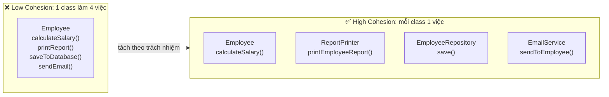

</details>

### Coupling

> **Coupling** là mức độ phụ thuộc giữa các `module/class` với nhau.

**Phân loại**

- **Loose Coupling**: Ít phụ thuộc, thay đổi một module ít ảnh hưởng module khác 👍🏼
- **Tight Coupling**: Phụ thuộc chặt, thay đổi một module ảnh hưởng nhiều module 👎🏼

> 💡 **Giải thích:** Coupling ("độ kết dính/phụ thuộc") nhìn *giữa các* class: class A biết bao nhiêu về class B? Nếu A tự `new` một class cụ thể B, gọi trực tiếp vào chi tiết của B, thì đổi B là phải sửa A → tight coupling. Mục tiêu là loose coupling.

### Tight Coupling

```java
// OrderProcessor phụ thuộc chặt vào MySQLDatabase
public class OrderProcessor {
    private MySQLDatabase database;

    public OrderProcessor() {
        // Khởi tạo cứng - TIGHT COUPLING
        this.database = new MySQLDatabase();
    }

    public void processOrder(Order order) {
        // Logic xử lý
        database.save(order);
    }
}
```

**Vấn đề**

- Không thể đổi sang **PostgreSQL**/**MongoDB**
- Khó test vì phụ thuộc vào database thật
- Thay đổi `MySQLDatabase` ảnh hưởng `OrderProcessor`

### Loose Coupling

```java
public interface Database {
    void save(Order order);
}

public class MySQLDatabase implements Database {
    public void save(Order order) { /* MySQL implementation */ }
}

public class MongoDatabase implements Database {
    public void save(Order order) { /* MongoDB implementation */ }
}

// OrderProcessor phụ thuộc vào interface
public class OrderProcessor {
    private Database database;

    // Dependency Injection
    public OrderProcessor(Database database) {
        this.database = database;
    }

    public void processOrder(Order order) {
        database.save(order);
    }
}
```

**Lợi ích**

- Dễ dàng thay đổi MySQL → MongoDB
- Dễ test với mock/fake database
- Thay đổi `MySQLDatabase` không ảnh hưởng `OrderProcessor`

> 💡 **Giải thích:** Hai thay đổi then chốt: (1) `OrderProcessor` khai báo field kiểu **interface** `Database` thay vì class cụ thể; (2) đối tượng database được **truyền vào qua constructor** (Dependency Injection) thay vì tự `new` bên trong. Nhờ vậy, ai tạo `OrderProcessor` sẽ quyết định dùng MySQL, MongoDB hay một database giả để test. Đây cũng chính là ý tưởng của nguyên lý DIP ở Phần 2.

**📊 Sơ đồ: Tight Coupling và Loose Coupling (Dependency Injection qua interface)**


<details><summary>🔧 Mã nguồn sơ đồ (mermaid)</summary>

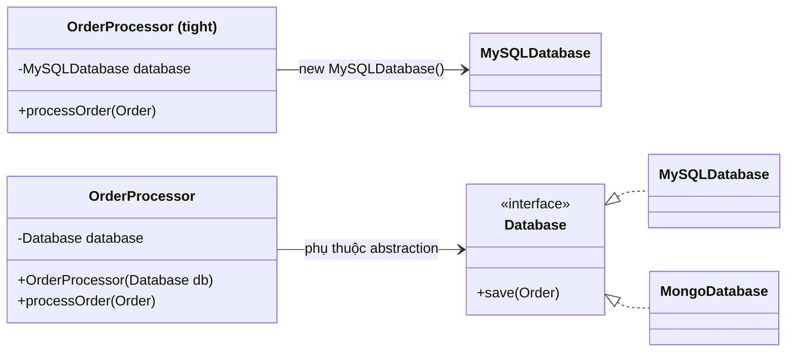

</details>

### Golden Goal

> **High Cohesion + Low Coupling = Maintainable Code**

> 💡 **Giải thích:** Đây là "công thức vàng" cần thuộc lòng: bên trong mỗi class thì gắn kết cao (làm một việc rõ ràng), giữa các class thì phụ thuộc thấp (giao tiếp qua abstraction). Hai tính chất này thường đi cùng nhau: tách class cho cohesion cao rồi nối chúng bằng interface để coupling thấp.

**📊 Sơ đồ: Mục tiêu vàng của thiết kế**


<details><summary>🔧 Mã nguồn sơ đồ (mermaid)</summary>

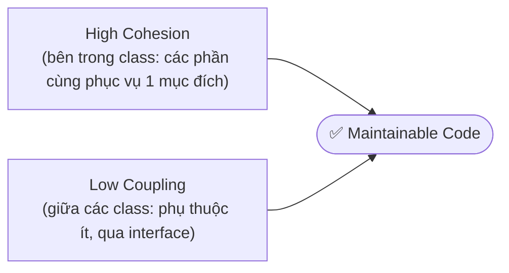

</details>

---

## Phần 2 — SOLID Principles

### Tổng Quan

- **S** - Single Responsibility Principle
- **O** - Open/Closed Principle
- **L** - Liskov Substitution Principle
- **I** - Interface Segregation Principle
- **D** - Dependency Inversion Principle

### Mục đích

- Làm cho phần mềm dễ hiểu, linh hoạt và bảo trì
- Giảm sự phức tạp khi thay đổi
- Tăng khả năng tái sử dụng

> 📌 **Mở rộng:** Bộ năm nguyên lý này được Robert C. Martin ("Uncle Bob") tổng hợp; từ viết tắt "SOLID" do Michael Feathers đặt.

### Single Responsibility Principle (SRP)

> Một class chỉ nên có một lý do để thay đổi

**Giải thích**

- Mỗi class chỉ làm một việc duy nhất
- Chỉ một **actor** (người dùng/stakeholder) có thể yêu cầu thay đổi `class`
- Tránh **God Class** - class làm mọi việc

> 💡 **Giải thích:** "Một lý do để thay đổi" nghĩa là chỉ có một nhóm người (actor) có quyền đòi sửa class đó. Ví dụ: phòng nhân sự đòi đổi cách tính lương, phòng IT đòi đổi database, phòng marketing đòi đổi mẫu email — nếu cả ba cùng phải sửa một class thì class đó đang có ba trách nhiệm.

### Eg: Violate SRP

**Vấn đề:** `User` class có 5 lý do để thay đổi!

```java
public class User {
    private String name;
    private String email;

    // Nghiệp vụ User
    public void updateProfile(String name, String email) {
        this.name = name;
        this.email = email;
    }

    // Validation - Lý do thay đổi #2
    public boolean validateEmail() {
        return email.contains("@");
    }

    // Database - Lý do thay đổi #3
    public void saveToDatabase() { ... }

    // Email - Lý do thay đổi #4
    public void sendWelcomeEmail() {
        // Email sending code
    }

    // Report - Lý do thay đổi #5
    public String generateReport() {
        return "User: " + name;
    }
}
```

### Eg: Follow SRP

```java
// 1. Chỉ quản lý dữ liệu user
public class User {
    private String name;
    private String email;

    public void updateProfile(String name, String email) {
        this.name = name;
        this.email = email;
    }

    public String getName() { return name; }
    public String getEmail() { return email; }
}

// 2. Chỉ validate
public class UserValidator {
    public boolean validateEmail(String email) {
        return email.contains("@") && email.contains(".");
    }
}
```

```java
// 3. Chỉ xử lý database
public class UserRepository {
    public void save(User user) { /* DB code */ }
    public User findById(String id) { /* DB code */ return null; }
}

// 4. Chỉ gửi email
public class EmailService {
    public void sendWelcomeEmail(User user) { /* Email code */ }
}

// 5. Chỉ tạo báo cáo
public class UserReportGenerator {
    public String generate(User user) {
        return "User Report: " + user.getName();
    }
}
```

> 💡 **Giải thích:** 5 lý do thay đổi → 5 class, mỗi class một lý do. Để ý rằng khi tách ra, `UserValidator` được sửa luật kiểm tra email (thêm điều kiện có dấu `.`) mà không hề đụng đến `User` hay `UserRepository` — đó chính là lợi ích của SRP.

**📊 Sơ đồ: SRP: tách class User thành 5 class, mỗi class một lý do để thay đổi**


<details><summary>🔧 Mã nguồn sơ đồ (mermaid)</summary>

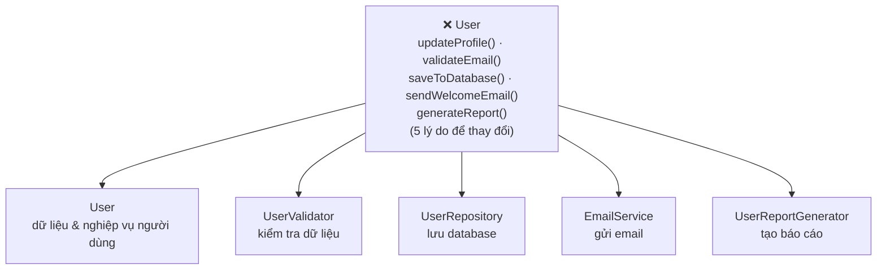

</details>

### Advantages of SRP

- **Dễ hiểu:** Mỗi class có một mục đích rõ ràng
- **Dễ test:** Test từng trách nhiệm riêng biệt
- **Dễ bảo trì:** Thay đổi validation không ảnh hưởng database
- **Tái sử dụng:** `EmailService` có thể dùng cho `Order`, `Product`...
- **Giảm conflict:** Team có thể làm việc song song

> **Câu hỏi kiểm tra:** Class này có bao nhiêu lý do để thay đổi?

> 💡 **Giải thích:** Câu hỏi kiểm tra ở trên là "mẹo" thực hành SRP: mỗi khi viết xong một class, hãy đếm số lý do (số actor) có thể khiến nó phải sửa. Lớn hơn 1 → cân nhắc tách. "Giảm conflict" ý nói: các dev sửa các file khác nhau nên ít bị xung đột khi merge code.

### Open/Closed Principle (OCP)

**Giải thích**

- **Open for extension:** Có thể thêm tính năng mới
- **Closed for modification:** Không sửa code cũ khi thêm tính năng

**Phương pháp**

- Sử dụng abstraction (**interface**, **abstract class**)
- Thêm tính năng bằng cách *tạo class mới*
- *Không sửa code* đã test và hoạt động tốt

> 📌 **Mở rộng:** Phát biểu gốc (Bertrand Meyer, 1988): *"Software entities should be open for extension, but closed for modification"* — thực thể phần mềm nên mở để mở rộng nhưng đóng để sửa đổi.

### Eg: Violate OCP

```java
public class PaymentProcessor {
    public void processPayment(String type, double amount) {
        if (type.equals("CREDIT_CARD")) {
            System.out.println("Processing credit card: " + amount);
            // Credit card logic
        }
        else if (type.equals("PAYPAL")) {
            System.out.println("Processing PayPal: " + amount);
            // PayPal logic
        }
        // Thêm Momo → phải SỬA code này!
        else if (type.equals("MOMO")) {
            System.out.println("Processing Momo: " + amount);
            // Momo logic
        }
    }
}
```

**Phân tích**

- Mỗi lần thêm phương thức thanh toán mới phải sửa `PaymentProcessor`
- Phải test lại toàn bộ code -> Rủi ro phá vỡ code cũ

### Eg: Follow OCP

```java
// Interface - abstraction
public interface PaymentMethod {
    void process(double amount);
}

// Implementation 1
public class CreditCardPayment implements PaymentMethod {
    public void process(double amount) {
        System.out.println("Processing credit card: " + amount);
        // Credit card logic
    }
}

// Implementation 2
public class PayPalPayment implements PaymentMethod {
    public void process(double amount) {
        System.out.println("Processing PayPal: " + amount);
        // PayPal logic
    }
}
```

```java
// Implementation 3 - THÊM MỚI mà KHÔNG SỬA code cũ
public class MomoPayment implements PaymentMethod {
    public void process(double amount) {
        System.out.println("Processing Momo: " + amount);
        // Momo logic
    }
}

// Processor không cần sửa
public class PaymentProcessor {
    public void processPayment(PaymentMethod method, double amount) {
        method.process(amount);
    }
}
```

### Eg: Follow OCP (cont)

```java
public class Main {
    public static void main(String[] args) {
        PaymentProcessor processor = new PaymentProcessor();

        // Sử dụng Credit Card
        processor.processPayment(new CreditCardPayment(), 100.0);

        // Sử dụng PayPal
        processor.processPayment(new PayPalPayment(), 200.0);

        // Sử dụng Momo - KHÔNG CẦN SỬA PaymentProcessor
        processor.processPayment(new MomoPayment(), 150.0);
    }
}
```

**Lợi ích**

- Thêm phương thức thanh toán mới -> tạo class mới
- Không sửa code đã test
- Không rủi ro phá vỡ code cũ
- Dễ maintain và mở rộng

> 💡 **Giải thích:** Dấu hiệu nhận biết vi phạm OCP là chuỗi `if/else if` (hoặc `switch`) theo "loại" (`type`). Cách sửa: biến mỗi nhánh thành một class cài đặt chung một interface, rồi dùng **polymorphism** — `PaymentProcessor` chỉ gọi `method.process(amount)` và không cần biết đó là loại gì. Thêm ZaloPay chỉ cần thêm class `ZaloPayPayment`, không sửa dòng nào cũ.

**📊 Sơ đồ: OCP: thêm phương thức thanh toán mới = thêm class mới, không sửa PaymentProcessor**


<details><summary>🔧 Mã nguồn sơ đồ (mermaid)</summary>

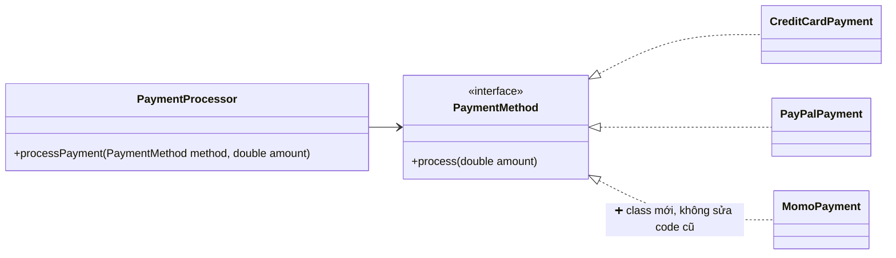

</details>

### Liskov Substitution Principle (LSP)

> **Nguyên lý Thay Thế Liskov**: Các đối tượng của lớp con phải có thể thay thế được các đối tượng của lớp cha mà không làm thay đổi tính đúng đắn của chương trình

**Giải thích**

- Nếu `S` là subtype của `T`, thì có thể thay `T` bằng `S` mà không gây lỗi
- Subclass phải tuân thủ **hợp đồng** (contract) của superclass
- Không được thay đổi hành vi mong đợi

```java
Parent p = new Child();  // Phải hoạt động đúng
```

> 💡 **Giải thích:** "Hợp đồng" là những gì code gọi được phép *kỳ vọng* ở lớp cha (ví dụ: gọi `setWidth` thì chỉ chiều rộng thay đổi). Lớp con có thể làm thêm, nhưng không được phá vỡ kỳ vọng đó. Kiểm tra LSP: mọi đoạn code đang chạy đúng với `Parent` thì khi đưa vào `Child` vẫn phải chạy đúng.
>
> 📌 **Mở rộng:** Nguyên lý do Barbara Liskov phát biểu năm 1987. Các vi phạm thường gặp: lớp con ném `UnsupportedOperationException` cho method của cha, lớp con siết chặt điều kiện đầu vào (precondition) hoặc nới lỏng điều kiện đầu ra (postcondition).

### Eg: Violate LSP

```java
public class Rectangle {
    protected int width;
    protected int height;

    public void setWidth(int width) {
        this.width = width;
    }

    public void setHeight(int height) {
        this.height = height;
    }

    public int getArea() {
        return width * height;
    }
}
```

```java
public class Square extends Rectangle {
    @Override
    public void setWidth(int width) {
        this.width = width;
        this.height = width;  // Vi phạm kỳ vọng!
    }

    @Override
    public void setHeight(int height) {
        this.width = height;  // Vi phạm kỳ vọng!
        this.height = height;
    }
}
```

### Eg: Violate LSP (cont)

```java
public class Test {
    public static void main(String[] args) {
        Rectangle rect = new Square();  // Thay thế
        rect.setWidth(5);
        rect.setHeight(4);

        // Kỳ vọng: 5 * 4 = 20
        // Thực tế: 4 * 4 = 16 (vì Square thay đổi cả width!)
        System.out.println(rect.getArea());  // 16 ???
    }
}
```

**Vấn đề:**

- `Square` thay đổi hành vi của `Rectangle`
- Không thể thay thế `Rectangle` bằng `Square`
- Vi phạm **hợp đồng** của `Rectangle`

> 💡 **Giải thích:** Trong toán học, "hình vuông là một hình chữ nhật" — nhưng trong OOP, quan hệ kế thừa phải dựa trên **hành vi**, không phải phân loại đời thực. `Rectangle` hứa "set chiều nào thì chỉ chiều đó đổi"; `Square` phá lời hứa này nên code dùng `Rectangle` cho kết quả sai (16 thay vì 20).

### Eg: Follow LSP

```java
// Interface chung
public interface Shape {
    int getArea();
}

// Rectangle - độc lập
public class Rectangle implements Shape {
    private int width;
    private int height;

    public Rectangle(int width, int height) {
        this.width = width;
        this.height = height;
    }

    public int getArea() {
        return width * height;
    }
}

// Square - độc lập
public class Square implements Shape {
    private int side;

    public Square(int side) {
        this.side = side;
    }

    public int getArea() {
        return side * side;
    }
}
```

> 💡 **Giải thích:** Lời giải là bỏ quan hệ cha–con giữa `Square` và `Rectangle`. Cả hai cùng cài đặt interface `Shape`, mà hợp đồng của `Shape` chỉ là "tính được diện tích" — điều cả hai đều làm đúng. Kích thước được truyền qua constructor nên không còn setter gây bất ngờ.

**📊 Sơ đồ: LSP: Square kế thừa Rectangle (sai) so với cùng implement Shape (đúng)**


<details><summary>🔧 Mã nguồn sơ đồ (mermaid)</summary>

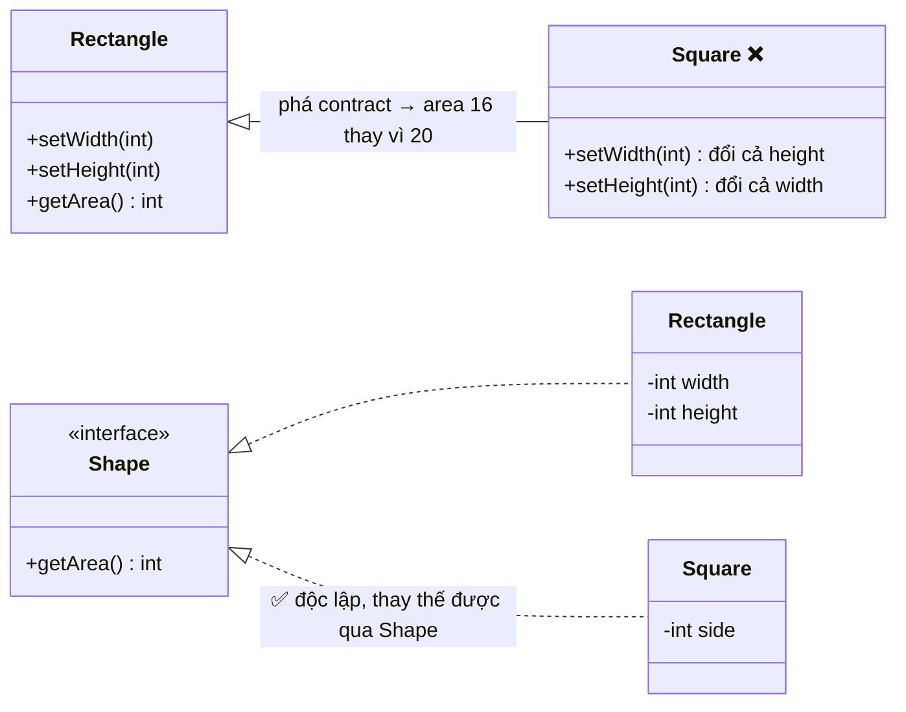

</details>

### Interface Segregation Principle (ISP)

> **Nguyên lý Phân Tách Interface**: Không nên ép **client** phụ thuộc vào các **interface** mà chúng *không sử dụng*

**Giải thích**

- Tách interface lớn thành nhiều interface nhỏ, chuyên biệt
- Client chỉ implement những gì cần thiết
- Tránh **fat interface** - interface có quá nhiều method
  - Chuyển thành nhiều **focused interface**

### Eg: Violate ISP

**Vấn đề:** `RobotWorker` bị ép implement `eat()` và `sleep()` không cần thiết.

```java
// Fat Interface - quá nhiều method
public interface Worker {
    void work();
    void eat();
    void sleep();
    void getPaid();
}

// Human worker - OK
public class HumanWorker implements Worker {
    public void work() { System.out.println("Working..."); }
    public void eat() { System.out.println("Eating..."); }
    public void sleep() { System.out.println("Sleeping..."); }
    public void getPaid() { System.out.println("Getting paid..."); }
}
```

```java
// Robot worker - VI PHẠM!
public class RobotWorker implements Worker {
    public void work() { System.out.println("Working..."); }

    // Robot không ăn/ngủ nhưng BẮT BUỘC phải implement!
    public void eat() {
        throw new UnsupportedOperationException("Robot doesn't eat");
    }
    public void sleep() {
        throw new UnsupportedOperationException("Robot doesn't sleep");
    }

    public void getPaid() { System.out.println("Getting charged..."); }
}
```

### Follow ISP

```java
// Tách thành nhiều interface nhỏ
public interface Workable {
    void work();
}

public interface Eatable {
    void eat();
}

public interface Sleepable {
    void sleep();
}

public interface Payable {
    void getPaid();
}
```

```java
// Human implement tất cả
public class HumanWorker implements Workable, Eatable, Sleepable, Payable {
    public void work() { System.out.println("Working..."); }
    public void eat() { System.out.println("Eating..."); }
    public void sleep() { System.out.println("Sleeping..."); }
    public void getPaid() { System.out.println("Getting paid..."); }
}

// Robot chỉ implement những gì cần
public class RobotWorker implements Workable, Payable {
    public void work() { System.out.println("Working..."); }
    public void getPaid() { System.out.println("Getting charged..."); }
    // Không cần eat(), sleep()!
}
```

> 💡 **Giải thích:** Dấu hiệu vi phạm ISP: class cài đặt interface nhưng phải để method rỗng hoặc ném `UnsupportedOperationException`. Để ý ví dụ này cũng là một vi phạm LSP: code nào gọi `worker.eat()` trên một `Worker` sẽ "nổ" nếu đó là robot. Tách interface xong, Java cho phép một class implement nhiều interface nên `HumanWorker` vẫn có đủ khả năng.

**📊 Sơ đồ: ISP: tách fat interface Worker thành các interface nhỏ**


<details><summary>🔧 Mã nguồn sơ đồ (mermaid)</summary>

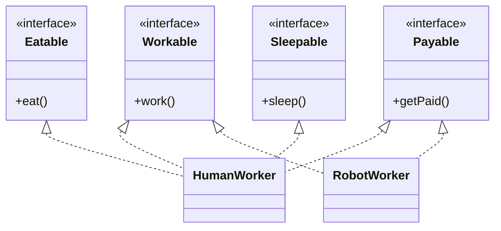

</details>

### Advantages of ISP

- **Linh hoạt:** Class chỉ implement những gì cần
- **Dễ hiểu:** Interface nhỏ, mục đích rõ ràng
- **Giảm coupling:** Thay đổi interface ít ảnh hưởng
- **Dễ test:** Mock/stub dễ dàng hơn

### Realworld Example

```java
// DAO pattern
public interface ReadableRepository<T> {
    T findById(String id);
    List<T> findAll();
}

public interface WritableRepository<T> {
    void save(T entity);
    void delete(String id);
}

// Read-only service chỉ cần ReadableRepository
public class ReportService {
    private ReadableRepository<Order> orderRepo;
    // Không thể gọi save() hay delete()
}
```

> 💡 **Giải thích:** Ví dụ thực tế: tách repository thành phần "đọc" và phần "ghi". `ReportService` chỉ cần đọc dữ liệu để làm báo cáo nên chỉ phụ thuộc `ReadableRepository` — trình biên dịch sẽ chặn ngay nếu ai đó lỡ gọi `save()`/`delete()` từ service báo cáo. Đây là lợi ích về cả thiết kế lẫn an toàn. (DAO = Data Access Object.)

### Dependency Inversion Principle (DIP)

> **Nguyên lý Đảo Ngược Sự Phụ Thuộc**
>
> - *High-level modules* không nên phụ thuộc vào *low-level modules*. Cả hai nên phụ thuộc vào abstraction.
> - *Abstraction* không nên phụ thuộc vào details. *Details* nên phụ thuộc vào abstraction.

**Giải thích**

- Phụ thuộc vào **interface/abstract class**, không phụ thuộc vào concrete class
- Đảo ngược hướng phụ thuộc: từ high → low thành cả hai → abstraction

> 💡 **Giải thích:** *High-level module* = phần chứa logic nghiệp vụ (ví dụ `UserService`); *low-level module* = phần chi tiết kỹ thuật (ví dụ `MySQLDatabase`). Bình thường mũi tên phụ thuộc đi từ nghiệp vụ → chi tiết. DIP "đảo" nó lại: chèn một interface ở giữa, nghiệp vụ phụ thuộc interface, và chi tiết kỹ thuật cũng phụ thuộc (implement) interface đó.
>
> 📌 **Mở rộng:** Phân biệt ba khái niệm hay bị nhầm: **DIP** là *nguyên lý* (phụ thuộc vào abstraction); **Dependency Injection (DI)** là *kỹ thuật* truyền phụ thuộc từ bên ngoài vào (qua constructor/setter); **IoC container** (như Spring) là *công cụ* tự động làm DI.

### Eg: Violate DIP

```java
// Low-level module
public class MySQLDatabase {
    public void save(String data) {
        System.out.println("Saving to MySQL: " + data);
    }
}

// High-level module PHỤ THUỘC vào low-level
public class UserService {
    private MySQLDatabase database;  // Phụ thuộc concrete class!

    public UserService() {
        this.database = new MySQLDatabase();  // Tight coupling!
    }

    public void createUser(String userData) {
        // Business logic
        database.save(userData);
    }
}
```

**Vấn đề**

- `UserService` phụ thuộc trực tiếp vào `MySQLDatabase`
- Không thể đổi sang PostgreSQL, MongoDB
- Khó test vì phải có database MySQL thật

### Eg: Follow DIP

```java
// Abstraction
public interface Database {
    void save(String data);
}

// Low-level module phụ thuộc vào abstraction
public class MySQLDatabase implements Database {
    public void save(String data) {
        System.out.println("Saving to MySQL: " + data);
    }
}

public class PostgreSQLDatabase implements Database {
    public void save(String data) {
        System.out.println("Saving to PostgreSQL: " + data);
    }
}
```

```java
// High-level module phụ thuộc vào abstraction
public class UserService {
    private Database database;  // Phụ thuộc interface!

    // Dependency Injection
    public UserService(Database database) {
        this.database = database;
    }

    public void createUser(String userData) {
        // Business logic
        database.save(userData);
    }
}
```

**📊 Sơ đồ: DIP: đảo chiều phụ thuộc, cả module cấp cao và cấp thấp cùng phụ thuộc abstraction**


<details><summary>🔧 Mã nguồn sơ đồ (mermaid)</summary>

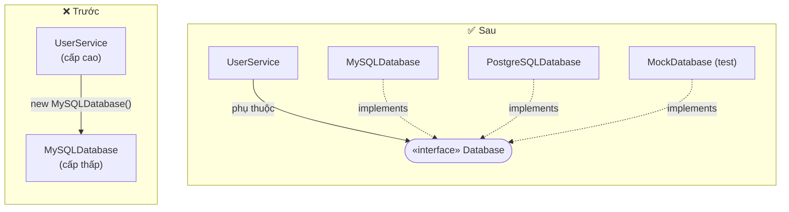

</details>

### Eg: Usage of DIP

```java
public class Main {
    public static void main(String[] args) {
        // Inject MySQL
        Database mysqlDb = new MySQLDatabase();
        UserService userService1 = new UserService(mysqlDb);
        userService1.createUser("John Doe");

        // Đổi sang PostgreSQL - KHÔNG SỬA UserService
        Database postgresDb = new PostgreSQLDatabase();
        UserService userService2 = new UserService(postgresDb);
        userService2.createUser("Jane Doe");

        // Test với Mock
        Database mockDb = new MockDatabase();
        UserService testService = new UserService(mockDb);
        testService.createUser("Test User");
    }
}
```

**Lợi ích**

- Dễ thay đổi implementation
- Dễ test với **mock/stub**
- Giảm coupling
- Tăng tính linh hoạt

> 💡 **Giải thích:** Cùng một `UserService` nhưng chạy được với MySQL, PostgreSQL hoặc `MockDatabase` (một class giả, chỉ cần nó `implements Database`, ví dụ lưu vào một `List` trong bộ nhớ). Ví dụ này giống hệt ví dụ ở phần *Loose Coupling* phía trên: DIP chính là cách có hệ thống để đạt loose coupling.

### Summary

| Nguyên lý | Ý nghĩa | Cách nhớ |
|---|---|---|
| **S**RP | 1 class = 1 trách nhiệm | Một việc thôi! |
| **O**CP | Mở rộng, không sửa | Thêm mới, không đụng cũ |
| **L**SP | Subclass thay thế được Parent | Con thay cha được |
| **I**SP | Interface nhỏ, chuyên biệt | Không ép làm việc không cần |
| **D**IP | Phụ thuộc vào `abstraction` | Phụ thuộc `interface`, không concrete |

**📊 Sơ đồ: Sơ đồ tư duy SOLID**


<details><summary>🔧 Mã nguồn sơ đồ (mermaid)</summary>

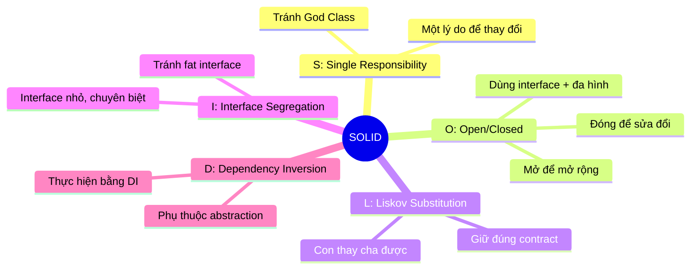

</details>

---

## Phần 3 — Các nguyên lý khác: DRY, KISS, YAGNI

### DRY - Don't Repeat Yourself

> Every piece of knowledge must have a single, unambiguous, authoritative representation within a system

**Giải thích**

- Mỗi đoạn logic chỉ nên xuất hiện một lần
- Tránh copy-paste code
- Tái sử dụng thông qua `function`, `class`, `module`

> 💡 **Giải thích:** Câu định nghĩa dịch là: "Mỗi mẩu tri thức phải có một biểu diễn duy nhất, rõ ràng và có thẩm quyền trong hệ thống." Điểm mấu chốt là **tri thức** (một quy tắc nghiệp vụ), không chỉ là "dòng code giống nhau" — xem phần *DRY - Shouldn't* bên dưới.
>
> 📌 **Mở rộng:** DRY được Andy Hunt và Dave Thomas đặt tên trong sách *The Pragmatic Programmer* (1999).

### Eg: Violate DRY (WET - Write Everything Twice)

> **Vấn đề:** Logic validate bị lặp lại → Sửa ở một chỗ, quên chỗ kia!

```java
public class OrderService {
    public void createOrder(Order order) {
        // Validate
        if (order.getItems().isEmpty()) {
            throw new IllegalArgumentException("Order must have items");
        }
        if (order.getCustomer() == null) {
            throw new IllegalArgumentException("Order must have customer");
        }

        // Save
        database.save(order);
    }

    public void updateOrder(Order order) {
        // DUPLICATE validation logic

        if (order.getItems().isEmpty()) {
            throw new IllegalArgumentException("Order must have items");
        }
        if (order.getCustomer() == null) {
            throw new IllegalArgumentException("Order must have customer");
        }

        // Update
        database.update(order);
    }
}
```

### Follow DRY

```java
public class OrderService {
    // Extract validation logic
    private void validateOrder(Order order) {
        if (order.getItems().isEmpty()) {
            throw new IllegalArgumentException("Order must have items");
        }
        if (order.getCustomer() == null) {
            throw new IllegalArgumentException("Order must have customer");
        }
    }

    public void createOrder(Order order) {
        validateOrder(order);  // Reuse
        database.save(order);
    }

    public void updateOrder(Order order) {
        validateOrder(order);  // Reuse
        database.update(order);
    }
}
```

**Lợi ích**

- Sửa một chỗ, ảnh hưởng toàn bộ
- Dễ maintain
- Giảm bug
- Code ngắn gọn hơn

> 💡 **Giải thích:** Kỹ thuật dùng ở đây là refactoring **Extract Method**: gom đoạn lặp vào một method `validateOrder` và gọi lại ở cả hai nơi. Nếu sau này thêm luật "đơn phải có địa chỉ giao hàng", bạn chỉ sửa một chỗ.

### DRY - Should

Nên áp dụng DRY cho:

- Logic nghiệp vụ giống nhau
- Validation rules
- Tính toán phức tạp
- Database queries

### DRY - Shouldn't

> *Duplication* is better than *wrong abstraction*

Không nên ép DRY khi:

- Code giống nhau nhưng khác ý nghĩa nghiệp vụ
- Code đơn giản (1-2 dòng)
- Logic có thể thay đổi độc lập

```java
// Hai method này GIỐNG NHAU nhưng khác ý nghĩa nghiệp vụ
public double calculateOrderTotal() { return price * quantity; }
public double calculateTax() { return price * quantity; }  // Tình cờ giống
```

> 💡 **Giải thích:** "Lặp code còn hơn trừu tượng sai." Tổng tiền đơn hàng và thuế hiện *tình cờ* có cùng công thức, nhưng là hai quy tắc khác nhau: mai kia thuế đổi thành `price * quantity * 0.1` thì tổng tiền không đổi theo. Nếu đã gộp chúng vào một hàm chung, bạn sẽ phải tách ra lại (hoặc tệ hơn, thêm `if` vào hàm chung). Hỏi: "hai đoạn này có **luôn phải thay đổi cùng nhau** không?" — có thì DRY, không thì để riêng.
>
> 📌 **Mở rộng:** Câu "Duplication is far cheaper than the wrong abstraction" là của Sandi Metz.

### KISS - Keep It Simple, Stupid

> *Simplicity* should be a key goal in design, and *unnecessary complexity* should be avoided

**Giải thích**

- Giải pháp đơn giản nhất thường là tốt nhất
- Tránh **over-engineering**
- Code dễ đọc > Code *thông-minh*

### Eg: Violate KISS (Over-engineer)

```java
// Cách phức tạp không cần thiết
public class NumberChecker {
    public boolean isEven(int number) {
        // Sử dụng bitwise operation "cho pro"
        return (number & 1) == 0;
    }

    public String getStatus(boolean active) {
        // Ternary lồng nhau
        return active ? (active == true ? "ACTIVE" : "INACTIVE") : "INACTIVE";
    }

    public int sum(int[] numbers) {
        // Stream phức tạp cho việc đơn giản
        return Arrays.stream(numbers)
                .boxed()
                .collect(Collectors
                        .summingInt(Integer::intValue));
    }
}
```

**Vấn đề**

- Khó đọc, khó hiểu
- Không cần thiết phức tạp
- Dễ gây bug

### Eg: Follow KISS

```java
// Giải pháp đơn giản, dễ hiểu
public class NumberChecker {
    public boolean isEven(int number) {
        return number % 2 == 0; // Đơn giản
    }

    public String getStatus(boolean active) {
        return active ? "ACTIVE" : "INACTIVE"; // Rõ ràng
    }

    public int sum(int[] numbers) { // Đơn giản nhất
        int total = 0;
        for (int num : numbers) {
            total += num;
        }
        return total;
    }
}
```

**Lợi ích**

- Dễ đọc, dễ hiểu, kể cả với *sinh viên năm 1*
- Dễ maintain
- Ít bug hơn

> 💡 **Giải thích:** Cả ba method ở phần *Eg: Violate KISS* đều *chạy đúng*, nhưng mỗi cái đều bắt người đọc phải dừng lại suy nghĩ: phép `& 1`, ternary lồng nhau với nhánh thừa (`active == true` luôn đúng trong nhánh đó), và chuỗi `stream().boxed().collect(...)` chỉ để cộng mảng. KISS không cấm dùng kỹ thuật nâng cao — nó yêu cầu chọn cách *dễ hiểu nhất* đủ giải quyết bài toán.
>
> 📌 **Mở rộng:** Với mảng `int[]`, Java có sẵn `Arrays.stream(numbers).sum()` — cũng là một cách đơn giản, ngắn gọn; vấn đề ở ví dụ vi phạm là dùng `boxed()` + `Collectors` rườm rà, không phải bản thân Stream.

### KISS - HOW

> Người khác có hiểu code này không?

- **Tránh premature optimization:**

  ```java
  // Không cần: Optimize trước khi có vấn đề
  // Nên: Code đơn giản trước, optimize sau khi đo đạc
  ```

- **Sử dụng tên biến rõ ràng:**

  ```java
  // Xấu: int d;
  // Tốt: int daysSinceCreation;
  ```

### KISS - HOW

- **Giữ function ngắn gọn:**

  ```java
  // Mỗi function làm 1 việc, < 20 dòng
  ```

- **Tránh deep nesting:**

  ```java
  // Tránh if-else lồng nhau > 3 cấp
  ```

> 💡 **Giải thích:** Bốn mẹo thực hành KISS: (1) chưa đo thấy chậm thì chưa tối ưu; (2) đặt tên biến nói rõ ý nghĩa; (3) function ngắn, dưới khoảng 20 dòng; (4) không lồng `if-else` quá 3 cấp. Câu hỏi kiểm tra chung: "Người khác có hiểu code này không?"
>
> 📌 **Mở rộng:** Cách phổ biến để giảm lồng nhau là dùng **guard clause** (return sớm): kiểm tra các trường hợp lỗi ở đầu hàm và `return`/`throw` ngay, phần logic chính không bị đẩy sâu vào trong. Câu nổi tiếng về tối ưu sớm là của Donald Knuth: "premature optimization is the root of all evil".

### YAGNI - You Aren't Gonna Need It

> Don't implement something until it is necessary - *Không cần thì đừng làm*

**Giải thích**

- Chỉ implement những gì CẦN THIẾT hiện tại
- Không code cho **tương lai có thể dùng**
- Tránh **over-engineering**

> 📌 **Mở rộng:** YAGNI xuất phát từ phương pháp Extreme Programming (XP).

### Eg: Violate YAGNI

```java
// Requirement: Lưu user vào MySQL
public interface UserRepository {
    void save(User user);

    // "Tương lai có thể cần"
    void saveToMongoDB(User user);
    void saveToRedis(User user);
    void saveToElasticsearch(User user);
    void export ToJSON(User user);
    void exportToXML(User user);
    void exportToCSV(User user);

    // "Có thể cần cho analytics"
    void saveUserActivity(User user);
    void trackUserBehavior(User user);
}
```

```java
public class MySQLUserRepository implements UserRepository {
    public void save(User user) { /* Implementation */ }

    // Phải implement TẤT CẢ method không cần thiết!
    public void saveToMongoDB(User user) {
        throw new UnsupportedOperationException("Not needed yet");
    }
    // ... 7 methods nữa không dùng đến
}
```

- Code **phức tạp** không cần thiết
- **Tốn thời gian** implement
- Khó maintain
- Có thể không bao giờ dùng đến

> 💡 **Giải thích:** Yêu cầu chỉ là "lưu user vào MySQL", nhưng interface đã "đoán trước" 8 nhu cầu tương lai → class cài đặt phải viết hàng loạt method ném exception. Ví dụ này đồng thời vi phạm ISP (fat interface) và SRP (repository còn lo cả export, analytics). Lưu ý: dòng `void export ToJSON(User user);` ở trên không biên dịch được trong Java vì có dấu cách thừa — viết đúng là `exportToJSON`.

### Eg: Follow YAGNI

```java
// Chỉ implement những gì CẦN
public interface UserRepository {
    void save(User user);  // Chỉ cần MySQL hiện tại
}

public class MySQLUserRepository implements UserRepository {
    public void save(User user) {
        // MySQL implementation
    }
}

// Khi THỰC SỰ cần MongoDB → tạo mới
// public class MongoDBUserRepository implements UserRepository { ... }

// Khi THỰC SỰ cần export → tạo service mới
// public class UserExportService { ... }
```

**Lợi ích**

- Code **đơn giản** hơn
- Phát triển **nhanh** hơn
- Dễ **maintain** hơn
- Tập trung vào **requirement thực tế**

> 💡 **Giải thích:** Để ý rằng thiết kế "tối giản" này vẫn **sẵn sàng mở rộng** nhờ OCP: khi thật sự cần MongoDB thì thêm `MongoDBUserRepository implements UserRepository`, không cần sửa code cũ. YAGNI + thiết kế tốt = không làm thừa nhưng cũng không tự trói tay.

### YAGNI nói KHÔNG / KHÔNG nói KHÔNG

| YAGNI nói KHÔNG với | YAGNI KHÔNG nói KHÔNG với |
|---|---|
| Code cho **có thể cần** | Clean code practices |
| Features không ai yêu cầu | **SOLID** principles |
| Optimization sớm | Design patterns |
| Abstraction phức tạp không cần thiết | Testing |

> 💡 **Giải thích:** YAGNI không phải cái cớ để viết code ẩu. Nó chỉ cắt bỏ *tính năng* và *độ phức tạp* chưa cần; còn chất lượng code (clean code, SOLID, test…) vẫn phải giữ.

### DRY vs KISS vs YAGNI

| Nguyên lý | Mục đích | Khi nào dùng |
|---|---|---|
| **DRY** | Tránh lặp code | Logic giống nhau ở nhiều nơi |
| **KISS** | Giữ đơn giản | Thiết kế giải pháp |
| **YAGNI** | Không code thừa | Quyết định implement feature |

**📊 Sơ đồ: DRY, KISS, YAGNI trả lời ba câu hỏi khác nhau**


<details><summary>🔧 Mã nguồn sơ đồ (mermaid)</summary>

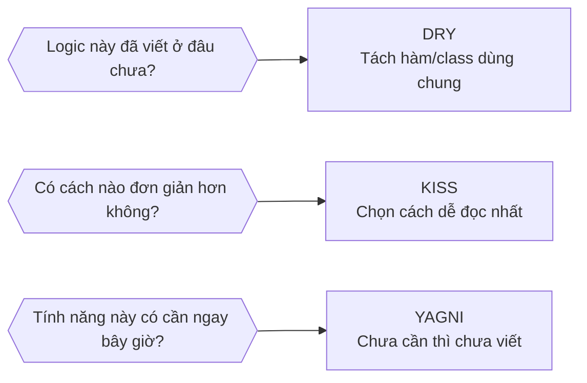

</details>

### Eg: DRY ft. KISS ft. YAGNI

```java
// YAGNI: Chỉ cần tính tổng (không cần trung bình, tích, ...)
// KISS: Dùng for loop đơn giản (không dùng Stream phức tạp)
// DRY: Extract thành method tái sử dụng

public class Calculator {
    // Simple, needed, reusable
    public int sum(int[] numbers) {
        int total = 0;
        for (int num : numbers) {
            total += num;
        }
        return total;
    }
}
```

> 💡 **Giải thích:** Ba nguyên lý không loại trừ nhau mà bổ sung cho nhau trong cùng một đoạn code: YAGNI quyết định *làm gì* (chỉ hàm tổng), KISS quyết định *làm thế nào* (vòng for đơn giản), DRY quyết định *đặt ở đâu* (một method dùng chung).

---

## Phần 4 — Áp dụng thực tế

### Best Practices

**Trước khi implement**

- [ ] Requirement rõ ràng chưa? (**YAGNI**)
- [ ] Giải pháp đơn giản nhất? (**KISS**)
- [ ] Có cần abstraction không? (**OCP**, **DIP**)

**Khi implement**

- [ ] Mỗi class làm 1 việc? (**SRP**)
- [ ] Có logic lặp không? (**DRY**)
- [ ] Interface có quá lớn không? (**ISP**)

**Sau khi implement**

- [ ] Code dễ hiểu không? (**KISS**)
- [ ] Thay thế được không? (**LSP**)
- [ ] Coupling thấp không? (**DIP**)

### Code Smell và nguyên lý vi phạm

| Code Smell | Nguyên lý vi phạm | Giải pháp |
|---|---|---|
| God Class | SRP | Tách thành nhiều class |
| Duplicate Code | DRY | Extract method/class |
| Long Method | SRP, KISS | Tách nhỏ method |
| Switch Statements | OCP | Dùng polymorphism |
| Tight Coupling | DIP | Dùng interface |
| Fat Interface | ISP | Tách interface |
| Dead Code | YAGNI | Xóa bỏ |

> 💡 **Giải thích:** "Code smell" là dấu hiệu bề ngoài cho thấy có thể có vấn đề thiết kế bên dưới. Bảng này rất hữu ích khi ôn thi: thấy smell → gọi tên nguyên lý bị vi phạm → nêu cách sửa. Ví dụ: `switch` theo loại thanh toán → vi phạm OCP → thay bằng polymorphism.

### Problem

Đề bài và code đầy đủ được chép ở mục [📝 Bài tập](#-bài-tập) (để bạn tự làm trước khi xem lời giải).

### Solution

Lời giải nằm trong khối "Đáp án" ở mục [📝 Bài tập](#-bài-tập).

**📊 Sơ đồ: Lời giải OrderManager: OrderService điều phối các dependency được inject**


<details><summary>🔧 Mã nguồn sơ đồ (mermaid)</summary>

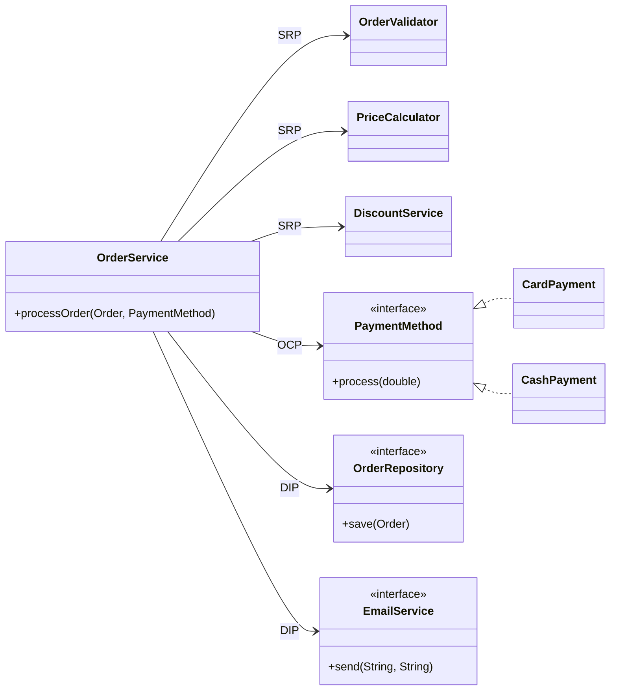

</details>

### Anti-Patterns

**Over-Engineering**

```java
// Không cần: Interface cho class chỉ có 1 implementation
public interface UserService { ... }
public class UserServiceImpl implements UserService { ... }
```

**Under-Engineering**

```java
// Quá đơn giản: Không có abstraction khi cần
public class OrderService {
    private MySQLDatabase db = new MySQLDatabase(); // Tight coupling
}
```

### Anti-Patterns (cont)

**Premature Abstraction**

```java
// Tạo abstraction trước khi biết pattern
public interface Strategy { ... }  // Chưa biết cần strategy pattern chưa
```

> Make it **work**, make it **right**, make it **fast** — Kent Beck

> 💡 **Giải thích:** Hai thái cực đều xấu: *over-engineering* (thêm interface/abstraction "cho chắc" dù chỉ có một cài đặt) và *under-engineering* (không có abstraction ngay cả ở chỗ rõ ràng cần, như database). *Premature abstraction* là tạo khung trừu tượng trước khi hiểu bài toán. Câu của Kent Beck gợi ý thứ tự ưu tiên: trước hết cho chạy đúng, sau đó làm cho thiết kế đúng (refactor), cuối cùng mới tối ưu tốc độ.

### Tools & Metrics

**Static Analysis**

- **SonarQube**: Phát hiện code smells, duplications
- **CheckStyle**: Kiểm tra coding standards
- **PMD**: Tìm potential bugs

**Code Coverage**

- **Test coverage**: nên > 80%
- **Lưu ý**: coverage cao ≠ code tốt!

**Metrics**

- **Cyclomatic Complexity**: Độ phức tạp (nên < 10)
- **Coupling**: Số phụ thuộc giữa classes
- **Cohesion**: LCOM (Lack of Cohesion of Methods)

> 💡 **Giải thích:** Các con số cần nhớ: test coverage **> 80%**, cyclomatic complexity **< 10**. Coverage cao chỉ nói code *được chạy qua* khi test, không chứng minh test kiểm tra đúng hay thiết kế tốt.
>
> 📌 **Mở rộng:** *Cyclomatic complexity* (McCabe) ≈ số đường đi độc lập qua hàm; tính nhanh: **1 + số điểm rẽ nhánh** (`if`, `for`, `while`, `case`, `&&`, `||`, `?:`…). *LCOM* đo mức "thiếu gắn kết": LCOM càng **cao** thì cohesion càng **thấp** (các method ít dùng chung field).

### Evolution of Design

- Design tốt không đến ngay từ đầu
- **Refactor** thường xuyên
- **Refactor** từng bước nhỏ
- **Test** trước khi refactor

> 💡 **Giải thích:** Thiết kế là quá trình tiến hóa. Phải có test trước khi refactor để chắc rằng sau khi đổi cấu trúc, hành vi vẫn giữ nguyên.

### Common Questions

**Q: Khi nào nên vi phạm SOLID?**
A: Khi tuân thủ làm code phức tạp hơn không cần thiết. Principles là guidelines, không phải laws.

**Q: DRY có mâu thuẫn với KISS không?**
A: Không. DRY loại bỏ duplicate, KISS giữ logic đơn giản. Cả hai hướng tới code dễ maintain.

**Q: Làm sao biết khi nào đủ abstraction?**
A: "Rule of Three" - Khi thấy duplicate lần thứ 3, hãy abstract. Lần 1-2 có thể còn sớm.

**Q: YAGNI có nghĩa là không cần design?**
A: Không. YAGNI là không implement feature chưa cần, nhưng vẫn cần good design cho code hiện tại.

### Mindset Shift

| Chuyển từ | Sang |
|---|---|
| "Code chạy được là đủ" | "Code phải dễ maintain" |
| "Viết nhanh rồi sửa sau" | "Viết đúng từ đầu, refactor thường xuyên" |
| "Chỉ mình tôi đọc code này" | "Code cho team và future self" |

> "Any fool can write code that a computer can understand. Good programmers write code that humans can understand." — *Martin Fowler*

> 💡 **Giải thích:** Câu của Martin Fowler: "Ai cũng viết được code mà máy hiểu. Lập trình viên giỏi viết code mà *con người* hiểu." "Future self" = chính bạn vài tháng sau, khi đã quên mình viết gì.

---

## 🧠 Tóm tắt nhanh

**Công thức vàng:** High Cohesion + Low Coupling = Maintainable Code

| Khái niệm | Một câu để nhớ | Dấu hiệu vi phạm | Cách sửa |
|---|---|---|---|
| **Cohesion** | Các phần trong 1 class cùng phục vụ 1 mục đích | Class vừa tính toán, vừa lưu DB, vừa gửi email | Tách class theo trách nhiệm |
| **Coupling** | Mức phụ thuộc giữa các class | `new MySQLDatabase()` bên trong class nghiệp vụ | Interface + Dependency Injection |
| **SRP** | 1 class = 1 lý do thay đổi (1 actor) | God Class, Long Method | Tách thành nhiều class |
| **OCP** | Mở để mở rộng, đóng để sửa | Chuỗi `if/else`/`switch` theo type | Interface + polymorphism, thêm class mới |
| **LSP** | Con thay cha mà chương trình vẫn đúng | Lớp con đổi hành vi / ném exception (Square–Rectangle) | Bỏ kế thừa sai, dùng interface chung |
| **ISP** | Không ép client phụ thuộc method không dùng | Fat interface, method ném `UnsupportedOperationException` | Tách thành nhiều interface nhỏ |
| **DIP** | High-level & low-level cùng phụ thuộc abstraction | Class nghiệp vụ tham chiếu class cụ thể | Phụ thuộc interface, inject từ ngoài |
| **DRY** | Mỗi tri thức chỉ có 1 biểu diễn | Copy-paste logic validate | Extract method/class (nhưng tránh "wrong abstraction") |
| **KISS** | Đơn giản nhất mà đủ dùng | Code "thông minh", ternary lồng, nesting > 3 cấp | Viết rõ ràng, tên biến tốt, hàm < 20 dòng |
| **YAGNI** | Không cần thì đừng làm | Method "để dành cho tương lai", dead code | Chỉ làm requirement hiện tại; xóa code chết |

**Con số & câu cần nhớ**

- Function < 20 dòng; if-else lồng ≤ 3 cấp; test coverage > 80%; cyclomatic complexity < 10; Rule of Three (abstract khi lặp lần 3).
- "Duplication is better than wrong abstraction."
- "Make it work, make it right, make it fast" — Kent Beck.
- Công cụ: SonarQube (smell, duplication), CheckStyle (coding standard), PMD (potential bug); cohesion đo bằng LCOM.
- Anti-pattern: over-engineering, under-engineering, premature abstraction.
- Principles là **guidelines**, không phải **laws**.

---

## ❓ Câu hỏi tự kiểm tra

**1.** Phân biệt cohesion và coupling. Thiết kế tốt cần mỗi cái ở mức cao hay thấp?

<details><summary>Đáp án</summary>

Cohesion là mức độ các thành phần **bên trong** một class/module cùng phục vụ một mục đích; coupling là mức độ phụ thuộc **giữa** các class/module. Thiết kế tốt cần **High Cohesion + Low Coupling**.

</details>

**2.** Trong ví dụ `OrderProcessor` tự `new MySQLDatabase()`, hãy nêu 3 vấn đề và 2 thay đổi cần làm để chuyển sang loose coupling.

<details><summary>Đáp án</summary>

Vấn đề: không đổi được sang PostgreSQL/MongoDB; khó test vì cần database thật; thay đổi `MySQLDatabase` ảnh hưởng `OrderProcessor`. Cách sửa: (1) tạo interface `Database` và cho field có kiểu interface; (2) truyền database vào qua constructor (Dependency Injection).

</details>

**3.** Phát biểu SRP theo nghĩa "actor". Class `User` ở ví dụ *Eg: Violate SRP* có bao nhiêu lý do thay đổi, đó là những gì?

<details><summary>Đáp án</summary>

Một class chỉ nên có một lý do để thay đổi — tức chỉ một actor/stakeholder có thể yêu cầu sửa nó. `User` có 5 lý do: nghiệp vụ user (updateProfile), validation, database, gửi email, tạo báo cáo.

</details>

**4.** Đoạn code có chuỗi `if (type.equals("CREDIT_CARD")) … else if (type.equals("PAYPAL")) …` vi phạm nguyên lý nào? Sửa thế nào?

<details><summary>Đáp án</summary>

Vi phạm **OCP** (code smell "Switch Statements"): thêm phương thức thanh toán mới phải sửa class cũ và test lại toàn bộ. Sửa: tạo interface `PaymentMethod` với `process(amount)`, mỗi phương thức là một class implement; `PaymentProcessor` nhận `PaymentMethod` và gọi `method.process(amount)` (polymorphism).

</details>

**5.** Vì sao `Square extends Rectangle` vi phạm LSP? Đoạn test cho ra kết quả gì so với kỳ vọng?

<details><summary>Đáp án</summary>

`Square` ghi đè `setWidth`/`setHeight` để đổi cả hai cạnh, phá vỡ hợp đồng "set chiều nào chỉ chiều đó đổi" của `Rectangle`. Với `rect = new Square(); setWidth(5); setHeight(4);` kỳ vọng diện tích 20 nhưng thực tế 16. Sửa: cho `Rectangle` và `Square` cùng implement interface `Shape` độc lập.

</details>

**6.** Dấu hiệu nào trong code cho thấy vi phạm ISP? Ví dụ `RobotWorker` được sửa ra sao?

<details><summary>Đáp án</summary>

Class phải implement method nó không cần (để rỗng hoặc ném `UnsupportedOperationException`) do interface quá lớn (fat interface). Sửa: tách `Worker` thành `Workable`, `Eatable`, `Sleepable`, `Payable`; `RobotWorker` chỉ implement `Workable, Payable`.

</details>

**7.** Nêu hai mệnh đề của DIP. DIP khác Dependency Injection thế nào?

<details><summary>Đáp án</summary>

(1) High-level modules không nên phụ thuộc low-level modules; cả hai phụ thuộc abstraction. (2) Abstraction không phụ thuộc details; details phụ thuộc abstraction. DIP là *nguyên lý* thiết kế; Dependency Injection là *kỹ thuật* (truyền phụ thuộc qua constructor/setter) thường dùng để hiện thực DIP.

</details>

**8.** Khi nào **không** nên áp dụng DRY? Giải thích ví dụ `calculateOrderTotal()` và `calculateTax()`.

<details><summary>Đáp án</summary>

Không nên khi code giống nhau nhưng khác ý nghĩa nghiệp vụ, khi code rất đơn giản (1–2 dòng), hoặc khi logic có thể thay đổi độc lập — vì "duplication is better than wrong abstraction". Hai method có cùng công thức `price * quantity` chỉ là tình cờ; khi luật thuế thay đổi, gộp chung sẽ gây sai hoặc phải tách lại.

</details>

**9.** Nêu 4 cách thực hành KISS (phần *KISS - HOW*).

<details><summary>Đáp án</summary>

Tránh premature optimization (code đơn giản trước, đo rồi mới tối ưu); dùng tên biến rõ ràng (`daysSinceCreation` thay vì `d`); giữ function ngắn (1 việc, < 20 dòng); tránh deep nesting (if-else lồng không quá 3 cấp).

</details>

**10.** YAGNI có nghĩa là bỏ qua thiết kế, SOLID và testing không? Nó nói "không" với những gì?

<details><summary>Đáp án</summary>

Không. YAGNI vẫn chấp nhận clean code, SOLID, design patterns, testing. Nó nói không với code "có thể cần", feature không ai yêu cầu, optimization sớm, abstraction phức tạp không cần thiết.

</details>

**11.** Ghép code smell với nguyên lý bị vi phạm: God Class, Duplicate Code, Fat Interface, Dead Code, Tight Coupling.

<details><summary>Đáp án</summary>

God Class → SRP (tách class); Duplicate Code → DRY (extract method/class); Fat Interface → ISP (tách interface); Dead Code → YAGNI (xóa bỏ); Tight Coupling → DIP (dùng interface).

</details>

**12.** "Rule of Three" là gì? Tại sao tạo interface `UserService` cho một class `UserServiceImpl` duy nhất bị xem là anti-pattern?

<details><summary>Đáp án</summary>

Rule of Three: khi thấy trùng lặp lần thứ 3 mới nên trừu tượng hóa; lần 1–2 có thể còn sớm. Interface cho class chỉ có một implementation là **over-engineering**: thêm tầng trừu tượng không mang lại lợi ích (premature abstraction). Ngược lại, thiếu abstraction ở chỗ cần (như `new MySQLDatabase()` trong service) là **under-engineering**.

</details>

---

## 📝 Bài tập

### Bài 1

**Scenario:** Hệ thống quản lý đơn hàng vi phạm những nguyên lý nào? Gợi ý cách điều chỉnh?

```java
public class OrderManager {
    public void processOrder(Order order) {
        // Validate
        if (order.items.isEmpty()) throw new Exception("Empty order");

        // Calculate
        double total = 0;
        for (Item item : order.items) {
            total += item.price * item.quantity;
        }

        // Apply discount
        if (order.customer.type.equals("VIP")) total *= 0.9;
        else if (order.customer.type.equals("MEMBER")) total *= 0.95;

        // Payment
        if (order.paymentType.equals("CARD")) {
            // Process card
        } else if (order.paymentType.equals("CASH")) {
            // Process cash
        }

        // Save
        connection.execute("INSERT INTO orders...");

        // Send email
        smtp.send(order.customer.email, "Order confirmed");
    }
}
```

<details><summary>Đáp án (Solution: Refactor theo SOLID)</summary>

**Phân tích vi phạm:**

- **SRP**: một method làm 6 việc — validate, tính tiền, giảm giá, thanh toán, lưu DB, gửi email (God Class / Long Method).
- **OCP**: `if/else` theo `customer.type` (VIP 10%, MEMBER 5%) và theo `paymentType` (CARD/CASH) → thêm loại khách hay phương thức thanh toán mới phải sửa code.
- **DIP**: phụ thuộc trực tiếp vào chi tiết hạ tầng (`connection.execute("INSERT …")`, `smtp.send(…)`) → khó đổi DB/email provider, khó test.

**Lời giải:**

```java
// SRP: Tách trách nhiệm
public class OrderValidator { ... }
public class PriceCalculator { ... }
public class DiscountService { ... }

// OCP: Mở rộng dễ dàng
public interface PaymentMethod { void process(double amount); }
public class CardPayment implements PaymentMethod { ... }
public class CashPayment implements PaymentMethod { ... }

// DIP: Phụ thuộc abstraction
public interface OrderRepository { void save(Order order); }
public interface EmailService { void send(String to, String msg); }

// Main service
public class OrderService {
    private OrderValidator validator;
    private PriceCalculator calculator;
    private DiscountService discountService;
    private OrderRepository repository;
    private EmailService emailService;

    public void processOrder(Order order, PaymentMethod payment) {
        validator.validate(order);
        double total = calculator.calculate(order);
        total = discountService.apply(total, order.getCustomer());
        payment.process(total);
        repository.save(order);
        emailService.send(order.getCustomer().getEmail(), "Order confirmed");
    }
}
```

**Gợi ý làm tiếp** (📌 Mở rộng):

- `DiscountService` vẫn còn `if/else` theo loại khách nếu viết thẳng. Để tuân thủ OCP triệt để, có thể tạo interface `DiscountPolicy` (`VipDiscount` 0.9, `MemberDiscount` 0.95, `NoDiscount` 1.0).
- Các dependency của `OrderService` nên được truyền qua constructor (Dependency Injection) để test được bằng mock.
- Code ban đầu còn dùng field public (`order.items`, `item.price`) và `throw new Exception(...)` trong method không khai báo `throws` (không biên dịch được trong Java) — bản refactor dùng getter (`order.getCustomer()`) và nên dùng `IllegalArgumentException` như ở ví dụ DRY (phần *Eg: Violate DRY* / *Follow DRY*).

</details>
