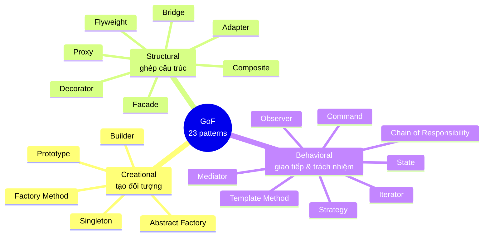
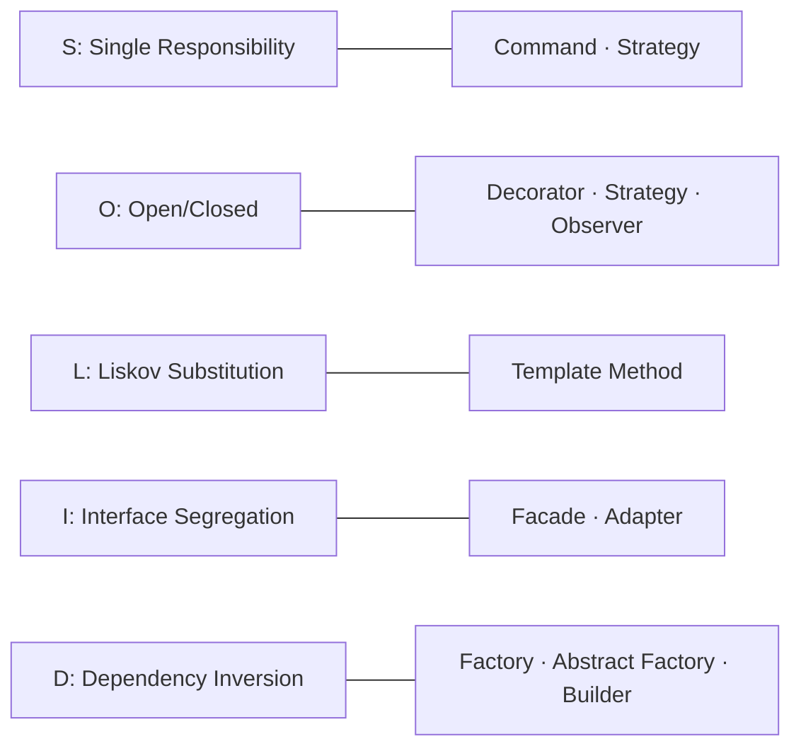
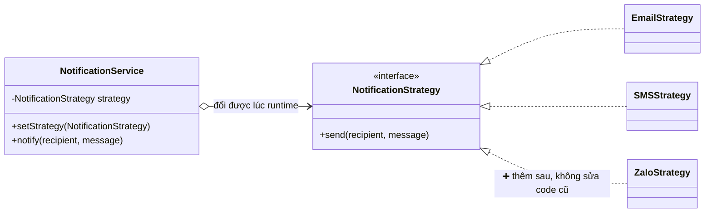
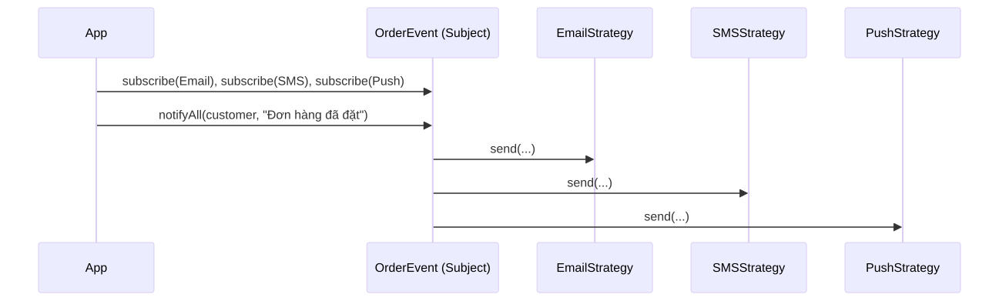
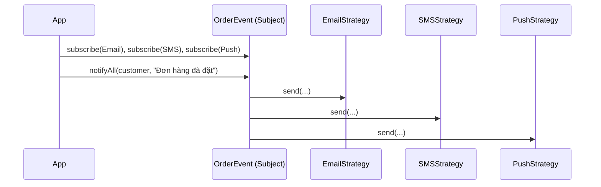
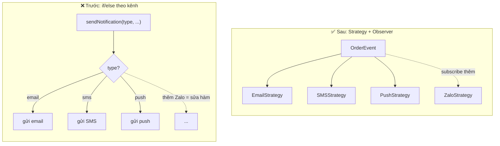

# Bài 2 — Design Patterns

## 🎯 Mục tiêu

- Hiểu design pattern là gì, khác thuật toán ở điểm nào, và một pattern được mô tả bằng những thành phần nào.
- Biết lịch sử hình thành (Christopher Alexander → Gang of Four) và lý do nên học pattern.
- Nhận thức được các phê phán đối với pattern để tránh lạm dụng (over-engineering).
- Phân biệt 3 nhóm pattern GoF: **Creational**, **Structural**, **Behavioral**, và mối liên hệ với **SOLID**.
- Đọc hiểu ví dụ áp dụng **Strategy** + **Observer** cho hệ thống thông báo.

## 📑 Mục lục

1. [Design Pattern là gì?](#phần-1--design-pattern-là-gì)
2. [Lịch sử hình thành](#phần-2--lịch-sử-hình-thành)
3. [Tại sao nên học pattern?](#phần-3--tại-sao-nên-học-pattern)
4. [Các ý kiến trái chiều](#phần-4--các-ý-kiến-trái-chiều)
5. [Phân loại pattern & liên hệ SOLID](#phần-5--phân-loại-pattern--liên-hệ-solid)
6. [Ví dụ: Hệ thống thông báo (Strategy + Observer)](#phần-6--ví-dụ-hệ-thống-thông-báo)
7. [📌 Mở rộng: Bảng intent của 23 pattern GoF](#-mở-rộng-bảng-intent-các-pattern-gof)
8. [🧠 Tóm tắt nhanh](#-tóm-tắt-nhanh) · [❓ Câu hỏi tự kiểm tra](#-câu-hỏi-tự-kiểm-tra)

---

## Phần 1 — Design Pattern là gì?

### Design Pattern là gì?

> **Design patterns** are typical solutions to commonly occurring problems in software design. They are like pre-made blueprints that you can customize to solve a recurring design problem in your code.

- Không phải đoạn code copy–paste được
- Là **khuôn mẫu tư duy** tổng quát cho một vấn đề thiết kế
- Được **tùy biến** để phù hợp với từng chương trình cụ thể

> 💡 **Giải thích:** Dịch ý: design pattern là *giải pháp điển hình* cho những *vấn đề hay gặp lại* trong thiết kế phần mềm — giống một bản thiết kế dựng sẵn mà bạn chỉnh lại cho hợp với code của mình. Vì là "bản thiết kế" chứ không phải "thư viện", bạn không thể import một pattern; bạn phải hiểu ý tưởng rồi tự hiện thực.

### Pattern ≠ Algorithm

| | Algorithm | Design Pattern |
|---|---|---|
| Bản chất | Tập hợp **bước cụ thể** để đạt mục tiêu | Mô tả **giải pháp cấp cao** cho một vấn đề |
| Ví von | Giống như **công thức nấu ăn** — có trình tự rõ ràng | Giống như **bản thiết kế** — bạn tự quyết cách triển khai |
| Kết quả | **Xác định** và **lặp lại được** | Cùng một pattern, **code có thể khác nhau** ở mỗi dự án |

> 💡 **Giải thích:** Thuật toán trả lời "làm *từng bước* thế nào" (ví dụ QuickSort); pattern trả lời "*tổ chức các class/đối tượng* thế nào" (ví dụ Strategy cho phép đổi thuật toán sắp xếp lúc chạy). Hai đội cùng dùng Observer có thể viết code rất khác nhau, nhưng hai người cùng cài QuickSort sẽ ra các bước giống nhau.

### Cấu trúc một Design Pattern

**4 thành phần**:

- **Intent** — Mục đích
- **Motivation** — Động lực / vấn đề
- **Structure** — Cấu trúc lớp / đối tượng
- **Code Example** — Ví dụ minh họa

**Thông tin bổ sung**

- **Applicability** — Khi nào nên dùng
- **Implementation steps** — Các bước triển khai
- **Relations** — Liên hệ với các pattern khác

> Một pattern tốt cung cấp đủ cả 4 phần cốt lõi lẫn thông tin bổ sung để bạn hiểu và áp dụng đúng.

> 💡 **Giải thích:** Khi học một pattern mới, hãy tự trả lời theo đúng khung này: *Nó dùng để làm gì?* (Intent) — *Vấn đề nào sinh ra nó?* (Motivation) — *Sơ đồ lớp ra sao?* (Structure) — *Code mẫu?* (Code Example) — *Khi nào dùng / các bước làm / liên quan pattern nào?*. Đây cũng là cách trang refactoring.guru (xem mục *Tài liệu tham khảo*) trình bày từng pattern.

---

## Phần 2 — Lịch sử hình thành

### Lịch sử hình thành

**Christopher Alexander (1977)**

- Kiến trúc sư người Áo–Mỹ
- Xuất bản cuốn **"A Pattern Language: Towns, Buildings, Construction"**
- Đề xuất khái niệm **"ngôn ngữ mẫu"** (pattern language) trong thiết kế đô thị
- Mỗi *pattern* mô tả một vấn đề **lặp lại** trong môi trường sống và cách giải quyết nó

> **Ý tưởng chính**: Khi một giải pháp được lặp lại nhiều lần trong nhiều dự án → ai đó đặt tên cho nó và ghi lại → **Pattern ra đời**

### Gang of Four — GoF (1994)

**Cuốn sách kinh điển:** *"Design Patterns: Elements of Reusable Object-Oriented Software"*

- Xuất bản năm **1994**
- Áp dụng khái niệm pattern vào **lập trình hướng đối tượng**
- Giới thiệu **23 patterns** kinh điển
- Trở thành **bestseller** ngay lập tức

**Bộ tứ tác giả**

| Tác giả | Vai trò |
|---|---|
| Erich Gamma | Kiến trúc sư chính |
| Richard Helm | Structural patterns |
| Ralph Johnson | Behavioral patterns |
| John Vlissides | Creational patterns |

> 💡 **Giải thích:** Mốc cần nhớ: **1977** — Alexander đưa ra ý tưởng pattern trong kiến trúc xây dựng; **1994** — nhóm "Gang of Four" (4 tác giả) mang ý tưởng đó sang lập trình hướng đối tượng với **23 pattern**.
>
> 📌 **Mở rộng:** Cột "Vai trò" chỉ là cách gán cho dễ nhớ; trong sách GoF không có phân công chính thức theo nhóm pattern như vậy — bốn tác giả cùng viết toàn bộ cuốn sách. Khi ôn thi, ưu tiên nhớ tên 4 tác giả, năm 1994 và con số 23.

### Phong trào lan rộng

- Hàng chục OOP patterns **mới** tiếp tục được khám phá
- Tư duy **pattern approach** lan sang **nhiều lĩnh vực** khác ngoài OOP
  - Kiến trúc phần mềm (Microservices, Event-Driven…)
  - Giao diện người dùng (UI Patterns)
  - Hệ thống phân tán (Distributed Systems Patterns)
- Ngày nay: pattern không còn giới hạn ở OOP

> *"Pattern là giải pháp đã được kiểm chứng qua thực tế — không ai phát minh ra chúng, người ta chỉ **khám phá** và **đặt tên** cho chúng."*

---

## Phần 3 — Tại sao nên học pattern?

### Why

> The truth is that you might manage to work as a programmer for many years without knowing about a single pattern. A lot of people do just that. Even in that case, though, you might be **implementing some patterns without even knowing it**.

- Nhiều lập trình viên kỳ cựu dùng pattern **mà không biết tên**
- Biết tên pattern giúp bạn **trao đổi nhanh hơn** với đồng nghiệp
- Học pattern giúp bạn **tư duy có hệ thống** hơn về thiết kế

> 💡 **Giải thích:** Ý trích dẫn: bạn có thể làm lập trình nhiều năm mà không biết pattern nào, nhưng rất có thể bạn *đã đang dùng* một số pattern mà không biết tên. Học pattern là học cách gọi tên và dùng chúng có chủ đích.

### #1: Bộ công cụ đã được kiểm chứng (Toolkit of Tried Solutions)

- Design patterns là **tập hợp giải pháp đã được thử nghiệm** cho các vấn đề phổ biến trong thiết kế phần mềm
- Dù bạn chưa gặp những vấn đề đó, **hiểu pattern dạy bạn tư duy OOP**
- Tránh phải *"phát minh lại bánh xe"* mỗi lần gặp bài toán quen thuộc

**Lợi ích thực tế**

- Giải pháp **đã được nhiều dự án kiểm chứng**
- Tập trung vào **vấn đề thực sự** thay vì mày mò cách giải
- Code dễ **bảo trì** và **mở rộng** hơn
- Giảm thiểu **kỹ thuật nợ** (technical debt)

### #2: Ngôn ngữ chung của lập trình viên (Common Language)

Patterns định nghĩa **ngôn ngữ chung** để cả team giao tiếp hiệu quả hơn.

**Ví dụ thực tế** — thay vì giải thích dài dòng:

> *"Hãy tạo một lớp chỉ có một thể hiện duy nhất, và cung cấp một điểm truy cập toàn cục đến nó..."*

Chỉ cần nói:

> ***"Oh, just use a Singleton for that"***

→ Cả team **hiểu ngay** — không cần giải thích thêm!

> 💡 **Giải thích:** Câu dài ở trên chính là *intent* của **Singleton**. Tên pattern nén cả một đoạn mô tả thiết kế thành một từ — giống như bác sĩ nói "viêm ruột thừa" thay vì mô tả toàn bộ triệu chứng.

### Tóm lại: Tại sao nên học Pattern?

| Lý do | Giải thích |
|---|---|
| **Toolkit đã kiểm chứng** | Giải pháp được thực tế xác nhận |
| **Nâng cao tư duy OOP** | Học cách giải quyết vấn đề theo nguyên tắc |
| **Ngôn ngữ chung** | Giao tiếp nhanh, rõ ràng trong team |
| **Tái sử dụng** | Áp dụng lại ở nhiều project |
| **Code chất lượng cao** | Dễ bảo trì, mở rộng, đọc hiểu |

---

## Phần 4 — Các ý kiến trái chiều

### Các ý kiến trái chiều

> *"It seems like only lazy people haven't criticized design patterns yet."* — **refactoring.guru**

Có **3 luồng ý kiến trái chiều chính** đối với design patterns:

- **Kludges for a weak programming language**
- **Inefficient solutions**
- **Unjustified use**

> 💡 **Giải thích:** Câu trích hài hước: "Có vẻ chỉ những người lười mới chưa chỉ trích design patterns." Ba phê phán lần lượt là: (1) pattern là "miếng vá" cho ngôn ngữ yếu, (2) giải pháp kém hiệu quả vì bị áp dụng máy móc, (3) dùng không có lý do chính đáng.

### #1: Sự chắp vá cho ngôn ngữ lập trình yếu (Kludge for Weak Languages)

> *"Nhu cầu dùng patterns thường xuất hiện khi người ta chọn ngôn ngữ hoặc công nghệ thiếu mức độ trừu tượng cần thiết."* — Paul Graham, *Revenge of the Nerds*

Pattern trở thành **"siêu năng lực"** hỗ trợ cho ngôn ngữ lập trình.

**Ví dụ** — Pattern **Strategy** trong Java:

```java
interface SortStrategy {
    void sort(int[] arr);
}
```

Trong Python / JavaScript hiện đại:

```python
# Chỉ cần truyền function!
sort(data, key=lambda x: x.price)
```

→ Ngôn ngữ mạnh hơn → ít cần pattern hơn

> 💡 **Giải thích:** Trong Java cổ điển, muốn "truyền một hành vi" phải bọc nó trong một interface + class (đó là Strategy). Ở ngôn ngữ có hàm là "công dân hạng nhất" (Python, JavaScript), chỉ cần truyền thẳng một hàm/lambda — pattern gần như "tan biến" vào ngôn ngữ. (Đoạn Python ở trên chỉ minh họa ý tưởng; hàm có sẵn của Python thực tế là `sorted(data, key=...)` hoặc `data.sort(key=...)`.)
>
> 📌 **Mở rộng:** Từ Java 8, Java cũng có lambda, nên Strategy có thể viết gọn: `list.sort(Comparator.comparing(Item::getPrice))` — `Comparator` chính là một Strategy.

### #2: Giải pháp kém hiệu quả (Inefficient Solutions)

- Patterns **hệ thống hóa** các cách tiếp cận phổ biến
- Nhiều người xem đây là **giáo điều** (dogma)
- Họ implement *"đúng theo sách"* mà **không điều chỉnh** theo ngữ cảnh dự án

**Hậu quả**

- Pattern trở nên **phức tạp hóa** không cần thiết
- Không giải quyết đúng **vấn đề thực tế** của dự án
- Codebase trở nên **khó hiểu** hơn thay vì dễ hiểu hơn

> Pattern là **hướng dẫn**, không phải **quy tắc cứng**.

### #3: Over-engineering (Unjustified Use)

> *"If all you have is a hammer, everything looks like a nail."* → **Nguyên tắc**: Chỉ dùng pattern khi **thực sự cần thiết**.

- Người mới học pattern thường **áp dụng mọi nơi**, kể cả những nơi mà **code đơn giản hơn** hoàn toàn đủ
- Đây là **anti-pattern** phổ biến nhất trong cộng đồng lập trình

**Dấu hiệu lạm dụng**

- Thêm nhiều **abstract layer** không cần thiết
- Code có pattern nhưng **không giải quyết** vấn đề rõ ràng
- Team mới cần nhiều thời gian để **onboard**
- Refactor liên tục

> 💡 **Giải thích:** "Khi trong tay chỉ có cây búa, thứ gì cũng giống cái đinh." Học xong pattern, ta dễ nhìn đâu cũng thấy chỗ "nhét" pattern. Đây chính là vi phạm **KISS** và **YAGNI** ở Bài 1.

### Sai lầm thường gặp & Cách tiếp cận đúng

| Sai lầm thường gặp | Cách tiếp cận đúng |
|---|---|
| Học pattern xong → áp dụng tất cả | Hiểu **vấn đề** trước khi nghĩ đến pattern |
| Xem pattern là **giải pháp cho mọi thứ** | Pattern là **tool**, không phải **mục tiêu** |
| Không xem xét ngữ cảnh và trade-offs | Ưu tiên **code dễ đọc** hơn code "đúng pattern" |
| Bỏ qua sự đơn giản (KISS principle) | Refactor khi thực sự thấy cần thiết |

---

## Phần 5 — Phân loại pattern & liên hệ SOLID

### Phân loại: 3 Nhóm Pattern Chính (GoF)

| Nhóm | Mục đích | Từ khóa |
|---|---|---|
| **Creational** | Tạo đối tượng | Factory, Singleton, Builder… |
| **Structural** | Tổ chức cấu trúc | Adapter, Decorator, Facade… |
| **Behavioral** | Giao tiếp & trách nhiệm | Observer, Strategy, Command… |

> 💡 **Giải thích:** Mẹo nhớ theo câu hỏi: **Creational** — "tạo đối tượng *thế nào*?"; **Structural** — "ghép các đối tượng/lớp *thành cấu trúc lớn* ra sao?"; **Behavioral** — "các đối tượng *nói chuyện và chia việc* với nhau thế nào?".

**📊 Sơ đồ: Ba nhóm pattern GoF**



<details><summary>🔧 Mã nguồn sơ đồ (mermaid)</summary>



</details>

### Creational Patterns

> **Creational patterns** provide object creation mechanisms that increase **flexibility** and **reuse** of existing code.

- Kiểm soát **cách tạo ra** đối tượng
- Che giấu logic tạo đối tượng khỏi client code
- Tăng tính **linh hoạt** khi thay đổi loại đối tượng

**Các pattern tiêu biểu**

- Factory Method
- Abstract Factory
- Builder
- Prototype
- Singleton

### Structural Patterns

> **Structural patterns** explain how to assemble objects and classes into **larger structures**, while keeping these structures **flexible and efficient**.

- Kết hợp các lớp và đối tượng thành cấu trúc lớn hơn
- Vẫn giữ cấu trúc **linh hoạt** và **hiệu quả**

**Các pattern tiêu biểu**

- Adapter
- Bridge
- Composite
- Decorator
- Facade
- Flyweight
- Proxy

### Behavioral Patterns

> **Behavioral patterns** take care of **effective communication** and the **assignment of responsibilities** between objects.

- Định nghĩa cách các đối tượng **giao tiếp** với nhau
- Phân chia **trách nhiệm** rõ ràng giữa các lớp
- Quản lý **luồng xử lý** và **thuật toán**

**Các pattern tiêu biểu**

- Chain of Responsibility
- Command
- Iterator
- Mediator
- Observer
- State
- Strategy
- Template Method

> 💡 **Giải thích:** Ba danh sách Creational, Structural, Behavioral ở trên gồm 5 + 7 + 8 = **20** pattern tiêu biểu. GoF có 23 pattern; 3 pattern Behavioral còn lại là **Interpreter**, **Memento** và **Visitor**. Ý định (intent) và ví dụ của cả 23 pattern có trong mục [📌 Mở rộng](#-mở-rộng-bảng-intent-các-pattern-gof) bên dưới.

### Mối liên hệ với các nguyên lý SOLID

| Nguyên lý | Pattern liên quan |
|---|---|
| Single Responsibility | Command, Strategy |
| Open/Closed | Decorator, Strategy, Observer |
| Liskov Substitution | Template Method |
| Interface Segregation | Facade, Adapter |
| Dependency Inversion | Factory, Abstract Factory, Builder |

> 💡 **Giải thích:** Pattern là cách "đóng gói" các nguyên lý SOLID thành giải pháp cụ thể:
> - **SRP** — Command tách *yêu cầu* thành object riêng; Strategy tách *thuật toán* ra khỏi class dùng nó.
> - **OCP** — thêm Decorator, Strategy hay Observer mới mà không sửa code cũ.
> - **LSP** — Template Method yêu cầu lớp con chỉ "điền" các bước, phải giữ đúng khung hành vi của lớp cha.
> - **ISP** — Facade/Adapter cung cấp cho client một interface gọn, đúng thứ client cần.
> - **DIP** — các pattern tạo đối tượng giúp client làm việc với abstraction thay vì tự `new` class cụ thể.

**📊 Sơ đồ: Pattern nào hiện thực nguyên lý SOLID nào**



<details><summary>🔧 Mã nguồn sơ đồ (mermaid)</summary>



</details>

---

## Phần 6 — Ví dụ: Hệ thống thông báo

### Ví dụ - Hệ thống thông báo

Xây dựng hệ thống gửi thông báo cho ứng dụng thương mại điện tử:

- Khi đặt hàng thành công → gửi **Email** + **SMS** + **Push Notification**
- Mỗi kênh gửi theo cách khác nhau
- Sau này có thể thêm kênh mới (Zalo, Telegram...)
- Người dùng có thể **chọn kênh** muốn nhận

### Phân tích

**Nhận diện vấn đề**

- Nhiều kênh thông báo → cần **mở rộng dễ dàng**
- Người dùng chọn kênh → cần **linh hoạt khi runtime**
- Hành vi khác nhau nhưng cùng mục đích → cần **giao diện thống nhất**

**Gợi ý Pattern**

| Vấn đề | Pattern phù hợp |
|---|---|
| Một sự kiện → nhiều người nhận | **Observer** |
| Chọn hành vi lúc runtime | **Strategy** |
| Gói lệnh gửi thành object | **Command** |
| Ẩn phức tạp hệ thống con | **Facade** |

> 💡 **Giải thích:** Đây là quy trình chọn pattern đúng cách (đúng tinh thần phần *Sai lầm thường gặp & Cách tiếp cận đúng*): **phân tích vấn đề trước**, rồi mới ánh xạ từng vấn đề sang pattern phù hợp. Các phần tiếp theo chỉ hiện thực hai pattern: Strategy và Observer.

### Áp dụng: Strategy Pattern

```java
interface NotificationStrategy {
    void send(String recipient, String message);
}

class EmailStrategy implements NotificationStrategy {
    @Override
    public void send(String recipient, String message) {
        System.out.println("[EMAIL] → " + recipient + ": " + message);
    }
}

class SMSStrategy implements NotificationStrategy {
    @Override
    public void send(String recipient, String message) {
        System.out.println("[SMS]   → " + recipient + ": " + message);
    }
}
```

### Áp dụng: Strategy Pattern (tiếp)

```java
class NotificationService {
    private NotificationStrategy strategy;

    public NotificationService(NotificationStrategy strategy) {
        this.strategy = strategy;
    }

    public void setStrategy(NotificationStrategy strategy) {
        this.strategy = strategy; // Đổi kênh lúc runtime!
    }

    public void notify(String recipient, String message) {
        this.strategy.send(recipient, message);
    }
}

// --- Sử dụng ---
NotificationService service = new NotificationService(new EmailStrategy());
service.notify("user@example.com", "Đơn hàng #1234 đã được xác nhận!");

service.setStrategy(new SMSStrategy());
service.notify("0901234567", "Đơn hàng #1234 đã được xác nhận!");
```

> 💡 **Giải thích:** Ba vai trò của Strategy: **Strategy interface** (`NotificationStrategy`), **Concrete Strategy** (`EmailStrategy`, `SMSStrategy`) và **Context** (`NotificationService` — giữ một strategy và ủy quyền công việc cho nó). Điểm mấu chốt là `setStrategy(...)`: đổi kênh gửi **lúc chương trình đang chạy** mà không sửa `NotificationService`. Context chỉ biết interface → đúng OCP và DIP.
>
> 📌 **Mở rộng:** Trong Java, mọi class kế thừa `Object` vốn đã có `notify()` và `notifyAll()` (dùng cho đồng bộ luồng, là `final`). Method `notify(String, String)` ở đây khác tham số nên là **overload** hợp lệ, nhưng dễ gây nhầm lẫn; code thực tế nên đặt tên khác như `sendNotification` hay `publish`.

**📊 Sơ đồ: Cấu trúc Strategy Pattern trong hệ thống thông báo**



<details><summary>🔧 Mã nguồn sơ đồ (mermaid)</summary>



</details>

### Áp dụng: Observer Pattern

```java
import java.util.*;

class OrderEvent {
    private List<NotificationStrategy> observers = new ArrayList<>();

    public void subscribe(NotificationStrategy observer) {
        observers.add(observer);
    }

    public void notifyAll(String recipient, String message) {
        for (NotificationStrategy obs : observers) {
            obs.send(recipient, message);
        }
    }
}
```

### Áp dụng: Observer Pattern (tiếp)

```java
// --- Sử dụng ---
OrderEvent event = new OrderEvent();
event.subscribe(new EmailStrategy());
event.subscribe(new SMSStrategy());
event.subscribe(new PushNotificationStrategy()); // Dễ thêm kênh mới!

event.notifyAll("user@example.com", "Cảm ơn bạn đã đặt hàng!");
```

> 💡 **Giải thích:** Hai vai trò của Observer: **Subject/Publisher** (`OrderEvent` — giữ danh sách người đăng ký, có `subscribe` và `notifyAll`) và **Observer/Subscriber** (các kênh gửi). Khi sự kiện "đặt hàng" xảy ra, *một* lời gọi `notifyAll` sẽ phát tới *tất cả* kênh đã đăng ký — đúng với vấn đề "một sự kiện → nhiều người nhận". Ví dụ này khéo léo **kết hợp hai pattern**: chính các `NotificationStrategy` được dùng làm observer. Lưu ý: class `PushNotificationStrategy` không được định nghĩa ở trên; nó được viết giống `EmailStrategy`/`SMSStrategy` (implement `NotificationStrategy`).
>
> 📌 **Mở rộng:** Observer đầy đủ thường có thêm `unsubscribe(observer)` để huỷ đăng ký. Khác biệt với Strategy: Strategy = **một** hành vi được chọn và thay thế; Observer = **nhiều** đối tượng cùng được báo khi có sự kiện.

**📊 Sơ đồ: Luồng Observer: một sự kiện đơn hàng, nhiều kênh nhận**



<details><summary>🔧 Mã nguồn sơ đồ (mermaid)</summary>



</details>

### Trước và Sau khi dùng Pattern

**Trước (không dùng Pattern)**

```java
void sendNotification(User user, String msg) {
    // Vô số if/else
    if (user.wantsEmail()) {
        sendEmail(user.getEmail(), msg);
    }
    if (user.wantsSms()) {
        sendSms(user.getPhone(), msg);
    }
    if (user.wantsPush()) {
        sendPush(user.getToken(), msg);
    }
    // Thêm kênh mới = sửa hàm này!
}
```

**Vấn đề:** Vi phạm OCP, khó test, khó mở rộng

**Sau (dùng Strategy + Observer)**

```java
// Thêm kênh mới chỉ cần:
class ZaloStrategy implements NotificationStrategy {
    @Override
    public void send(String recipient, String message) {
        System.out.println("[ZALO] → " + recipient + ": " + message);
    }
}

// Đăng ký là xong!
event.subscribe(new ZaloStrategy());
```

**Lợi ích:** Tuân thủ OCP, dễ test từng kênh độc lập

> 💡 **Giải thích:** So sánh trực tiếp: trước đây thêm Zalo phải mở hàm `sendNotification` ra sửa (thêm một `if`), có nguy cơ làm hỏng các kênh cũ. Sau khi áp dụng pattern, thêm Zalo = **thêm một class mới + một dòng đăng ký**, không đụng code cũ. Mỗi kênh là một class riêng nên có thể unit test độc lập.

**📊 Sơ đồ: Trước và sau khi áp dụng Strategy + Observer**



<details><summary>🔧 Mã nguồn sơ đồ (mermaid)</summary>



</details>

### Checklist đánh giá

Khi áp dụng một Design Pattern, hãy tự hỏi:

- Pattern này **giải quyết đúng vấn đề** chưa?
- Code sau khi áp dụng có **dễ đọc hơn** không?
- Có dễ **thêm tính năng mới** mà không sửa code cũ không?
- Có dễ **viết unit test** cho từng thành phần không?
- Có đang **over-engineer** không? (Pattern có quá phức tạp cho bài toán không?)

### Tài liệu tham khảo

- https://refactoring.guru/design-patterns

---

## 📌 Mở rộng: Bảng intent các pattern GoF

> Bảng dưới đây tóm tắt *ý định (intent)* và một *ví dụ đời thực* ngắn cho từng pattern để bạn ôn tập; chi tiết cấu trúc và code xem tại refactoring.guru. Các pattern đánh dấu (*) là pattern GoF **không** nằm trong danh sách tiêu biểu ở Phần 5.

### Creational — "Tạo đối tượng thế nào?"

| Pattern | Intent (ý định) | Ví dụ đời thực / trong phần mềm |
|---|---|---|
| **Factory Method** | Định nghĩa một method để tạo đối tượng, nhưng để **lớp con quyết định** tạo class cụ thể nào. | Ứng dụng logistics: lớp `RoadLogistics` tạo `Truck`, lớp `SeaLogistics` tạo `Ship` — code lập kế hoạch giao hàng chỉ gọi `createTransport()`. |
| **Abstract Factory** | Tạo **một họ** các đối tượng liên quan (cùng "phong cách") mà không chỉ rõ class cụ thể. | Bộ giao diện: `WindowsFactory` tạo `WindowsButton` + `WindowsCheckbox`, `MacFactory` tạo bộ tương ứng của macOS — đảm bảo không trộn lẫn hai phong cách. |
| **Builder** | Xây dựng đối tượng phức tạp **từng bước**; cùng quy trình có thể tạo ra các biểu diễn khác nhau. | Gọi món burger: chọn bánh, thêm thịt, phô mai, rau… rồi `build()`; trong Java: `StringBuilder`, `HttpRequest.newBuilder()`. |
| **Prototype** | Tạo đối tượng mới bằng cách **sao chép (clone)** một đối tượng mẫu có sẵn. | Photocopy một tài liệu mẫu rồi sửa vài chỗ; trong game: nhân bản một quái vật đã cấu hình sẵn thay vì khởi tạo lại từ đầu. |
| **Singleton** | Đảm bảo một class **chỉ có một thể hiện** và cung cấp điểm truy cập toàn cục tới nó. | Một quốc gia chỉ có một chính phủ chính thức; trong phần mềm: đối tượng cấu hình ứng dụng, logger dùng chung. |

### Structural — "Ghép đối tượng thành cấu trúc lớn thế nào?"

| Pattern | Intent (ý định) | Ví dụ đời thực / trong phần mềm |
|---|---|---|
| **Adapter** | Cho phép hai interface **không tương thích** làm việc với nhau bằng một lớp "chuyển đổi". | Đầu chuyển phích cắm điện khi đi nước ngoài; bọc thư viện trả XML để dùng trong hệ thống chỉ hiểu JSON. |
| **Bridge** | Tách một lớp lớn thành hai phân cấp độc lập — **abstraction** và **implementation** — để phát triển riêng rẽ. | Điều khiển từ xa (abstraction) và thiết bị TV/Radio (implementation): thêm loại remote mới không cần sửa thiết bị và ngược lại. |
| **Composite** | Tổ chức đối tượng thành **cấu trúc cây** và xử lý phần tử đơn lẻ lẫn nhóm theo **cùng một cách**. | Thư mục chứa file và thư mục con: lệnh "tính dung lượng" áp dụng như nhau cho file lẫn thư mục; hộp quà chứa sản phẩm và hộp nhỏ hơn. |
| **Decorator** | **Gắn thêm hành vi** cho đối tượng một cách động bằng cách bọc nó trong các lớp "trang trí". | Mặc thêm áo khoác, áo mưa lên người; cà phê + sữa + đường; Java I/O: `new BufferedReader(new FileReader(...))`. |
| **Facade** | Cung cấp một **interface đơn giản** cho một hệ thống con phức tạp. | Gọi tổng đài đặt hàng: nhân viên lo kho, thanh toán, giao hàng thay bạn; một hàm `convertVideo()` che giấu cả thư viện xử lý video. |
| **Flyweight** | Tiết kiệm bộ nhớ bằng cách **chia sẻ phần trạng thái chung** giữa rất nhiều đối tượng nhỏ. | Game có hàng triệu viên đạn/cây dùng chung một texture; trình soạn thảo dùng chung đối tượng font/glyph cho mọi ký tự giống nhau. |
| **Proxy** | Cung cấp một **đối tượng thay thế** kiểm soát truy cập tới đối tượng thật (lazy load, cache, phân quyền, log…). | Thẻ tín dụng là "proxy" của tài khoản ngân hàng; ảnh chỉ được tải khi cuộn tới (lazy loading); cache cho dịch vụ chậm. |

### Behavioral — "Đối tượng giao tiếp và chia trách nhiệm thế nào?"

| Pattern | Intent (ý định) | Ví dụ đời thực / trong phần mềm |
|---|---|---|
| **Chain of Responsibility** | Chuyển yêu cầu dọc theo **chuỗi xử lý**; mỗi mắt xích tự quyết xử lý hay chuyển tiếp. | Gọi tổng đài: robot trả lời → nhân viên → kỹ sư; middleware web: xác thực → phân quyền → log → controller. |
| **Command** | Đóng gói một **yêu cầu thành đối tượng**, cho phép xếp hàng, lưu lịch sử, **undo/redo**. | Phiếu gọi món ở nhà hàng (bồi bàn không cần biết nấu); nút Undo trong trình soạn thảo. |
| **Iterator** | Duyệt tuần tự các phần tử của một tập hợp **mà không lộ cấu trúc bên trong**. | Nút "bài tiếp theo" trong playlist; `for (x : list)` trong Java dùng `Iterator`. |
| **Mediator** | Giảm phụ thuộc chéo bằng cách buộc các đối tượng **giao tiếp qua một trung gian**. | Đài kiểm soát không lưu điều phối máy bay thay vì phi công nói chuyện trực tiếp với nhau; form UI nơi các ô nhập liên lạc qua một dialog. |
| **Observer** | Cơ chế **đăng ký – thông báo**: khi một đối tượng đổi trạng thái, mọi đối tượng đăng ký được báo tự động. | Đăng ký kênh YouTube/nhận bản tin; listener sự kiện click trong UI; ví dụ `OrderEvent` ở Phần 6. |
| **State** | Cho đối tượng **đổi hành vi khi trạng thái nội bộ thay đổi**, như thể đổi class. | Máy bán hàng: chưa nhận tiền / đã nhận tiền / hết hàng xử lý nút bấm khác nhau; trạng thái đơn hàng: mới → đang giao → đã giao. |
| **Strategy** | Định nghĩa một **họ thuật toán**, đóng gói từng cái và cho phép **hoán đổi lúc runtime**. | Chọn cách đi đến sân bay: taxi, xe buýt, xe đạp; chọn kênh gửi thông báo ở Phần 6; `Comparator` trong Java. |
| **Template Method** | Định nghĩa **khung thuật toán** ở lớp cha, để lớp con ghi đè **một số bước** mà không đổi cấu trúc chung. | Quy trình xây nhà cố định (móng → khung → tường → mái) nhưng mỗi mẫu nhà tùy biến từng bước; lớp `DataMiner` đọc–phân tích–báo cáo cho file PDF/CSV. |
| **Interpreter** (*) | Định nghĩa **ngữ pháp** cho một ngôn ngữ đơn giản và bộ thông dịch các câu theo ngữ pháp đó. | Biểu thức chính quy (regex); máy tính bỏ túi phân tích biểu thức `2 + 3 * 4`; ngôn ngữ truy vấn/luật nhỏ trong ứng dụng. |
| **Memento** (*) | **Lưu và khôi phục** trạng thái trước đó của đối tượng mà không phá vỡ tính đóng gói. | Điểm lưu (save game); chức năng snapshot/undo của trình soạn thảo. |
| **Visitor** (*) | Tách **thao tác** ra khỏi cấu trúc đối tượng, cho phép thêm thao tác mới mà không sửa các class phần tử. | Nhân viên bảo hiểm ghé từng loại khách (nhà ở, ngân hàng, cửa hàng) và chào gói phù hợp; xuất một cây đối tượng ra XML/JSON mà không sửa các class trong cây. |

---

## 🧠 Tóm tắt nhanh

- **Design pattern** = giải pháp điển hình, dạng *bản thiết kế* (blueprint), cho vấn đề thiết kế hay lặp lại; **không** phải code copy–paste; phải tùy biến theo ngữ cảnh.
- **Pattern ≠ Algorithm**: algorithm = các bước cụ thể, kết quả xác định (công thức nấu ăn); pattern = giải pháp cấp cao, code có thể khác nhau (bản thiết kế).
- **Cấu trúc 4 phần cốt lõi**: Intent – Motivation – Structure – Code Example; thông tin bổ sung: Applicability – Implementation steps – Relations.
- **Lịch sử**: Christopher Alexander, *A Pattern Language* (**1977**) → Gang of Four, *Design Patterns: Elements of Reusable Object-Oriented Software* (**1994**, **23 pattern**; Gamma, Helm, Johnson, Vlissides).
- **Vì sao học**: toolkit đã kiểm chứng · nâng cao tư duy OOP · ngôn ngữ chung ("just use a Singleton") · tái sử dụng · code chất lượng cao.
- **3 phê phán**: kludge cho ngôn ngữ yếu (Paul Graham; Strategy ↔ truyền lambda) · giải pháp kém hiệu quả (áp dụng giáo điều) · dùng không chính đáng (over-engineering, "cây búa – cái đinh").
- **Cách dùng đúng**: hiểu vấn đề trước; pattern là tool, không phải mục tiêu; ưu tiên code dễ đọc; chỉ refactor khi cần.

| Nhóm | Mục đích | Pattern |
|---|---|---|
| Creational (5) | Tạo đối tượng | Factory Method, Abstract Factory, Builder, Prototype, Singleton |
| Structural (7) | Tổ chức cấu trúc | Adapter, Bridge, Composite, Decorator, Facade, Flyweight, Proxy |
| Behavioral (8 tiêu biểu, 11 trong GoF) | Giao tiếp & trách nhiệm | Chain of Responsibility, Command, Iterator, Mediator, Observer, State, Strategy, Template Method (+ Interpreter, Memento, Visitor) |

| SOLID | Pattern liên quan |
|---|---|
| SRP | Command, Strategy |
| OCP | Decorator, Strategy, Observer |
| LSP | Template Method |
| ISP | Facade, Adapter |
| DIP | Factory, Abstract Factory, Builder |

- **Ví dụ thông báo**: Strategy (chọn kênh lúc runtime, `setStrategy`) + Observer (`subscribe` / `notifyAll` — một sự kiện, nhiều kênh). Thêm Zalo = thêm class `ZaloStrategy` + `subscribe` → tuân thủ OCP.
- **Checklist**: đúng vấn đề? dễ đọc hơn? thêm tính năng không sửa code cũ? dễ unit test? có over-engineer không?

---

## ❓ Câu hỏi tự kiểm tra

**1.** Design pattern khác một đoạn code/thư viện có thể tái sử dụng ở điểm nào?

<details><summary>Đáp án</summary>

Pattern không phải code copy–paste được; nó là *khuôn mẫu tư duy* (bản thiết kế) tổng quát cho một vấn đề thiết kế, phải được **tùy biến** để phù hợp với từng chương trình. Thư viện thì có code dùng ngay được.

</details>

**2.** Phân biệt design pattern với algorithm, kèm hình ảnh ví von cho mỗi khái niệm.

<details><summary>Đáp án</summary>

Algorithm là tập các bước cụ thể để đạt mục tiêu, kết quả xác định và lặp lại được — như **công thức nấu ăn**. Design pattern mô tả giải pháp cấp cao — như **bản thiết kế**; bạn tự quyết cách triển khai, nên cùng một pattern code có thể khác nhau ở mỗi dự án.

</details>

**3.** Nêu 4 thành phần cốt lõi và 3 thông tin bổ sung khi mô tả một pattern.

<details><summary>Đáp án</summary>

Cốt lõi: Intent (mục đích), Motivation (động lực/vấn đề), Structure (cấu trúc lớp/đối tượng), Code Example (ví dụ). Bổ sung: Applicability (khi nào dùng), Implementation steps (các bước triển khai), Relations (liên hệ với pattern khác).

</details>

**4.** Ai là người đầu tiên đưa ra khái niệm pattern, trong lĩnh vực nào, năm nào? Cuốn sách GoF ra đời năm nào và giới thiệu bao nhiêu pattern?

<details><summary>Đáp án</summary>

Christopher Alexander — kiến trúc sư, với cuốn *A Pattern Language: Towns, Buildings, Construction* (1977), trong thiết kế đô thị/kiến trúc. Sách GoF *Design Patterns: Elements of Reusable Object-Oriented Software* xuất bản năm 1994, giới thiệu 23 pattern, tác giả Erich Gamma, Richard Helm, Ralph Johnson, John Vlissides.

</details>

**5.** Lợi ích "ngôn ngữ chung" của pattern được minh họa bằng ví dụ nào?

<details><summary>Đáp án</summary>

Thay vì giải thích "hãy tạo một lớp chỉ có một thể hiện duy nhất và cung cấp một điểm truy cập toàn cục đến nó…", chỉ cần nói "just use a Singleton for that" — cả team hiểu ngay.

</details>

**6.** Nêu 3 luồng phê phán design patterns. Vì sao Paul Graham cho rằng pattern là "kludge"?

<details><summary>Đáp án</summary>

(1) Kludges for a weak programming language; (2) Inefficient solutions (áp dụng giáo điều, không điều chỉnh theo ngữ cảnh); (3) Unjustified use (over-engineering). Paul Graham cho rằng nhu cầu dùng pattern xuất hiện khi ngôn ngữ thiếu mức trừu tượng cần thiết — ví dụ Strategy trong Java cần interface + class, còn Python/JavaScript chỉ cần truyền một function/lambda.

</details>

**7.** Liệt kê các dấu hiệu cho thấy pattern đang bị lạm dụng.

<details><summary>Đáp án</summary>

Thêm nhiều abstract layer không cần thiết; code có pattern nhưng không giải quyết vấn đề rõ ràng; team mới cần nhiều thời gian để onboard; refactor liên tục.

</details>

**8.** Ba nhóm pattern GoF là gì, mỗi nhóm giải quyết câu hỏi gì? Cho 2 ví dụ mỗi nhóm.

<details><summary>Đáp án</summary>

Creational — cách tạo đối tượng (Factory Method, Singleton, Builder…). Structural — cách ghép lớp/đối tượng thành cấu trúc lớn mà vẫn linh hoạt, hiệu quả (Adapter, Decorator, Facade…). Behavioral — cách các đối tượng giao tiếp và phân chia trách nhiệm (Observer, Strategy, Command…).

</details>

**9.** Theo bảng liên hệ SOLID, pattern nào liên quan đến OCP và DIP? Giải thích ngắn vì sao Strategy hỗ trợ OCP.

<details><summary>Đáp án</summary>

OCP: Decorator, Strategy, Observer. DIP: Factory, Abstract Factory, Builder. Strategy hỗ trợ OCP vì muốn thêm hành vi mới chỉ cần thêm một class implement interface strategy; class context (ví dụ `NotificationService`) không phải sửa.

</details>

**10.** Trong ví dụ hệ thống thông báo, vấn đề nào ứng với Observer, Strategy, Command và Facade?

<details><summary>Đáp án</summary>

Một sự kiện → nhiều người nhận: Observer. Chọn hành vi lúc runtime: Strategy. Gói lệnh gửi thành object: Command. Ẩn phức tạp hệ thống con: Facade.

</details>

**11.** Trong code Strategy của ví dụ hệ thống thông báo, method nào cho phép "đổi kênh lúc runtime"? Trong code Observer, class nào là Subject và đối tượng nào là Observer?

<details><summary>Đáp án</summary>

`setStrategy(NotificationStrategy strategy)` của `NotificationService`. Trong Observer, `OrderEvent` là Subject (có `subscribe` và `notifyAll`), các đối tượng `NotificationStrategy` (`EmailStrategy`, `SMSStrategy`, `PushNotificationStrategy`…) là Observer.

</details>

**12.** Hàm `sendNotification` với chuỗi `if (user.wantsEmail())…` có vấn đề gì? Sau khi áp dụng pattern, muốn thêm kênh Zalo cần làm gì?

<details><summary>Đáp án</summary>

Vi phạm OCP (thêm kênh phải sửa hàm), khó test, khó mở rộng. Sau khi áp dụng Strategy + Observer: tạo class `ZaloStrategy implements NotificationStrategy` và gọi `event.subscribe(new ZaloStrategy())` — không sửa code cũ, mỗi kênh test độc lập được.

</details>
