# Bài 3 — Kiến trúc phần mềm (Software Architecture)

## 🎯 Mục tiêu

Sau bài này bạn cần:

- Hiểu **kiến trúc phần mềm** là gì, vai trò của **kiến trúc sư phần mềm**, và phân biệt **kiến trúc** với **thiết kế chi tiết**.
- Nắm được 3 nhóm **phong cách kiến trúc cổ điển** (Data Flow, Call and Return, Independent Components) và các phong cách con: Pipe-and-Filter, Batch Sequential, Main Program & Subroutine, OO Systems, Layered, Event-based / Implicit Invocation.
- Biết các **tiêu chí lựa chọn** kiến trúc và nhìn mỗi lựa chọn như một **trade-off**.
- Hiểu các kiến trúc phổ biến: **Layered, Client-Server, Peer-to-Peer, Event-driven, SOA**, và biết chúng thuộc nhóm phong cách nào.
- Áp dụng để nhận diện, phân tích trade-off và thiết kế kiến trúc cho một hệ thống nhỏ.

## 📑 Mục lục

1. [Kiến trúc phần mềm](#1-kiến-trúc-phần-mềm)
2. [Các phong cách kiến trúc cổ điển](#2-các-phong-cách-kiến-trúc-cổ-điển)
3. [Lựa chọn phong cách kiến trúc](#3-lựa-chọn-phong-cách-kiến-trúc)
4. [Các phong cách kiến trúc phổ biến](#4-các-phong-cách-kiến-trúc-phổ-biến)
5. [Bài tập áp dụng](#5-bài-tập-áp-dụng)
6. [Tóm tắt](#6-tóm-tắt)
7. [🧠 Tóm tắt nhanh](#-tóm-tắt-nhanh) · [❓ Câu hỏi tự kiểm tra](#-câu-hỏi-tự-kiểm-tra) · [📝 Bài tập](#-bài-tập)

---

## 1. Kiến trúc phần mềm

### Kiến Trúc Phần Mềm Là Gì?

> **Kiến trúc phần mềm** là cấu trúc tổng thể của hệ thống — bao gồm các thành phần, quan hệ giữa chúng, và các nguyên tắc chi phối thiết kế.

- **Cấu trúc hệ thống**: phân chia thành các thành phần (*component*) lớn
- **Quan hệ**: cách các thành phần tương tác và phụ thuộc lẫn nhau
- **Nguyên tắc**: quyết định về công nghệ, giao tiếp, và phân phối trách nhiệm
- **Mục tiêu**: đáp ứng yêu cầu chức năng ***và*** phi chức năng (hiệu năng, bảo mật, khả năng mở rộng)

> 💡 **Giải thích:** Hãy nghĩ đến bản vẽ kiến trúc của một tòa nhà: nó không cho biết từng viên gạch đặt thế nào, mà cho thấy các khối lớn được bố trí và liên kết ra sao. Kiến trúc phần mềm cũng vậy — là "bản vẽ tổng thể" của hệ thống, không phải chi tiết từng dòng code. Một kiến trúc tốt phải thỏa mãn cả **yêu cầu chức năng** (hệ thống *làm được gì*) lẫn **yêu cầu phi chức năng** (hệ thống *hoạt động tốt đến mức nào*: nhanh, an toàn, mở rộng được...).

### Vai Trò Của Kiến Trúc Sư Phần Mềm

> **Kiến trúc sư phần mềm** (*Software Architect*) chịu trách nhiệm đưa ra các quyết định thiết kế cấp cao ảnh hưởng toàn bộ hệ thống.

- Xác định **phong cách kiến trúc** phù hợp với yêu cầu
- Định nghĩa **giao diện** giữa các thành phần lớn
- Cân bằng các **đánh đổi** (*trade-off*): tốc độ, chi phí, độ phức tạp
- Đảm bảo kiến trúc **có thể mở rộng** và bảo trì lâu dài
- Hướng dẫn và đánh giá quyết định kỹ thuật của đội

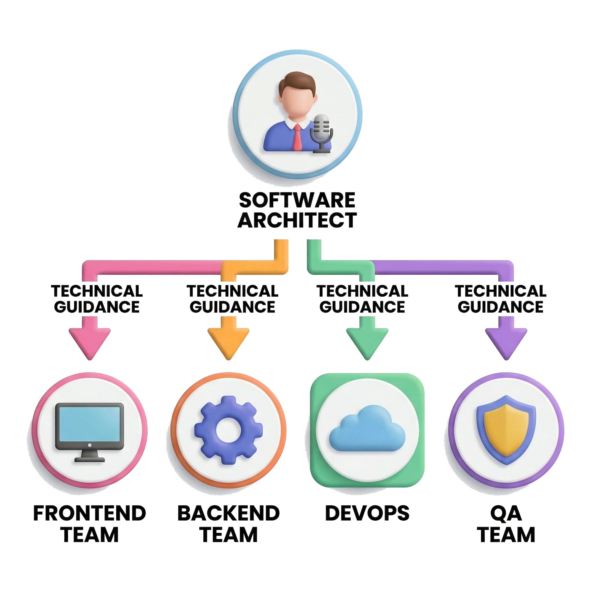

> 💡 **Giải thích:** Kiến trúc sư không đơn giản là "người code giỏi nhất" mà là người **nhìn toàn cục**: hiểu yêu cầu nghiệp vụ, hiểu giới hạn kỹ thuật, rồi đưa ra quyết định mà cả đội thực thi được. Quyết định kiến trúc sai từ đầu thường rất tốn kém để sửa về sau.

### Kiến Trúc vs. Thiết Kế Chi Tiết

> **Kiến trúc** định hình *cái gì* và *tại sao*; **thiết kế chi tiết** trả lời *như thế nào*.

| Tiêu chí | **Kiến trúc (Architecture)** | **Thiết kế Chi tiết (Detailed Design)** |
|---|---|---|
| Phạm vi | Toàn bộ hệ thống | Từng module, class, hàm |
| Quyết định | Chọn phong cách, phân chia module lớn | Thuật toán, cấu trúc dữ liệu, pattern |
| Người thực hiện | Kiến trúc sư phần mềm | Lập trình viên / tech lead |
| Thay đổi | Tốn kém, ảnh hưởng rộng | Linh hoạt hơn, ảnh hưởng cục bộ |

> 💡 **Giải thích:** Hai khái niệm này hay bị nhầm. So sánh với xây nhà: *kiến trúc* là quyết định "xây nhà 3 tầng, tầng trệt làm garage"; *thiết kế chi tiết* là chọn loại gạch, kiểu cửa. Cả hai đều quan trọng, nhưng kiến trúc phải quyết định **trước** và có tác động **lâu dài** hơn.

---

## 2. Các phong cách kiến trúc cổ điển

> 💡 **Giải thích:** Việc phân loại phong cách kiến trúc cho chúng ta một **ngôn ngữ chung** khi bàn về thiết kế — giống văn học có các thể loại tiểu thuyết, thơ, kịch, mỗi thể loại có quy tắc và đặc trưng riêng. Bài học đi qua 3 nhóm chính và từng phong cách cụ thể trong mỗi nhóm.

### Phân Loại Phong Cách Kiến Trúc

> **Phong cách kiến trúc** (*Architectural Style*) là một mẫu tổ chức hệ thống tổng quát — định nghĩa cách các thành phần tương tác và luồng dữ liệu chảy qua hệ thống.

- **Data Flow Styles**: dữ liệu chảy qua chuỗi biến đổi tuần tự
- **Call and Return Styles**: các thành phần gọi nhau theo cấu trúc phân cấp
- **Independent Components**: các thành phần hoạt động độc lập, giao tiếp qua sự kiện

### Sơ đồ phân loại phong cách kiến trúc

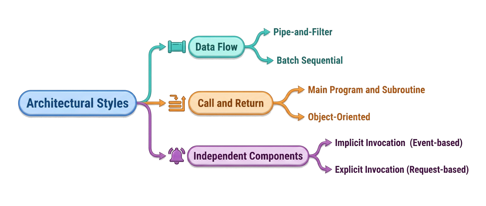

Hình minh họa: cây phân loại với gốc "Architectural Styles" tách thành 3 nhánh — Data Flow (biểu tượng đường ống), Call and Return (biểu tượng call stack), Independent Components (biểu tượng chuông sự kiện) — mỗi nhánh có các phong cách con.

> 📌 **Mở rộng:** Theo nội dung bài, cây phân loại có thể tóm như sau:
>
> ```text
> Architectural Styles
> ├── Data Flow
> │   ├── Pipe-and-Filter
> │   └── Batch Sequential
> ├── Call and Return
> │   ├── Main Program & Subroutine
> │   ├── Object-Oriented Systems
> │   └── Layered
> └── Independent Components
>     └── Event-based / Implicit Invocation
> ```

### Data Flow — Pipe-and-Filter

> Dữ liệu chảy qua một chuỗi **bộ lọc** (*filter*) kết nối bằng **đường ống** (*pipe*) — mỗi filter biến đổi dữ liệu đầu vào thành đầu ra.

- **Filter**: thành phần xử lý độc lập, không biết filter nào đứng trước/sau
- **Pipe**: kênh truyền dữ liệu một chiều giữa các filter
- **Ưu điểm**: dễ thêm/bỏ/hoán đổi filter, xử lý song song tự nhiên
- **Nhược điểm**: không phù hợp khi cần tương tác người dùng phức tạp
- **Ví dụ**: pipeline xử lý ảnh, compiler (lexer → parser → optimizer → codegen)

> 💡 **Giải thích:** Đây là một trong những phong cách lâu đời và "thanh lịch" nhất. Ví dụ kinh điển là Unix shell:
>
> ```bash
> cat file.txt | grep error | sort | uniq
> ```
>
> Mỗi lệnh (`cat`, `grep`, `sort`, `uniq`) là một **filter**, dấu `|` là **pipe**. Điểm mạnh lớn nhất là **tái sử dụng**: ghép các filter theo thứ tự khác nhau sẽ tạo ra hành vi mới.

### Sơ Đồ: Pipe-and-Filter

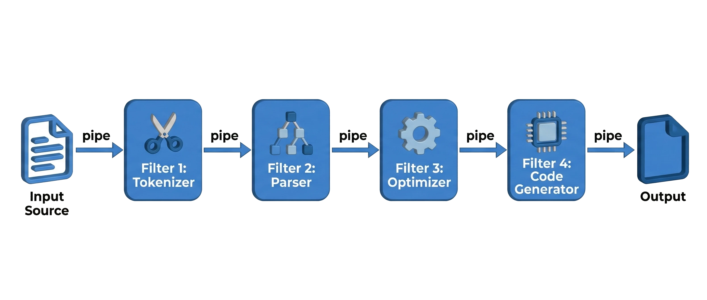

Hình minh họa: một pipeline 5 chặng — Input Source → Filter 1: Tokenizer → Filter 2: Parser → Filter 3: Optimizer → Filter 4: Code Generator → Output — nối với nhau bằng các mũi tên "pipe".

> 💡 **Giải thích:** Dữ liệu chỉ chảy **một chiều** (trái sang phải). Mỗi filter không biết dữ liệu đến từ đâu hay đi đâu — nó chỉ *nhận input → xử lý → trả output*. Chính vì vậy kiến trúc này **dễ kiểm thử** và **dễ tái sử dụng**.

### Data Flow — Batch Sequential

> Hệ thống xử lý dữ liệu theo **từng lô** (*batch*) qua các bước tuần tự — mỗi bước hoàn thành toàn bộ trước khi bước tiếp theo bắt đầu.

- **Đặc trưng**: không có tương tác người dùng trong quá trình xử lý
- **Khác với Pipe-and-Filter**: dữ liệu không chảy liên tục — mỗi bước chờ bước trước xong hẳn
- **Ưu điểm**: đơn giản, dễ kiểm soát, phù hợp xử lý khối lượng lớn
- **Nhược điểm**: độ trễ cao, không xử lý theo thời gian thực
- **Ví dụ**: xử lý bảng lương cuối tháng, ETL pipeline trong data warehouse

> 💡 **Giải thích:** Đây là phong cách cổ điển nhất, có từ thời mainframe. Hình dung một dây chuyền sản xuất mà công đoạn 1 phải làm xong **toàn bộ** sản phẩm rồi mới chuyển sang công đoạn 2. Dù đơn giản, nó vẫn rất phổ biến trong ngân hàng, kế toán — nơi **tính chính xác** quan trọng hơn tốc độ phản hồi tức thời.

### Sơ Đồ: Batch Sequential

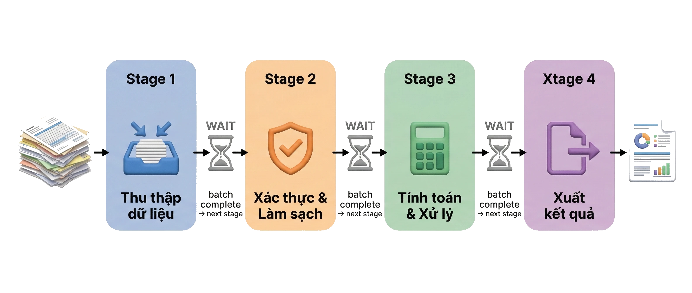

Hình minh họa: 4 giai đoạn xếp từ trái sang phải — Stage 1: Thu thập dữ liệu → Stage 2: Xác thực & Làm sạch → Stage 3: Tính toán & Xử lý → Stage 4: Xuất kết quả — giữa mỗi giai đoạn có rào cản "WAIT" (đồng hồ cát), mũi tên ghi "batch complete → next stage".

> 💡 **Giải thích:** Điểm khác then chốt so với Pipe-and-Filter là các rào cản **WAIT**. Ở Pipe-and-Filter, dữ liệu chảy liên tục: bản ghi đầu có thể đang ở Filter 3 trong khi bản ghi mới vừa vào Filter 1. Ở Batch Sequential, **cả lô** phải xong Stage 1 thì Stage 2 mới bắt đầu. Nhờ vậy dữ liệu **nhất quán tại mỗi checkpoint** — rất quan trọng với nghiệp vụ tài chính.

### Call and Return — Main Program & Subroutine

> Chương trình chính (*main program*) điều phối luồng thực thi bằng cách gọi các **chương trình con** (*subroutine*) theo thứ tự xác định.

- **Cấu trúc phân cấp**: main → subroutine cấp 1 → subroutine cấp 2
- **Luồng điều khiển**: hoàn toàn tập trung tại main program
- **Ưu điểm**: dễ hiểu, dễ debug, theo dõi luồng thực thi tuyến tính
- **Nhược điểm**: khó mở rộng, main program dễ trở nên phức tạp (*god object*)
- **Ví dụ**: các chương trình thủ tục cổ điển viết bằng C, Pascal, COBOL

> 💡 **Giải thích:** Đây là kiểu lập trình mà hầu hết sinh viên quen từ khi học cơ bản: `main()` gọi hàm con, hàm con gọi hàm con khác → tạo thành **cây gọi hàm**. Nhược điểm lớn nhất: khi hệ thống phức tạp, `main` trở thành "thần" kiểm soát mọi thứ — vi phạm nguyên tắc **Single Responsibility**.

### Sơ Đồ: Main Program & Subroutine

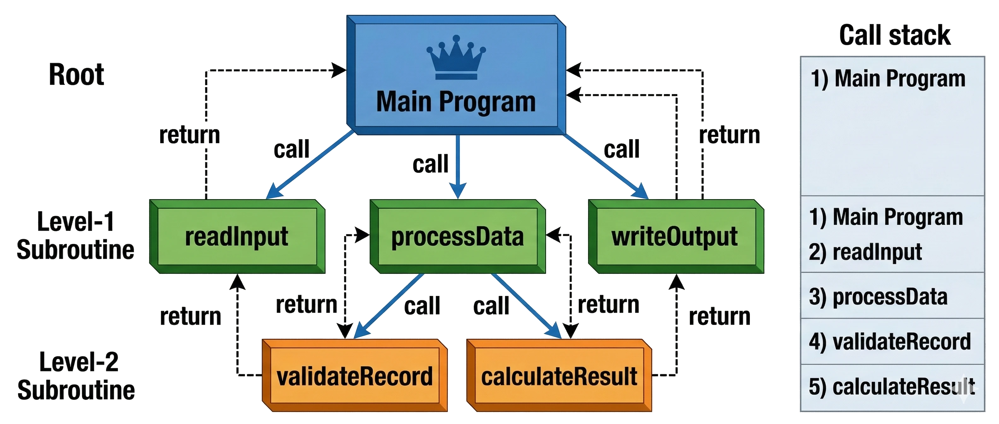

Hình minh họa: Main Program ở trên cùng gọi 3 subroutine cấp 1 (`readInput`, `processData`, `writeOutput`); `processData` lại gọi 2 subroutine cấp 2 (`validateRecord`, `calculateResult`); mũi tên "call" đi xuống, mũi tên nét đứt "return" đi lên; bên phải là bảng call stack với thứ tự thực thi 1→2→3→4→5.

> 💡 **Giải thích:** Luồng điều khiển xuất phát hoàn toàn từ Main Program. Bảng stack bên phải mô phỏng **call stack** thật trong bộ nhớ: khi `main` gọi `processData`, rồi `processData` gọi `validateRecord`, thì `validateRecord` phải chạy xong và trả về trước khi `processData` tiếp tục. Đây là kiểu **synchronous** và **blocking** hoàn toàn — đặc trưng của Call and Return.
>
> 📌 **Mở rộng:** Phác họa bằng mã giả:
>
> ```c
> int main(void) {
>     readInput();      // 1
>     processData();    // 2 -> gọi validateRecord() (3), calculateResult() (4)
>     writeOutput();    // 5
>     return 0;
> }
> ```

### Call and Return — Hệ Thống Hướng Đối Tượng

> **Hệ thống hướng đối tượng** (*OO Systems*) tổ chức code thành các **đối tượng** tự quản lý trạng thái và hành vi của mình, giao tiếp qua **gửi thông điệp**.

- **Đóng gói** (*Encapsulation*): đối tượng che giấu trạng thái nội tại
- **Kế thừa** (*Inheritance*): tái sử dụng và mở rộng hành vi
- **Đa hình** (*Polymorphism*): cùng interface, nhiều cách thực thi khác nhau
- **Ưu điểm**: mô hình hóa tự nhiên, dễ tái sử dụng, dễ mở rộng
- **Ví dụ**: Java EE applications, C++ systems, Python frameworks

> 💡 **Giải thích:** OO vẫn là Call and Return, nhưng **phân tán trách nhiệm** ra nhiều đối tượng thay vì dồn hết vào main program — mỗi đối tượng lo một phần logic. Đây là bước tiến lớn so với Main Program & Subroutine. Lưu ý: OO là **cách tổ chức code**, không phải một ngôn ngữ — bạn hoàn toàn có thể viết theo phong cách OO bằng C.

### Sơ Đồ: OO Systems — Giao Tiếp Qua Thông Điệp

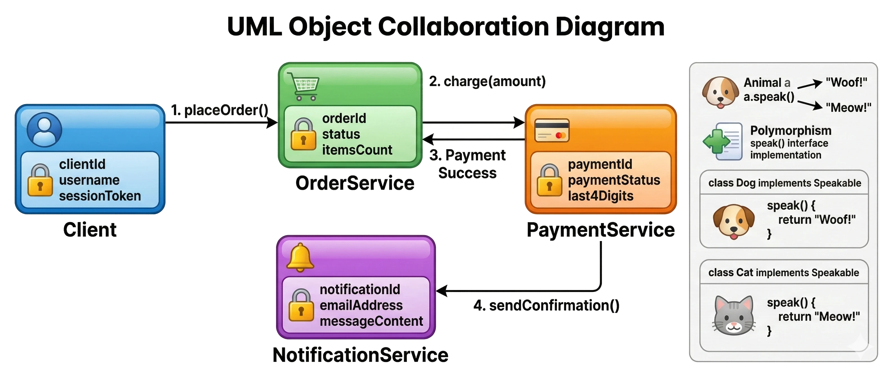

Hình minh họa: 4 đối tượng `Client`, `OrderService`, `PaymentService`, `NotificationService` gửi thông điệp cho nhau qua các lời gọi `placeOrder()`, `charge(amount)`, `sendConfirmation()`; mỗi đối tượng có trạng thái riêng (ví dụ `orderId, status`) bị "khóa" lại để thể hiện đóng gói; một ô phụ minh họa đa hình: `Dog` và `Cat` cùng cài đặt `speak()` nhưng cho kết quả khác nhau.

> 💡 **Giải thích:** Mấu chốt: mỗi đối tượng có **vùng trạng thái riêng được che giấu**, không đối tượng nào truy cập trực tiếp dữ liệu nội tại của đối tượng khác — mọi tương tác đều qua **thông điệp** (method call). So với Main Program & Subroutine, nơi dữ liệu thường là **biến global** mà subroutine nào cũng đọc/ghi được, OO **đảo ngược** điều này: đối tượng sở hữu dữ liệu và chỉ cung cấp giao diện có kiểm soát.
>
> 📌 **Mở rộng:** Ví dụ đa hình `Dog`/`Cat` trong hình, viết bằng Java:
>
> ```java
> interface Animal {
>     String speak();
> }
>
> class Dog implements Animal {
>     public String speak() { return "Woof"; }
> }
>
> class Cat implements Animal {
>     public String speak() { return "Meow"; }
> }
> ```

### Call and Return — Layered Architecture

> **Kiến trúc phân lớp** (*Layered Architecture*) tổ chức hệ thống thành các **lớp xếp chồng** — mỗi lớp chỉ sử dụng dịch vụ của lớp ngay bên dưới và cung cấp dịch vụ cho lớp ngay bên trên.

- **Phân tách trách nhiệm**: mỗi lớp có một vai trò rõ ràng
- **Nguyên tắc**: lớp trên *gọi xuống*, lớp dưới *không biết* lớp trên tồn tại
- **Ưu điểm**: dễ thay thế từng lớp, dễ kiểm thử từng tầng độc lập
- **Nhược điểm**: yêu cầu phải đi qua nhiều lớp, có thể gây overhead
- **Ví dụ điển hình**: Presentation → Business Logic → Data Access → Database

> 💡 **Giải thích:** Đây là phong cách phổ biến nhất trong ứng dụng doanh nghiệp. Nguyên tắc cốt lõi: **dependency chỉ đi một chiều, từ trên xuống**. Presentation không bao giờ chạm thẳng vào Database mà phải đi qua Business Logic rồi Data Access → tách biệt rõ, dễ bảo trì. Kiến trúc này được xem kỹ hơn ở Phần 4.

### Sơ Đồ: Layered Architecture — Luồng Gọi

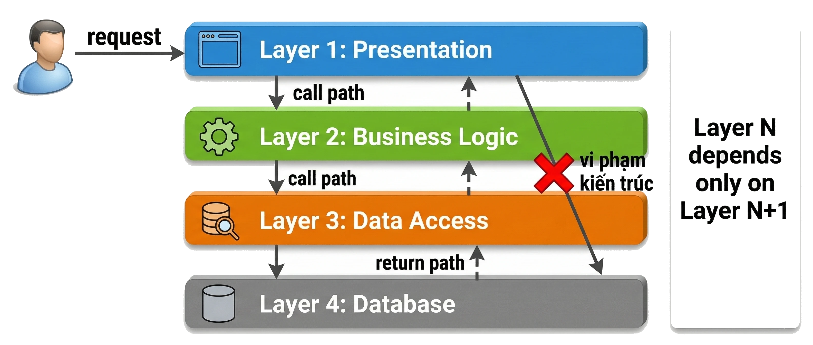

Hình minh họa: 4 lớp xếp chồng Presentation → Business Logic → Data Access → Database; người dùng gửi request vào lớp Presentation; mũi tên liền "call path" đi thẳng xuống, mũi tên nét đứt "return path" đi lên; một mũi tên chéo từ Presentation thẳng tới Database bị gạch chéo đỏ với nhãn "vi phạm kiến trúc"; bên phải ghi quy tắc phụ thuộc "Layer N depends only on Layer N+1".

> 💡 **Giải thích:** Chi tiết quan trọng là mũi tên đỏ **"vi phạm kiến trúc"** — lỗi phổ biến nhất khi làm Layered: vì lười hoặc gấp deadline, lập trình viên truy cập thẳng database từ Presentation. Code vẫn chạy, nhưng tính cô lập giữa các lớp đã bị phá: khi đổi database, bạn phải sửa cả Presentation. Thông điệp: **kiến trúc là kỷ luật, không phải gợi ý**.

### Independent Components — Event-based / Implicit Invocation

> Các thành phần **không gọi nhau trực tiếp** — thay vào đó, chúng **phát sự kiện** (*emit events*) và **đăng ký lắng nghe** (*subscribe*) sự kiện từ các thành phần khác.

- **Khớp nối lỏng** (*loose coupling*): thành phần phát sự kiện không biết ai xử lý
- **Implicit Invocation**: việc gọi xảy ra ngầm định qua cơ chế sự kiện
- **Ưu điểm**: dễ thêm thành phần mới mà không sửa code cũ
- **Nhược điểm**: khó theo dõi luồng thực thi, khó debug
- **Ví dụ**: GUI frameworks (onClick, onChange), message queues (Kafka, RabbitMQ)

> 💡 **Giải thích:** Đây là một sự **thay đổi tư duy**. Trong Call and Return, component A biết rõ mình đang gọi B. Trong Event-based, A chỉ thông báo "sự kiện X đã xảy ra" và không biết ai sẽ phản ứng. Rất linh hoạt, nhưng khi debug bạn phải lần theo **luồng sự kiện** thay vì luồng gọi hàm.

### Event-based — Call and Return vs. Implicit Invocation

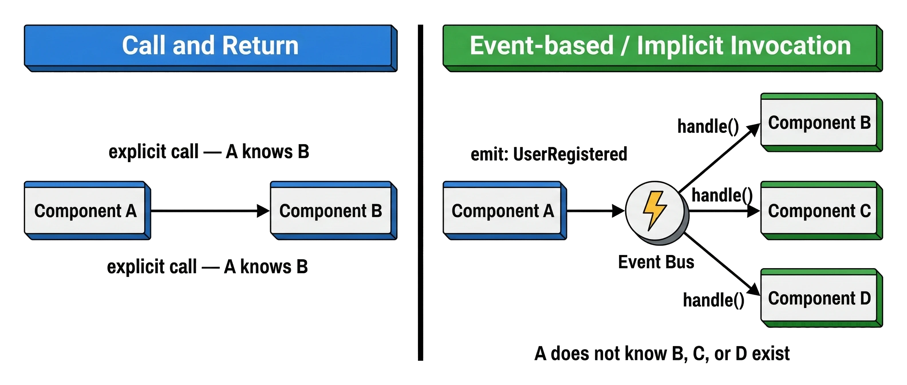

Hình minh họa: hai nửa đối lập — bên trái "Call and Return": A gọi trực tiếp B ("explicit call — A knows B"); bên phải "Event-based / Implicit Invocation": A phát sự kiện `UserRegistered` vào một Event Bus, Event Bus chuyển tới B, C, D qua `handle()`, kèm ghi chú "A does not know B, C, or D exist".

> 💡 **Giải thích:** Bên trái, A và B **bị buộc chặt**: muốn thêm C xử lý cùng việc đó thì phải sửa code A. Bên phải, chỉ cần **đăng ký C vào Event Bus**, A không cần biết và không phải thay đổi. Đây chính là nguyên tắc **Open/Closed** (mở để mở rộng, đóng để sửa đổi) — Event-based thực thi nguyên tắc này ở **cấp độ kiến trúc**.
>
> 📌 **Mở rộng:** Phác họa Event Bus tối giản bằng Python:
>
> ```python
> class EventBus:
>     def __init__(self):
>         self.handlers = {}
>
>     def subscribe(self, event, handler):
>         self.handlers.setdefault(event, []).append(handler)
>
>     def emit(self, event, data):
>         for handler in self.handlers.get(event, []):
>             handler(data)
>
> bus = EventBus()
> bus.subscribe("UserRegistered", lambda u: print("Send welcome email to", u))
> bus.subscribe("UserRegistered", lambda u: print("Grant reward points to", u))
> bus.emit("UserRegistered", "alice")   # A không biết có bao nhiêu handler
> ```

---

## 3. Lựa chọn phong cách kiến trúc

### Tiêu Chí Lựa Chọn Kiến Trúc

> Không có phong cách kiến trúc nào là tốt nhất tuyệt đối — mỗi lựa chọn là một **đánh đổi** (*trade-off*) dựa trên ngữ cảnh cụ thể.

- **Yêu cầu chức năng**: hệ thống cần làm gì? (streaming, batch, interactive?)
- **Yêu cầu phi chức năng**: hiệu năng, độ trễ, khả năng mở rộng, bảo mật
- **Đội ngũ**: kinh nghiệm và quy mô của team phát triển
- **Thời gian và ngân sách**: độ phức tạp triển khai và vận hành
- **Khả năng thay đổi**: hệ thống có thường xuyên mở rộng tính năng không?

> 💡 **Giải thích:** Kiến trúc sư không chỉ nhìn yêu cầu kỹ thuật mà còn phải tự hỏi: team đã có kinh nghiệm với phong cách này chưa? Có đủ thời gian để làm **đúng cách** không? Hệ thống sẽ phát triển theo hướng nào trong **3–5 năm** tới? Lưu ý: một kiến trúc **quá phức tạp so với nhu cầu thực tế** cũng là một lỗi thiết kế.

### So Sánh Các Phong Cách Kiến Trúc

> Mỗi phong cách phù hợp với một nhóm bài toán khác nhau — hiểu rõ đặc trưng giúp lựa chọn đúng.

| Phong cách | Phù hợp khi | Tránh khi |
|---|---|---|
| **Pipe-and-Filter** | Xử lý luồng dữ liệu tuần tự | Cần tương tác người dùng |
| **Batch Sequential** | Xử lý khối lượng lớn, không thời gian thực | Cần phản hồi tức thì |
| **Layered** | Ứng dụng doanh nghiệp, dễ bảo trì | Hiệu năng cao, độ trễ thấp |
| **OO Systems** | Mô hình hóa nghiệp vụ phức tạp | Xử lý dữ liệu thuần túy |
| **Event-driven** | Hệ thống phân tán, mở rộng linh hoạt | Cần luồng thực thi rõ ràng |

> 💡 **Giải thích:** Bảng này là công cụ tra cứu nhanh. Thực tế, hầu hết hệ thống lớn **kết hợp nhiều phong cách**. Ví dụ một trang thương mại điện tử: **Layered** cho core business logic, **Event-driven** cho thông báo và tích hợp bên thứ ba, **Batch Sequential** cho báo cáo định kỳ.

---

## 4. Các phong cách kiến trúc phổ biến

### Layered Architecture

> Thuộc nhóm **Call and Return Styles** — hệ thống được tổ chức thành các lớp xếp chồng, mỗi lớp phục vụ lớp trên và sử dụng lớp dưới.

**4 lớp điển hình:**

- **Presentation Layer**: giao diện người dùng (UI/API)
- **Business Logic Layer**: quy tắc nghiệp vụ, xử lý logic
- **Data Access Layer**: truy vấn và thao tác với dữ liệu
- **Database Layer**: lưu trữ dữ liệu vật lý

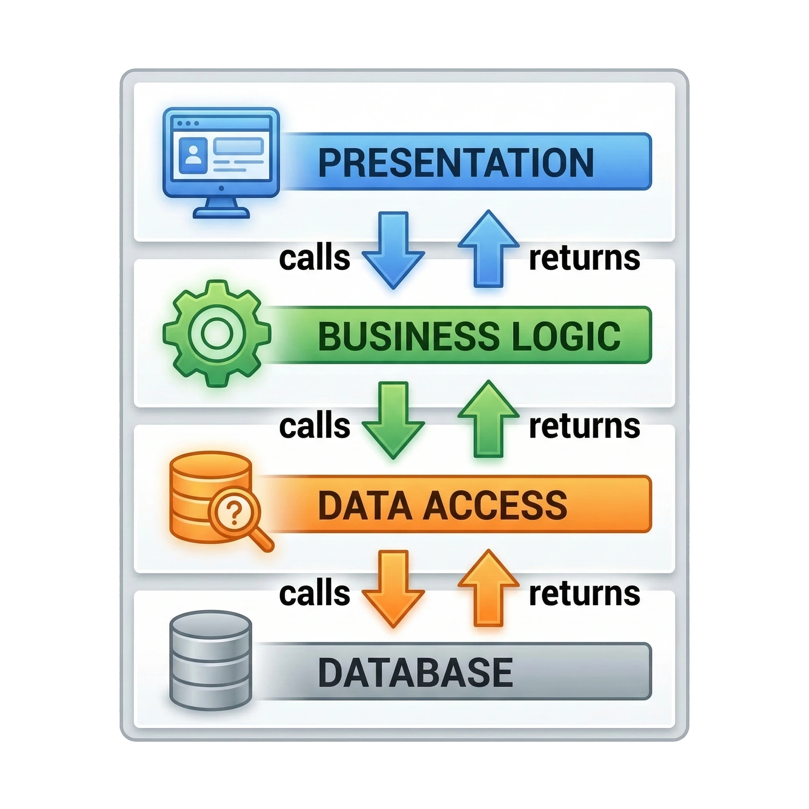

> 💡 **Giải thích:** Đây là kiến trúc bạn gần như chắc chắn gặp trong dự án thực tế đầu tiên. **Nguyên tắc vàng**: dependency chỉ đi từ trên xuống. Nếu thấy lớp Business Logic `import` trực tiếp từ lớp Presentation → đó là dấu hiệu vi phạm kiến trúc. Lợi ích lớn nhất là **khả năng thay thế**: có thể đổi từ REST API sang GraphQL (lớp Presentation) mà không phải sửa Business Logic.

### Layered Architecture — Ưu và Nhược Điểm

> **Layered Architecture** đạt được sự cân bằng tốt giữa tính tổ chức và độ phức tạp — phù hợp với đa số ứng dụng doanh nghiệp vừa và nhỏ.

- **Separation of Concerns**: mỗi lớp có trách nhiệm rõ ràng và độc lập
- **Testability**: có thể kiểm thử từng lớp bằng cách mock lớp phụ thuộc
- **Maintainability**: thay đổi một lớp ít ảnh hưởng đến các lớp còn lại
- **Overhead**: mọi request đều phải đi qua tất cả các lớp, dù đơn giản
- **Anemic Domain Model**: nguy cơ Business Logic chỉ là lớp trung gian rỗng

(Ba ý đầu là **ưu điểm**, hai ý cuối là **nhược điểm**.)

> 💡 **Giải thích:** Nhược điểm "overhead" thường bị **phóng đại**: với web app thông thường, chi phí gọi hàm qua các lớp gần như không đáng kể so với chi phí network hay database. Vấn đề **thực sự** đáng lo hơn là **Anemic Domain Model** — khi Business Logic Layer chỉ chuyền dữ liệu qua lại mà không chứa logic nghiệp vụ thật, đi ngược mục đích ban đầu của kiến trúc này.
>
> 📌 **Mở rộng:** "Anemic" nghĩa là "thiếu máu": các đối tượng domain chỉ có getter/setter, còn toàn bộ quy tắc nghiệp vụ bị đẩy sang nơi khác (Controller, SQL...). Ví dụ một `OrderService.placeOrder()` chỉ gọi thẳng `orderRepository.save(order)` mà không kiểm tra tồn kho, giới hạn, khuyến mãi... thì lớp Business Logic đang "rỗng".

### Client-Server Architecture

> Thuộc nhóm **Call and Return Styles** — hệ thống phân chia thành **client** (yêu cầu dịch vụ) và **server** (cung cấp dịch vụ), giao tiếp qua mạng.

- **Client**: khởi tạo yêu cầu, hiển thị kết quả cho người dùng
- **Server**: lắng nghe, xử lý yêu cầu, trả về phản hồi
- **Giao tiếp**: request-response qua HTTP, TCP, hoặc RPC
- **Ưu điểm**: tập trung hóa dữ liệu, dễ quản lý bảo mật và cập nhật
- **Ví dụ**: trình duyệt web ↔ web server, mobile app ↔ REST API

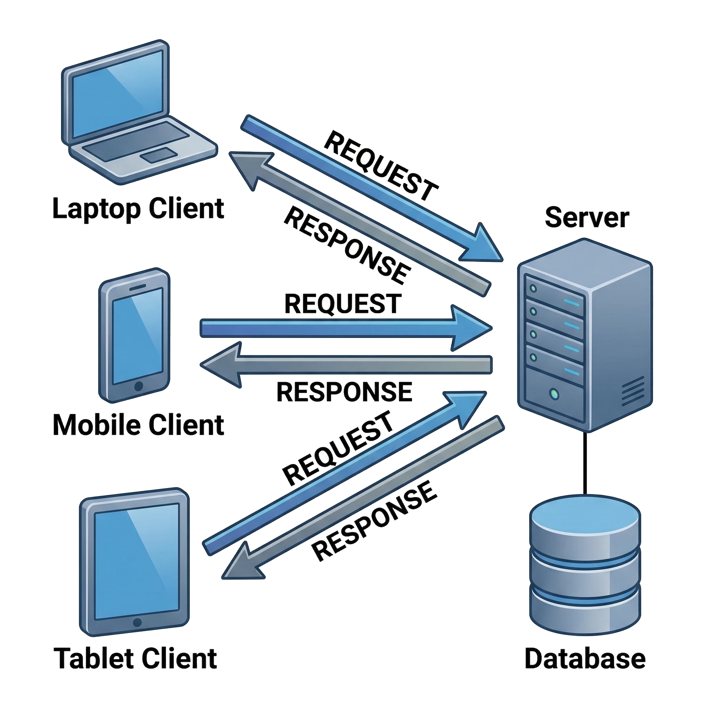

> 💡 **Giải thích:** Client-Server là nền tảng của Internet — mỗi lần bạn mở trình duyệt vào một trang web là một giao dịch Client-Server. **Điểm mạnh**: server là **nguồn sự thật duy nhất** (*single source of truth*), dữ liệu không bị phân tán ra các máy client. **Điểm yếu**: server là **điểm tập trung** — server sự cố thì mọi client đều bị ảnh hưởng.

### Peer-to-Peer Architecture

> Thuộc nhóm **Independent Components** — mỗi node (*peer*) vừa đóng vai **client** vừa đóng vai **server**, không có node trung tâm điều phối.

- **Phi tập trung**: không có server trung tâm, mọi node bình đẳng
- **Khả năng phục hồi**: hệ thống tiếp tục hoạt động dù nhiều node bị mất
- **Khả năng mở rộng**: thêm node tự động tăng tài nguyên hệ thống
- **Nhược điểm**: khó quản lý bảo mật, khó đảm bảo tính nhất quán dữ liệu
- **Ví dụ**: BitTorrent, blockchain, Skype (trước khi chuyển sang server-based)

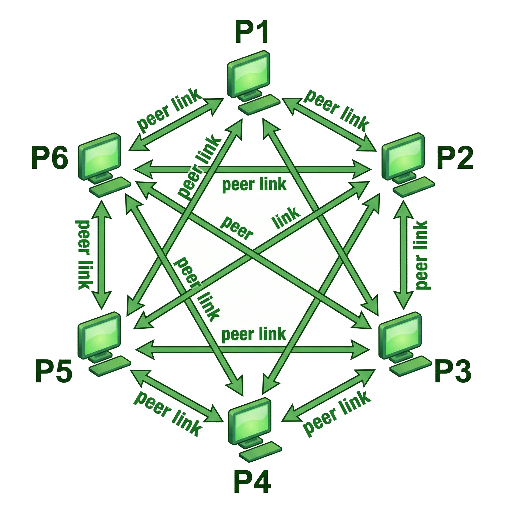

> 💡 **Giải thích:** P2P là **đối cực** của Client-Server: thay vì một server phục vụ nhiều client, mỗi máy vừa là client vừa là server. **BitTorrent**: khi bạn tải file, bạn đồng thời upload phần đã tải cho người khác. **Blockchain**: mỗi node giữ một bản sao đầy đủ của sổ cái (*ledger*) và tham gia xác thực giao dịch.

### So Sánh: Client-Server vs. Peer-to-Peer

> **Client-Server** tối ưu cho kiểm soát tập trung; **Peer-to-Peer** tối ưu cho khả năng phục hồi và mở rộng phi tập trung.

| **Client-Server** | **Peer-to-Peer** |
|---|---|
| Dễ quản lý, bảo mật tập trung | Không có điểm nghẽn trung tâm |
| Server là điểm nghẽn (*bottleneck*) | Khó kiểm soát, bảo mật phức tạp hơn |
| Phụ thuộc vào tính sẵn sàng của server | Tiếp tục hoạt động dù mất nhiều node |
| Dữ liệu nhất quán, dễ kiểm soát | Đồng bộ dữ liệu phức tạp |
| Phù hợp: web app, mobile app, SaaS | Phù hợp: file sharing, blockchain, CDN |

> 💡 **Giải thích:** Thực tế nhiều hệ thống **kết hợp cả hai**. Skype ban đầu dùng P2P thuần — hiệu quả nhưng khó kiểm soát nội dung và bảo mật. Sau khi Microsoft mua lại, Skype chuyển sang mô hình **hybrid** với các super-node là server trung tâm. Đây là ví dụ điển hình của **trade-off giữa hiệu năng và khả năng quản lý**.

### Event-driven Architecture

> Thuộc nhóm **Independent Components** — các thành phần giao tiếp qua **sự kiện** (*events*) thay vì gọi nhau trực tiếp, tạo ra **khớp nối lỏng** hoàn toàn.

- **Event Producer**: phát sự kiện khi có thay đổi trạng thái
- **Event Broker**: trung gian định tuyến sự kiện (Kafka, RabbitMQ)
- **Event Consumer**: đăng ký và xử lý các sự kiện quan tâm
- **Ưu điểm**: dễ mở rộng, thêm consumer mà không sửa producer
- **Ví dụ**: hệ thống thông báo, microservices integration, IoT

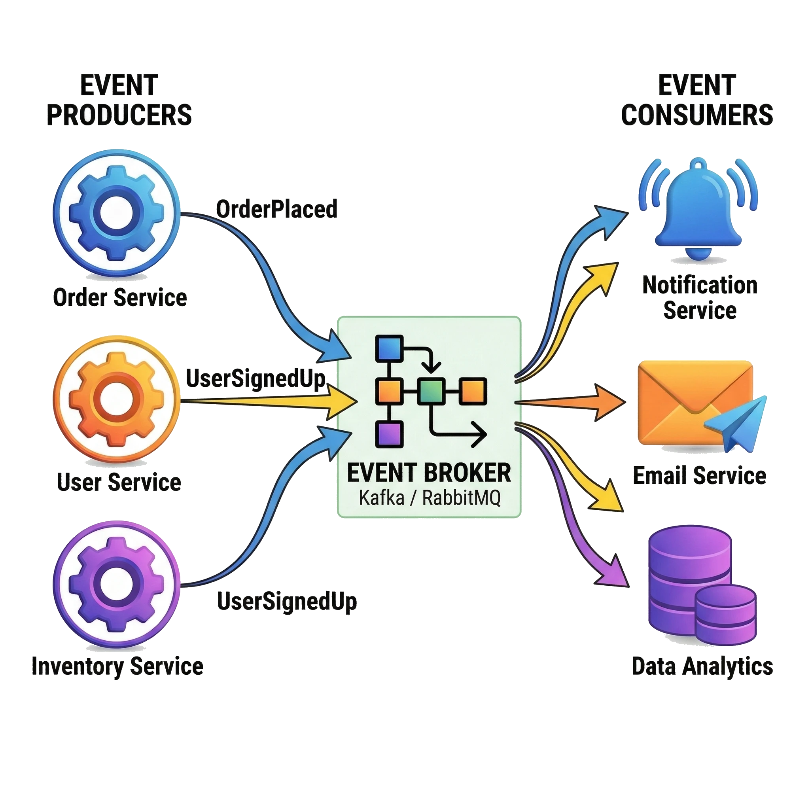

> 💡 **Giải thích:** Thay vì A gọi B trực tiếp, A chỉ báo "sự kiện X đã xảy ra" và không quan tâm ai xử lý. Nhờ đó có thể **thêm tính năng mới bằng cách thêm consumer mới**, không phải sửa code hiện có — đó là sức mạnh thực sự của kiến trúc này. **Kafka** là công nghệ phổ biến nhất hiện nay cho vai trò Event Broker.
>
> 📌 **Mở rộng:** *Event-based / Implicit Invocation* là **phong cách** ở mức khái niệm (có thể chạy ngay trong một tiến trình, ví dụ `onClick` của GUI); *Event-driven Architecture* là cách áp dụng phong cách đó ở mức **hệ thống phân tán**, có thêm thành phần Event Broker riêng.

### Service-Oriented Architecture (SOA)

> Thuộc nhóm **Call and Return Styles** — hệ thống được xây dựng từ các **dịch vụ** (*services*) độc lập, giao tiếp qua giao thức chuẩn, có thể tái sử dụng và kết hợp linh hoạt.

- **Service**: đơn vị chức năng độc lập, có interface rõ ràng
- **Loose Coupling**: dịch vụ không phụ thuộc vào implementation của nhau
- **Reusability**: dịch vụ được tái sử dụng bởi nhiều ứng dụng khác nhau
- **Interoperability**: giao tiếp qua chuẩn mở (SOAP, REST, gRPC)
- **Ví dụ**: hệ thống doanh nghiệp tích hợp ERP, CRM, và billing

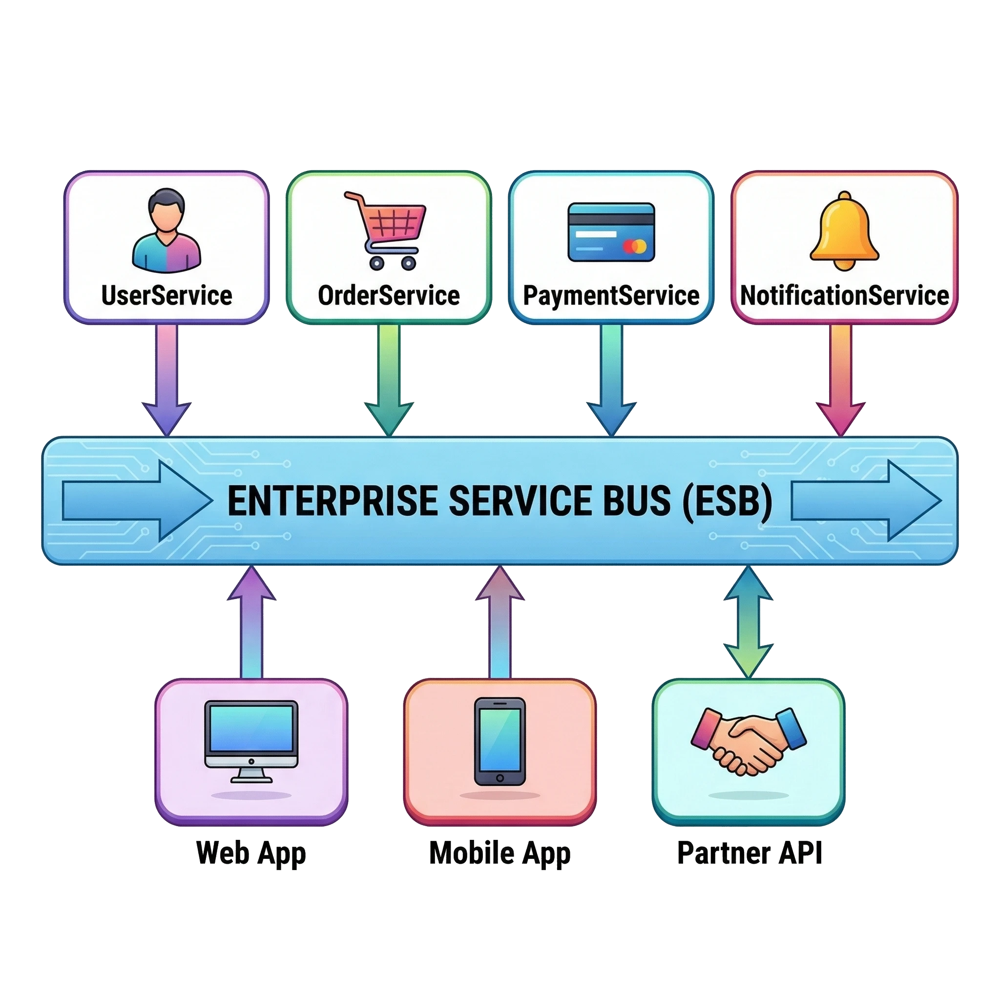

> 💡 **Giải thích:** SOA ra đời khoảng **những năm 2000** để giải bài toán **tích hợp hệ thống doanh nghiệp**. Thay vì các ứng dụng nối trực tiếp với nhau thành một "mạng nhện" rối rắm, mọi giao tiếp đi qua **Enterprise Service Bus (ESB)**. ESB không chỉ truyền dữ liệu mà còn lo:
>
> - **Routing**: gửi request tới đúng service
> - **Transformation**: chuyển đổi định dạng dữ liệu
> - **Orchestration**: điều phối quy trình nghiệp vụ phức tạp liên quan nhiều service
>
> SOA là **tiền thân trực tiếp của Microservices** — phần lớn khái niệm giống nhau, nhưng Microservices đẩy xa hơn về mức độ tách biệt và **triển khai độc lập**, và phân tán logic orchestration vào từng service thay vì dồn vào ESB.

---

## 5. Bài tập áp dụng

> Đề bài đầy đủ kèm gợi ý lời giải nằm ở mục [📝 Bài tập](#-bài-tập) cuối file.

### Bài Tập 1: Nhận Diện Phong Cách Kiến Trúc

Cho mỗi mô tả hệ thống bên dưới, hãy xác định **phong cách kiến trúc** phù hợp nhất và giải thích lý do.

**Tình huống A — Hệ thống xử lý ảnh y tế:**
Mỗi đêm, bệnh viện chạy một job tự động: đọc 10.000 ảnh X-quang từ thiết bị, chuyển đổi sang định dạng chuẩn, phân tích bất thường bằng AI, lưu kết quả vào hồ sơ bệnh nhân. Không có người dùng tương tác trong quá trình này.

**Tình huống B — Ứng dụng đặt vé máy bay:**
Người dùng truy cập web, tìm kiếm chuyến bay, đặt vé và thanh toán. Hệ thống cần phân tách rõ giữa giao diện, quy tắc nghiệp vụ đặt vé, và truy cập cơ sở dữ liệu chuyến bay.

### Bài Tập 1 (tiếp)

**Tình huống C — Hệ thống thông báo đa kênh:**
Khi người dùng đăng ký tài khoản, hệ thống cần đồng thời: gửi email chào mừng, gửi SMS xác thực, tạo hồ sơ analytics, và cấp điểm thưởng. Mỗi tác vụ do một module riêng biệt xử lý.

> 💡 **Giải thích:** Đây là bài tập **nhận diện** — dùng đặc trưng của từng phong cách để phân loại. Trên lớp dành 5–7 phút thảo luận nhóm trước khi chốt đáp án (xem gợi ý cuối file).

### Bài Tập 2: Phân Tích Trade-Offs

Một startup đang xây dựng nền tảng **chia sẻ tài liệu học tập** cho sinh viên. Hãy phân tích ưu và nhược điểm của hai phương án kiến trúc được đề xuất.

**Phương án X — Client-Server:**
Một server trung tâm lưu toàn bộ tài liệu. Sinh viên upload và download thông qua web app. Server xử lý xác thực, phân quyền, và giới hạn dung lượng.

**Phương án Y — Peer-to-Peer:**
Mỗi sinh viên cài app trên máy tính. Tài liệu được chia sẻ trực tiếp giữa các máy qua mạng P2P. Không có server trung tâm lưu trữ nội dung.

### Bài Tập 2 (tiếp): Câu hỏi thảo luận

**Câu hỏi thảo luận:**

- Phương án nào dễ kiểm soát vi phạm bản quyền hơn?
- Phương án nào hoạt động tốt hơn khi số lượng sinh viên tăng gấp 10 lần?
- Trường đại học nên chọn phương án nào? Tại sao?

> 💡 **Giải thích:** Bài này **không có đáp án tuyệt đối**; mục tiêu là buộc bạn suy nghĩ về trade-off thực tế (xem gợi ý cuối file).

### Bài Tập 3: Thiết Kế Kiến Trúc Mini

> Nhóm 3-4 sinh viên. Thời gian: 10 phút. Vẽ sơ đồ kiến trúc cho hệ thống sau.

**Yêu cầu hệ thống: Ứng dụng Giao đồ ăn**

- Khách hàng đặt món qua mobile app
- Nhà hàng nhận đơn và xác nhận
- Tài xế nhận thông báo đơn cần giao
- Hệ thống theo dõi vị trí tài xế theo thời gian thực
- Sau khi giao xong: tự động gửi hóa đơn qua email và trừ tiền ví

### Bài Tập 3 (tiếp): Yêu cầu bài nộp

**Yêu cầu bài nộp:**

1. Liệt kê các thành phần chính của hệ thống
2. Xác định phong cách kiến trúc cho từng phần (không nhất thiết một phong cách duy nhất)
3. Vẽ sơ đồ tương tác giữa các thành phần

> 💡 **Giải thích:** Bài thiết kế **mở**, không có đáp án duy nhất. Mục đích là để bạn nhận ra hệ thống thực tế thường là **hybrid** của nhiều phong cách (xem gợi ý cuối file).

---

## 6. Tóm tắt

### Tóm Tắt

> Kiến trúc phần mềm là nền tảng của mọi hệ thống — lựa chọn phong cách kiến trúc đúng sẽ quyết định khả năng phát triển và bảo trì lâu dài.

- **Kiến trúc** định hình toàn bộ hệ thống; **thiết kế chi tiết** giải quyết từng thành phần
- **Data Flow**: Pipe-and-Filter (streaming) và Batch Sequential (xử lý lô)
- **Call and Return**: Main-Subroutine, OO Systems, Layered Architecture
- **Independent Components**: Event-based — khớp nối lỏng qua sự kiện
- **Kiến trúc cơ bản**: Layered, Client-Server, P2P, Event-driven, SOA — mỗi loại thuộc một phong cách và phù hợp với bài toán riêng

---

## 🧠 Tóm tắt nhanh

**Bảng so sánh các phong cách kiến trúc** (nhóm theo cách phân loại ở trên):

| Phong cách | Nhóm | Đặc điểm chính | Ưu điểm | Nhược điểm | Khi dùng | Ví dụ |
|---|---|---|---|---|---|---|
| **Pipe-and-Filter** | Data Flow | Dữ liệu chảy liên tục, một chiều qua các filter độc lập nối bằng pipe | Dễ thêm/bỏ/hoán đổi filter; song song tự nhiên; dễ test, tái sử dụng | Không hợp với tương tác người dùng phức tạp | Xử lý luồng dữ liệu tuần tự (streaming) | Unix pipe, compiler (lexer → parser → optimizer → codegen), pipeline xử lý ảnh |
| **Batch Sequential** | Data Flow | Xử lý theo lô; bước sau chờ bước trước xong **toàn bộ** (rào cản WAIT) | Đơn giản, dễ kiểm soát, hợp khối lượng lớn; dữ liệu nhất quán tại checkpoint | Độ trễ cao, không thời gian thực | Khối lượng lớn, không cần phản hồi tức thì | Bảng lương cuối tháng, ETL trong data warehouse |
| **Main Program & Subroutine** | Call and Return | Main điều phối, gọi subroutine theo cây phân cấp; đồng bộ, blocking | Dễ hiểu, dễ debug, luồng tuyến tính | Khó mở rộng; main dễ thành *god object*; dữ liệu hay là global | Chương trình thủ tục nhỏ/cổ điển | Chương trình C, Pascal, COBOL |
| **OO Systems** | Call and Return | Đối tượng tự quản lý trạng thái & hành vi, giao tiếp qua thông điệp | Mô hình hóa tự nhiên, tái sử dụng, dễ mở rộng (encapsulation, inheritance, polymorphism) | Không hợp xử lý dữ liệu thuần túy | Nghiệp vụ phức tạp | Java EE, hệ thống C++, framework Python |
| **Layered** | Call and Return | Các lớp xếp chồng; dependency chỉ đi từ trên xuống | Separation of Concerns, testability, maintainability; dễ thay từng lớp | Overhead qua nhiều lớp; nguy cơ Anemic Domain Model | Ứng dụng doanh nghiệp vừa và nhỏ | Presentation → Business Logic → Data Access → Database |
| **Client-Server** | Call and Return | Client gửi request, server xử lý và trả response qua mạng (HTTP, TCP, RPC) | Dữ liệu tập trung, nhất quán; dễ quản lý bảo mật, cập nhật | Server là bottleneck và điểm lỗi tập trung | Web app, mobile app, SaaS | Trình duyệt ↔ web server, mobile app ↔ REST API |
| **SOA** | Call and Return | Dịch vụ độc lập, interface rõ, giao tiếp chuẩn mở, thường qua ESB | Loose coupling, reusability, interoperability | ESB tập trung nhiều logic *(📌 Mở rộng: có thể thành điểm nghẽn/phức tạp)* | Tích hợp hệ thống doanh nghiệp | Tích hợp ERP, CRM, billing |
| **Event-based / Implicit Invocation** | Independent Components | Thành phần phát sự kiện & đăng ký lắng nghe, không gọi nhau trực tiếp | Loose coupling; thêm thành phần không sửa code cũ (Open/Closed) | Khó theo dõi luồng thực thi, khó debug | Cần mở rộng linh hoạt | GUI (`onClick`, `onChange`), message queue |
| **Event-driven** | Independent Components | Producer → Broker → Consumer | Thêm consumer không sửa producer; hợp hệ phân tán | Luồng thực thi không rõ ràng | Hệ phân tán, mở rộng linh hoạt | Hệ thống thông báo, tích hợp microservices, IoT (Kafka, RabbitMQ) |
| **Peer-to-Peer** | Independent Components | Mỗi peer vừa là client vừa là server, không có node trung tâm | Không có điểm nghẽn; chịu lỗi tốt; thêm node tăng tài nguyên | Khó bảo mật, khó kiểm soát; đồng bộ dữ liệu phức tạp | File sharing, hệ phi tập trung | BitTorrent, blockchain, CDN, Skype (thời đầu) |

**Ý chính cần nhớ:**

- Kiến trúc = *cái gì & tại sao*; thiết kế chi tiết = *như thế nào*.
- Không có kiến trúc "tốt nhất" — chỉ có **trade-off** phù hợp với ngữ cảnh (yêu cầu, team, thời gian/ngân sách, khả năng thay đổi).
- Hệ thống thực tế thường là **hybrid** của nhiều phong cách.
- Kiến trúc là **kỷ luật**: đi tắt (ví dụ Presentation gọi thẳng Database) là phá vỡ kiến trúc.

---

## ❓ Câu hỏi tự kiểm tra

**1.** Kiến trúc phần mềm gồm những yếu tố nào, và phải đáp ứng những loại yêu cầu nào?

<details><summary>Đáp án</summary>

Gồm **cấu trúc hệ thống** (các component lớn), **quan hệ** giữa các thành phần, và **nguyên tắc** chi phối thiết kế (công nghệ, giao tiếp, phân phối trách nhiệm). Nó phải đáp ứng cả **yêu cầu chức năng** (làm được gì) lẫn **phi chức năng** (hiệu năng, bảo mật, khả năng mở rộng).

</details>

**2.** Phân biệt kiến trúc và thiết kế chi tiết theo 4 tiêu chí: phạm vi, quyết định, người thực hiện, chi phí thay đổi.

<details><summary>Đáp án</summary>

- Kiến trúc: toàn hệ thống; chọn phong cách, chia module lớn; kiến trúc sư; thay đổi tốn kém, ảnh hưởng rộng.
- Thiết kế chi tiết: từng module/class/hàm; thuật toán, cấu trúc dữ liệu, pattern; lập trình viên/tech lead; thay đổi linh hoạt, ảnh hưởng cục bộ.

</details>

**3.** Kể tên 3 nhóm phong cách kiến trúc cổ điển và các phong cách con của mỗi nhóm.

<details><summary>Đáp án</summary>

- **Data Flow**: Pipe-and-Filter, Batch Sequential.
- **Call and Return**: Main Program & Subroutine, OO Systems, Layered.
- **Independent Components**: Event-based / Implicit Invocation.

</details>

**4.** Khác biệt then chốt giữa Pipe-and-Filter và Batch Sequential là gì? Vì sao nghiệp vụ tài chính hay dùng Batch Sequential?

<details><summary>Đáp án</summary>

Pipe-and-Filter cho dữ liệu **chảy liên tục** (bản ghi đầu có thể ở filter 3 khi bản ghi mới vào filter 1). Batch Sequential có rào cản **WAIT**: cả lô phải xong bước trước mới sang bước sau. Nhờ vậy dữ liệu **nhất quán tại mỗi checkpoint**, và ở tài chính tính chính xác quan trọng hơn phản hồi tức thời.

</details>

**5.** Trong lệnh `cat file.txt | grep error | sort | uniq`, đâu là filter, đâu là pipe? Ưu điểm lớn nhất của cách tổ chức này?

<details><summary>Đáp án</summary>

`cat`, `grep`, `sort`, `uniq` là các **filter**; ký tự `|` là **pipe**. Ưu điểm lớn nhất là **tái sử dụng**: ghép filter theo thứ tự khác nhau tạo hành vi mới; mỗi filter độc lập nên dễ test.

</details>

**6.** Vì sao Main Program & Subroutine khó mở rộng? OO Systems cải thiện điều gì?

<details><summary>Đáp án</summary>

Luồng điều khiển dồn hết vào main → main thành *god object*, vi phạm Single Responsibility; dữ liệu thường là biến global mà subroutine nào cũng đọc/ghi. OO **phân tán trách nhiệm** cho nhiều đối tượng, mỗi đối tượng **sở hữu và che giấu dữ liệu** của mình (encapsulation) và chỉ giao tiếp qua thông điệp.

</details>

**7.** Trong Layered Architecture, việc Presentation truy cập thẳng Database có hậu quả gì?

<details><summary>Đáp án</summary>

Đây là **vi phạm kiến trúc**: code vẫn chạy nhưng phá vỡ tính cô lập giữa các lớp. Khi đổi database, phải sửa cả Presentation. Nguyên tắc: dependency chỉ đi từ trên xuống, lớp N chỉ phụ thuộc lớp ngay dưới.

</details>

**8.** "Anemic Domain Model" là gì và tại sao nó được xem là vấn đề thực sự hơn "overhead" trong Layered?

<details><summary>Đáp án</summary>

Là khi Business Logic Layer chỉ là lớp trung gian rỗng, chuyền dữ liệu mà không chứa logic nghiệp vụ thật → đi ngược mục đích của kiến trúc. Overhead thường bị phóng đại vì chi phí gọi hàm qua lớp không đáng kể so với network/database.

</details>

**9.** Event-based / Implicit Invocation thể hiện nguyên tắc Open/Closed như thế nào? Nhược điểm chính là gì?

<details><summary>Đáp án</summary>

Component A chỉ phát sự kiện (vd. `UserRegistered`) vào Event Bus; muốn thêm xử lý mới chỉ cần **đăng ký thêm subscriber**, không phải sửa A → mở để mở rộng, đóng để sửa đổi. Nhược điểm: **khó theo dõi luồng thực thi, khó debug** vì phải lần theo luồng sự kiện.

</details>

**10.** Nêu 3 vai trò trong Event-driven Architecture và 1 công nghệ phổ biến cho vai trò trung gian.

<details><summary>Đáp án</summary>

**Event Producer** (phát sự kiện khi trạng thái đổi), **Event Broker** (định tuyến sự kiện), **Event Consumer** (đăng ký và xử lý sự kiện). Broker phổ biến nhất: **Kafka** (ngoài ra RabbitMQ).

</details>

**11.** So sánh Client-Server và Peer-to-Peer về điểm nghẽn, bảo mật, tính nhất quán dữ liệu và khả năng chịu lỗi. Mỗi bên thuộc nhóm phong cách nào?

<details><summary>Đáp án</summary>

- Client-Server (Call and Return): server là bottleneck và điểm lỗi tập trung; bảo mật tập trung, dễ quản lý; dữ liệu nhất quán.
- P2P (Independent Components): không có điểm nghẽn trung tâm; bảo mật phức tạp, khó kiểm soát; đồng bộ dữ liệu phức tạp; vẫn hoạt động dù mất nhiều node.

</details>

**12.** ESB trong SOA đảm nhiệm những chức năng gì? SOA khác Microservices ở điểm nào?

<details><summary>Đáp án</summary>

ESB làm **routing** (gửi request tới đúng service), **transformation** (chuyển đổi định dạng dữ liệu), **orchestration** (điều phối quy trình nhiều service). SOA là tiền thân của Microservices; Microservices tách biệt mạnh hơn, **triển khai độc lập**, và phân tán logic orchestration vào từng service thay vì tập trung ở ESB.

</details>

---

## 📝 Bài tập

### Bài tập 1 — Nhận diện phong cách kiến trúc

Cho mỗi mô tả hệ thống bên dưới, hãy xác định **phong cách kiến trúc** phù hợp nhất và giải thích lý do.

- **Tình huống A — Hệ thống xử lý ảnh y tế:** Mỗi đêm, bệnh viện chạy một job tự động: đọc 10.000 ảnh X-quang từ thiết bị, chuyển đổi sang định dạng chuẩn, phân tích bất thường bằng AI, lưu kết quả vào hồ sơ bệnh nhân. Không có người dùng tương tác trong quá trình này.
- **Tình huống B — Ứng dụng đặt vé máy bay:** Người dùng truy cập web, tìm kiếm chuyến bay, đặt vé và thanh toán. Hệ thống cần phân tách rõ giữa giao diện, quy tắc nghiệp vụ đặt vé, và truy cập cơ sở dữ liệu chuyến bay.
- **Tình huống C — Hệ thống thông báo đa kênh:** Khi người dùng đăng ký tài khoản, hệ thống cần đồng thời: gửi email chào mừng, gửi SMS xác thực, tạo hồ sơ analytics, và cấp điểm thưởng. Mỗi tác vụ do một module riêng biệt xử lý.

<details><summary>Gợi ý lời giải</summary>

| Tình huống | Phong cách | Lý do |
|---|---|---|
| A | **Batch Sequential** | Xử lý theo lô (10.000 ảnh mỗi đêm), không có người dùng tương tác, tuần tự từng bước: đọc → chuyển định dạng → phân tích AI → lưu kết quả. |
| B | **Layered Architecture** | Yêu cầu tách biệt rõ **Presentation** (giao diện web), **Business Logic** (quy tắc đặt vé, thanh toán), **Data Access** (CSDL chuyến bay). |
| C | **Event-based / Implicit Invocation** | Một sự kiện `UserRegistered` kích hoạt nhiều handler độc lập (email, SMS, analytics, điểm thưởng) mà các module không cần biết về nhau; thêm kênh mới chỉ cần đăng ký handler mới. |

</details>

### Bài tập 2 — Phân tích trade-offs

Một startup đang xây dựng nền tảng **chia sẻ tài liệu học tập** cho sinh viên. Hãy phân tích ưu và nhược điểm của hai phương án kiến trúc được đề xuất.

- **Phương án X — Client-Server:** Một server trung tâm lưu toàn bộ tài liệu. Sinh viên upload và download thông qua web app. Server xử lý xác thực, phân quyền, và giới hạn dung lượng.
- **Phương án Y — Peer-to-Peer:** Mỗi sinh viên cài app trên máy tính. Tài liệu được chia sẻ trực tiếp giữa các máy qua mạng P2P. Không có server trung tâm lưu trữ nội dung.

**Câu hỏi thảo luận:**

1. Phương án nào dễ kiểm soát vi phạm bản quyền hơn?
2. Phương án nào hoạt động tốt hơn khi số lượng sinh viên tăng gấp 10 lần?
3. Trường đại học nên chọn phương án nào? Tại sao?

<details><summary>Gợi ý lời giải</summary>

Bài **không có đáp án tuyệt đối đúng** — mục tiêu là cân nhắc trade-off thực tế.

| | **X — Client-Server** | **Y — Peer-to-Peer** |
|---|---|---|
| Ưu | Dễ kiểm soát nội dung, dễ enforce chính sách (xác thực, phân quyền, giới hạn dung lượng) | Tự mở rộng tự nhiên, chi phí thấp |
| Nhược | Chi phí server tăng theo số người dùng; server là điểm nghẽn/điểm lỗi tập trung | Cực kỳ khó kiểm soát nội dung và bảo mật |

1. **Kiểm soát bản quyền:** Client-Server dễ hơn hẳn, vì mọi tài liệu đi qua server trung tâm nên có thể kiểm duyệt, gỡ bỏ.
2. **Tăng 10 lần người dùng:** P2P mở rộng tự nhiên hơn (thêm peer là thêm tài nguyên); Client-Server phải tăng chi phí server tương ứng.
3. **Trường đại học nên chọn:** thường là **Client-Server**, vì có yêu cầu **compliance** và quản lý — dù kém "cool" hơn về mặt kỹ thuật.

</details>

### Bài tập 3 — Thiết kế kiến trúc mini

> Nhóm 3-4 sinh viên. Thời gian: 10 phút. Vẽ sơ đồ kiến trúc cho hệ thống sau.

**Yêu cầu hệ thống: Ứng dụng Giao đồ ăn**

- Khách hàng đặt món qua mobile app
- Nhà hàng nhận đơn và xác nhận
- Tài xế nhận thông báo đơn cần giao
- Hệ thống theo dõi vị trí tài xế theo thời gian thực
- Sau khi giao xong: tự động gửi hóa đơn qua email và trừ tiền ví

**Yêu cầu bài nộp:**

1. Liệt kê các thành phần chính của hệ thống
2. Xác định phong cách kiến trúc cho từng phần (không nhất thiết một phong cách duy nhất)
3. Vẽ sơ đồ tương tác giữa các thành phần

<details><summary>Gợi ý lời giải (có phần 📌 mở rộng)</summary>

Bài thiết kế **mở**, không có đáp án duy nhất. Một kiến trúc hợp lý là **hybrid**:

- **Client-Server** cho giao tiếp giữa mobile app và backend.
- **Event-driven** cho luồng thông báo: *đặt đơn → nhà hàng nhận*; *đơn sẵn sàng → tài xế nhận*; *giao xong → billing service và email service*.
- **Layered** cho core business logic bên trong từng service.

📌 **Mở rộng — gợi ý cụ thể hóa:**

1. **Thành phần chính:** Customer App, Restaurant App, Driver App (client); API Gateway; Order Service; Restaurant Service; Driver/Dispatch Service; Location Tracking Service; Billing/Wallet Service; Email Service; Event Broker (vd. Kafka); các cơ sở dữ liệu.
2. **Phong cách theo phần:** app ↔ backend: Client-Server; thông báo giữa các service: Event-driven qua broker; bên trong mỗi service: Layered (Presentation/API → Business Logic → Data Access → DB); vị trí tài xế: các app gửi cập nhật liên tục về Location Tracking Service, service này phát sự kiện vị trí cho các consumer quan tâm.
3. **Sơ đồ tương tác (dạng chữ):**

```text
Customer App ──HTTP──▶ API Gateway ──▶ Order Service ──emit OrderPlaced──▶ [Event Broker]
                                                                              │
          ┌──────────────────────────────────────────────────────────────────┤
          ▼                                   ▼                              ▼
Restaurant Service                  Driver/Dispatch Service          (consumer khác...)
 (nhà hàng xác nhận)                 (nhận OrderReady → báo tài xế)
   └─emit OrderReady──▶ [Event Broker]

Driver App ──cập nhật vị trí──▶ Location Tracking Service ──▶ Customer App (theo dõi realtime)

Driver App ──xác nhận giao──▶ Order Service ──emit OrderDelivered──▶ [Event Broker]
                                                                     ├─▶ Billing/Wallet Service (trừ tiền ví)
                                                                     └─▶ Email Service (gửi hóa đơn)
```

</details>
