# Bài 4 — Khái niệm nền tảng & tính nhất quán trong thiết kế hệ thống

---

## 🎯 Mục tiêu

Học xong bài này, bạn cần:

- Phân biệt được **latency** (độ trễ của một request) và **throughput** (tổng khối lượng xử lý), hiểu vì sao chúng không phải lúc nào cũng đi cùng nhau.
- Hiểu **scalability**, so sánh **vertical scaling** và **horizontal scaling**, biết vì sao horizontal được ưu tiên.
- Định nghĩa **availability**, đọc được bảng "số chín" (the nines) và tính downtime cho phép.
- Hiểu **consistency** và sự đánh đổi **consistency ↔ availability**; nắm ba mô hình nhất quán **strong / eventual / weak**.
- Hiểu các cơ chế **replication** (synchronous / asynchronous), **failover**, **quorum** với công thức **W + R > N**.
- Phát biểu được **định lý CAP**, phân loại hệ thống **CP** / **AP**.
- Phân biệt **availability** và **reliability**, biết các kỹ thuật tăng độ tin cậy.
- Vẽ được **kiến trúc cấp cao** (high-level architecture) và nêu vai trò của các thành phần: Web Server, Application Server, Database, Load Balancer, Cache, CDN, Message Queue.
- Biết cách trình bày các lựa chọn trên trong **phỏng vấn system design** (best practices).

## 📑 Mục lục

1. Latency — độ trễ
2. Throughput — thông lượng
3. Scalability — khả năng mở rộng
4. Consistency & Availability — tính khả dụng và sự đánh đổi
5. Các mô hình nhất quán (strong / eventual / weak)
6. Đảm bảo nhất quán và khả dụng: Replication & Failover
7. Quorum
8. Định lý CAP và các đánh đổi kinh điển
9. Best Practices (cách trả lời phỏng vấn)
10. Reliability — độ tin cậy
11. High-Level Architecture — kiến trúc cấp cao
12. Các thành phần phổ biến trong hệ thống
13. 🧠 Tóm tắt nhanh · ❓ Câu hỏi ôn tập · 📝 Bài tập

---

## 1. Latency — Độ trễ

### Latency là gì?

> **Latency** là khoảng thời gian từ lúc gửi yêu cầu đến khi nhận được phản hồi.

- Đo bằng **mili-giây (ms)**: con số càng nhỏ càng tốt
- Còn gọi là *độ trễ* hay *response time* của hệ thống
- Ví dụ web: thời gian từ click chuột đến khi trang hiển thị nội dung
- Phụ thuộc vào: khoảng cách máy chủ, tốc độ đường truyền, thời gian xử lý

> 💡 **Giải thích:** Latency là khái niệm đầu tiên và cơ bản nhất. Nó đo thời gian của **một yêu cầu đơn lẻ**, từ lúc gửi đến lúc nhận phản hồi, thường tính bằng mili-giây. Con số nhỏ nghĩa là hệ thống phản hồi nhanh. Nhiều yếu tố làm tăng latency: máy chủ ở xa, đường truyền kém, hoặc tải xử lý nặng.

### Ví dụ minh họa: độ trễ trong thực tế

> Giống như gửi bưu phẩm từ Hà Nội vào TP. Hồ Chí Minh: thời gian chờ nhận hàng chính là "độ trễ".

- Máy chủ **xa** + đường truyền **chậm** → độ trễ **cao**
- Máy chủ **gần** + đường truyền **tốt** → độ trễ **thấp**
- Độ trễ cao khiến người dùng khó chịu, có thể rời đi
- Độ trễ thấp tạo cảm giác mượt mà, tức thì

> 💡 **Giải thích:** Khi máy chủ ở xa, tín hiệu phải đi quãng đường dài nên thời gian chờ lâu hơn. Đặt máy chủ gần người dùng (ví dụ dùng **CDN**) giúp giảm đáng kể độ trễ. Latency ảnh hưởng trực tiếp đến trải nghiệm người dùng.

### Hình: latency cao vs latency thấp

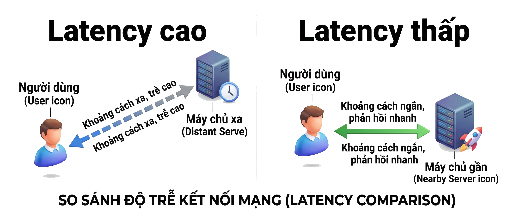

Hình minh họa: hai kịch bản đặt cạnh nhau, bên trái client nối tới máy chủ ở xa bằng mũi tên dài nét đứt ("Latency cao"), bên phải client nối tới máy chủ gần bằng mũi tên ngắn nét liền ("Latency thấp").

### Cách giảm latency

> Mục tiêu trong thiết kế hệ thống là ***luôn tối thiểu hóa độ trễ***.

- **Tối ưu đường truyền:** sử dụng giao thức hiệu quả hơn
- **Đặt máy chủ gần người dùng:** dùng CDN hoặc edge server
- **Cải thiện tốc độ xử lý:** tối ưu thuật toán, dùng cache
- **Giảm số lượng round-trip:** gộp các request khi có thể

> 💡 **Giải thích:** Ba hướng chính: (1) rút ngắn khoảng cách vật lý bằng CDN; (2) tăng tốc xử lý bằng cache và thuật toán tốt hơn; (3) giảm số lần đi-về (round-trip) giữa client và server. Đây là nền tảng để hiểu các kỹ thuật sâu hơn ở các chương sau.

---

## 2. Throughput — Thông lượng

### Throughput là gì?

> **Throughput** là số lượng yêu cầu (hoặc khối lượng dữ liệu) hệ thống xử lý thành công trong một đơn vị thời gian.

- Đo bằng: **requests/giây**, MB/giây, giao dịch/phút
- Còn gọi là *sức tải* hay *băng thông thực tế* của hệ thống
- Khác với latency: latency đo một yêu cầu, throughput đo *tổng khối lượng*
- Server xử lý 1000 req/s có throughput cao hơn server 100 req/s

> 💡 **Giải thích:** Throughput là "đối trọng" của latency. Latency nói về **tốc độ của một yêu cầu**, throughput nói về **khối lượng công việc tổng thể**. Người học rất hay nhầm hai khái niệm này. Throughput đo bằng số yêu cầu hoặc lượng dữ liệu xử lý *thành công* mỗi giây.

### Ví dụ minh họa: trạm thu phí

> Thông lượng = số xe qua trạm thu phí mỗi phút, không phải tốc độ mỗi chiếc xe.

- **Latency** ~ thời gian một xe qua trạm (nhanh hay chậm)
- **Throughput** ~ số xe qua trạm trong một phút
- Trạm 60 xe/phút có throughput cao hơn trạm 30 xe/phút
- Mở thêm làn thu phí → tăng throughput

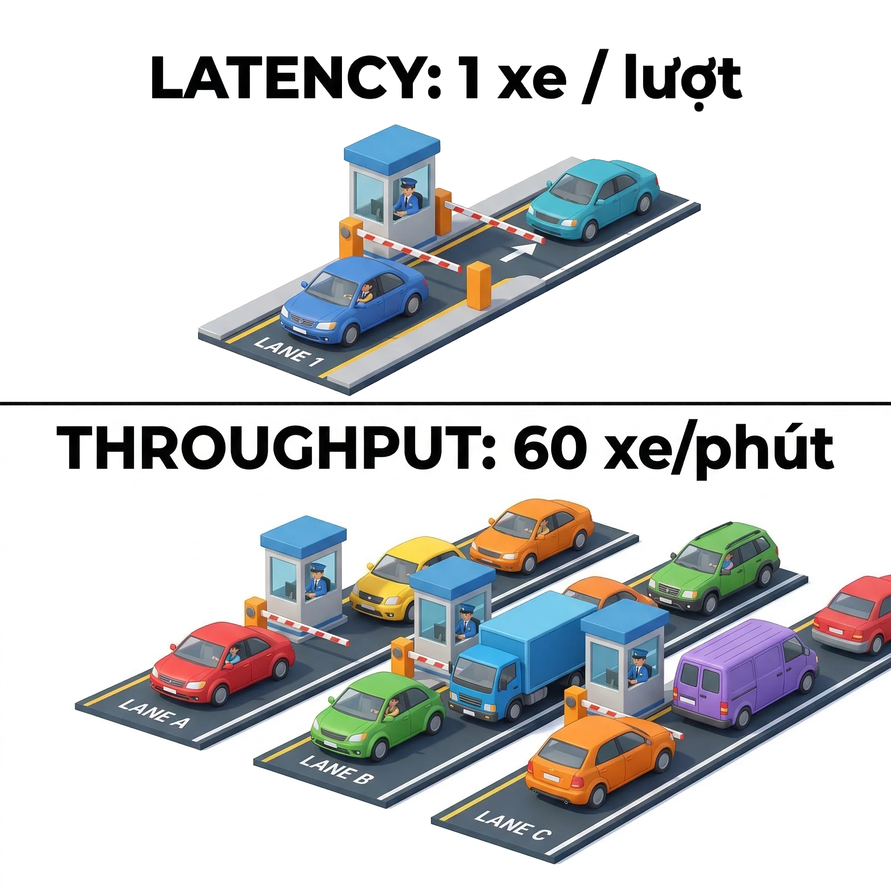

> 💡 **Giải thích:** Mỗi chiếc xe tương ứng một request. Latency là thời gian một xe cần để qua trạm; throughput là tổng số xe qua được trong một phút. Mở thêm làn (tương tự **thêm server**) làm throughput tăng, dù latency của mỗi xe không đổi.

### Mối quan hệ giữa latency và throughput

> Latency thấp và throughput cao ***không phải lúc nào cũng đi cùng nhau***.

- Latency thấp nhưng throughput thấp: phản hồi nhanh nhưng phục vụ ít người
- Throughput cao nhưng latency cao: nhiều yêu cầu được xử lý nhưng mỗi cái chờ lâu
- Khi hệ thống **quá tải**: throughput cao kéo theo latency tăng
- Thiết kế tốt cần ***cân bằng cả hai*** yếu tố

> 💡 **Giải thích:** Hai chỉ số này **bổ sung** cho nhau chứ không thay thế nhau. Hệ thống lý tưởng có cả latency thấp lẫn throughput cao. Trong thực tế, khi tải vượt ngưỡng, throughput tăng bắt đầu kéo latency lên cao (request phải xếp hàng chờ). Đó là dấu hiệu cần mở rộng hệ thống.

---

## 3. Scalability — Khả năng mở rộng

### Scalability là gì?

> **Scalability** là khả năng hệ thống xử lý hiệu quả khi khối lượng công việc tăng lên mà không suy giảm hiệu năng.

- Hệ thống "lớn lên" cùng với số lượng người dùng và dữ liệu
- Quan trọng với ứng dụng hướng đến hàng triệu người dùng
- Hai hướng mở rộng: *chiều dọc* và *chiều ngang*
- Mở rộng tốt có thể **thu nhỏ** khi nhu cầu giảm (scale down)

> 💡 **Giải thích:** Scalability cho phép hệ thống phát triển **mà không cần viết lại từ đầu**. Hệ thống không scalable sẽ gặp vấn đề nghiêm trọng khi lượng người dùng tăng đột biến. Có hai cách mở rộng chính: vertical và horizontal.

### Hình: Vertical Scaling vs Horizontal Scaling

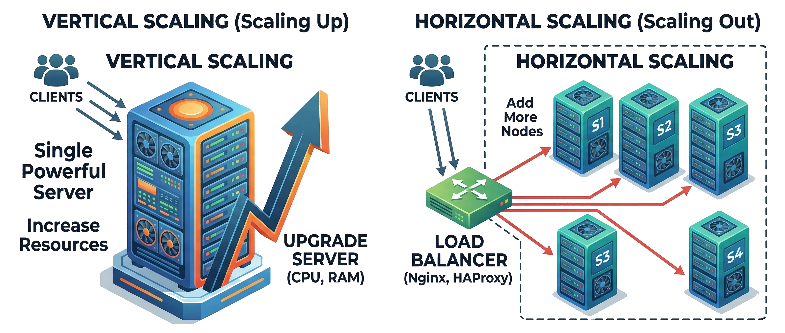

Hình minh họa: bên trái là một máy chủ lớn duy nhất có mũi tên đi lên ("Vertical Scaling"); bên phải là 4 máy chủ giống nhau chạy song song phía sau một load balancer, client gửi request tới load balancer rồi được chia ra các máy ("Horizontal Scaling").

> 💡 **Giải thích:** Vertical scaling dồn toàn bộ sức mạnh vào một máy; horizontal scaling phân tán tải ra nhiều máy qua load balancer. Câu hỏi gợi mở: *nếu máy duy nhất trong vertical scaling bị hỏng thì sao?* → toàn bộ dịch vụ ngừng.

### Vertical scaling vs Horizontal scaling

> **Vertical scaling** nâng cấp máy đơn; **horizontal scaling** thêm nhiều máy song song.

| Vertical Scaling (Scale Up) | Horizontal Scaling (Scale Out) |
|---|---|
| Thêm CPU, RAM, ổ cứng nhanh hơn cho *máy chủ hiện có* | Thêm *nhiều máy chủ* vào hệ thống |
| Đơn giản, không cần thay đổi kiến trúc | Linh hoạt, không có giới hạn lý thuyết |
| Có **giới hạn phần cứng**, không mở rộng mãi được | Cần **load balancer** để phân phối tải |
| Khi máy hỏng → *toàn bộ dịch vụ ngừng* | Một máy hỏng → *các máy còn lại vẫn chạy* |

> 💡 **Giải thích:** Đây là phép so sánh quan trọng nhất của phần scalability. Vertical scaling giống **thuê một đầu bếp giỏi hơn cho cùng một quán**: có giới hạn. Horizontal scaling giống **mở thêm nhiều chi nhánh**: linh hoạt hơn nhiều. Thực tế, horizontal scaling được ưu tiên vì còn mang lại khả năng dự phòng lỗi tốt hơn.

### Vì sao horizontal scaling được ưu tiên?

> Horizontal scaling vừa tăng **sức tải** vừa tăng **khả năng dự phòng** cho hệ thống.

- Không bị giới hạn bởi phần cứng của một máy đơn
- Một server hỏng, các server còn lại vẫn phục vụ bình thường
- Dễ dàng thêm/bớt server theo nhu cầu thực tế
- Kết hợp với **load balancer** để phân phối công việc đều

> 💡 **Giải thích:** Ba lý do: không có giới hạn lý thuyết, có tính dự phòng (**fault tolerance**), và linh hoạt hơn. Để horizontal scaling hoạt động tốt **bắt buộc phải có load balancer** (xem phần *Load Balancer — Bộ cân bằng tải* ở mục 12 phía dưới).

---

## 4. Consistency & Availability

### Availability là gì?

> **Availability** là tỉ lệ thời gian hệ thống hoạt động bình thường và sẵn sàng phục vụ.

- Đo bằng phần trăm uptime trong một khoảng thời gian
- Hệ thống *khả dụng cao* nghĩa là người dùng luôn truy cập được
- Downtime thường xuyên → tính khả dụng thấp
- Tương tự điện sinh hoạt: bạn muốn đèn sáng mỗi khi bật công tắc

> 💡 **Giải thích:** Availability hiểu đơn giản là: *hệ thống có hoạt động không khi người dùng cần?* Giống như điện sinh hoạt: ai cũng biết cúp điện bất tiện thế nào. Khi người dùng mở ứng dụng mà không vào được, đó là vấn đề availability.

### Hình: ATM luôn sẵn sàng

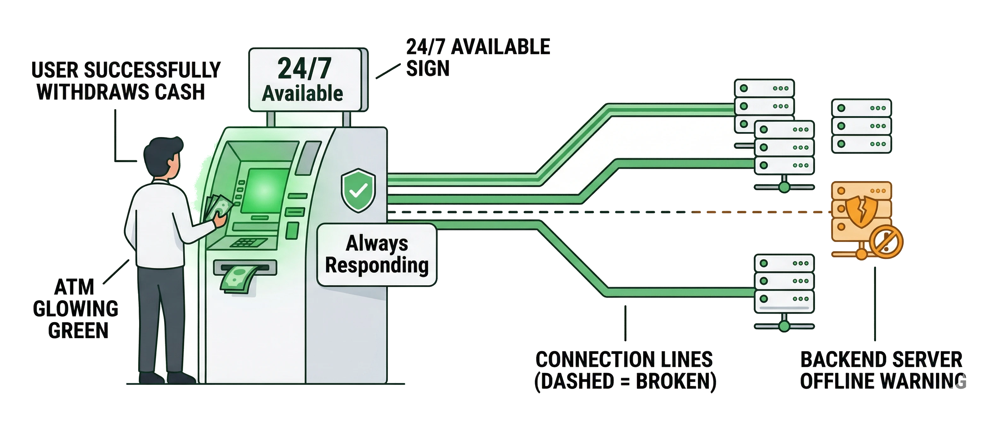

Hình minh họa: một cây ATM sáng xanh với biển "24/7 Available", người dùng rút tiền thành công dù một server backend phía sau đang offline (đường kết nối bị đứt), nhãn trạng thái "Always Responding".

> 💡 **Giải thích:** Hình ATM cho thấy sự đánh đổi giữa availability và consistency. Dù một server backend offline, ATM vẫn phục vụ. Đây là lựa chọn **ưu tiên availability**: chấp nhận số dư hiển thị có thể chưa cập nhật hoàn toàn, nhưng dịch vụ không bao giờ ngừng.

### Các con số "chín" (The Nines)

> Availability được đo bằng "số chín": ***càng nhiều số 9 thì downtime cho phép càng ít***.

| Mức độ | Uptime | Downtime/năm |
|---|---|---|
| 99% (2 nines) | 99% | ~3.65 ngày |
| 99.9% (3 nines) | 99.9% | ~8.7 giờ |
| 99.99% (4 nines) | 99.99% | ~52 phút |
| 99.999% (5 nines) | 99.999% | ~5 phút |

> 💡 **Giải thích:** Bảng này rất hay xuất hiện trong phỏng vấn. "Five nines" (99.999%) nghĩa là hệ thống chỉ được ngừng khoảng **5 phút mỗi năm**; đạt được mức đó đòi hỏi kiến trúc rất phức tạp và chi phí cao. Hầu hết dịch vụ thực tế nhắm tới **99.9% hoặc 99.99%**.

> 📌 **Mở rộng — cách tính:** Downtime = (1 − uptime) × tổng thời gian. Một năm = 365 × 24 = 8 760 giờ = 525 600 phút; một tháng trung bình ≈ 30,44 ngày ≈ 43 830 phút (nếu lấy tròn 30 ngày thì 43 200 phút).
>
> | Uptime | Downtime/năm (chính xác) | Downtime/tháng (≈30,44 ngày) | Downtime/ngày |
> |---|---|---|---|
> | 99% | 87,6 giờ ≈ 3,65 ngày | ≈ 7,3 giờ | ≈ 14,4 phút |
> | 99.9% | 8,76 giờ | ≈ 43,8 phút | ≈ 1,44 phút |
> | 99.99% | 52,56 phút | ≈ 4,38 phút | ≈ 8,6 giây |
> | 99.999% | 5,26 phút | ≈ 26,3 giây | ≈ 0,86 giây |

### Kỹ thuật tăng tính khả dụng

> Để tăng availability, hệ thống cần **loại bỏ điểm thất bại duy nhất** và có cơ chế *tự động phục hồi*.

- **Dự phòng (redundancy):** nhiều máy chủ chạy song song, một hỏng có máy khác thay thế
- **Load balancing:** rút server ra bảo trì mà người dùng không bị ảnh hưởng
- **Multi-zone / multi-region:** triển khai ở nhiều trung tâm dữ liệu khác nhau
- **Health check tự động:** phát hiện và loại server lỗi ra khỏi hệ thống

> 💡 **Giải thích:** Redundancy là chìa khóa: khi không còn **single point of failure** (điểm thất bại duy nhất), hệ thống không sập hoàn toàn chỉ vì một thành phần hỏng. Multi-region đặc biệt quan trọng khi muốn chống lại sự cố của **cả một trung tâm dữ liệu**.

### Tính nhất quán (Consistency)

> Mọi node trong hệ thống đều thấy **cùng một dữ liệu** tại cùng một thời điểm.

- Sau khi cập nhật, tất cả lần đọc tiếp theo đều nhận được **dữ liệu mới nhất**
- Không có tình trạng đọc ra dữ liệu cũ sau khi đã có bản cập nhật mới
- Ví dụ: chỉnh sửa tài liệu dùng chung, người khác thấy thay đổi **ngay lập tức**
- Yêu cầu cơ chế đồng bộ hoặc khóa giữa các node

> 💡 **Giải thích:** Trong hệ thống phân tán, nhất quán nghĩa là mọi thành phần nhìn thấy dữ liệu giống nhau tại bất kỳ thời điểm nào. Hình dung **Google Docs**: bạn gõ thêm một từ, người cộng tác ở xa thấy ngay. Để đạt điều này, hệ thống phải đồng bộ chặt giữa các máy chủ, đảm bảo mọi bản sao giống nhau **trước khi** phục vụ thêm yêu cầu đọc.

### Hình: Strong Consistency với tài liệu dùng chung


Hình minh họa: hai laptop cùng mở một tài liệu dùng chung; laptop trái đang gõ nội dung mới, laptop phải lập tức hiện cùng nội dung (tô xanh), ở giữa là database trung tâm có mũi tên đồng bộ hai chiều, nhãn "Strong Consistency".

> 💡 **Giải thích:** Khi một người cập nhật, người còn lại thấy thay đổi ngay nhờ đồng bộ qua database trung tâm. Đây là trạng thái lý tưởng mà hệ thống nhất quán mạnh hướng tới: mọi node có cùng dữ liệu tại mọi thời điểm.

### Sự mâu thuẫn giữa nhất quán và khả dụng

> Trong hệ thống phân tán, tăng một yếu tố thường **đòi hỏi hy sinh** yếu tố còn lại.

- **Nhất quán tuyệt đối** → đôi khi phải tạm ngừng phục vụ để đồng bộ dữ liệu
- **Khả dụng tối đa** → chấp nhận dữ liệu chưa hoàn toàn cập nhật tạm thời
- Nhiệm vụ kỹ sư: tìm **điểm cân bằng** phù hợp với yêu cầu ứng dụng
- Không có giải pháp hoàn hảo, chỉ có giải pháp *phù hợp với bài toán*

> 💡 **Giải thích:** Đây là "căng thẳng" cốt lõi của hệ thống phân tán. Muốn mọi node có dữ liệu mới nhất thì phải **chờ đồng bộ xong** mới phục vụ, làm giảm khả dụng. Muốn hệ thống luôn sẵn sàng thì phải cho phép vài node **phục vụ dữ liệu cũ**. Kỹ sư không tránh được sự đánh đổi này, chỉ có thể chọn điểm cân bằng hợp lý theo yêu cầu nghiệp vụ.

### Hình: Cán cân Consistency ↔ Availability

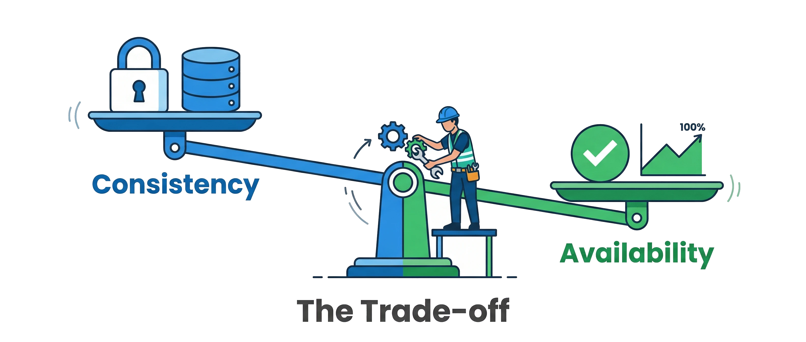

Hình minh họa: một cái cân, đĩa trái là "Consistency" (biểu tượng khóa, database), đĩa phải là "Availability" (dấu tick xanh, biểu đồ uptime), một kỹ sư đứng ở điểm tựa điều chỉnh độ nghiêng; chú thích "The Trade-off".

> 💡 **Giải thích:** Kỹ sư đứng ở điểm tựa và quyết định cân nghiêng về phía nào dựa trên yêu cầu nghiệp vụ. Không có vị trí "cân bằng hoàn hảo": mỗi hệ thống có điểm tối ưu riêng, tùy loại dữ liệu và **hậu quả của sai lệch**.

---

## 5. Các mô hình nhất quán

### Tổng quan ba mô hình nhất quán

> Mức độ nhất quán quyết định **cách dữ liệu được đọc** sau khi có cập nhật mới.

- **Nhất quán mạnh** (*strong*): đọc luôn trả về dữ liệu mới nhất
- **Nhất quán cuối cùng** (*eventual*): dữ liệu sẽ đồng bộ sau một khoảng thời gian
- **Nhất quán yếu** (*weak*): không đảm bảo thời hạn đồng bộ cụ thể
- Mỗi mô hình phù hợp với loại ứng dụng và yêu cầu khác nhau

> 💡 **Giải thích:** Ba mô hình tạo thành một **phổ** từ chặt chẽ nhất đến linh hoạt nhất:
> - **Strong**: dùng khi dữ liệu sai lệch dù chỉ trong tích tắc cũng gây hậu quả nghiêm trọng (giao dịch tài chính).
> - **Eventual**: phổ biến nhất trong hệ thống hiện đại, đánh đổi tính chính xác tức thì lấy hiệu năng và khả năng mở rộng.
> - **Weak**: chấp nhận mức bất đồng bộ cao nhất, dùng cho dữ liệu ít quan trọng như bảng xếp hạng game, cache ngắn hạn.

### Nhất quán mạnh — định nghĩa

> Sau khi ghi xong, ***mọi lần đọc tiếp theo đều nhận được dữ liệu vừa cập nhật***.

- Hệ thống **không cho phép** đọc dữ liệu cũ sau khi đã có bản mới
- Yêu cầu **cơ chế khóa** hoặc đồng bộ chặt giữa các node
- Mọi cập nhật phải lan tới tất cả node **trước khi** cho phép đọc tiếp
- Đổi lại: có thể tăng **độ trễ** hoặc tạm giảm khả dụng

> 💡 **Giải thích:** Đây là mức nghiêm ngặt nhất. Ví dụ ngân hàng: khi bạn rút tiền ở ATM, số dư phải được cập nhật trên **toàn hệ thống ngay lập tức**, để bạn không thể rút cùng một khoản tiền hai lần ở hai máy khác nhau. Muốn vậy, hệ thống phải khóa dữ liệu trong lúc cập nhật và chờ xác nhận từ tất cả node liên quan. Cái giá: độ trễ tăng, và có lúc dịch vụ tạm thời không phản hồi.

### Nhất quán mạnh — ví dụ thực tế

> Ví dụ điển hình: **đặt vé máy bay** và **giao dịch ngân hàng**.

- Chỉ còn 1 ghế, đại lý A bán → hệ thống cập nhật **ngay lập tức** toàn bộ
- Đại lý B kiểm tra ngay sau đó → thấy **ghế đã hết**, không thể bán trùng
- Ngân hàng: rút tiền tại ATM → *mobile banking* hiển thị số dư giảm **ngay**
- Ngăn chặn lỗi ***double-booking***, điều không thể chấp nhận trong tài chính

> 💡 **Giải thích:** Nếu chỉ còn một ghế và hai đại lý cùng cố bán, **một trong hai phải thất bại**. Strong consistency đảm bảo ngay khi A xác nhận, B sẽ thấy ghế đã bán; không có kịch bản hai người cùng mua một ghế. Tương tự, mọi giao dịch ngân hàng phải phản ánh tức thì trên mọi kênh để tránh chi tiêu quá số dư.

### Hình: Không double-booking


Hình minh họa: đại lý A đặt ghế cuối cùng (ghế chuyển từ xanh sang đỏ), đại lý B kiểm tra cùng ghế thì thấy ngay "Seat Unavailable"; ở giữa là database có biểu tượng khóa, nhãn "Updated Instantly", banner "No Double Booking".

> 💡 **Giải thích:** Khi A xác nhận, database cập nhật ngay với cơ chế khóa; B kiểm tra ngay sau đó đã thấy ghế không còn. **Không tồn tại khoảng thời gian nào cả hai cùng thấy ghế trống.**

### Nhất quán mạnh — khi nào nên chọn

> Chọn strong consistency khi **sai lệch dữ liệu dù tạm thời đều không chấp nhận được**.

- Hệ thống **tài chính, ngân hàng**: số dư, giao dịch phải chính xác tuyệt đối
- Hệ thống **đặt chỗ**: vé, phòng, lịch hẹn không được bán trùng
- Đánh đổi: **độ trễ tăng**, phải chờ đồng bộ hoàn tất trước khi phản hồi
- Nếu một node chậm, hệ thống có thể phải **chờ hoặc ngừng** phục vụ node đó

> 💡 **Giải thích:** Strong consistency là bắt buộc khi độ chính xác dữ liệu ảnh hưởng trực tiếp tới nghiệp vụ hoặc tính hợp lệ của giao dịch. Trong phỏng vấn, khi gặp đề ngân hàng hay đặt vé, hãy **chủ động đề xuất strong consistency và giải thích lý do**, đồng thời nói rõ đánh đổi: hệ thống có thể chậm đáng kể vì phải chờ xác nhận từ các node trước khi trả kết quả cho client.

### Nhất quán cuối cùng — định nghĩa

> Hệ thống ***cho phép dữ liệu tạm thời không đồng bộ***, nhưng đảm bảo cuối cùng sẽ nhất quán.

- Sau khi cập nhật, một số lần đọc **tạm thời** có thể thấy dữ liệu cũ
- Nếu không có cập nhật mới, mọi node sẽ **dần hội tụ** về trạng thái mới nhất
- Đánh đổi nhất quán tức thì để lấy **khả dụng cao** và **hiệu suất tốt hơn**
- Là một dạng của nhất quán yếu nhưng có **cam kết đồng bộ cuối cùng**

> 💡 **Giải thích:** Eventual consistency là mô hình phổ biến nhất trong hệ thống phân tán hiện đại. Ý tưởng: dữ liệu có thể chưa nhất quán ngay, nhưng **nếu không có cập nhật mới, mọi bản sao cuối cùng sẽ giống nhau**. Nhờ vậy hệ thống phản hồi nhanh hơn: ghi vào một node rồi trả kết quả ngay, không chờ mọi node cập nhật xong. Đó là lý do các NoSQL lớn như **DynamoDB** và **Cassandra** chọn mô hình này.

### Nhất quán cuối cùng — ví dụ

> Giống như sao lưu ổ cứng hàng tuần: dữ liệu sẽ nhất quán **sau khi đồng bộ**.

- Laptop có ảnh mới từ thứ Bảy, ổ cứng chưa được sao lưu đến Chủ Nhật
- Bạn mượn ổ cứng Chủ Nhật → thấy **ảnh cũ** (không nhất quán tạm thời)
- Đến tối Chủ Nhật, cắm ổ cứng vào đồng bộ → dữ liệu **nhất quán trở lại**
- Mạng xã hội: đổi avatar → một số người vẫn thấy ảnh cũ trong **vài giây**

> 💡 **Giải thích:** Khi bạn đổi ảnh đại diện, hệ thống ghi vào server chính ngay, nhưng bản sao trên CDN hay server phụ có thể chưa kịp cập nhật. Sau vài giây hoặc vài phút, mọi người đều thấy ảnh mới. **Đây không phải lỗi** mà là thiết kế có chủ ý để hệ thống luôn phản hồi nhanh thay vì chờ đồng bộ hoàn toàn.

### Hình: Timeline eventual consistency

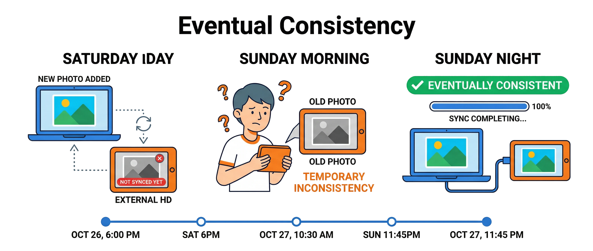

Hình minh họa: timeline ba giai đoạn: (1) thứ Bảy, laptop có ảnh mới, ổ cứng vẫn ảnh cũ ("Not Synced Yet"); (2) sáng Chủ Nhật, người mượn ổ cứng thấy ảnh cũ ("Temporary Inconsistency"); (3) tối Chủ Nhật, cắm ổ cứng đồng bộ xong, hai thiết bị cùng ảnh mới ("Eventually Consistent").

> 💡 **Giải thích:** Chu kỳ eventual consistency: dữ liệu mới có ở nguồn → tạm thời lệch với bản sao → hội tụ sau khi đồng bộ. Khoảng thời gian không nhất quán là **dự đoán được và chấp nhận được** với các hệ thống không đòi hỏi chính xác tuyệt đối.

### Nhất quán cuối cùng — khi nào nên chọn

> Chọn eventual consistency khi **hiệu năng và khả dụng quan trọng hơn** tính chính xác tức thì.

- Cơ sở dữ liệu NoSQL phân tán: **Cassandra**, **DynamoDB**, tốc độ ghi/đọc cao
- Dịch vụ **mạng xã hội**: bài đăng, bình luận, lượt thích, trễ vài giây là chấp nhận được
- Hệ thống **CDN**, cache web: nội dung phân phối rộng, cập nhật dần dần
- *Không dùng* khi dữ liệu yêu cầu chính xác tuyệt đối tại mọi thời điểm

> 💡 **Giải thích:** Khi hàng trăm triệu người cùng đăng bài, nếu mọi thao tác đều phải đồng bộ ngay thì sẽ tạo **bottleneck khổng lồ**. Thay vào đó, hệ thống ghi nhanh vào một chỗ rồi để dữ liệu tự lan truyền, nhờ đó **scale tuyến tính**. Trong phỏng vấn, hãy gắn eventual consistency với hệ thống cụ thể như Cassandra, DynamoDB hay kiến trúc **BASE** để thể hiện hiểu biết thực tế.
>
> 📌 **Mở rộng:** **BASE** = *Basically Available, Soft state, Eventually consistent*, đối lập với **ACID** (*Atomicity, Consistency, Isolation, Durability*) của CSDL quan hệ truyền thống. Chi tiết ở Bài 5B.

### Nhất quán yếu — định nghĩa và ví dụ

> Hệ thống **không hứa hẹn** thời hạn cụ thể nào để dữ liệu trở nên nhất quán.

- Cho phép dữ liệu không đồng bộ trong **khoảng thời gian dài** hoặc không xác định
- Ví dụ: cache 60 giây → người dùng thấy danh sách sản phẩm cũ đến khi cache hết hạn
- Ví dụ: **bảng xếp hạng game** chỉ làm mới mỗi vài phút, ưu tiên gameplay mượt mà
- *Eventual consistency* là dạng yếu có thêm cam kết; weak là trường hợp tổng quát hơn

> 💡 **Giải thích:** "Nhất quán yếu" là thuật ngữ bao quát; **eventual consistency là một trường hợp đặc biệt** của nó, có thêm cam kết "cuối cùng sẽ đồng bộ". Weak consistency thuần túy hay gặp ở cache có TTL dài, bảng điểm game, bộ đếm lượt xem video. Hệ thống tối ưu hoàn toàn cho tốc độ và khả năng mở rộng, chấp nhận dữ liệu cũ trong thời gian không xác định. Điều kiện: loại dữ liệu này **không ảnh hưởng tính đúng đắn của nghiệp vụ** nếu tạm thời hiển thị sai.

### Tổng kết ba mô hình nhất quán

| Mô hình | Đảm bảo | Đánh đổi | Ứng dụng tiêu biểu |
|---|---|---|---|
| **Strong** | Luôn đọc được dữ liệu mới nhất | Độ trễ cao, có thể giảm khả dụng | Ngân hàng, đặt vé |
| **Eventual** | Cuối cùng sẽ đồng bộ | Tạm thời có thể đọc dữ liệu cũ | Mạng xã hội, NoSQL |
| **Weak** | Không đảm bảo thời hạn đồng bộ | Dữ liệu có thể cũ lâu | Cache, bảng xếp hạng |

> 💡 **Giải thích:** Câu hỏi đầu tiên khi thiết kế: ***"Nếu người dùng đọc dữ liệu cũ trong một khoảng ngắn, có gây hậu quả nghiêm trọng không?"*** Có → chọn **strong**. Không → **eventual** hoặc **weak** tốt hơn cho hiệu năng. Trình bày bảng so sánh như vậy trong phỏng vấn thể hiện tư duy có hệ thống.

---

## 6. Đảm bảo nhất quán và khả dụng: Replication & Failover

### Nhân bản dữ liệu (Replication)

> **Replication** sao chép dữ liệu sang nhiều node để tăng khả dụng và chịu lỗi.

- Khi một máy chủ gặp sự cố, **node khác** có thể tiếp tục phục vụ
- Giống như photo nhiều bản sổ ghi chép: mất một bản vẫn còn bản khác
- Thách thức: làm sao đảm bảo **tất cả bản sao đều giống nhau** sau mỗi cập nhật
- Hai chiến lược chính: **đồng bộ chặt** và **đồng bộ bất đồng bộ**

> 💡 **Giải thích:** Replication là nền tảng của hầu hết hệ thống phân tán hiện đại. Duy trì nhiều bản sao trên nhiều máy (thậm chí nhiều vùng địa lý) giúp hệ thống tiếp tục chạy khi một máy gặp sự cố. Nhưng nó sinh ra bài toán mới: **làm sao mọi bản sao phản ánh trạng thái mới nhất?** Câu trả lời phụ thuộc chiến lược đồng bộ, mỗi chiến lược có đánh đổi riêng giữa nhất quán và hiệu năng.

### Hình: High Availability via Replication

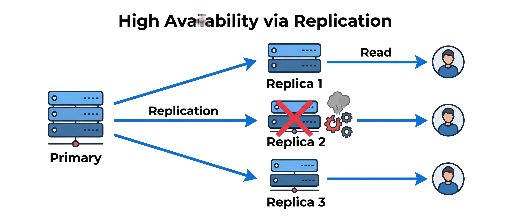

Hình minh họa: một server **Primary** sao chép dữ liệu sang **Replica 1, 2, 3**; Replica 3 bị sập (dấu X đỏ) nhưng người dùng vẫn đọc thành công từ các replica còn lại.

> 💡 **Giải thích:** Khi Replica 3 sập, người dùng vẫn đọc từ Replica 1 và 2 mà không bị gián đoạn; Primary tiếp tục nhận ghi và sao chép sang các replica còn lại. Đây là lý do replication là nền tảng của mọi hệ thống yêu cầu availability cao.

### Đồng bộ chặt vs đồng bộ bất đồng bộ

> Chiến lược đồng bộ quyết định **mức độ nhất quán** và **hiệu năng** của replication.

| Đồng bộ chặt (*synchronous*) | Đồng bộ bất đồng bộ (*asynchronous*) |
|---|---|
| Cập nhật tất cả bản sao **trước khi** xác nhận | Ghi vào node chính → xác nhận ngay |
| Đảm bảo ***strong consistency*** | Dữ liệu lan sang bản sao **sau đó** |
| Độ trễ cao hơn, có thể block nếu node chậm | Nhanh hơn, khả dụng cao hơn |
| Dùng cho: hệ thống **tài chính** | Kết quả: ***eventual consistency*** |

> 💡 **Giải thích:** Đây là đánh đổi kinh điển trong replication.
> - **Synchronous:** client phải chờ xác nhận từ tất cả (hoặc đa số) node rồi giao dịch mới được coi là hoàn thành → nhất quán nhưng tăng độ trễ. Ngân hàng dùng cách này.
> - **Asynchronous:** client nhận xác nhận ngay khi node chính ghi xong, bản sao được cập nhật ngầm → nhanh hơn nhưng có khoảng thời gian ngắn dữ liệu không nhất quán. Mạng xã hội dùng cách này.

### Hình: Synchronous vs Asynchronous Replication

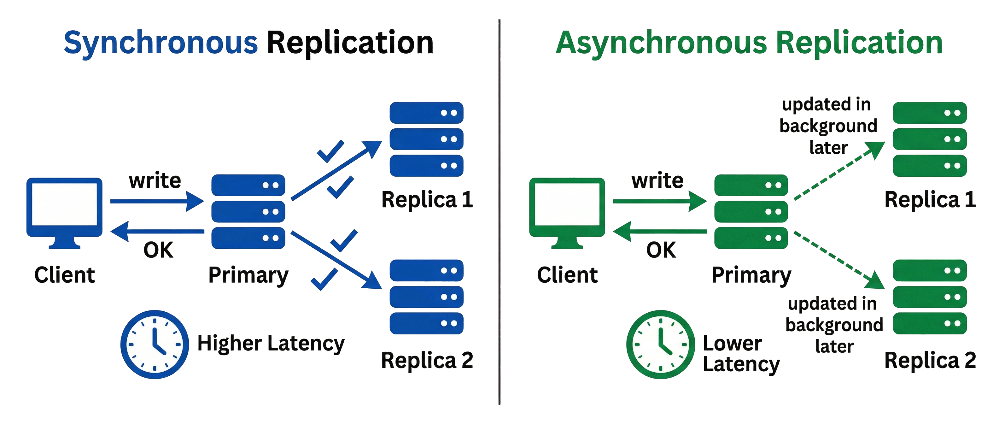

Hình minh họa: bên trái (Synchronous), client ghi → primary cập nhật Replica 1 và 2 (có dấu tick) → rồi mới trả "OK", kèm biểu tượng đồng hồ "Higher Latency"; bên phải (Asynchronous), primary trả "OK" ngay, các replica được cập nhật sau bằng mũi tên nét đứt, "Lower Latency".

> 💡 **Giải thích:** Bên trái đảm bảo nhất quán nhưng latency cao; bên phải latency thấp nhưng có khoảng thời gian dữ liệu chưa nhất quán. Chọn bên nào tùy yêu cầu nghiệp vụ.

### Chuyển đổi dự phòng (Failover)

> **Failover** tự động chuyển sang máy chủ dự phòng khi máy chủ chính gặp sự cố.

- Kiến trúc: một máy **primary** đang phục vụ + một hoặc nhiều **secondary** chờ sẵn
- Khi primary ngừng hoạt động → secondary **tiếp quản tự động**
- Người dùng chỉ thấy **chậm thoáng qua** rồi hệ thống hoạt động bình thường
- Yêu cầu secondary phải được **đồng bộ kịp thời** với primary (kết hợp replication)

> 💡 **Giải thích:** Failover giúp hệ thống khả dụng liên tục: luôn có ít nhất một máy dự phòng sẵn sàng tiếp quản. Điểm mấu chốt: **failover và replication phải đi cùng nhau**. Nếu secondary không được cập nhật thường xuyên từ primary, khi failover xảy ra người dùng sẽ thấy dữ liệu cũ hoặc **mất dữ liệu**. Vì vậy trong hệ thống high availability, hai cơ chế này được thiết kế như một cặp không tách rời.

### Hình: Automatic Failover

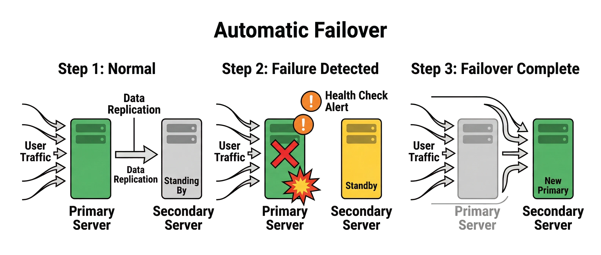

Hình minh họa: ba bước: (1) "Normal": traffic vào Primary, Secondary chờ sẵn và nhận replication; (2) "Failure Detected": Primary hỏng, health check báo động; (3) "Failover Complete": traffic tự động chuyển sang Secondary, nay là "New Primary".

> 💡 **Giải thích:** Bước 1: chạy bình thường, primary và secondary luôn đồng bộ. Bước 2: **health check** phát hiện primary ngừng hoạt động. Bước 3: secondary tiếp quản vai trò primary, traffic được chuyển hướng tự động. Người dùng chỉ gặp gián đoạn ngắn trong lúc chuyển.

---

## 7. Quorum

### Quorum — khái niệm

> **Quorum** yêu cầu một số lượng tối thiểu node phải đồng ý trước khi thao tác được chấp nhận.

- Giống như biểu quyết nhóm: cần ít nhất **3/5 người đồng ý** mới ra quyết định
- Áp dụng cho cả thao tác **ghi** (W nodes) và **đọc** (R nodes)
- Điều chỉnh W và R → điều chỉnh mức độ nhất quán và tốc độ của hệ thống
- Dùng trong: **Cassandra**, **etcd**, **Zookeeper** và nhiều hệ thống phân tán khác

> 💡 **Giải thích:** Quorum là một trong những công cụ mạnh nhất để điều chỉnh mức nhất quán. Ý tưởng: **không** đòi tất cả node đồng ý (rất chậm, dễ gián đoạn), cũng **không** chỉ cần một node (không đảm bảo nhất quán), mà **chỉ cần đa số**. Đây là điểm cân bằng tốt giữa hiệu năng và độ tin cậy. Cassandra cho phép client chọn mức nhất quán cho từng truy vấn qua tham số *consistency level*, từ `ONE` đến `ALL`.

### Quorum — công thức W + R > N

> Điều kiện ***W + R > N*** đảm bảo tập đọc và tập ghi luôn **chồng chéo** lên nhau.

- **N** = tổng số bản sao; **W** = số node xác nhận ghi; **R** = số node tham gia đọc
- Ví dụ: N=5, W=3, R=3 → W+R=6 > 5 → đọc luôn thấy ít nhất 1 node có dữ liệu mới
- **W = R = N/2 + 1** → đạt gần *strong consistency* nhưng mỗi thao tác chậm hơn
- Giảm W hoặc R → tăng tốc độ nhưng **giảm mức độ nhất quán**

> 💡 **Giải thích:** W + R > N là "trái tim" của quorum. Khi tổng số node tham gia ghi và đọc vượt quá tổng số bản sao, **luôn có ít nhất một node nằm trong cả hai tập**: node đó có dữ liệu mới nhất và tham gia thao tác đọc → người đọc luôn thấy phiên bản mới nhất. Trong Cassandra, đặt consistency level `QUORUM` để tự dùng N/2+1 node cho mọi thao tác, hoặc `ONE` để tối đa tốc độ với mức nhất quán thấp hơn.
>
> 📌 **Mở rộng:** Số node chồng chéo tối thiểu = **W + R − N** (theo nguyên lý Dirichlet/chuồng bồ câu). Với N=5, W=R=3: 3+3−5 = 1 node chung. "N/2 + 1" hiểu là **⌊N/2⌋ + 1** (phần nguyên), ví dụ N=5 → 3, N=7 → 4. Khi đọc nhận về nhiều phiên bản khác nhau, hệ thống chọn bản có **version/timestamp mới nhất**.

### Hình: Write quorum và Read quorum chồng nhau

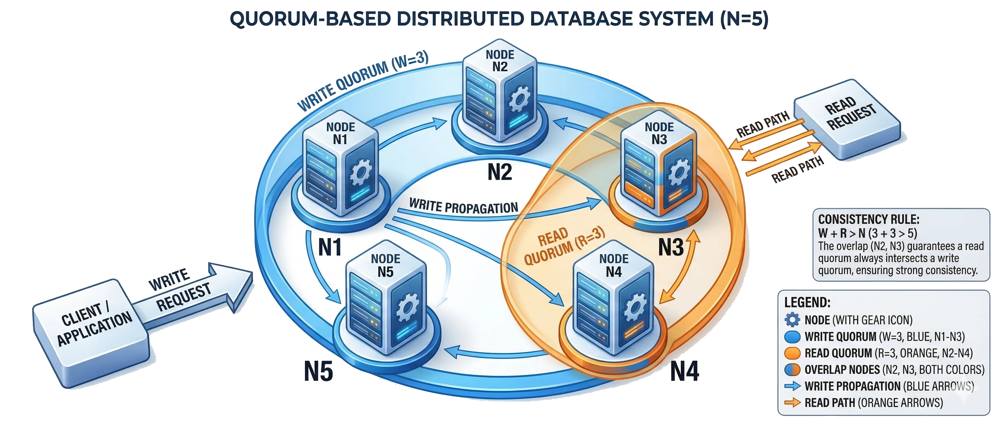

Hình minh họa: 5 node N1–N5 xếp thành vòng tròn; tập ghi W=3 (xanh dương) gồm N1, N2, N3; tập đọc R=3 (cam) gồm N2, N3, N4; N2 và N3 mang cả hai màu.

> 💡 **Giải thích:** Vì W+R = 6 > N = 5, luôn có ít nhất một node thuộc cả hai tập. Node đó đã nhận bản ghi mới nhất và tham gia đọc, nên đọc luôn ra dữ liệu mới nhất.

---

## 8. CAP và các đánh đổi kinh điển

### Ba thuộc tính CAP

> ***Định lý CAP***: một hệ thống phân tán không thể đồng thời đảm bảo cả ba thuộc tính C-A-P.

- **C** (*Consistency*): mọi lần đọc nhận được dữ liệu mới nhất hoặc thông báo lỗi
- **A** (*Availability*): mọi yêu cầu đều nhận được phản hồi, dù dữ liệu có thể không mới nhất
- **P** (*Partition tolerance*): hệ thống tiếp tục hoạt động khi **kết nối mạng bị gián đoạn**
- Thực tế: P gần như **bắt buộc** → lựa chọn thực sự là giữa **CP** hoặc **AP**

> 💡 **Giải thích:** Định lý CAP do **Eric Brewer** đề xuất năm **2000**, được chứng minh chính thức năm **2002**. Điểm hay bị hiểu nhầm: trong môi trường phân tán thực tế, **phân vùng mạng là không tránh được** (đứt cáp, datacenter mất kết nối, node timeout). Vì vậy P không phải là "lựa chọn" mà là **điều kiện bắt buộc**. Lựa chọn thật sự của kỹ sư là: **khi xảy ra phân vùng**, hệ thống ưu tiên nhất quán (CP) hay khả dụng (AP)?

### Hệ thống CP vs AP

> Khi xảy ra phân vùng mạng, **CP** chọn tính đúng đắn còn **AP** chọn tính sẵn sàng.

| Hệ thống CP | Hệ thống AP |
|---|---|
| Ưu tiên **nhất quán** khi có lỗi mạng | Ưu tiên **khả dụng**, luôn phục vụ |
| Tạm dừng giao dịch, trả lỗi nếu cần | Chấp nhận *eventual consistency* |
| Ví dụ: **ngân hàng**, **SQL databases** | Ví dụ: **mạng xã hội**, NoSQL (**BASE**) |
| Dữ liệu sai lệch là không chấp nhận được | Dữ liệu trễ vài giây là chấp nhận được |

> 💡 **Giải thích:** Phân loại CP/AP giúp nhanh chóng xác định hướng thiết kế. **CP** sẵn sàng trả lỗi hoặc tạm ngừng phục vụ để mọi dữ liệu đều đúng: phù hợp tài chính, y tế, hệ thống điều khiển. **AP** luôn phản hồi dù dữ liệu chưa nhất quán hoàn toàn: phù hợp mạng xã hội, thương mại điện tử, hệ thống nội dung. Trong phỏng vấn, xếp hệ thống đang thiết kế vào CP hay AP thể hiện tư duy kiến trúc rõ ràng.

### Hình: CP vs AP khi có phân vùng mạng

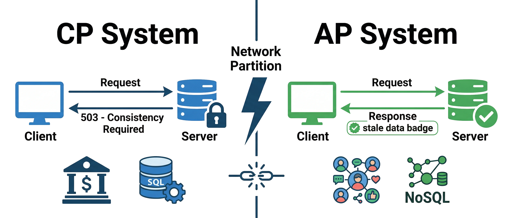

Hình minh họa: tia sét "Network Partition" chia đôi khung hình; bên trái hệ thống CP trả lỗi "503 - Consistency Required" (biểu tượng ngân hàng, SQL); bên phải hệ thống AP vẫn trả phản hồi kèm nhãn "stale data" (biểu tượng mạng xã hội, NoSQL).

> 💡 **Giải thích:** CP trả lỗi **503** để bảo vệ nhất quán: người dùng không truy cập được nhưng dữ liệu luôn đúng. AP tiếp tục phục vụ với dữ liệu có thể cũ: người dùng không bị gián đoạn nhưng có thể thấy thông tin chưa cập nhật.

### CAP — ví dụ hai cửa hàng

> Khi mạng giữa hai chi nhánh bị đứt, bạn phải chọn: **dừng bán** hay **chấp nhận rủi ro bán trùng**.

- Hai chi nhánh bán chung kho hàng, đột nhiên **mạng giữa hai bên bị mất**
- **Chọn CP**: ngừng bán tại một chi nhánh đến khi kết nối phục hồi, *mất doanh thu tạm thời*
- **Chọn AP**: hai bên tiếp tục bán độc lập, *có thể bán trùng cùng một sản phẩm*
- Không có giải pháp hoàn hảo: hoặc **an toàn dữ liệu** hoặc **không gián đoạn dịch vụ**

> 💡 **Giải thích:** Mạng giữa hai chi nhánh bị đứt chính là tình huống **phân vùng P**. Lúc này không thể vừa giữ tồn kho đồng nhất vừa cho cả hai bên tiếp tục bán. **CP** khóa một bên để tránh bán vượt số hàng thực. **AP** cho cả hai tiếp tục rồi **giải quyết xung đột sau** (có thể phải xin lỗi khách hoặc nhập thêm hàng). Đây là ví dụ rất dễ dùng trong phỏng vấn.

### Hình: Hai chi nhánh khi mạng bị đứt

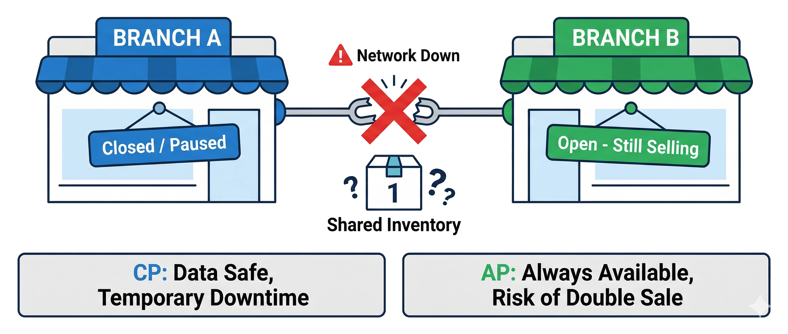

Hình minh họa: chi nhánh A và B nối với nhau bằng đường mạng bị cắt ("Network Down"); kho chung ở giữa còn số lượng "1"; chi nhánh A treo biển "Closed / Paused" (CP: dữ liệu an toàn, tạm ngừng), chi nhánh B treo "Open - Still Selling" (AP: luôn sẵn sàng, rủi ro bán trùng).

> 💡 **Giải thích:** Chi nhánh A chọn đóng cửa (CP): an toàn dữ liệu nhưng mất doanh thu. Chi nhánh B tiếp tục bán (AP): không gián đoạn nhưng có nguy cơ bán trùng sản phẩm cuối cùng. Không lựa chọn nào hoàn hảo; đó là bản chất của định lý CAP.

---

## 9. Best Practices (trả lời phỏng vấn về nhất quán)

### Xác định yêu cầu

> ***Luôn làm rõ mức nhất quán cần thiết trước*** khi đề xuất giải pháp.

- Hỏi: "Hệ thống này ưu tiên **dữ liệu chính xác tuyệt đối** hay **hiệu năng và khả dụng**?"
- Thể hiện bạn hiểu rằng câu trả lời phụ thuộc vào **yêu cầu nghiệp vụ cụ thể**
- Tránh đề xuất strong consistency cho mọi hệ thống, đó là *over-engineering*
- Câu hỏi làm rõ → điểm cộng về **tư duy trade-off** trong mắt người phỏng vấn

> 💡 **Giải thích:** Sai lầm phổ biến nhất trong phỏng vấn system design là **trả lời quá nhanh mà không làm rõ yêu cầu**. Khi được hỏi về consistency, hãy dừng lại và hỏi ngược: hệ thống xử lý loại dữ liệu nào? Dữ liệu cũ một giây có gây hậu quả nghiêm trọng không? Việc này vừa giúp ra giải pháp đúng hơn, vừa thể hiện tư duy kỹ sư trưởng thành: không có giải pháp "one-size-fits-all" trong hệ thống phân tán.

### Nhấn mạnh sự đánh đổi (trade-off)

> Trong hệ thống phân tán, **không thể có tất cả**, luôn phải đánh đổi một thứ gì đó.

- Trình bày ngắn gọn định lý CAP: "không thể đồng thời đạt **100% C và 100% A** khi có phân vùng"
- Với strong consistency: "chấp nhận độ trễ tăng và có thể giảm khả dụng tạm thời"
- Với eventual consistency: "chấp nhận dữ liệu có thể cũ trong thời gian ngắn"
- Kết luận: "Lựa chọn phụ thuộc vào **mức độ chịu đựng lỗi** của nghiệp vụ"

> 💡 **Giải thích:** Người phỏng vấn muốn thấy bạn không chỉ biết định nghĩa mà còn **hiểu hệ quả** của từng lựa chọn. Chủ động nói "với lựa chọn này, đánh đổi là..." chứng minh tư duy có chiều sâu. **Tránh** câu "hệ thống này cần cả nhất quán lẫn khả dụng cao" mà không giải thích cách cân bằng; câu đó vô nghĩa trong ngữ cảnh CAP.

### Đề xuất giải pháp cụ thể kèm lý do

> Giải pháp tốt là giải pháp được **gắn với yêu cầu cụ thể** và có lý do rõ ràng.

- **Strong consistency cần thiết** → đề xuất quorum (W + R > N) hoặc leader-based replication
- **Eventual consistency đủ dùng** → đề xuất *asynchronous replication* kiểu master-slave
- Luôn giải thích: "Em chọn cách này vì **ưu tiên của hệ thống là...**"
- Không đề xuất giải pháp phức tạp khi yêu cầu đơn giản, *đừng over-engineer*

> 💡 **Giải thích:** Đừng chỉ nêu tên giải pháp, hãy **giải thích cơ chế**. Ví dụ mẫu: *"Em dùng quorum với W=3, R=3 trên 5 node, vì W+R=6>5 đảm bảo mọi lần đọc luôn chồng chéo với ít nhất một node đã nhận bản ghi mới nhất."* Ngược lại, nếu chỉ cần eventual consistency thì đừng đề xuất quorum toàn bộ; hãy chọn asynchronous replication và giải thích vì sao nó phù hợp.

### Đề cập cơ chế hỗ trợ

> Lồng ghép các **từ khóa kỹ thuật đúng chỗ** và dùng ví dụ ngắn khi cần làm rõ.

- Đề cập: ***replication***, ***failover***, ***quorum***, *cache TTL*, mỗi cái đúng ngữ cảnh
- Ví dụ: "Triển khai **failover** giữa 2 datacenter → nếu một bên down, bên kia tiếp quản ngay"
- Ví dụ quorum: "Như nhóm họp 5 người, cần **3 đồng ý** mới quyết định, hệ thống phân tán cũng vậy"
- Ví dụ ngắn gọn, phục vụ để *làm rõ ý*, không kể chuyện lan man

> 💡 **Giải thích:** Dùng từ khóa kỹ thuật đúng chỗ, đúng nghĩa là tín hiệu mạnh về kinh nghiệm. Người phỏng vấn muốn nghe *"tôi sẽ kết hợp asynchronous replication với failover"*, chứ không chỉ *"tôi sẽ sao chép dữ liệu sang máy khác"*. Ví dụ đời thường như nhóm họp cần đa số phiếu giúp giải thích quorum dễ nhớ, nhất là khi người phỏng vấn chưa theo kịp phần kỹ thuật.

### Tập trung vào người dùng

> Lựa chọn kiến trúc cuối cùng phải **phù hợp với trải nghiệm người dùng** và nghiệp vụ thực tế.

- Giao dịch tiền tệ → ***strong consistency***: sai lệch dù một giây cũng không thể chấp nhận
- Bảng thông báo, tin tức → *eventual consistency*: người dùng tải nhanh hơn là quan trọng hơn
- Tóm lại: "Luôn có **đánh đổi**, em sẽ giải thích rõ cho team để ra quyết định đúng"
- Ba điều cần nhớ: **hiểu nhu cầu**, **biết đánh đổi**, **giải thích mạch lạc**

> 💡 **Giải thích:** Kết thúc câu trả lời bằng người dùng và nghiệp vụ là dấu hiệu tư duy trưởng thành: kỹ thuật không phải mục đích cuối cùng. Ví dụ: *"Với tính năng này, người dùng chấp nhận được dữ liệu cũ vài giây nên em chọn eventual consistency để tải nhanh hơn."* Bộ ba **hiểu nhu cầu, biết đánh đổi, giải thích mạch lạc** là framework để tự đánh giá mọi câu trả lời phỏng vấn về chủ đề này.

---

## 10. Reliability — Độ tin cậy

### Reliability là gì?

> **Reliability** là mức độ hệ thống vận hành *ổn định, nhất quán* và đảm bảo ***toàn vẹn dữ liệu*** trong thời gian dài.

- Hệ thống tin cậy: ít lỗi nghiêm trọng, không mất dữ liệu
- Nếu có sự cố nhỏ, hệ thống tự phục hồi hoặc có cơ chế khôi phục
- Đặc biệt quan trọng trong hệ thống tài chính, thương mại điện tử
- Ví dụ: mỗi giao dịch phải được lưu chắc chắn, không "mất giữa chừng"

> 💡 **Giải thích:** Reliability khác availability ở chỗ nó không chỉ hỏi *"hệ thống có đang chạy không?"* mà còn hỏi *"khi chạy, nó có chạy **đúng** và dữ liệu có **toàn vẹn** không?"*. Ví dụ ngân hàng: nếu server sập giữa lúc xử lý giao dịch, tiền có bị mất không? Hệ thống tin cậy đảm bảo câu trả lời là **không**.

### Availability vs Reliability

> Reliability **bao hàm** availability, nhưng còn thêm yếu tố ***toàn vẹn và đúng đắn*** của hoạt động.

- Reliability cao → gần như chắc chắn availability cũng cao
- Availability cao **chưa chắc** reliability cao (uptime tốt nhưng dữ liệu có thể sai)
- Reliability = availability + *tính đúng đắn của dữ liệu*
- Trong thực tế: tập trung vào availability cao + *giảm thiểu rủi ro mất dữ liệu*

> 💡 **Giải thích:** Điểm này rất hay bị nhầm. Hãy hình dung sơ đồ Venn: reliability là **tập cha** chứa availability. Một hệ thống có thể luôn chạy (availability cao) nhưng đôi khi trả dữ liệu sai hoặc làm mất dữ liệu; hệ thống đó **không reliable**. Reliability đòi hỏi cả hai: hệ thống phải chạy **và** chạy đúng.

### Hình: Venn Reliability ⊃ Availability


Hình minh họa: vòng tròn lớn "Reliability" chứa vòng tròn nhỏ "Availability"; phần nằm trong vòng lớn nhưng ngoài vòng nhỏ được ghi "Tính toàn vẹn dữ liệu".

> 💡 **Giải thích:** Phần nằm ngoài availability nhưng trong reliability chính là **tính toàn vẹn dữ liệu**: hệ thống chạy được nhưng phải chạy đúng. Học viên hay bỏ qua phân biệt này.

### Kỹ thuật tăng độ tin cậy

> Reliability đạt được bằng cách thiết kế hệ thống *chống lỗi từ nhiều lớp*.

- **Sao lưu và phục hồi dữ liệu (backup & restore):** đảm bảo không mất dữ liệu khi có sự cố
- **Replication:** nhân bản dữ liệu sang nhiều máy theo thời gian thực
- **Loại bỏ single point of failure:** không có thành phần nào mà hỏng là sập cả hệ thống
- **Idempotency:** thiết kế để xử lý lặp lại một thao tác không gây ra lỗi

> 💡 **Giải thích:** Bốn kỹ thuật này là nền tảng của hệ thống đáng tin cậy. **Replication** đặc biệt quan trọng: có nhiều bản sao trên nhiều máy thì mất một máy không đồng nghĩa mất dữ liệu. **Single point of failure** là "kẻ thù" của reliability: bất kỳ thành phần nào mà hỏng là sập cả hệ thống đều là nguy cơ.
>
> 📌 **Mở rộng — idempotency:** một thao tác *idempotent* cho cùng kết quả dù thực hiện 1 lần hay nhiều lần. Ví dụ: client gửi lệnh "chuyển 100k" kèm `idempotency key`; nếu mạng lỗi và client gửi lại, server nhận ra key đã xử lý nên không trừ tiền lần hai. Chi tiết ở Bài 8.

---

## 11. High-Level Architecture — Kiến trúc cấp cao

### Kiến trúc cấp cao là gì?

> **High-level architecture** là bức tranh tổng quát về các thành phần chính của hệ thống và cách chúng tương tác, *không đi sâu vào chi tiết implementation*.

- Giống như bản thiết kế tổng thể của ngôi nhà trước khi lo từng phòng
- Thể hiện bằng sơ đồ các khối (boxes) và đường nối giữa chúng
- Mỗi khối là một thành phần: web server, database, cache, v.v.
- Mỗi đường nối thể hiện cách các thành phần giao tiếp

> 💡 **Giải thích:** Đây là kỹ năng cốt lõi trong phỏng vấn system design: người phỏng vấn **luôn yêu cầu vẽ sơ đồ tổng quan trước**. Mục tiêu là truyền đạt ý tưởng rõ ràng, chưa cần chi tiết kỹ thuật sâu ở bước này.

### Ví dụ: kiến trúc mạng xã hội đơn giản

> Một kiến trúc cấp cao tốt phải **đơn giản, rõ ràng** và đủ thành phần để đáp ứng yêu cầu.

- Client (mobile/web) gửi yêu cầu lên **load balancer**
- Load balancer phân phối đến nhiều **application server**
- Application server đọc/ghi dữ liệu từ **database**
- Dịch vụ phụ trợ: lưu trữ ảnh, tìm kiếm, thông báo

> 💡 **Giải thích:** Không cần vẽ từng dòng code hay từng API endpoint, chỉ cần thể hiện **các thành phần chính và luồng dữ liệu** giữa chúng. Kỹ năng này cần luyện trước khi đi phỏng vấn.

### Hình: Kiến trúc mạng xã hội đơn giản

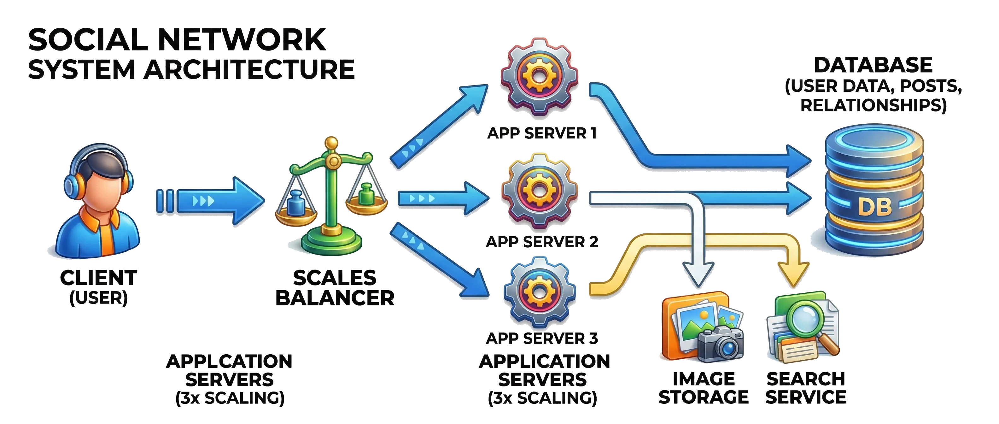

Hình minh họa: Client → Load Balancer → 3 Application Server → Database; từ App Server có nhánh phụ tới Image Storage và Search Service.

```text
Client (web/mobile)
        │
        ▼
  Load Balancer
   ┌────┼────┐
   ▼    ▼    ▼
 App1 App2 App3 ──► Image Storage
   └────┼────┘  └──► Search Service
        ▼
     Database
```

> 💡 **Giải thích:** Luồng client → load balancer → application server → database là **pattern phổ biến nhất**. Các dịch vụ phụ trợ như image storage và search service cho thấy hệ thống thực tế được tách thành nhiều thành phần độc lập.

### Mục đích của kiến trúc cấp cao

> Kiến trúc cấp cao giúp toàn đội ***cùng hiểu*** cấu trúc hệ thống trước khi đi vào chi tiết.

- Xác định các thành phần chính và mối quan hệ giữa chúng
- Phát hiện sớm điểm mạnh, điểm yếu và *nút thắt cổ chai* tiềm năng
- Nền tảng để thảo luận về scalability, availability, reliability
- Kỹ năng thiết yếu trong **phỏng vấn system design**

> 💡 **Giải thích:** Kiến trúc cấp cao không chỉ dùng cho phỏng vấn. Thực tế, nó là **công cụ giao tiếp** giữa các kỹ sư với nhau và giữa kỹ sư với stakeholder; một sơ đồ rõ ràng giúp cả đội thống nhất cách hệ thống hoạt động trước khi bắt đầu code.

---

## 12. Các thành phần phổ biến trong hệ thống

### Web Server — Máy chủ web

> **Web server** là cửa ngõ giao tiếp giữa bên ngoài và hệ thống, tiếp nhận và điều hướng mọi yêu cầu HTTP.

- Nhận yêu cầu HTTP từ client (trình duyệt, ứng dụng)
- Phục vụ *nội dung tĩnh* trực tiếp: hình ảnh, CSS, JavaScript
- Chuyển tiếp yêu cầu phức tạp đến **application server**
- Ví dụ phổ biến: *Apache*, *Nginx*, *IIS*

> 💡 **Giải thích:** Web server là tầng đầu tiên của hầu hết hệ thống web. Ví dụ **lễ tân**: mọi khách đến đều qua lễ tân, lễ tân hướng dẫn khách tới đúng phòng ban. Web server cũng vậy: tự xử lý việc đơn giản (file tĩnh) và chuyển việc phức tạp cho application server.

### Application Server — Máy chủ ứng dụng

> **Application server** là nơi chứa và thực thi toàn bộ *business logic* của ứng dụng.

- Nhận yêu cầu từ web server, xử lý logic nghiệp vụ
- Truy vấn/cập nhật database, gọi các dịch vụ khác
- Trả về kết quả (HTML, JSON) để web server gửi lại client
- Công nghệ đa dạng: *Spring Boot*, *Django*, *Node.js/Express*, *.NET*

> 💡 **Giải thích:** Nếu web server là lễ tân thì application server là **phòng bếp**, nơi mọi việc thực sự diễn ra. Ví dụ ứng dụng đặt xe: tìm tài xế gần nhất, tính giá cước, tạo chuyến đi trong database đều chạy ở application server. Hệ thống lớn thường có **nhiều application server chạy song song sau load balancer**.

### Database — Cơ sở dữ liệu

> **Database** là *bộ nhớ lâu dài* của hệ thống, lưu trữ mọi dữ liệu cần ghi nhớ và truy xuất sau này.

- Tài khoản người dùng, bài viết, đơn hàng, tin nhắn: tất cả lưu trong database
- Chạy trên máy chủ riêng, tách biệt với application server
- Có thể dùng **replication**: một máy chính ghi, nhiều máy phụ đọc
- Lựa chọn đúng loại database rất quan trọng cho hiệu năng

> 💡 **Giải thích:** Database là "ký ức" của hệ thống; không có nó, mọi dữ liệu mất khi server tắt. Tách database ra máy chủ riêng giúp **mở rộng từng thành phần độc lập**. Replication giúp tăng **throughput đọc** và độ tin cậy.

### Hai loại database phổ biến

> Chọn loại database phù hợp với đặc điểm dữ liệu và yêu cầu truy vấn của hệ thống.

| SQL (Relational) | NoSQL (Non-Relational) |
|---|---|
| MySQL, PostgreSQL, Oracle | MongoDB, Cassandra, Redis, DynamoDB |
| Dữ liệu dạng **bảng**, cấu trúc rõ ràng | Dữ liệu dạng *document, key-value, graph* |
| Ngôn ngữ truy vấn *SQL* | **Linh hoạt** hơn về schema |
| Phù hợp cho dữ liệu có cấu trúc chặt, truy vấn phức tạp (JOIN) | Phù hợp cho dữ liệu không có cấu trúc cố định, cần hiệu năng cao |

> 💡 **Giải thích:** "Chọn SQL hay NoSQL?" là câu hỏi phỏng vấn kinh điển, và không có đáp án tuyệt đối. **SQL** phù hợp khi dữ liệu có quan hệ phức tạp và cần **ACID transaction**. **NoSQL** phù hợp khi cần mở rộng nhanh, dữ liệu ít cấu trúc cố định, hoặc cần đọc/ghi hiệu năng rất cao. (Chi tiết ở Bài 5A.)

### Load Balancer — Bộ cân bằng tải

> **Load balancer** phân phối đều yêu cầu đến nhiều server, đảm bảo không server nào bị quá tải.

- **Phân phối tải:** round-robin, least connections, hoặc theo trọng số
- **Dự phòng:** tự động loại server lỗi, chuyển traffic sang server khác
- **Linh hoạt:** thêm/gỡ server mà không cần dừng dịch vụ
- Có thể là phần cứng hoặc phần mềm (*HAProxy*, *Nginx*, cloud LB)

> 💡 **Giải thích:** Load balancer là thành phần **không thể thiếu của horizontal scaling**. Ví dụ mua vé bóng đá: 100.000 người cùng bấm mua lúc mở bán; không có load balancer thì một server quá tải và sập, có load balancer thì tải được chia cho nhiều server xử lý song song. Ba vai trò cần nhớ: **phân phối tải, dự phòng, linh hoạt bảo trì**.
>
> 📌 **Mở rộng:** *Round-robin* chia lần lượt cho từng server; *least connections* gửi tới server đang có ít kết nối nhất; *weighted* (theo trọng số) gửi nhiều hơn cho server mạnh hơn. Chi tiết ở Bài 6.

### Hình: Load balancer phân phối traffic

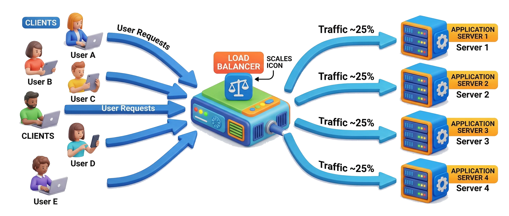

Hình minh họa: nhiều client gửi request tới một Load Balancer, load balancer chia cho 4 Application Server giống nhau, mỗi server nhận khoảng 25% tải.

> 💡 **Giải thích:** Khi một server quá tải hoặc hỏng, load balancer tự động phân phối lại phần tải đó cho các server còn lại. Đây là cơ chế cốt lõi của horizontal scaling.

### Cache — Bộ nhớ đệm

> **Cache** lưu trữ tạm thời dữ liệu thường xuyên truy cập để ***tăng tốc độ phản hồi*** và giảm tải cho database.

- Dữ liệu được lưu trong bộ nhớ nhanh (RAM) thay vì đọc từ đĩa
- **Cache phía client:** trình duyệt cache file CSS, JS, hình ảnh
- **Cache phía server:** in-memory cache hoặc distributed cache (*Redis*, *Memcached*)
- Thách thức chính: *invalidation*, tức đồng bộ cache khi dữ liệu gốc thay đổi

> 💡 **Giải thích:** Ví dụ **bàn làm việc và tủ hồ sơ**: thay vì lần nào cũng ra tủ tìm, ta photo sẵn để trên bàn. Nhưng nếu tài liệu gốc thay đổi thì bản photo phải được cập nhật; đó là bài toán **cache invalidation** nổi tiếng. Cache phù hợp nhất cho dữ liệu **đọc nhiều, ít thay đổi**.

### CDN — Mạng phân phối nội dung

> **CDN** (Content Delivery Network) phân phối nội dung đến người dùng từ máy chủ ***gần họ nhất về mặt địa lý***.

- Mạng lưới máy chủ đặt tại nhiều vị trí địa lý trên toàn thế giới
- Giảm latency: người dùng Việt Nam lấy nội dung từ server Việt Nam
- Giảm tải cho máy chủ gốc: nội dung tĩnh không cần request về trung tâm
- Thường dùng cho: hình ảnh, video, file CSS/JS, đôi khi cả trang HTML
- Ví dụ: *Cloudflare*, *Akamai*, *Amazon CloudFront*

> 💡 **Giải thích:** CDN giải quyết **bài toán địa lý của latency**. Ví dụ **kho hàng vệ tinh**: thay vì gửi hàng từ Hà Nội sang Mỹ cho mỗi đơn, đặt sẵn kho ở Mỹ rồi giao từ đó. Với người dùng, CDN hoàn toàn "vô hình": họ chỉ thấy website tải nhanh hơn.

### Message Queue — Hàng đợi thông điệp

> **Message Queue** cho phép các thành phần hệ thống giao tiếp *bất đồng bộ*: bên gửi không cần chờ bên nhận xử lý xong.

- Bên gửi (producer) đẩy thông điệp vào hàng đợi rồi tiếp tục làm việc khác
- Bên nhận (consumer) lấy thông điệp ra xử lý khi sẵn sàng
- Ví dụ: *RabbitMQ*, *Apache Kafka*, *Amazon SQS*
- Tách biệt các service → hệ thống linh hoạt và ít phụ thuộc hơn

> 💡 **Giải thích:** Ví dụ **quán phở**: phiếu gọi món là *message*, bảng ghim trong bếp là *queue*, anh phục vụ là *producer*, đầu bếp là *consumer*. Anh phục vụ không cần đứng chờ đầu bếp nấu xong mới đi phục vụ khách tiếp theo. Mô hình này rất phổ biến trong kiến trúc **microservices**.

### Ứng dụng của message queue

> Message queue phù hợp với mọi tác vụ ***không cần kết quả tức thì*** cho người dùng.

- **Xử lý tác vụ nền:** gửi email xác nhận sau khi đăng ký tài khoản
- **Điều hòa tải:** lúc cao điểm, nhiệm vụ xếp hàng và xử lý dần, tránh sập hệ thống
- **Tách rời service:** các service không phụ thuộc thời gian thực vào nhau
- Khi thiết kế: nếu tác vụ không cần kết quả ngay → cân nhắc dùng *message queue*

> 💡 **Giải thích:** Hai use case quan trọng nhất: **xử lý nền** (gửi email, tạo báo cáo, resize ảnh) và **điều hòa tải đỉnh**. Nếu 100.000 người đặt vé cùng lúc, thay vì xử lý tất cả một lượt, ta đưa vào queue rồi xử lý tuần tự, nên hệ thống không bị quá tải.

### Tổng kết các thành phần

> Mọi hệ thống lớn đều được xây dựng từ những thành phần cơ bản này: hiểu rõ từng thành phần là chìa khóa của system design.

| Thành phần | Vai trò chính |
|---|---|
| **Web Server** | Tiếp nhận và điều hướng request HTTP |
| **Application Server** | Thực thi business logic |
| **Database** | Lưu trữ dữ liệu lâu dài |
| **Load Balancer** | Phân phối tải, tăng availability |
| **Cache** | Tăng tốc đọc, giảm tải database |
| **CDN** | Phân phối nội dung theo địa lý |

> 💡 **Giải thích:** Trong hệ thống thực tế, các thành phần này thường xuất hiện cùng nhau và bổ trợ cho nhau. **Message Queue** không có trong bảng nhưng vẫn là thành phần quan trọng, đã trình bày ở phần *Message Queue — Hàng đợi thông điệp* phía trên: *giao tiếp bất đồng bộ, xử lý nền, điều hòa tải*.

### Tổng kết

> Nắm vững các khái niệm nền tảng chính là ***chìa khóa*** để thiết kế hệ thống.

- **Chỉ số hiệu năng:** Latency (độ trễ một request) và Throughput (sức tải tổng thể)
- **Tính chất hệ thống:** Scalability, Availability, Reliability, ba trụ cột thiết kế
- **Nhất quán:** strong / eventual / weak, lựa chọn theo yêu cầu nghiệp vụ
- **Kiến trúc cấp cao:** bức tranh tổng quan, công cụ giao tiếp và phỏng vấn
- **Các thành phần:** Web Server, App Server, Database, Load Balancer, Cache, CDN, Message Queue

> 💡 **Giải thích:** Chương này đặt nền móng cho toàn khóa học; mọi thiết kế phức tạp hơn ở các chương sau đều dựa trên các khái niệm này. Phần nhất quán và CAP bổ sung chiều sâu cho availability và reliability. Nên **tự vẽ lại sơ đồ kiến trúc cấp cao** để nhớ cách các thành phần kết hợp với nhau.

---

## 🧠 Tóm tắt nhanh

| Khái niệm | Ý chính cần nhớ |
|---|---|
| **Latency** | Thời gian 1 request (ms), càng nhỏ càng tốt. Giảm bằng: CDN/edge, cache, tối ưu thuật toán, giảm round-trip, giao thức hiệu quả |
| **Throughput** | Số request/dữ liệu xử lý thành công mỗi đơn vị thời gian (req/s, MB/s). Tăng bằng thêm "làn" (thêm server) |
| **Latency vs Throughput** | Không luôn đi cùng nhau; quá tải → latency tăng vọt → cần mở rộng |
| **Scalability** | Chịu tải tăng mà không giảm hiệu năng; có thể scale down |
| **Vertical (scale up)** | Nâng cấp 1 máy; đơn giản, có giới hạn phần cứng, là SPOF |
| **Horizontal (scale out)** | Thêm máy; không giới hạn lý thuyết, chịu lỗi, cần load balancer → được ưu tiên |
| **Availability** | % uptime. 99% ≈ 3,65 ngày/năm; 99.9% ≈ 8,76 giờ/năm (≈ 43,8 phút/tháng); 99.99% ≈ 52,6 phút/năm; 99.999% ≈ 5,26 phút/năm |
| **Tăng availability** | Redundancy, load balancing, multi-zone/region, health check, loại bỏ SPOF |
| **Consistency** | Mọi node thấy cùng dữ liệu, đọc luôn ra bản mới nhất |
| **C ↔ A** | Nhất quán tuyệt đối → có lúc ngừng phục vụ; khả dụng tối đa → chấp nhận dữ liệu cũ |
| **Strong** | Đọc luôn mới nhất; khóa/đồng bộ chặt; latency cao. Ngân hàng, đặt vé, đặt lịch |
| **Eventual** | Tạm lệch, cuối cùng hội tụ; nhanh, khả dụng cao. Mạng xã hội, Cassandra, DynamoDB, CDN |
| **Weak** | Không hứa thời hạn; cache TTL, bảng xếp hạng, view counter. Eventual ⊂ Weak |
| **Sync replication** | Cập nhật mọi bản sao rồi mới ACK → strong, chậm, có thể block |
| **Async replication** | ACK ngay sau khi primary ghi → eventual, nhanh |
| **Failover** | Primary hỏng → secondary tự tiếp quản (health check); phải đi cặp với replication |
| **Quorum** | **W + R > N** → tập đọc ∩ tập ghi ≠ ∅ (chồng tối thiểu W+R−N node). W=R=⌊N/2⌋+1 ≈ strong |
| **CAP** | Brewer 2000, chứng minh 2002. P là bắt buộc → chọn **CP** (trả lỗi, giữ đúng: ngân hàng, SQL) hoặc **AP** (luôn trả lời, dữ liệu có thể cũ: mạng xã hội, NoSQL/BASE) |
| **Reliability** | = availability + đúng đắn/toàn vẹn dữ liệu. Reliability ⊃ Availability. Kỹ thuật: backup & restore, replication, loại SPOF, idempotency |
| **High-level architecture** | Boxes + đường nối, không chi tiết implementation; bước đầu tiên khi thiết kế/phỏng vấn |
| **Thành phần** | Web server (cửa ngõ, file tĩnh), App server (business logic), Database (lưu lâu dài; SQL vs NoSQL), Load balancer (phân tải, dự phòng), Cache (RAM, invalidation), CDN (gần người dùng), Message queue (bất đồng bộ) |
| **Phỏng vấn** | Làm rõ yêu cầu → nêu trade-off → giải pháp cụ thể kèm lý do → dùng từ khóa đúng chỗ → quay về người dùng |

---

## ❓ Câu hỏi ôn tập

**Câu 1.** **Latency** và **throughput** khác nhau như thế nào? Cho ví dụ minh họa mỗi khái niệm.

<details><summary>Đáp án</summary>

- **Latency** = thời gian xử lý **một** yêu cầu, từ lúc gửi đến lúc nhận phản hồi (đơn vị ms). Ví dụ: bấm "Đăng nhập" mất 200 ms mới thấy trang chủ; một chiếc xe mất 30 giây để qua trạm thu phí.
- **Throughput** = **số lượng** yêu cầu (hoặc dữ liệu) xử lý thành công trong một đơn vị thời gian (req/s, MB/s). Ví dụ: server xử lý 1 000 req/s; trạm thu phí cho 60 xe/phút đi qua.
- Khác biệt cốt lõi: latency đo **tốc độ của từng việc**, throughput đo **sức chứa tổng thể**. Hai chỉ số độc lập: mở thêm làn thu phí làm tăng throughput nhưng không làm xe qua nhanh hơn (latency không đổi); ngược lại khi quá tải, request xếp hàng làm latency tăng.

</details>

**Câu 2.** Một hệ thống có latency = 10ms nhưng chỉ xử lý được 5 req/s. Đây là vấn đề về latency hay throughput? Làm thế nào để cải thiện?

<details><summary>Đáp án</summary>

- Đây là **vấn đề throughput**. Latency 10 ms là rất tốt (mỗi request được trả lời nhanh), nhưng hệ thống chỉ phục vụ được 5 request mỗi giây, quá ít.
- Phân tích nhanh: nếu mỗi request chỉ tốn 10 ms và xử lý tuần tự, về lý thuyết một luồng đã đạt 1 000 / 10 = **100 req/s**. Chỉ đạt 5 req/s cho thấy có **nút thắt** khác: xử lý đồng thời bị giới hạn (ít thread/worker, khóa toàn cục), tài nguyên dùng chung bị nghẽn (connection pool database quá nhỏ), hoặc một bước nặng chạy nối tiếp.
- Cách cải thiện:
  1. **Horizontal scaling**: thêm server phía sau **load balancer** (giống mở thêm làn thu phí).
  2. **Tăng xử lý đồng thời**: thêm worker/thread, dùng I/O bất đồng bộ, tăng connection pool, bỏ khóa không cần thiết.
  3. **Cache** dữ liệu đọc nhiều để giảm tải database.
  4. Đưa tác vụ không cần kết quả ngay vào **message queue** để xử lý nền.
  5. Vertical scaling (thêm CPU/RAM) nếu nút thắt là tài nguyên phần cứng, nhưng có giới hạn.

</details>

**Câu 3.** **Vertical scaling** và **horizontal scaling**: khi nào nên dùng cách nào?

<details><summary>Đáp án</summary>

- **Vertical scaling (scale up)** nên dùng khi: hệ thống còn nhỏ hoặc vừa, tải tăng vừa phải; muốn giải pháp nhanh, **không đổi kiến trúc**; thành phần khó phân tán (ví dụ một database quan hệ đơn, ứng dụng có trạng thái). Nhược điểm: giới hạn phần cứng, chi phí tăng nhanh ở cấu hình cao, và máy đó là **single point of failure**.
- **Horizontal scaling (scale out)** nên dùng khi: số người dùng lớn và tăng liên tục hoặc đột biến; cần **chịu lỗi/high availability**; cần co giãn linh hoạt (thêm/bớt máy theo tải). Yêu cầu: có **load balancer**, ứng dụng nên **stateless** (trạng thái lưu ở DB/cache dùng chung), chấp nhận độ phức tạp của hệ phân tán.
- Thực tế thường **bắt đầu bằng vertical** cho đơn giản, rồi chuyển sang **horizontal** khi chạm giới hạn hoặc khi cần dự phòng; hai cách cũng có thể kết hợp.

</details>

**Câu 4.** Giải thích sự khác biệt giữa **availability** và **reliability**. Một hệ thống có thể có availability cao nhưng reliability thấp không? Cho ví dụ.

<details><summary>Đáp án</summary>

- **Availability**: tỉ lệ thời gian hệ thống **đang chạy và phản hồi** được (uptime).
- **Reliability**: hệ thống chạy **ổn định, đúng đắn và giữ toàn vẹn dữ liệu** trong thời gian dài. Reliability = availability + tính đúng đắn của dữ liệu; reliability **bao hàm** availability.
- **Có thể** có availability cao nhưng reliability thấp. Ví dụ:
  - Một ví điện tử uptime 99.99% nhưng thỉnh thoảng trừ tiền hai lần khi người dùng bấm lại (không có idempotency), hoặc làm mất giao dịch khi server sập giữa chừng.
  - Một website luôn trả về trang, nhưng do lỗi cache trả **số dư sai** hoặc dữ liệu của người khác.
- Hệ thống đó lúc nào cũng "lên", nhưng không thể tin được kết quả, nên reliability thấp. Ngược lại reliability cao thì gần như chắc chắn availability cũng cao.

</details>

**Câu 5.** Hệ thống đạt **99.9% uptime** thì mỗi tháng được phép downtime tối đa bao nhiêu phút?

<details><summary>Đáp án</summary>

Downtime cho phép = (1 − 0,999) × thời gian = **0,1%** thời gian.

- Tháng 30 ngày: 30 × 24 × 60 = 43 200 phút → 43 200 × 0,001 = **43,2 phút**.
- Tháng trung bình (365/12 ≈ 30,44 ngày ≈ 43 800 phút): 43 800 × 0,001 ≈ **43,8 phút** (con số thường được trích dẫn).
- Đối chiếu theo năm: 525 600 phút × 0,001 = 525,6 phút ≈ **8,76 giờ/năm**, khớp với bảng "số chín".

→ Đáp án: khoảng **43–44 phút/tháng** (≈ 43,8 phút).

</details>

**Câu 6.** Tại sao **kiến trúc cấp cao** (high-level architecture) lại là bước đầu tiên khi thiết kế hệ thống?

<details><summary>Đáp án</summary>

- Nó cho **bức tranh tổng thể** (các thành phần chính và cách chúng tương tác) trước khi sa vào chi tiết, giống bản thiết kế tổng thể của ngôi nhà trước khi lo từng phòng.
- Giúp **cả đội và stakeholder cùng hiểu, cùng thống nhất** cấu trúc hệ thống trước khi code (công cụ giao tiếp).
- **Phát hiện sớm** điểm mạnh, điểm yếu, **nút thắt cổ chai** và single point of failure, khi sửa còn rẻ.
- Là **nền để thảo luận** scalability, availability, reliability, consistency: phải biết có những khối nào thì mới bàn được nhân bản khối nào, cache ở đâu, đặt load balancer chỗ nào.
- Trong phỏng vấn system design, người phỏng vấn luôn yêu cầu vẽ sơ đồ tổng quan trước; đây là kỹ năng thể hiện tư duy có cấu trúc.

</details>

**Câu 7.** **Load balancer** giải quyết vấn đề gì? Nếu không có load balancer, điều gì xảy ra khi một server bị quá tải?

<details><summary>Đáp án</summary>

- Load balancer giải quyết ba vấn đề:
  1. **Phân phối tải** đều cho nhiều server (round-robin, least connections, weighted) để không server nào quá tải, nhờ đó horizontal scaling hoạt động được.
  2. **Dự phòng**: dùng health check để loại server lỗi, chuyển traffic sang server khỏe, giúp tăng availability.
  3. **Linh hoạt**: thêm/gỡ server, bảo trì từng máy mà không dừng dịch vụ.
- Không có load balancer: client gọi thẳng vào một server cố định (hoặc phân chia thủ công). Khi server đó quá tải thì latency tăng vọt, request bị timeout/lỗi, và server có thể **sập**; các server khác dù rảnh cũng không được tận dụng. Nếu server sập, mọi người dùng trỏ vào nó đều mất dịch vụ, tức nó là **single point of failure**. Ví dụ: 100 000 người mua vé bóng đá cùng lúc dồn vào một server, server sập.

</details>

**Câu 8.** Phân biệt **cache phía client** và **cache phía server**. Nêu một trường hợp phù hợp cho từng loại.

<details><summary>Đáp án</summary>

| | Cache phía client | Cache phía server |
|---|---|---|
| Nằm ở đâu | Trình duyệt / app của người dùng | Trên hạ tầng của hệ thống: in-memory trong app server, hoặc distributed cache (Redis, Memcached) |
| Phạm vi | Riêng cho **một** người dùng | **Dùng chung** cho mọi người dùng |
| Lợi ích | Không cần gửi request lên mạng → latency gần 0, giảm băng thông | Giảm tải database, tăng tốc các truy vấn lặp lại |
| Kiểm soát | Hệ thống khó chủ động xóa (dựa vào HTTP header, TTL, đổi tên file) | Hệ thống chủ động invalidate/cập nhật được |

- Trường hợp phù hợp cho **client cache**: file tĩnh ít đổi như logo, CSS, JS, font (ví dụ đặt `Cache-Control: max-age=31536000` và đổi tên file khi có phiên bản mới).
- Trường hợp phù hợp cho **server cache**: danh sách "bài viết hot" của trang tin tức hoặc trang chi tiết sản phẩm được hàng nghìn người đọc mỗi phút; lưu trong Redis với TTL vài phút để database không phải truy vấn lặp lại.

</details>

**Câu 9.** Khi nào nên dùng **message queue** thay vì xử lý trực tiếp (synchronous)? Cho một ví dụ cụ thể.

<details><summary>Đáp án</summary>

- Dùng message queue khi tác vụ **không cần kết quả tức thì** cho người dùng, và khi:
  - tác vụ **chậm/nặng** (gửi email, resize ảnh, xuất báo cáo, transcode video);
  - cần **điều hòa tải đỉnh** (nhận yêu cầu nhanh, xử lý dần theo năng lực);
  - cần **tách rời service**, để service A không phụ thuộc vào việc service B có đang sống hay không.
- Vẫn nên xử lý trực tiếp (synchronous) khi người dùng cần kết quả ngay để đi tiếp (ví dụ kiểm tra đăng nhập, hiển thị số dư).
- Ví dụ: người dùng **đăng ký tài khoản**. App server lưu user vào database, trả "Đăng ký thành công" ngay, đồng thời đẩy message `SendWelcomeEmail(userId)` vào queue (RabbitMQ/SQS). Email worker (consumer) lấy message ra để gửi email. Nếu dịch vụ email chậm hoặc tạm lỗi, việc đăng ký không bị ảnh hưởng và message được xử lý lại sau. Ví dụ khác: 100 000 người đặt vé cùng lúc, yêu cầu được đưa vào queue và xử lý tuần tự để hệ thống không sập.

</details>

---

## 📝 Bài tập

### Bài tập 1 — Kiến trúc tổng quan

**Tình huống:** Bạn được giao thiết kế hệ thống cho một **trang tin tức trực tuyến** với 500.000 lượt đọc mỗi ngày, nội dung cập nhật mỗi giờ.

- Vẽ **kiến trúc cấp cao** gồm ít nhất 5 thành phần đã học
- Xác định thành phần nào giúp giảm **latency** cho người đọc ở nhiều vùng địa lý
- Giải thích tại sao cần **cache** và nên đặt cache ở đâu trong kiến trúc
- Chỉ ra điểm nào có thể là **nút thắt cổ chai** khi traffic tăng đột biến

<details><summary>Lời giải gợi ý</summary>

**Ước lượng tải:** 500 000 lượt/ngày ÷ 86 400 s ≈ **5,8 lượt/s trung bình**. Tin tức có giờ cao điểm và tin "nóng", nên giả sử đỉnh gấp 10–20 lần, tức khoảng **60–120 lượt/s**. Đây là hệ thống **đọc rất nhiều, ghi rất ít** (biên tập viên đăng bài, nội dung đổi mỗi giờ). Dữ liệu cũ vài phút chấp nhận được, nên có thể dùng **eventual consistency** và cache mạnh tay.

**Kiến trúc (6–7 thành phần):**

```text
Người đọc (nhiều vùng)
        │
        ▼
      CDN  ──(cache trang HTML/ảnh/CSS/JS, TTL ≈ vài phút–1 giờ)
        │ cache miss
        ▼
  Load Balancer
        │
   ┌────┴────┐
   ▼         ▼
Web/App   Web/App   (stateless, scale ngang)
Server 1  Server 2
   │         │
   └──┬──────┘
      ▼
 Cache (Redis): bài hot, trang chủ, danh sách theo chuyên mục
      │ cache miss
      ▼
 Database (Primary)  ──async replication──►  Read Replica(s)
      ▲
      │ ghi bài mới mỗi giờ
 CMS biên tập  ──►  Message Queue  ──►  Worker (resize ảnh, cập nhật search, xóa/làm mới cache & CDN)
```

**Giảm latency theo địa lý:** **CDN**. Người đọc ở mỗi vùng nhận nội dung tĩnh (ảnh, CSS, JS) và cả trang HTML bài viết từ edge server gần họ, không phải đi về máy chủ gốc.

**Vì sao cần cache và đặt ở đâu:**
- Nội dung đọc nhiều, ít đổi (mỗi giờ), đúng loại dữ liệu lý tưởng cho cache. Cache giảm latency và **giảm tải database** rất mạnh.
- Đặt cache ở nhiều lớp:
  1. **Client (trình duyệt):** CSS/JS/ảnh với `max-age` dài.
  2. **CDN:** trang bài viết và trang chủ, TTL khớp chu kỳ cập nhật (vài phút đến 1 giờ).
  3. **Server-side (Redis)** giữa app server và database: danh sách bài hot, trang chủ, chuyên mục, bài viết theo ID.
- Khi đăng bài mới: **invalidate/làm mới** cache liên quan (qua worker), hoặc dựa vào TTL.

**Nút thắt cổ chai khi traffic tăng đột biến:**
- **Database** là điểm nghẽn chính nếu không có cache. Khắc phục bằng cache và read replica.
- **Cache stampede** 📌: khi một bài hot hết TTL, hàng nghìn request cùng miss và cùng đập vào DB. Khắc phục: khóa khi nạp lại cache, làm mới cache trước khi hết hạn.
- **Application server** nếu số máy cố định: thêm máy (auto scaling) sau load balancer.
- **Load balancer** nếu chỉ có một cái thì cũng là SPOF: dùng cặp LB active-passive hoặc LB của cloud.

</details>

### Bài tập 2 — Phân tích yêu cầu nhất quán

> Với mỗi hệ thống dưới đây, xác định mô hình nhất quán phù hợp và giải thích lý do.

- **A.** Hệ thống quản lý tồn kho thương mại điện tử (hàng nghìn đơn/phút)
- **B.** Tính năng "đang nhập..." (*typing indicator*) trong ứng dụng chat
- **C.** Hệ thống thanh toán cổng nạp điện thoại: số tiền nạp vào tài khoản
- **D.** Bảng xếp hạng người chơi trong game mobile, cập nhật theo mùa
- **E.** Tính năng đặt lịch khám bệnh tại bệnh viện, một bác sĩ chỉ khám một bệnh nhân/khung giờ

*Yêu cầu: nêu mô hình (strong / eventual / weak), lý do chọn, và đánh đổi cần chấp nhận.*

<details><summary>Lời giải gợi ý</summary>

Đây là bài phân loại **mở**: quan trọng là lập luận, không có đáp án cứng.

| Hệ thống | Mô hình | Lý do | Đánh đổi chấp nhận |
|---|---|---|---|
| **A. Tồn kho TMĐT** | **Eventual** | Hàng nghìn đơn/phút, tốc độ và khả dụng quan trọng; số tồn hiển thị lệch vài giây không gây hại lớn; conflict (bán vượt) có thể xử lý sau: hoàn tiền, xin lỗi, đặt thêm hàng | Có thể **bán vượt (oversell)** vài đơn khi hàng gần hết |
| **B. "Đang nhập..."** | **Weak** | Tín hiệu tạm thời, vô hại nếu trễ vài giây hoặc mất hẳn; cần nhẹ, nhanh | Có lúc hiển thị sai hoặc trễ, không ai bị thiệt |
| **C. Nạp tiền điện thoại** | **Strong** | Liên quan tiền: sai lệch số tiền (nạp hai lần, mất tiền) là không chấp nhận được | Latency cao hơn; khi có sự cố mạng có thể **từ chối giao dịch** (CP) thay vì xử lý sai |
| **D. Bảng xếp hạng theo mùa** | **Weak hoặc Eventual** | Không cần cập nhật tức thì; chỉ cần đúng khi chốt mùa; ưu tiên gameplay mượt | Người chơi thấy thứ hạng cũ trong vài phút |
| **E. Đặt lịch khám** | **Strong** | Một bác sĩ chỉ khám một bệnh nhân/khung giờ, giống bài toán double-booking ghế máy bay | Đặt lịch chậm hơn một chút; khi có sự cố có thể tạm không cho đặt |

📌 **Mở rộng cho câu A:** thực tế thường **kết hợp**: phần *hiển thị* tồn kho và danh mục dùng eventual consistency (nhanh), còn bước *trừ kho khi thanh toán* với mặt hàng sắp hết dùng thao tác nguyên tử hoặc khóa (strong) để tránh oversell. Nêu được sự kết hợp này là điểm cộng khi phỏng vấn.

</details>

### Bài tập 3 — Tính toán quorum

Cho một cụm gồm **7 node** lưu trữ dữ liệu. Tính toán và trả lời các câu hỏi sau.

- **3a.** Giá trị tối thiểu của W và R để thỏa mãn điều kiện quorum (*W + R > N*) là bao nhiêu?
- **3b.** Nếu chọn W=4, R=4: hệ thống chịu được tối đa bao nhiêu node ghi thất bại mà vẫn hoạt động?
- **3c.** Nếu chọn W=2, R=6: hiệu năng ghi hay đọc cao hơn? Ưu nhược điểm là gì?
- **3d.** Khi nào nên chọn W lớn (gần N)? Khi nào nên chọn R lớn?
- **3e.** Nếu một node chứa dữ liệu mới nhất bị offline trong thao tác đọc R=4: điều gì xảy ra?

*Yêu cầu: trình bày phép tính và giải thích ý nghĩa thực tế của từng kết quả.*

<details><summary>Lời giải gợi ý</summary>

**N = 7.**

**3a. Giá trị tối thiểu**

- Điều kiện: W + R > 7, tức **W + R ≥ 8** (W, R nguyên).
- Tổng nhỏ nhất là **8**. Các cặp thỏa mãn với tổng 8: (W, R) = (1, 7), (2, 6), (3, 5), **(4, 4)**, (5, 3), (6, 2), (7, 1).
- Cấu hình cân bằng nhỏ nhất: **W = R = ⌊7/2⌋ + 1 = 4** (quorum đa số). Số node chồng chéo tối thiểu = W + R − N = 8 − 7 = **1**, nên mọi lần đọc luôn gặp ít nhất 1 node có bản ghi mới nhất.
- 📌 Nếu còn muốn ngăn **hai lần ghi đồng thời xung đột** thì cần thêm **W > N/2**, tức W ≥ 4. Khi đó cặp nhỏ nhất thỏa cả hai điều kiện là W = 4, R = 4.
- Ý nghĩa: (4, 4) là điểm cân bằng; các cặp lệch (2, 6), (6, 2)... vẫn nhất quán nhưng dồn chi phí về một phía (đọc hoặc ghi).

**3b. W = 4, R = 4: chịu được bao nhiêu node lỗi?**

- Ghi thành công cần 4 node xác nhận → tối đa **7 − 4 = 3 node** có thể lỗi mà ghi vẫn thành công.
- Đọc cần 4 node trả lời → cũng chịu được **7 − 4 = 3 node** lỗi.
- Kết luận: hệ thống chịu tối đa **3 node hỏng** mà vẫn đọc và ghi bình thường. Hỏng từ 4 node trở lên thì chỉ còn ≤ 3 node, không đủ quorum, nên thao tác **bị từ chối** (hệ thống chọn đúng đắn thay vì khả dụng, kiểu CP).

**3c. W = 2, R = 6**

- Kiểm tra: 2 + 6 = 8 > 7, vẫn **thỏa quorum**; chồng chéo tối thiểu 2 + 6 − 7 = 1 node, nên đọc vẫn ra bản mới nhất.
- **Ghi nhanh hơn** (chỉ chờ 2 xác nhận, và chỉ cần chờ node nhanh thứ 2); **đọc chậm hơn** (phải chờ 6 node trả lời, nên bị kéo theo node chậm thứ 6).

| | Ghi (W=2) | Đọc (R=6) |
|---|---|---|
| Tốc độ | Nhanh | Chậm |
| Số node lỗi chịu được | 7 − 2 = **5** | 7 − 6 = **1** |

- **Ưu điểm:** latency ghi thấp, khả dụng ghi rất cao (5 node hỏng vẫn ghi được), hợp với workload **ghi nhiều, đọc ít** (log, sự kiện, sensor).
- **Nhược điểm:** đọc chậm và **khả dụng đọc thấp** (chỉ cần 2 node hỏng là không đọc được); lúc xác nhận ghi, dữ liệu mới chỉ chắc chắn nằm trên 2 node nên độ bền thấp hơn nếu 2 node đó cùng hỏng trước khi kịp lan ra.
- 📌 Lưu ý: nhiều người cho rằng *R=6 đọc chậm hơn nhưng nhất quán cao hơn, nên hợp với hệ thống đọc nhiều cần độ chính xác cao*. Thực ra về mặt đảm bảo, (2, 6) và (4, 4) **nhất quán ngang nhau** (đều chồng chéo ít nhất 1 node). Với hệ thống đọc nhiều, cấu hình hợp lý hơn thường là **R nhỏ, W lớn** (xem 2d).

**3d. Khi nào chọn W lớn, khi nào chọn R lớn?**

- **W lớn (gần N), ví dụ W = 7, R = 1:** mỗi lần ghi phải lan tới gần như mọi node, nên dữ liệu **bền** (nhiều bản sao ngay khi ACK) và **đọc rất rẻ** (R nhỏ vẫn thỏa quorum). Phù hợp khi **đọc nhiều, ghi ít** và cần chắc chắn dữ liệu đã ghi thì không mất (cấu hình hệ thống, danh mục sản phẩm, hồ sơ người dùng). Đánh đổi: ghi chậm, và chỉ cần vài node hỏng là **không ghi được**.
- **R lớn (gần N), ví dụ W = 1–2, R = 6–7:** ghi rất rẻ; mỗi lần đọc hỏi gần như mọi node nên chắc chắn thấy bản mới nhất. Phù hợp khi **ghi nhiều, đọc ít** nhưng lúc đọc cần chính xác (thu thập log/metrics, sự kiện). Đánh đổi: đọc chậm, khả dụng đọc thấp.
- Tóm lại: chọn W lớn khi cần nhất quán mạnh **ngay lúc ghi**; chọn R lớn khi cần đảm bảo **đọc được dữ liệu mới nhất**.

**3e. Node chứa dữ liệu mới nhất offline khi đọc với R = 4**

Giả sử cấu hình W = 4, R = 4 (đúng quorum):

- Lần ghi mới nhất nằm trên 4 node (gọi là "mới"), 3 node còn lại giữ bản cũ.
- Một node "mới" offline → còn **3 node mới + 3 node cũ = 6 node** online.
- Lần đọc phải lấy **4** câu trả lời trong 6 node này. Vì chỉ có 3 node cũ online, mọi tập 4 node **bắt buộc chứa ≥ 1 node mới**. Hệ thống so version/timestamp và trả về **bản mới nhất**, sau đó có thể *read repair* (ghi đè bản mới lên các node cũ).
- Tổng quát: với quorum chặt (W + R > N), node offline chỉ làm **giảm khả dụng**, không làm đọc ra dữ liệu cũ. Nếu offline quá nhiều (ở đây ≥ 4 node) thì không gom đủ R = 4 câu trả lời, nên lần đọc **thất bại/timeout** chứ không trả dữ liệu sai.
- **Khi nào thì đọc ra dữ liệu cũ?** (rủi ro *"quorum không đủ chặt"*):
  - Cấu hình **không thỏa** W + R > N, ví dụ W = 3, R = 4 (3 + 4 = 7, không lớn hơn 7). Nếu trong 3 node mới có 1 node offline, tập đọc có thể là 4 node cũ, nên đọc ra **dữ liệu cũ**.
  - Dùng *sloppy quorum / hinted handoff* 📌 (như Cassandra/Dynamo): khi node chính offline, ghi tạm vào node khác ngoài tập N, nên tập đọc và tập ghi có thể không giao nhau.
  - Một lần ghi thất bại nửa chừng (đã ghi vào < W node rồi báo lỗi) cũng có thể gây kết quả đọc không ổn định.
- Ý nghĩa thực tế: muốn an toàn thì phải **giữ đúng W + R > N**, kết hợp version/timestamp và read repair, đồng thời chấp nhận lần đọc có thể thất bại khi quá nhiều node hỏng.

</details>

### Bài tập 4 — Thiết kế replication và failover

Thiết kế chiến lược *replication* và *failover* cho hệ thống **đặt phòng khách sạn** với các yêu cầu sau.

- Hệ thống phục vụ **500.000 lượt đặt phòng/ngày**, không cho phép đặt trùng phòng
- Cần **uptime 99.9%**: tối đa ~8.7 giờ downtime mỗi năm
- Dữ liệu phải **không bị mất** khi có một node gặp sự cố
- Phạm vi triển khai: **hai trung tâm dữ liệu** tại Việt Nam

*Yêu cầu: vẽ sơ đồ kiến trúc (có thể mô tả bằng văn bản), chọn chiến lược replication, quorum W và R, và cơ chế failover. Giải thích lý do từng quyết định.*

<details><summary>Lời giải gợi ý</summary>

**Phân tích yêu cầu:**
- 500 000 lượt/ngày ÷ 86 400 s ≈ **5,8 lượt/s**; đỉnh gấp 10 lần khoảng **60 lượt/s**. Tải ghi không lớn, nên ưu tiên **đúng đắn** hơn tốc độ.
- "Không đặt trùng phòng" → **strong consistency** cho thao tác đặt phòng (hệ thống **CP** khi có phân vùng).
- 99.9% → ≤ **8,76 giờ/năm ≈ 43,8 phút/tháng**, nên failover phải **tự động**, tính bằng giây hoặc phút, không chờ người can thiệp.
- "Không mất dữ liệu khi 1 node hỏng" → mỗi lần ghi phải nằm trên **≥ 2 node** trước khi trả "OK", tức replication **đồng bộ** (ít nhất một phần).

**Sơ đồ (mô tả bằng văn bản):**

```text
                 Người dùng / App / Đại lý
                           │
                    DNS / Global LB  (health check, chuyển DC khi DC1 sập)
                  ┌────────┴─────────┐
                  ▼                  ▼
        ┌──── DC1 (Hà Nội) ────┐   ┌──── DC2 (TP.HCM) ────┐
        │ Load Balancer (x2)   │   │ Load Balancer (x2)   │
        │ App Servers (N máy)  │   │ App Servers (standby │
        │                      │   │  hoặc chỉ phục vụ đọc)│
        │ DB cluster 3 node:   │   │ DB 1–3 node replica  │
        │  Primary + 2 replica │──►│  (async replication) │
        │  sync / quorum       │   │                      │
        │  N=3, W=2, R=2       │   │                      │
        └──────────────────────┘   └──────────────────────┘
```

**Quyết định và lý do:**

1. **Trong DC1: synchronous replication (quorum) trên 3 node DB.**
   - **N = 3, W = 2, R = 2** → W + R = 4 > 3, nên đọc luôn chồng với ít nhất 1 node có bản mới; W = 2 nghĩa là mỗi lần đặt phòng được ghi trên **2 node trước khi ACK**, mất 1 node vẫn **không mất dữ liệu**.
   - Chịu lỗi: 3 − 2 = **1 node hỏng** vẫn đọc và ghi được.
   - Thay thế tương đương: primary + 1 synchronous standby + 1 async replica (leader-based replication).
2. **Chống đặt trùng:** mọi thao tác đặt phòng ghi qua **primary/leader** trong một **transaction**, với ràng buộc duy nhất `(room_id, date)` hoặc khóa dòng (`SELECT ... FOR UPDATE`) / optimistic locking theo version. Strong consistency trên node chính giúp hai người không thể cùng giữ một phòng một đêm.
3. **Giữa DC1 và DC2: asynchronous replication.**
   - Giúp không cộng độ trễ liên vùng vào mỗi lần đặt phòng; DC2 là bản sao dự phòng thảm họa và có thể phục vụ **đọc** (tra cứu phòng trống mang tính tham khảo).
   - Đánh đổi: nếu **toàn bộ DC1** mất, có thể mất vài giây dữ liệu cuối chưa kịp sang DC2. 📌 Vì Hà Nội–TP.HCM chỉ cách vài chục ms, nếu nghiệp vụ không chấp nhận mất bất kỳ booking nào khi mất cả DC, có thể đặt **một replica đồng bộ ở DC2** (W tính cả node DC2), chấp nhận latency ghi tăng nhẹ.
4. **Failover:**
   - **Trong DC:** health check (heartbeat) mỗi vài giây; nếu primary **không phản hồi khoảng 30 giây**, tự động **bầu/thăng cấp** replica đồng bộ lên primary (Patroni, MySQL Group Replication, hoặc Raft/etcd) và cập nhật endpoint cho app server. Vì replica đồng bộ đã có đủ dữ liệu nên không mất booking.
   - **Giữa DC:** Global LB/DNS health check; khi DC1 mất hoàn toàn thì chuyển traffic sang DC2 và thăng cấp DB ở DC2. Cần cơ chế tránh **split-brain** (chỉ một primary tại một thời điểm: dùng quorum/witness ở nơi thứ ba hoặc fencing).
   - Load balancer và app server đều có ≥ 2 bản để **không còn SPOF**.
5. **Kiểm tra với 99.9%:** failover tự động khoảng 30–60 giây mỗi sự cố; ngân sách khoảng 43 phút/tháng đủ cho vài chục lần failover cộng với bảo trì có kế hoạch (rolling update qua load balancer nên không cần downtime).
6. **Thêm cho reliability:** backup định kỳ và point-in-time recovery; **idempotency key** cho API đặt phòng để người dùng bấm lại không tạo booking trùng.

</details>

### Bài tập 5 — Tình huống CAP thực tế

Đọc hai tình huống và trả lời câu hỏi phân tích thiết kế.

**Tình huống A — Mạng xã hội toàn cầu:** Hệ thống có 3 datacenter tại Mỹ, Châu Âu, và Châu Á. Cáp ngầm biển bị đứt khiến Châu Á mất kết nối với hai khu vực còn lại trong 2 giờ. Hệ thống nên làm gì?

**Tình huống B — Sàn giao dịch chứng khoán:** Node phụ mất kết nối với node chính trong 500ms. Trong khoảng thời gian đó, một lệnh mua cổ phiếu vào với giá thị trường. Hệ thống nên xử lý thế nào?

*Yêu cầu: xác định loại sự cố (phân vùng P), phân tích hệ thống là CP hay AP, và đề xuất hành vi cụ thể của hệ thống trong mỗi tình huống.*

<details><summary>Lời giải gợi ý</summary>

**Tình huống A: Mạng xã hội toàn cầu → AP**

- **Loại sự cố:** network partition (P). Datacenter Châu Á vẫn sống nhưng bị cô lập khỏi Mỹ và Châu Âu trong 2 giờ.
- **Phân loại:** **AP**. Dữ liệu mạng xã hội (bài đăng, like, bình luận) không đòi hỏi chính xác tuyệt đối; để hàng trăm triệu người dùng Châu Á mất dịch vụ 2 giờ là thiệt hại lớn hơn nhiều so với việc thấy dữ liệu cũ.
- **Hành vi đề xuất:**
  - DC Châu Á **tiếp tục phục vụ** người dùng khu vực: đọc dữ liệu đang có (có thể cũ tới 2 giờ với nội dung từ Mỹ/Âu), vẫn **cho đăng bài, like, comment** và ghi cục bộ.
  - Các thay đổi được **xếp hàng (queue/log)** để đồng bộ khi cáp phục hồi; khi nối lại, hệ thống đồng bộ hai chiều và giải quyết xung đột (last-write-wins theo timestamp, hoặc gộp cho bộ đếm like, CRDT 📌).
  - Có thể hiển thị thông báo nhẹ kiểu "một số nội dung có thể chưa cập nhật"; các tính năng nhạy cảm (đổi mật khẩu, thanh toán quảng cáo) có thể tạm khóa hoặc chuyển sang chế độ CP riêng.
  - Kết quả: hệ thống **eventually consistent** sau khi phân vùng kết thúc.

**Tình huống B: Sàn giao dịch chứng khoán → CP**

- **Loại sự cố:** network partition (P) ngắn (500 ms) giữa node chính và node phụ.
- **Phân loại:** **CP**. Khớp lệnh sai giá, khớp trùng hoặc mất lệnh là không chấp nhận được về tài chính và pháp lý; độ trễ 500 ms thì chấp nhận được.
- **Hành vi đề xuất:**
  - Lệnh mua **không được khớp dựa trên dữ liệu có thể đã cũ** ở phía bị cô lập. Chỉ node chính (leader, nơi giữ sổ lệnh chuẩn) mới được khớp lệnh; nếu lệnh đi vào node phụ đang mất kết nối, node phụ **từ chối tạm thời** (trả lỗi, client retry) hoặc **giữ lệnh ở trạng thái pending** trong hàng đợi.
  - Khi kết nối phục hồi và trạng thái đã đồng bộ, lệnh pending được chuyển tới node chính và khớp theo **giá thị trường tại thời điểm khớp thật**, đúng thứ tự thời gian nhận lệnh.
  - Nếu chính node chính bị cô lập khỏi đa số cụm, nó phải **ngừng nhận ghi** (quorum/consensus) để tránh split-brain.
  - Đánh đổi: hy sinh availability trong khoảng 500 ms (hoặc lâu hơn nếu sự cố kéo dài) để giữ **tính đúng đắn**.

**So sánh:** cả hai tình huống đều là P, nhưng mạng xã hội chọn **uptime (A)**, còn sàn chứng khoán chọn **tính chính xác (C)**. Lựa chọn phụ thuộc **hậu quả của dữ liệu sai** trong từng nghiệp vụ.

</details>
