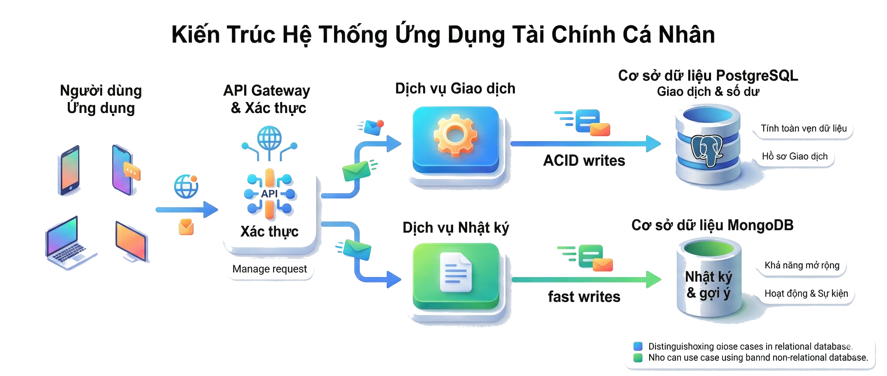
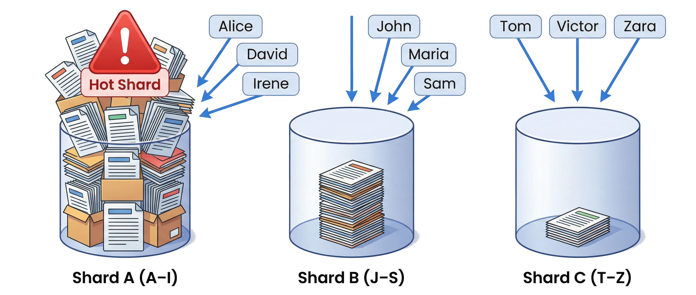
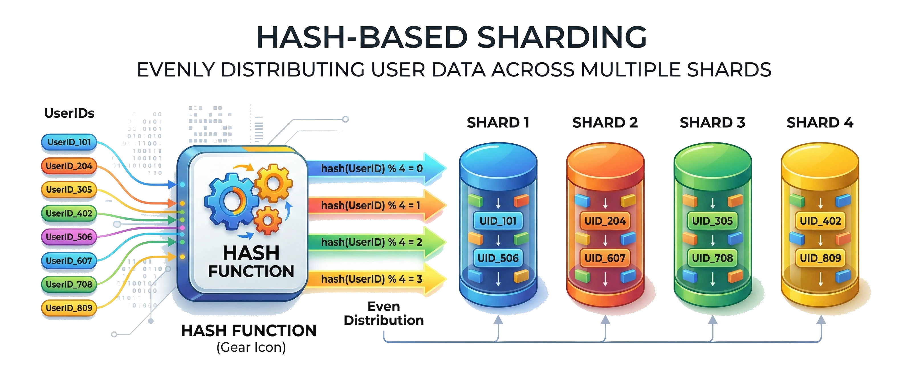
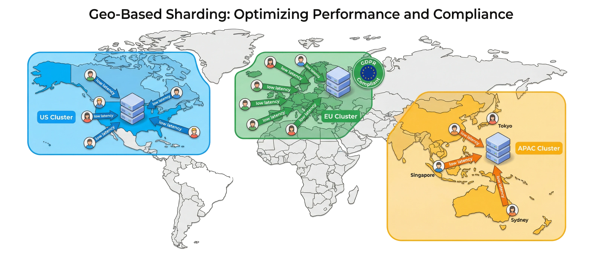
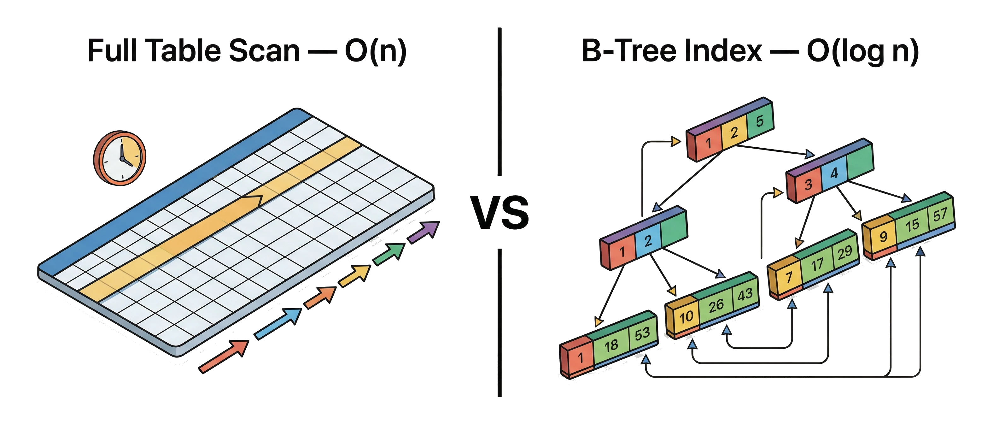
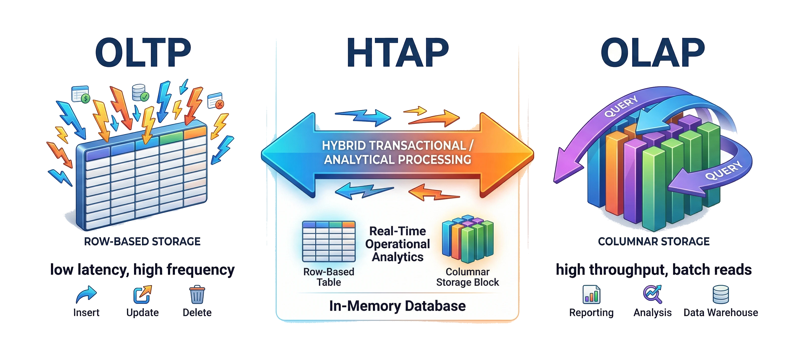
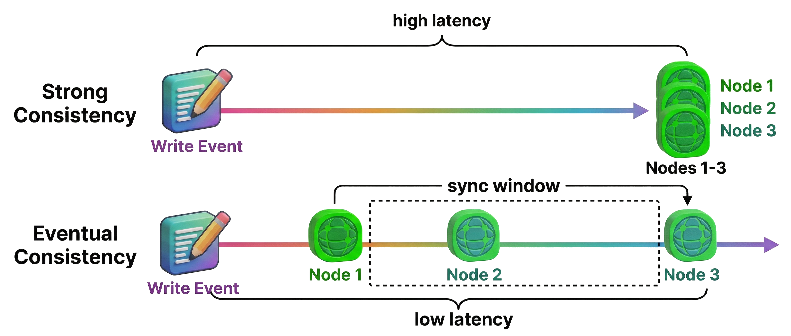
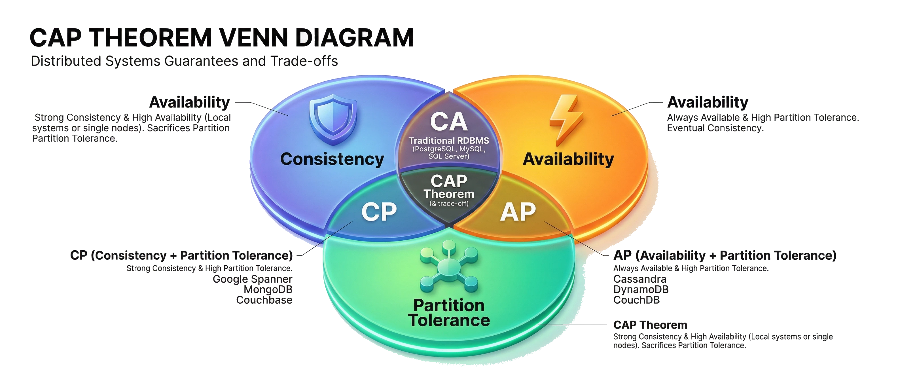
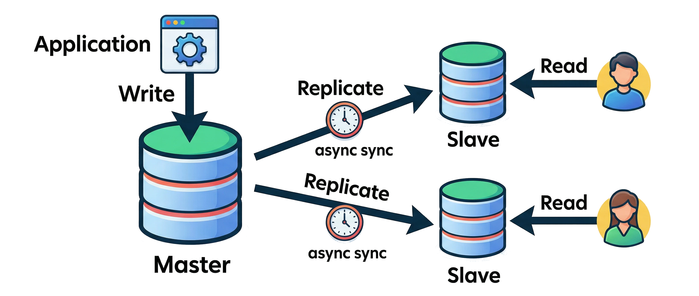

# Bài 5A — Lựa chọn cơ sở dữ liệu: SQL/NoSQL, Sharding, Index

## 🎯 Mục tiêu

Sau bài này bạn có thể:

- Phân biệt **SQL** và **NoSQL**, biết khi nào chọn loại nào và khi nào kết hợp cả hai (*polyglot persistence*).
- Hiểu **sharding** là gì, so sánh 4 chiến lược: **range-based**, **hash-based**, **directory/key-based**, **geo-based**; biết cách chọn **shard key** và nhận diện các vấn đề **cross-shard query**, **hotspot**, **rebalancing**.
- Hiểu cách **index** (B-Tree, Hash) tăng tốc truy vấn, biết khi nào nên và không nên tạo index, cách dùng **composite index**.
- Phân biệt workload **OLTP / OLAP / HTAP** và chọn data store theo mô hình dữ liệu, quy mô, yêu cầu nhất quán, chi phí, đội ngũ.
- Hiểu **strong consistency** vs **eventual consistency**, **CAP Theorem**, và cách trình bày thiết kế database trong phỏng vấn.

## 📑 Mục lục

1. SQL vs NoSQL
2. Phân mảnh dữ liệu — Sharding
3. Chỉ mục (Index) và tối ưu hóa truy vấn
4. Cân nhắc khi chọn kiểu lưu trữ
5. Dữ liệu phân tán và tính nhất quán
6. Best Practices và Tổng kết
7. 🧠 Tóm tắt nhanh
8. ❓ Câu hỏi tự kiểm tra
9. 📝 Bài tập

---

## 1. SQL vs NoSQL

Đây là hai lựa chọn lưu trữ phổ biến nhất, mỗi loại phù hợp với từng bài toán khác nhau.

### SQL — Cơ sở dữ liệu quan hệ

> Dữ liệu có cấu trúc rõ ràng, cần tính nhất quán cao và hỗ trợ giao dịch phức tạp.

- Lưu dữ liệu trong **bảng** (table) với dòng và cột cố định
- Yêu cầu **schema chặt chẽ** — cấu trúc phải được định nghĩa trước
- Tuân thủ nguyên tắc **ACID** để đảm bảo tính toàn vẹn dữ liệu
- Hỗ trợ **JOIN phức tạp** giữa các bảng
- Khó mở rộng ngang (*scale-out*) — thường phải nâng cấp máy chủ (*scale-up*)

> 💡 **Giải thích:** SQL là lựa chọn truyền thống, đáng tin cậy cho dữ liệu có cấu trúc. Điểm mạnh là **tính toàn vẹn dữ liệu** nhờ ACID và khả năng **JOIN** linh hoạt. Điểm yếu: khi dữ liệu tăng rất lớn, SQL truyền thống khó mở rộng ngang. Ví dụ điển hình: **hệ thống ngân hàng**, **cửa hàng trực tuyến** — nơi cần độ chính xác tuyệt đối và quan hệ dữ liệu rõ ràng.
>
> 📌 **Mở rộng — ACID là gì?**
> - **A**tomicity (nguyên tử): một transaction hoặc thành công trọn vẹn, hoặc không có gì xảy ra (không có trạng thái "nửa vời").
> - **C**onsistency (nhất quán): transaction đưa DB từ trạng thái hợp lệ này sang trạng thái hợp lệ khác, không vi phạm ràng buộc.
> - **I**solation (cô lập): các transaction chạy đồng thời không làm nhiễu lẫn nhau.
> - **D**urability (bền vững): đã commit thì dữ liệu không mất, kể cả khi sập máy.
>
> 📌 **Mở rộng — scale-up vs scale-out:** *scale-up* (mở rộng dọc) = mua máy mạnh hơn (thêm CPU/RAM); *scale-out* (mở rộng ngang) = thêm nhiều máy và chia tải cho chúng.

### NoSQL — Cơ sở dữ liệu phi quan hệ

> Dữ liệu linh hoạt, schema có thể thay đổi, ưu tiên hiệu năng và khả năng mở rộng ngang.

- Lưu dữ liệu dưới nhiều dạng: **document JSON**, **key-value**, **column-family**, **graph**
- Không đòi hỏi schema cố định — hỗ trợ dữ liệu bán cấu trúc hoặc phi cấu trúc
- Hy sinh một phần **ACID** để đạt hiệu năng và *scalability* cao hơn
- Dễ dàng **mở rộng ngang** bằng cách thêm máy (*scale-out*)
- Hạn chế với truy vấn phức tạp và JOIN giữa các tập dữ liệu

> 💡 **Giải thích:** NoSQL ra đời để giải bài toán SQL khó xử lý: **dữ liệu phi cấu trúc với khối lượng rất lớn**. Trường hợp điển hình: mạng xã hội, hệ thống log sự kiện, quản lý nội dung. Cái giá phải trả: lập trình viên phải **tự đảm bảo một phần tính toàn vẹn** và chấp nhận **eventual consistency** (dữ liệu "cuối cùng mới nhất quán" — xem phần *Eventual Consistency* ở mục 5) ở một số thao tác.

### Khi nào chọn SQL, khi nào chọn NoSQL?

> Không có câu trả lời tuyệt đối — chọn dựa trên đặc tính dữ liệu và yêu cầu hệ thống.

| Chọn **SQL** khi | Chọn **NoSQL** khi |
|---|---|
| Dữ liệu quan hệ chặt chẽ, schema rõ ràng | Dữ liệu linh hoạt, không cấu trúc cố định |
| Cần transaction đảm bảo **ACID** | Cần mở rộng nhanh, chịu tải lớn |
| Ví dụ: tài chính, ngân hàng, thương mại điện tử | Ví dụ: mạng xã hội, logging, analytics |

> 💡 **Giải thích:** Quyết định SQL hay NoSQL dựa trên **ba yếu tố chính**: (1) cấu trúc dữ liệu, (2) yêu cầu nhất quán, (3) quy mô mở rộng. SQL hợp khi dữ liệu có quan hệ phức tạp và cần ACID; NoSQL hợp khi cần linh hoạt và scale nhanh. Quan trọng: **không bắt buộc chọn một bên** — nhiều hệ thống kết hợp cả hai.

### Ví dụ: kết hợp SQL và NoSQL trong một hệ thống

> Dùng đúng công cụ cho đúng phần của hệ thống — không ép mọi thứ vào một database.

- Ứng dụng quản lý chi tiêu: dùng **PostgreSQL** cho giao dịch và số dư (cần ACID)
- Cùng ứng dụng đó: dùng **MongoDB** để lưu nhật ký hoạt động và gợi ý khuyến mãi
- *Polyglot persistence* — mỗi phần dùng loại storage phù hợp với nhu cầu riêng
- SQL giữ lõi chặt chẽ; NoSQL mở rộng linh hoạt ở các phần ít quan trọng hơn

> 💡 **Giải thích:** Dữ liệu tài chính cần ACID → đặt trong SQL. Nhật ký hoạt động ít đòi hỏi nhất quán nhưng cần **ghi nhanh** → NoSQL hợp hơn. Nhờ vậy hệ thống vừa **chặt chẽ ở lõi**, vừa **linh hoạt và scalable** ở các phần mở rộng. Đó chính là *polyglot persistence* ("lưu trữ đa ngôn ngữ" — dùng nhiều loại DB trong cùng một hệ thống).

### (Hình) Kiến trúc ứng dụng quản lý chi tiêu dùng PostgreSQL + MongoDB



Hình minh họa: ứng dụng tài chính cá nhân có hai DB — PostgreSQL ("Giao dịch & số dư") nối với dịch vụ giao dịch qua mũi tên "ACID writes", và MongoDB ("Nhật ký & gợi ý") nối với dịch vụ logging qua mũi tên "fast writes".

---

## 2. Phân mảnh dữ liệu (Sharding)

Kỹ thuật chia nhỏ database ra nhiều máy để xử lý tải lớn và tránh điểm nghẽn đơn lẻ.

### Sharding là gì và tại sao cần?

> Khi một máy chủ không còn đủ sức chứa và xử lý toàn bộ dữ liệu, sharding là giải pháp phân tán tải.

- **Sharding** chia database thành nhiều phần độc lập gọi là **shard** hoặc **partition**
- Mỗi máy chủ chứa một phần dữ liệu — hệ thống xử lý song song nhiều yêu cầu hơn
- Giảm tải cho từng máy, cải thiện **thông lượng** (throughput) tổng thể
- Tránh sự cố toàn hệ thống: nếu một shard lỗi, các shard khác vẫn hoạt động
- Cần thiết khi dữ liệu vượt ngưỡng một server đơn có thể gánh chịu

> 💡 **Giải thích:** Sharding giải quyết **bottleneck** khi một database đơn lẻ không còn đủ sức. Thay vì nâng cấp máy chủ (*scale-up*), ta mở rộng ngang (*scale-out*) bằng cách phân tán dữ liệu. Nó cũng tăng **độ chịu lỗi**: một shard gặp sự cố không kéo sập cả hệ thống. Khi đi phỏng vấn, hãy cho thấy bạn biết **khi nào cần sharding và khi nào một database đơn vẫn đủ**.

### Range-based sharding

> Chia dữ liệu theo khoảng giá trị của khóa — đơn giản, dễ truy vấn theo dải.

- Shard 1: ID từ 1–1.000.000; Shard 2: ID 1.000.001–2.000.000; v.v.
- Hoặc theo alphabet: tên A–I vào shard A, J–S vào shard B, T–Z vào shard C
- **Ưu điểm:** dễ hiểu, truy vấn theo khoảng rất thuận tiện khi dữ liệu cùng shard
- **Nhược điểm:** dữ liệu phân bố không đều — một shard có thể quá tải (*hot shard*)
- Ví dụ: shard A–I có thể đông khách hàng hơn shard T–Z đáng kể

> 💡 **Giải thích:** Range-based trực quan, đặc biệt hiệu quả khi cần **truy vấn theo khoảng liên tục** (vd: lấy mọi đơn hàng trong một tháng — chúng nằm gọn trong một/vài shard). Rủi ro lớn nhất là **phân bố không đều**: nếu một khoảng giá trị có quá nhiều dữ liệu, shard đó thành **hot spot** và làm mất lợi ích của sharding.

### (Hình) Range-based sharding và hot shard



Hình minh họa: ba shard "Shard A (A–I)", "Shard B (J–S)", "Shard C (T–Z)" chứa lượng dữ liệu không đều — Shard A tràn dữ liệu với cảnh báo đỏ "Hot Shard", Shard C gần như trống; tên người dùng được định tuyến tới shard tương ứng.

### Hash-based sharding

> Dùng hàm băm để phân bổ dữ liệu đều hơn giữa các shard — tránh hot spot hiệu quả.

- Áp dụng hàm băm lên khóa: `hash(userID) mod 4` → chọn 1 trong 4 shard
- Phân bố dữ liệu **đồng đều hơn** so với range-based
- **Nhược điểm:** thêm node mới đòi hỏi tính lại hàm băm — dùng ***consistent hashing*** để giảm ảnh hưởng
- Khó thực hiện **range query** vì dữ liệu liên tiếp có thể nằm trên nhiều shard

> 💡 **Giải thích:** Hash-based giải quyết vấn đề phân bố không đều của range-based: hàm băm "trộn" khóa nên dữ liệu trải đều qua các shard. Nhưng khi **thêm node**, công thức thay đổi (vd `mod 4` → `mod 5`) nên **rất nhiều dữ liệu phải di chuyển**. **Consistent hashing** là kỹ thuật giảm thiểu lượng dữ liệu phải tái phân bổ khi thêm/bớt node.
>
> 📌 **Mở rộng — ví dụ con số:** với `hash mod N`, đổi N từ 4 lên 5 làm khoảng 80% khóa đổi shard. Với consistent hashing (đặt node và khóa trên một "vòng băm", mỗi khóa thuộc node gần nhất theo chiều kim đồng hồ), thêm 1 node chỉ phải di chuyển khoảng 1/N dữ liệu (≈ 20% khi lên 5 node).

### (Hình) Hash-based sharding



Hình minh họa: hộp "Hash Function" nhận các userID rồi phân phối đều vào bốn shard "Shard 1" → "Shard 4" có kích thước bằng nhau.

### Directory/Key-based sharding

> Dùng bảng tra cứu để quyết định shard — linh hoạt nhất nhưng phức tạp nhất để duy trì.

- Một **bảng tra cứu** (lookup table) ánh xạ giá trị thuộc tính sang shard tương ứng
- Ví dụ: khách hàng loại *Doanh nghiệp* → shard A; *Cá nhân* → shard B
- Ví dụ e-commerce: sản phẩm *Điện tử* → shard X; *Thời trang* → shard Y
- **Ưu điểm:** rất linh hoạt, phân chia theo bất kỳ tiêu chí nào phù hợp truy vấn
- **Nhược điểm:** bảng tra cứu lỗi hoặc phân loại sai gây mất cân bằng; khó duy trì khi tiêu chí thay đổi

> 💡 **Giải thích:** Directory-based cho phép **kiểm soát chính xác** dữ liệu nào vào shard nào theo bất kỳ tiêu chí nghiệp vụ nào — hữu ích khi có logic phân tách rõ (loại khách hàng, danh mục sản phẩm). Nhưng **bảng tra cứu trở thành điểm yếu**: nếu nó lỗi hoặc phân loại sai, toàn bộ việc định tuyến (routing) dữ liệu bị ảnh hưởng.

### Geo-based sharding

> Chia dữ liệu theo vùng địa lý để giảm độ trễ và tuân thủ quy định địa phương.

- Dữ liệu người dùng Châu Âu → cụm máy chủ **EU**; Châu Á → cụm **APAC**
- Người dùng truy cập máy chủ gần họ nhất — giảm **latency** đáng kể
- Hỗ trợ tuân thủ quy định địa phương như **GDPR** (dữ liệu EU lưu trong EU)
- **Nhược điểm:** phân bố không đồng đều nếu một khu vực có quá nhiều người dùng
- Cần cân nhắc kỹ về đồng bộ dữ liệu giữa các vùng

> 💡 **Giải thích:** Geo-based thường dùng cho sản phẩm toàn cầu, với **lợi ích kép**: giảm latency cho người dùng địa phương và đáp ứng yêu cầu pháp lý (GDPR). Nhược điểm là tải không đồng đều — vd cụm US có thể chịu tải lớn hơn nhiều so với cụm EU. Nếu một vùng vẫn quá lớn, **kết hợp hash-based sharding bên trong mỗi cụm**.

### (Hình) Geo-based sharding trên bản đồ thế giới



Hình minh họa: bản đồ thế giới với ba cụm "US Cluster", "EU Cluster", "APAC Cluster"; người dùng mỗi vùng được trỏ tới cụm gần nhất ("low latency"), cụm EU có huy hiệu GDPR.

### Vấn đề Cross-Shard Query & Hotspot

> Cross-shard query và hotspot là hai thách thức lớn nhất khi vận hành hệ thống sharding.

- **Cross-shard query**: query cần join data từ nhiều shard → phải query song song rồi merge → chậm, phức tạp
- **Hotspot**: một shard nhận quá nhiều traffic (VD: celebrity user, trending product)
- **Rebalancing**: khi thêm/xóa shard, cần migrate data → downtime hoặc phức tạp

> 💡 **Giải thích:** Đây là lý do sharding được xem là **"giải pháp cuối cùng"** — chỉ dùng khi vertical scaling (scale-up) và caching không còn đủ. Ví dụ thực tế: **Instagram** ban đầu chỉ dùng PostgreSQL một node, sau đó mới sharding; **Twitter** phải xây hệ thống riêng để xử lý *fan-out write* của người nổi tiếng có hàng triệu follower (một bài đăng phải được "rải" tới timeline của hàng triệu người). **Chọn shard key là quyết định kiến trúc quan trọng nhất** khi thiết kế hệ thống có sharding.

### Chọn shard key đúng cách

> Shard key quyết định hiệu quả của toàn bộ chiến lược sharding — chọn sai dẫn đến hot spot.

- Shard key phải là thuộc tính **dùng thường xuyên** trong truy cập dữ liệu
- Cần có khả năng **phân tán tương đối đều** trên các shard
- Chọn sai shard key tạo **điểm nóng** (*hot spot*): một shard quá nhiều tải so với shard khác
- Ban đầu một database đơn có thể đủ cho MVP — sharding khi quy mô vượt ngưỡng

> 💡 **Giải thích:** Shard key tốt phải thỏa **hai điều kiện cùng lúc**: (1) **thường xuyên xuất hiện trong truy vấn** (để mỗi truy vấn chỉ cần đến đúng một shard, tránh cross-shard), và (2) **phân bổ đều dữ liệu**. Trong phỏng vấn, không cần áp dụng sharding ngay từ đầu — hãy cho thấy bạn biết **khi nào cần và tiếp cận thế nào**. Chủ động nêu giới hạn của MVP và kế hoạch scale là **điểm cộng lớn**.

### Ví dụ: kết hợp geo + hash sharding

> Kết hợp nhiều chiến lược sharding để đạt hiệu quả tối đa ở từng cấp độ.

- Hệ thống 10 triệu người dùng toàn cầu — một database SQL đơn bắt đầu quá tải
- **Tầng 1 — Geo sharding:** người dùng Châu Mỹ → cụm US; Châu Âu → cụm EU; Châu Á → cụm APAC
- **Tầng 2 — Hash sharding:** trong từng cụm, `hash(userID)` chia nhỏ tiếp nếu cụm vẫn quá lớn
- Truy vấn đăng nhập của user Châu Âu đến thẳng cụm EU gần họ — nhanh hơn đáng kể
- Cách tiếp cận phân tầng này cho thấy tư duy thiết kế có hệ thống

> 💡 **Giải thích:** Geo sharding ở **tầng ngoài** giải quyết latency và compliance (tuân thủ pháp lý); hash sharding ở **tầng trong** đảm bảo phân bố đều trong mỗi cụm địa lý. Trình bày phân tầng như vậy trong phỏng vấn chứng tỏ bạn không chỉ biết từng chiến lược mà còn **biết kết hợp chúng hợp lý**.

---

## 3. Chỉ mục (Index) và tối ưu hóa truy vấn

Index giúp truy vấn nhanh như **tra mục lục sách**, thay vì đọc từng trang một.

### Index là gì và cách hoạt động?

> Index là cấu trúc dữ liệu bổ sung giúp định vị nhanh các hàng cần thiết mà không cần quét toàn bảng.

- Tương tự **mục lục cuốn sách** — tra để nhảy thẳng đến trang cần tìm
- Khi tạo index trên cột, CSDL xây dựng cấu trúc **B-Tree** sắp xếp giá trị kèm con trỏ vị trí
- Tìm kiếm một giá trị cụ thể hoặc theo khoảng (`>`, `<`, `BETWEEN`) nhanh hơn rất nhiều
- **Hash index** hữu ích cho so sánh bằng (`=`, `!=`) nhưng không hỗ trợ truy vấn khoảng
- **B-Tree index** phổ biến nhất — đa năng, hỗ trợ `ORDER BY`, `LIKE`, so sánh lớn/nhỏ

> 💡 **Giải thích:** B-Tree lưu giá trị **theo thứ tự đã sắp xếp**, nên tìm kiếm (kể cả theo khoảng) giảm từ **O(n)** (quét toàn bảng) xuống **O(log n)**. Hash index nhanh hơn cho phép **so sánh bằng** nhưng không dùng được cho range query (vì băm làm mất thứ tự). Trong thực tế **B-Tree là lựa chọn mặc định** cho hầu hết trường hợp nhờ tính đa năng. Hiểu cách index hoạt động là nền tảng để dùng index cho đúng.
>
> 📌 **Mở rộng — cảm nhận con số:** bảng 1 triệu dòng, quét toàn bảng cần tới ~1.000.000 phép so sánh; tìm trên cây cân bằng chỉ cần khoảng log₂(1.000.000) ≈ 20 bước (B-Tree thực tế còn ít "tầng" hơn vì mỗi nút chứa nhiều khóa). Lưu ý: B-Tree hỗ trợ `LIKE 'abc%'` (tiền tố cố định), nhưng thường **không** dùng được cho `LIKE '%abc'`.

### (Hình) Full Table Scan vs B-Tree Index



Hình minh họa: bên trái "Full Table Scan — O(n)" quét từng dòng kèm đồng hồ chậm; bên phải "B-Tree Index — O(log n)" là cây cân bằng với giá trị đã sắp xếp ở lá và con trỏ nhảy thẳng đến dòng cần tìm.

### Chiến lược dùng index hiệu quả (1)

> Index tăng tốc đọc nhưng làm chậm ghi — dùng có chọn lọc, không lạm dụng.

- **Chỉ tạo index khi cần:** bảng trên ~100k bản ghi và cột được truy vấn thường xuyên
- **Index cột hay dùng trong** `WHERE`, `JOIN`, `ORDER BY`, `GROUP BY`
- Ví dụ: bảng `users(name, email, age, city)` — index `email` và `name` nếu hay tìm theo đó
- **Hạn chế index cột độ phân biệt thấp:** cột `gender` chỉ có 2 giá trị — index ít tác dụng
- **Primary key** tự động có index — không cần tạo thêm trên khóa chính

> 💡 **Giải thích:** Nguyên tắc đầu tiên: **không lạm dụng index**. Mỗi index tốn thêm storage và làm chậm `INSERT`, `UPDATE`, `DELETE` vì CSDL phải cập nhật index đồng thời. Cột có **ít giá trị phân biệt** (boolean, gender) index không hiệu quả vì CSDL vẫn phải đọc rất nhiều hàng. Hãy tập trung index vào các cột thực sự xuất hiện trong `WHERE` của **những truy vấn quan trọng nhất**.

📌 **Mở rộng** — ví dụ SQL cho bảng `users` ở trên:

```sql
-- Hay tìm user theo email và theo tên
CREATE INDEX idx_users_email ON users(email);
CREATE INDEX idx_users_name  ON users(name);
```

### Chiến lược dùng index hiệu quả (2)

> Composite index và việc dọn dẹp index thừa là hai yếu tố tối ưu hóa quan trọng.

- **Composite index** cho truy vấn kết hợp: tìm theo `(country, name)` → tạo index `(country, name)`
- Thứ tự cột trong composite index ***rất quan trọng*** — cột lọc trước đặt trước
- Index `(country, name)` phục vụ truy vấn theo `country` hoặc `country + name` — không phục vụ chỉ `name`
- **Xóa index không còn dùng:** index thừa làm chậm ghi và tốn dung lượng
- Định kỳ soát lại và loại bỏ index ít được sử dụng

> 💡 **Giải thích:** Composite index (index nhiều cột) rất hiệu quả khi truy vấn thường kết hợp nhiều cột, nhưng **thứ tự cột phải theo pattern truy vấn thực tế**: truy vấn hay bắt đầu bằng `country` thì đặt `country` trước. Hình dung như danh bạ sắp theo (tỉnh, tên): tìm theo tỉnh rất nhanh, tìm theo tỉnh + tên càng nhanh, nhưng **chỉ biết tên** thì vẫn phải lật cả cuốn. Index thừa là vấn đề ít được để ý nhưng ảnh hưởng đáng kể đến hiệu năng ghi — đặc biệt quan trọng với hệ thống **write-heavy**.

📌 **Mở rộng** — ví dụ SQL:

```sql
CREATE INDEX idx_users_country_name ON users(country, name);

-- Dùng được index:
SELECT * FROM users WHERE country = 'VN';
SELECT * FROM users WHERE country = 'VN' AND name = 'An';

-- KHÔNG tận dụng được index (thiếu cột đầu tiên):
SELECT * FROM users WHERE name = 'An';
```

### Ví dụ: index tối ưu cho bảng products

> Chọn đúng index theo pattern truy vấn thực tế của ứng dụng, không index một cách máy móc.

- Bảng `products(id, name, category, price, description)` với hàng triệu sản phẩm
- Ứng dụng hay tìm theo `name` và lọc theo `category` → tạo index trên cả hai cột
- Cột `description` (text dài) — **không nên index** toàn bộ; dùng **ElasticSearch** nếu cần full-text search
- Hay truy vấn kết hợp `category + price` → composite index `(category, price)` rất hữu ích
- Trình bày hiểu biết về index trong phỏng vấn cho thấy bạn biết tối ưu hệ thống lớn

> 💡 **Giải thích:** Không phải cột nào cũng cần index. `description` là text dài — index sẽ rất nặng mà ít tác dụng; khi cần **full-text search**, ElasticSearch là giải pháp đúng hơn index SQL. Composite index `(category, price)` cho phép **vừa lọc danh mục vừa sắp xếp theo giá** trong một lần truy vấn.

📌 **Mở rộng** — ví dụ SQL:

```sql
CREATE INDEX idx_products_name           ON products(name);
CREATE INDEX idx_products_category_price ON products(category, price);
-- idx (category, price) cũng phục vụ truy vấn chỉ lọc theo category

-- Truy vấn được phục vụ trọn vẹn bởi (category, price):
SELECT id, name, price
FROM products
WHERE category = 'Điện tử'
ORDER BY price
LIMIT 20;
```

---

## 4. Cân nhắc khi chọn kiểu lưu trữ

Không có giải pháp *all-in-one* — mỗi hệ thống cần cân nhắc nhiều yếu tố trước khi quyết định.

### OLTP vs OLAP

> Tính chất workload quyết định kiến trúc lưu trữ — xử lý giao dịch và phân tích dữ liệu cần cách tiếp cận khác nhau.

- **OLTP** (*Online Transaction Processing*): nhiều thao tác đọc/ghi nhỏ, liên tục, cần đáp ứng nhanh
  - OLTP → ưu tiên RDBMS hoặc Key-Value store tối ưu cho ghi/đọc ngẫu nhiên và ACID
- **OLAP** (*Online Analytical Processing*): truy vấn tính toán phức tạp trên dữ liệu tổng hợp
  - OLAP → cần *columnar storage* hoặc *data warehouse* tối ưu cho đọc lô lớn
- **HTAP** (*Hybrid*): hỗ trợ cả hai — có thể dùng in-memory database cho phân tích thời gian thực

> 💡 **Giải thích:** Phân biệt OLTP và OLAP là **bước đầu tiên** khi thiết kế lưu trữ. Ứng dụng web thông thường là **OLTP** — cần **latency thấp** cho từng giao dịch nhỏ (đặt hàng, đăng nhập...). Hệ thống báo cáo/analytics là **OLAP** — cần **throughput cao** cho các truy vấn tổng hợp trên dữ liệu lớn (doanh thu theo tháng, theo vùng...). Một số hệ thống lớn cần cả hai, dẫn đến kiến trúc **HTAP** phức tạp hơn.
>
> 📌 **Mở rộng — vì sao OLAP thích columnar storage?** Lưu theo cột nghĩa là các giá trị của cùng một cột nằm liền nhau trên đĩa. Truy vấn kiểu `SUM(total_price)` trên 100 triệu dòng chỉ cần đọc đúng cột `total_price` (và nén rất tốt), thay vì đọc cả dòng như kho lưu theo hàng (row-based) của OLTP.

### (Hình) OLTP vs OLAP vs HTAP



Hình minh họa: bên trái "OLTP" với nhiều mũi tên đọc/ghi nhỏ vào bảng lưu theo hàng ("low latency, high frequency"); bên phải "OLAP" với vài truy vấn lớn quét qua khối lưu trữ theo cột ("high throughput, batch reads"); ở giữa "HTAP" kết hợp cả hai.

### Mô hình dữ liệu và kiểu truy vấn

> Chọn data store theo bản chất dữ liệu, không theo xu hướng công nghệ.

| Bản chất dữ liệu | Loại data store | Ví dụ |
|---|---|---|
| Nhiều bảng liên kết, quan hệ phức tạp | **RDBMS** (SQL) | PostgreSQL, MySQL |
| Cặp khóa-giá trị, truy cập chỉ qua key | **Key-Value store** | Redis, DynamoDB |
| JSON/XML lồng nhau, cấu trúc linh hoạt | **Document DB** | MongoDB, Couchbase |
| Quan hệ đồ thị như mạng xã hội | **Graph DB** | Neo4j |
| File và media dung lượng lớn | **Object storage** + DB lưu metadata | AWS S3, GCS |

> 💡 **Giải thích:** Mỗi loại data store sinh ra cho một bài toán cụ thể; dùng sai loại sẽ dẫn đến hiệu năng kém hoặc phức tạp không cần thiết. Ví dụ rõ nhất: **không bao giờ lưu ảnh/video trực tiếp trong SQL** — dùng object storage cho dữ liệu nhị phân lớn, database chỉ lưu **đường dẫn (URL/path)**. Graph DB xử lý truy vấn kiểu **"bạn của bạn"** hiệu quả hơn SQL nhiều bậc (SQL phải JOIN bảng quan hệ với chính nó nhiều lần).

### Quy mô dữ liệu và khả năng mở rộng

> Đánh giá quy mô hiện tại và dự kiến — không áp dụng giải pháp phức tạp khi chưa cần thiết.

- Dự kiến hàng tỷ bản ghi, hàng TB dữ liệu → ưu tiên giải pháp **phân tán sẵn** (Cassandra)
- Cassandra (NoSQL wide-column) được thiết kế để phân tán trên nhiều node dễ dàng
- MySQL có thể đủ dùng nhưng cần **sharding thủ công** khi đến ngưỡng
- Dữ liệu vừa phải → RDBMS đơn giản đáng tin cậy và *tiết kiệm* hơn
- Luôn cân nhắc **chi phí vs lợi ích** — không phải lúc nào cũng cần "big data" phức tạp

> 💡 **Giải thích:** Sai lầm phổ biến là **over-engineer** ngay từ đầu. Hệ thống mới khởi động với vài nghìn người dùng thì một PostgreSQL đơn giản có thể chạy tốt **hàng năm**. Chỉ khi quy mô thực sự vượt ngưỡng mới cần giải pháp phân tán. Trong phỏng vấn, hãy thể hiện khả năng **đánh giá quy mô thực tế** và biết lúc nào cần scale.

### Transaction, nhất quán, chi phí và đội ngũ

> Yêu cầu về ACID, tính nhất quán, và thực tế của tổ chức đều ảnh hưởng đến lựa chọn.

- Cần ***strong consistency*** → chọn ACID hoặc hệ thống CP theo CAP theorem
- Chấp nhận *eventual consistency* → hệ thống AP (Cassandra, DynamoDB) cho hiệu suất tốt hơn
- Bảo mật, tuân thủ (*compliance*) có thể ép buộc lựa chọn: GDPR, audit log, mã hóa tích hợp
- **Chi phí:** PostgreSQL miễn phí vs Oracle đắt đỏ — cân nhắc ngân sách thực tế
- **Kinh nghiệm đội ngũ:** team quen MongoDB → dùng MongoDB nhanh hơn học tool mới

> 💡 **Giải thích:** Ngoài yếu tố kỹ thuật thuần túy, lựa chọn database còn chịu ảnh hưởng của **thực tế tổ chức**: team đã quen một công nghệ là lợi thế lớn về tốc độ phát triển; chi phí bản quyền không thể bỏ qua với startup hay dự án ngân sách hạn chế. Nêu các yếu tố thực tế này trong phỏng vấn cho thấy **tư duy toàn diện**. (CP/AP được giải thích ở phần *Ví dụ và CAP Theorem*, mục 5.)

---

## 5. Dữ liệu phân tán và tính nhất quán

Khi dữ liệu trải rộng trên nhiều server, đảm bảo nhất quán giữa các bản sao là thách thức trung tâm.

### Strong Consistency — nhất quán mạnh

> Mọi lần đọc sau khi ghi đều thấy dữ liệu mới nhất, bất kể đọc từ node nào.

- Sau khi cập nhật, **mọi truy cập đọc** tiếp theo đều thấy dữ liệu mới
- Để đạt điều này: đa số node phải xác nhận cập nhật xong mới báo thành công
- **Đánh đổi:** độ trễ cao hơn — người dùng chờ thêm để dữ liệu đồng bộ
- Phù hợp: dữ liệu tài chính, số dư tài khoản, đơn hàng thanh toán
- Có thể giảm availability: nếu node chính lỗi, hệ thống tạm khóa ghi

> 💡 **Giải thích:** Strong consistency đảm bảo **không bao giờ đọc ra dữ liệu cũ (stale)**. Điều này đặc biệt quan trọng với dữ liệu tài chính — số dư hiển thị sai có thể gây hậu quả nghiêm trọng. Cái giá là **latency cao hơn** vì phải chờ **quorum** (đa số node) xác nhận. Đây là **sự đánh đổi có chủ đích**, không phải lỗi thiết kế.
>
> 📌 **Mở rộng — quorum:** với N bản sao, nếu ghi cần W node xác nhận và đọc hỏi R node sao cho **W + R > N** (vd N=3, W=2, R=2) thì tập node đọc luôn giao với tập node đã ghi, nên luôn đọc được bản mới nhất.

### Eventual Consistency — nhất quán cuối cùng

> Dữ liệu sẽ đồng bộ sau một khoảng thời gian ngắn — ưu tiên availability và hiệu năng hơn nhất quán tức thời.

- Sau cập nhật, một số node chưa kịp đồng bộ — có thể trả dữ liệu cũ trong thời gian ngắn
- **Cuối cùng** (sau vài mili-giây đến vài giây), tất cả node sẽ có dữ liệu mới
- Hệ thống phản hồi nhanh hơn — không cần chờ mọi node nhất quán trước khi trả lời
- Cassandra và Dynamo mặc định *eventual consistency*: ghi vào 1–2 node, sync sau
- Phù hợp: mạng xã hội, news feed, nội dung hiển thị cho người dùng

> 💡 **Giải thích:** Eventual consistency chấp nhận dữ liệu trên các node **khác nhau trong một khoảng rất ngắn**. Người dùng mạng xã hội không phiền nếu bài đăng mới mất vài giây mới xuất hiện trên news feed của bạn bè. Đổi lại, hệ thống **ghi nhanh** và **luôn sẵn sàng** ngay cả khi một số node gặp sự cố.

### (Hình) Dòng thời gian Strong vs Eventual Consistency



Hình minh họa: hàng trên "Strong Consistency" — sau thao tác ghi, cả ba node cùng chuyển xanh đồng thời ("high latency"); hàng dưới "Eventual Consistency" — Node 1 xanh ngay, Node 2 sau một chút, Node 3 sau lâu hơn ("low latency", có chú thích "sync window").

### Ví dụ và CAP Theorem

> Strong consistency và eventual consistency là hai cực của một sự đánh đổi cơ bản trong hệ thống phân tán.

- **Strong:** mọi chi nhánh cập nhật giá ngay lập tức khi trụ sở thay đổi — khách hàng ở đâu cũng thấy cùng một giá
- **Eventual:** trụ sở gửi email thông báo, chi nhánh cập nhật dần trong ngày — tạm thời không đồng nhất
- **CAP Theorem:** khi phân tán gặp sự cố mạng (*Partition*), chỉ có thể chọn **Consistency** hoặc **Availability** — không có cả hai tức thì
- Hệ thống CP: ưu tiên nhất quán, chấp nhận giảm availability
- Hệ thống AP: ưu tiên availability, chấp nhận eventual consistency

> 💡 **Giải thích:** Ví dụ chuỗi cửa hàng giúp trực quan hóa sự khác biệt. **CAP Theorem** là nền tảng lý thuyết: trong môi trường phân tán, **Partition Tolerance là bắt buộc** (mạng có thể đứt bất cứ lúc nào), nên thực chất bạn chỉ chọn giữa **Consistency** và **Availability**. **CP**: ví dụ **Zookeeper** chọn nhất quán. **AP**: ví dụ **Cassandra** chọn availability. Hiểu CAP giúp bạn giải thích rõ trade-off thiết kế trong phỏng vấn.
>
> 📌 **Mở rộng — ba chữ cái:** **C**onsistency = mọi node trả về cùng dữ liệu mới nhất; **A**vailability = mọi request đều nhận được phản hồi (không lỗi); **P**artition tolerance = hệ thống vẫn chạy khi mạng giữa các node bị chia cắt.

### (Hình) Sơ đồ Venn CAP Theorem



Hình minh họa: ba vòng tròn "Consistency", "Availability", "Partition Tolerance" giao nhau tạo các vùng "CP", "AP", "CA" kèm ví dụ database.

> 📌 **Mở rộng:** vùng **CA** chỉ có ý nghĩa với hệ thống **không phân tán** (một node, vd một RDBMS đơn) — vì một khi đã phân tán thì partition là điều không tránh được (Partition Tolerance là bắt buộc).

### Khi nào chọn strong vs eventual consistency?

> Quyết định dựa trên mức độ nhạy cảm của dữ liệu và yêu cầu nghiệp vụ cụ thể.

- **Dùng strong consistency:** dữ liệu tài chính, số dư, đơn hàng — sai lệch gây hậu quả thực tế
- **Dùng eventual consistency:** mạng xã hội, tin tức, nội dung người dùng — trễ vài giây không sao
- Hệ thống phức tạp thường dùng ***cả hai*** cho các phần khác nhau
- Ví dụ: module thanh toán → strong; module chat → eventual

> 💡 **Giải thích:** Hệ thống thực tế hiếm khi chọn hoàn toàn một mô hình. Phần **xử lý tiền** cần strong consistency tuyệt đối; phần **hiển thị nội dung, thông báo, gợi ý** có thể thoải mái hơn với eventual.

### Master-slave replication

> **Master-slave replication:** ghi vào master (đảm bảo nhất quán), slave phục vụ đọc (gần strong)



Hình minh họa: ứng dụng ghi (Write) vào một DB "Master"; Master sao chép (Replicate, đồng bộ bất đồng bộ — "async sync") sang hai DB "Slave"; người dùng đọc (Read) từ các Slave.

> 💡 **Giải thích:** Master-slave replication là giải pháp phổ biến cho phần cần **gần strong consistency** mà vẫn **scale được việc đọc** (thêm slave = thêm năng lực đọc). Phân tích từng phần của hệ thống theo cách này rất ấn tượng trong phỏng vấn.
>
> 📌 **Mở rộng:** vì sao chỉ "gần" strong? Do replicate **bất đồng bộ**, slave có thể trễ (*replication lag*) vài mili-giây đến vài giây — đọc từ slave ngay sau khi ghi có thể thấy dữ liệu cũ. Với thao tác cần chắc chắn (vd xem số dư ngay sau chuyển tiền), có thể đọc thẳng từ master. Ngày nay thuật ngữ thường dùng là **primary/replica**.

---

## 6. Best Practices và Tổng kết

Phần này hướng dẫn cách **trình bày thiết kế database** (đặc biệt khi phỏng vấn system design).

### Bắt đầu từ yêu cầu dữ liệu và lựa chọn CSDL

> Thiết kế dựa trên yêu cầu — không thuộc lòng công thức, không chọn SQL/NoSQL theo thói quen.

- Trước tiên: nhắc lại yêu cầu dữ liệu của bài toán (*"Hệ thống này cần lưu gì, với đặc tính nào?"*)
- Nêu rõ lựa chọn loại database và ***lý do*** — so sánh nhanh với giải pháp khác
- Ví dụ: *"Tôi chọn SQL cho user và giao dịch vì cần JOIN và ACID. Ngoài ra dùng Redis cho cache phiên"*
- Cách này cho thấy bạn thiết kế dựa trên yêu cầu, không phải theo công thức có sẵn
- Kết hợp nhiều thành phần khi cần: thể hiện bạn biết *polyglot persistence*

> 💡 **Giải thích:** Bước đầu tiên là **đặt lại bối cảnh** — tóm tắt yêu cầu dữ liệu trước khi nêu giải pháp. Điều này cho người phỏng vấn thấy bạn không "bốc thuốc" theo thói quen mà phân tích từ yêu cầu cụ thể. Sau đó nêu lựa chọn **kèm lý do rõ ràng** và **so sánh nhanh với các phương án khác** (alternatives).

### Mô hình dữ liệu và kế hoạch mở rộng

> Nói về entities chính và kế hoạch scale — cho thấy bạn thiết kế cho tương lai, không chỉ cho hôm nay.

- Nêu qua các **thực thể chính** và quan hệ: *"Bảng User, bảng Post — post.user_id là foreign key"*
- Với NoSQL: *"Mỗi user là một document bao gồm cả profile và danh sách bạn bè"*
- Nói về scaling: read-replicas khi tải đọc tăng; sharding theo userID khi tải ghi tăng
- Đưa ra **con số ước lượng** về khi nào cần scale (*"khi đạt X triệu user"*) — gây ấn tượng thực tế
- Thể hiện bạn nghĩ xa hơn bản thiết kế ban đầu

> 💡 **Giải thích:** Không cần thiết kế chi tiết từng bảng — chỉ cần nêu **entities chính và quan hệ**. Điều quan trọng là **kế hoạch scale**: bắt đầu đơn giản nhưng biết khi nào và bằng cách nào để mở rộng. Con số cụ thể, dù sơ bộ, cho thấy bạn có kinh nghiệm thực tế và biết **ước lượng capacity**.

Minh họa hai cách mô tả mô hình dữ liệu ở trên (📌 Mở rộng):

```sql
-- SQL: User và Post, post.user_id là foreign key
CREATE TABLE users (
    id    BIGINT PRIMARY KEY,
    name  VARCHAR(100) NOT NULL
);

CREATE TABLE posts (
    id       BIGINT PRIMARY KEY,
    user_id  BIGINT NOT NULL REFERENCES users(id),
    content  TEXT
);
```

```json
{
  "_id": "u123",
  "profile": { "name": "An", "city": "HCM" },
  "friends": ["u456", "u789"]
}
```

### Index, tối ưu truy vấn và consistency trade-off

> Chi tiết về indexing và consistency là dấu hiệu của kỹ sư hiểu sâu hệ thống, không chỉ vẽ kiến trúc.

- Đề cập index trên các cột quan trọng: *"Index product_id và category để tránh full scan"*
- Nêu cache cho truy vấn phổ biến — giảm tải database thêm một bậc
- Với hệ thống phân tán: giải thích mô hình nhất quán từng phần
- Ví dụ: *"Module chat dùng eventual consistency; module thanh toán dùng strong consistency"*
- Thể hiện bạn **tự tin nhưng linh hoạt** — sẵn sàng điều chỉnh khi người phỏng vấn đặt câu hỏi *"Nếu... thì sao?"*

> 💡 **Giải thích:** Hai điểm nhiều ứng viên bỏ qua là **indexing** và **consistency trade-off**. Hãy nhắc đến chúng một cách tự nhiên — không cần mọi chi tiết, chỉ đủ cho thấy bạn nghĩ đến hiệu năng và tính nhất quán. Khi được hỏi về kịch bản xấu (**tải tăng đột biến, node chết**), hãy bình tĩnh trả lời bằng giải pháp cụ thể: **sharding thêm, dùng DynamoDB, tách dữ liệu ít dùng**.

### Tổng kết

**Nền tảng thiết kế data tốt:**

- Chọn đúng database
- Sharding hợp lý
- Index có chọn lọc
- ... và hiểu trade-off nhất quán.

---

## 🧠 Tóm tắt nhanh

### SQL vs NoSQL

| Tiêu chí | SQL (quan hệ) | NoSQL (phi quan hệ) |
|---|---|---|
| Mô hình dữ liệu | Bảng, dòng/cột cố định | Document JSON, key-value, column-family, graph |
| Schema | Chặt chẽ, định nghĩa trước | Linh hoạt, bán/phi cấu trúc |
| Tính nhất quán | ACID đầy đủ | Hy sinh một phần ACID, thường eventual consistency |
| JOIN / truy vấn phức tạp | Mạnh | Hạn chế |
| Mở rộng | Chủ yếu scale-up, scale-out khó | Scale-out dễ dàng |
| Use case | Tài chính, ngân hàng, thương mại điện tử | Mạng xã hội, logging, analytics, quản lý nội dung |
| Ví dụ | PostgreSQL, MySQL, Oracle | MongoDB, Cassandra, Redis, DynamoDB, Neo4j |

→ Kết hợp cả hai = **polyglot persistence** (vd PostgreSQL cho giao dịch + MongoDB cho log/gợi ý).

### Các kiểu sharding

| Kiểu | Cách chia | Ưu điểm | Nhược điểm | Hợp khi |
|---|---|---|---|---|
| **Range-based** | Theo khoảng giá trị khóa (ID 1–1tr, tên A–I...) | Đơn giản, range query thuận tiện | Phân bố không đều → *hot shard* | Hay truy vấn theo dải (thời gian, ID) |
| **Hash-based** | `hash(key) mod N` | Phân bố đều, tránh hot spot | Thêm node phải tính lại (→ consistent hashing); range query khó | Truy cập theo key, cần phân bố đều |
| **Directory/Key-based** | Bảng tra cứu thuộc tính → shard | Linh hoạt nhất, chia theo tiêu chí nghiệp vụ | Bảng tra cứu là điểm yếu; khó duy trì | Có logic phân tách nghiệp vụ rõ ràng |
| **Geo-based** | Theo vùng địa lý (US/EU/APAC) | Giảm latency, tuân thủ GDPR | Tải không đều giữa các vùng; đồng bộ liên vùng | Sản phẩm toàn cầu |

Thách thức chung: **cross-shard query**, **hotspot**, **rebalancing**. Shard key tốt = **hay dùng trong truy vấn** + **phân tán đều**. Có thể **kết hợp** (geo tầng ngoài + hash tầng trong). Sharding là "giải pháp cuối cùng" sau scale-up và caching.

### B-Tree index vs Hash index

| Tiêu chí | B-Tree index | Hash index |
|---|---|---|
| Cấu trúc | Cây cân bằng, giá trị đã sắp xếp + con trỏ | Bảng băm |
| So sánh bằng (`=`) | Có, O(log n) | Có, rất nhanh |
| Range (`>`, `<`, `BETWEEN`) | Có | Không |
| `ORDER BY`, `LIKE 'abc%'` | Có | Không |
| Mức phổ biến | Mặc định cho hầu hết trường hợp | Chỉ khi thuần truy vấn bằng |

Nguyên tắc index: index cột trong `WHERE`/`JOIN`/`ORDER BY`/`GROUP BY`; bảng lớn (~100k+ bản ghi); tránh cột độ phân biệt thấp; PK tự có index; composite index theo thứ tự "cột lọc trước đặt trước" (leftmost prefix); xóa index thừa; text dài → ElasticSearch. **Index tăng tốc đọc nhưng làm chậm ghi.**

### OLTP vs OLAP vs HTAP

| Tiêu chí | OLTP | OLAP | HTAP |
|---|---|---|---|
| Tên đầy đủ | Online Transaction Processing | Online Analytical Processing | Hybrid Transactional/Analytical Processing |
| Workload | Nhiều đọc/ghi nhỏ, liên tục | Truy vấn tổng hợp phức tạp trên dữ liệu lớn | Cả hai |
| Mục tiêu | Latency thấp | Throughput cao | Phân tích thời gian thực trên dữ liệu giao dịch |
| Lưu trữ | RDBMS, Key-Value store (row-based, ACID) | Columnar storage, data warehouse | In-memory DB, vd TiDB |
| Ví dụ | Đặt hàng, đăng nhập | Báo cáo doanh thu tháng | — |

### Strong vs Eventual consistency (CAP)

| | Strong consistency | Eventual consistency |
|---|---|---|
| Đọc sau ghi | Luôn thấy dữ liệu mới nhất | Có thể thấy dữ liệu cũ trong thời gian ngắn |
| Latency | Cao hơn (chờ quorum) | Thấp |
| Availability | Có thể giảm | Cao |
| CAP | CP (vd Zookeeper) | AP (vd Cassandra, DynamoDB) |
| Dùng cho | Tài chính, số dư, thanh toán | Mạng xã hội, news feed, chat |

---

## ❓ Câu hỏi tự kiểm tra

**1.** Nêu 3 yếu tố chính quyết định chọn SQL hay NoSQL. "Polyglot persistence" là gì? Cho ví dụ.

<details><summary>Đáp án</summary>

Ba yếu tố: **cấu trúc dữ liệu**, **yêu cầu nhất quán**, **quy mô mở rộng**. Polyglot persistence là dùng nhiều loại storage trong cùng hệ thống, mỗi phần dùng loại phù hợp. Ví dụ: ứng dụng quản lý chi tiêu dùng PostgreSQL cho giao dịch/số dư (cần ACID) và MongoDB cho nhật ký hoạt động, gợi ý khuyến mãi (cần ghi nhanh, linh hoạt).
</details>

**2.** Vì sao SQL truyền thống khó mở rộng ngang còn NoSQL thì dễ? NoSQL phải đánh đổi gì?

<details><summary>Đáp án</summary>

SQL đảm bảo ACID và JOIN giữa các bảng; khi dữ liệu nằm trên nhiều máy, việc giữ transaction và JOIN xuyên máy rất tốn kém nên thường phải scale-up. NoSQL không ràng buộc schema cố định, hạn chế JOIN và hy sinh một phần ACID nên dễ chia dữ liệu ra nhiều máy (scale-out). Đổi lại: lập trình viên tự đảm bảo một phần tính toàn vẹn, chấp nhận eventual consistency, và hạn chế truy vấn phức tạp.
</details>

**3.** So sánh range-based và hash-based sharding. Trường hợp nào nên chọn range-based?

<details><summary>Đáp án</summary>

Range-based chia theo khoảng giá trị: dễ hiểu, range query thuận tiện, nhưng dễ phân bố không đều (hot shard). Hash-based dùng `hash(key) mod N`: phân bố đều, nhưng range query khó (dữ liệu liên tiếp rải nhiều shard) và thêm node phải tính lại hàm băm. Nên chọn range-based khi truy vấn chủ yếu theo dải liên tục (vd đơn hàng theo tháng) và phân bố giá trị tương đối đều.
</details>

**4.** Consistent hashing giải quyết vấn đề gì của hash-based sharding?

<details><summary>Đáp án</summary>

Với `hash mod N`, khi thêm/bớt node, N thay đổi nên phần lớn khóa phải đổi shard → di chuyển rất nhiều dữ liệu. Consistent hashing giảm thiểu lượng dữ liệu phải tái phân bổ khi thêm/bớt node (chỉ một phần nhỏ khóa lân cận node mới bị di chuyển).
</details>

**5.** Directory-based và geo-based sharding mỗi loại có điểm mạnh/điểm yếu chính nào?

<details><summary>Đáp án</summary>

- **Directory-based:** mạnh — linh hoạt nhất, chia theo bất kỳ tiêu chí nghiệp vụ nào (loại khách hàng, danh mục sản phẩm). Yếu — bảng tra cứu là điểm yếu: lỗi hoặc phân loại sai làm hỏng routing, gây mất cân bằng; khó duy trì khi tiêu chí thay đổi.
- **Geo-based:** mạnh — giảm latency (người dùng gần máy chủ), tuân thủ quy định như GDPR. Yếu — tải không đều giữa các vùng; phải lo đồng bộ dữ liệu liên vùng.
</details>

**6.** Ba thách thức lớn khi vận hành hệ thống sharding là gì? Tiêu chí của một shard key tốt?

<details><summary>Đáp án</summary>

**Cross-shard query** (phải query song song nhiều shard rồi merge → chậm, phức tạp), **hotspot** (một shard nhận quá nhiều traffic, vd celebrity, sản phẩm trending), **rebalancing** (thêm/xóa shard phải migrate dữ liệu → downtime hoặc phức tạp). Shard key tốt: là thuộc tính **dùng thường xuyên trong truy vấn** và **phân tán tương đối đều** dữ liệu trên các shard.
</details>

**7.** Vì sao B-Tree index là lựa chọn mặc định thay vì Hash index? Độ phức tạp tìm kiếm thay đổi thế nào khi có index?

<details><summary>Đáp án</summary>

B-Tree lưu giá trị theo thứ tự sắp xếp nên hỗ trợ cả so sánh bằng lẫn range (`>`, `<`, `BETWEEN`), `ORDER BY`, `LIKE` (tiền tố). Hash index chỉ tốt cho so sánh bằng, không hỗ trợ range. Tìm kiếm giảm từ O(n) (full table scan) xuống O(log n).
</details>

**8.** Có index `(country, name)`. Truy vấn nào dùng được index: (a) `WHERE country = ?`, (b) `WHERE name = ?`, (c) `WHERE country = ? AND name = ?`?

<details><summary>Đáp án</summary>

(a) và (c) dùng được; (b) **không** dùng được vì thiếu cột đầu tiên `country`. Thứ tự cột trong composite index rất quan trọng — cột lọc trước đặt trước.
</details>

**9.** Tại sao không nên index cột `gender` hoặc cột `description` dài? Mặt trái của việc có quá nhiều index là gì?

<details><summary>Đáp án</summary>

`gender` có độ phân biệt thấp (2 giá trị) → index vẫn phải đọc rất nhiều hàng nên ít tác dụng. `description` là text dài → index rất nặng, ít tác dụng; nếu cần full-text search thì dùng ElasticSearch. Quá nhiều index: tốn storage và làm chậm `INSERT`/`UPDATE`/`DELETE` vì phải cập nhật index đồng thời — đặc biệt hại với hệ thống write-heavy.
</details>

**10.** Phân biệt OLTP, OLAP, HTAP và loại lưu trữ phù hợp với mỗi loại.

<details><summary>Đáp án</summary>

OLTP: nhiều đọc/ghi nhỏ, liên tục, cần latency thấp → RDBMS hoặc Key-Value store (ACID). OLAP: truy vấn tổng hợp phức tạp trên dữ liệu lớn, cần throughput cao → columnar storage / data warehouse. HTAP: hỗ trợ cả hai, có thể dùng in-memory database cho phân tích thời gian thực (vd TiDB).
</details>

**11.** Phát biểu CAP Theorem. Vì sao trong hệ phân tán thực chất chỉ chọn giữa C và A? Cho ví dụ hệ CP và AP.

<details><summary>Đáp án</summary>

Khi hệ phân tán gặp sự cố mạng (Partition), chỉ có thể chọn Consistency hoặc Availability, không có cả hai tức thì. Vì trong môi trường phân tán, partition chắc chắn có thể xảy ra nên Partition Tolerance là bắt buộc → chỉ còn chọn C hay A. CP: Zookeeper (ưu tiên nhất quán, chấp nhận giảm availability). AP: Cassandra, DynamoDB (ưu tiên availability, chấp nhận eventual consistency).
</details>

**12.** Một ứng dụng có module thanh toán và module chat. Mỗi module nên dùng mô hình nhất quán nào? Master-slave replication giúp gì?

<details><summary>Đáp án</summary>

Thanh toán → **strong consistency** (sai lệch gây hậu quả thực tế). Chat → **eventual consistency** (trễ vài giây không sao, đổi lại nhanh và sẵn sàng cao). Master-slave replication: ghi vào master để đảm bảo nhất quán, các slave phục vụ đọc → gần strong consistency mà vẫn scale được việc đọc.
</details>

---

## 📝 Bài tập

### Bài tập 1 — Chọn database cho hệ thống đặt vé

> Một startup xây dựng nền tảng đặt vé xem phim: người dùng tìm phim, chọn ghế, thanh toán trực tuyến.

**Yêu cầu phân tích:**

- Phần nào của hệ thống nên dùng **SQL**? Tại sao?
- Phần nào có thể dùng **NoSQL**? Loại NoSQL nào phù hợp?
- Xác định ít nhất **một trường hợp** cần kết hợp cả hai (polyglot persistence)

**Gợi ý hướng tiếp cận:**

- Bắt đầu từ đặc tính dữ liệu: cấu trúc, quan hệ, mức độ nhất quán cần thiết
- Đặt câu hỏi: *"Nếu giao dịch thất bại, hậu quả là gì?"*

> 💡 **Giải thích:** Điểm mấu chốt: **giao dịch đặt vé và thanh toán cần ACID (SQL)**, còn **lịch sử tìm kiếm, gợi ý phim, review** của người dùng hợp hơn với NoSQL. Cần nhận ra ranh giới giữa dữ liệu **"cần chính xác tuyệt đối"** và dữ liệu **"chấp nhận linh hoạt"**; đây cũng là dịp thảo luận về polyglot persistence.

<details><summary>Lời giải gợi ý</summary>

**Trả lời câu hỏi gợi ý "Nếu giao dịch thất bại, hậu quả là gì?"** — Nếu đặt ghế/thanh toán sai: hai người mua trùng một ghế (*double-booking*), hoặc bị trừ tiền mà không có vé. Đây là hậu quả thực tế về tiền và uy tín → phần này bắt buộc chính xác tuyệt đối.

**1. Phần dùng SQL (vd PostgreSQL):**

| Dữ liệu | Lý do |
|---|---|
| Người dùng (tài khoản) | Có cấu trúc rõ, liên kết với đặt vé, thanh toán |
| Rạp, phòng chiếu, ghế, suất chiếu | Quan hệ chặt chẽ: rạp → phòng → ghế; phim → suất chiếu |
| Đặt vé (booking), vé, trạng thái ghế theo suất chiếu | Cần **ACID**: không được bán trùng ghế |
| Thanh toán | Giao dịch tiền tệ — cần ACID, audit |

Lý do chung: dữ liệu có quan hệ rõ ràng (cần JOIN: suất chiếu ↔ phim ↔ phòng ↔ ghế), và đặt ghế + thanh toán phải nguyên tử (atomic). Ví dụ (📌 Mở rộng) dùng ràng buộc UNIQUE để DB tự chặn bán trùng ghế:

```sql
CREATE TABLE bookings (
    id           BIGINT PRIMARY KEY,
    user_id      BIGINT NOT NULL REFERENCES users(id),
    showtime_id  BIGINT NOT NULL REFERENCES showtimes(id),
    seat_id      BIGINT NOT NULL REFERENCES seats(id),
    status       VARCHAR(20) NOT NULL,   -- 'pending' | 'paid' | 'cancelled'
    UNIQUE (showtime_id, seat_id)        -- một ghế chỉ bán một lần cho mỗi suất
);

BEGIN;
INSERT INTO bookings (id, user_id, showtime_id, seat_id, status)
VALUES (1001, 42, 7, 15, 'pending');
INSERT INTO payments (booking_id, amount, status)
VALUES (1001, 90000, 'success');
UPDATE bookings SET status = 'paid' WHERE id = 1001;
COMMIT;   -- lỗi ở bất kỳ bước nào → ROLLBACK, không mất tiền mà không có vé
```

**2. Phần dùng NoSQL:**

| Dữ liệu | Loại NoSQL | Lý do |
|---|---|---|
| Lịch sử tìm kiếm, nhật ký hoạt động (click, xem trailer) | Document (MongoDB) hoặc wide-column (Cassandra) | Khối lượng lớn, ghi nhanh, không cần ACID |
| Review, đánh giá phim | Document (MongoDB) | Cấu trúc linh hoạt (text, sao, ảnh, reply lồng nhau) |
| Gợi ý phim | Document (lưu danh sách gợi ý theo user) hoặc Graph (Neo4j: "người xem phim A cũng xem B") | Truy vấn kiểu quan hệ/đồ thị, chấp nhận eventual consistency |
| Session đăng nhập, cache danh sách phim đang chiếu, **giữ ghế tạm thời** | Key-Value (Redis) | Truy cập qua key, rất nhanh, có TTL (tự hết hạn) |
| Poster, trailer | Object storage (S3/GCS) + DB lưu URL | File media lớn, không lưu trong SQL |

(📌 Mở rộng: nếu cần tìm phim theo tên/mô tả kiểu full-text, dùng ElasticSearch như với cột `description` ở phần *Ví dụ: index tối ưu cho bảng products*.)

**3. Trường hợp polyglot persistence — luồng chọn ghế và thanh toán:**

1. User chọn ghế → hệ thống **giữ ghế tạm** trong **Redis** với key `hold:{showtime_id}:{seat_id}`, TTL ~10 phút (nhanh, tự nhả nếu user bỏ ngang).
2. User thanh toán → ghi **booking + payment** trong một transaction **PostgreSQL** (nguồn sự thật, ACID).
3. Sau khi thành công → ghi sự kiện "đã xem/đã đặt phim X" vào **MongoDB** để cập nhật lịch sử và hệ thống gợi ý (eventual consistency, trễ vài giây không sao).

→ SQL giữ lõi giao dịch chặt chẽ; Redis/MongoDB đảm nhận phần cần tốc độ và linh hoạt.
</details>

### Bài tập 2 — Thiết kế chiến lược sharding

> Hệ thống mạng xã hội có 50 triệu người dùng toàn cầu. Database chính đang quá tải vào giờ cao điểm.

**Nhiệm vụ:**

- Đề xuất **chiến lược sharding** phù hợp (range, hash, geo, hoặc kết hợp)
- Xác định **shard key** và giải thích lý do chọn
- Liệt kê ít nhất **hai rủi ro** của chiến lược bạn chọn và cách giảm thiểu

**Câu hỏi mở rộng:**

- Nếu phần lớn người dùng ở Đông Nam Á, chiến lược sharding thay đổi như thế nào?

> 💡 **Giải thích:** Bài này đòi hỏi không chỉ biết tên các chiến lược mà phải biết **áp dụng và phân tích trade-off**. Mạng xã hội với người dùng toàn cầu là ứng viên tốt cho **geo sharding ở tầng ngoài, hash sharding theo userID ở tầng trong**. Shard key tốt thường là **userID** — phân bố đều và xuất hiện trong hầu hết truy vấn. Câu hỏi mở rộng buộc ta **điều chỉnh chiến lược theo thực tế tải**.

<details><summary>Lời giải gợi ý</summary>

**0. Trước khi shard** (sharding là "giải pháp cuối cùng" — xem phần *Vấn đề Cross-Shard Query & Hotspot*): quá tải "vào giờ cao điểm" có thể do tải đọc → thử trước **read-replicas** và **cache** (Redis) cho feed/profile. Nếu tải ghi và dung lượng vẫn vượt ngưỡng một máy thì mới sharding.

**1. Chiến lược: kết hợp 2 tầng (giống phần *Ví dụ: kết hợp geo + hash sharding*)**

- **Tầng 1 — Geo sharding:** chia theo vùng cư trú của user (US, EU, APAC...). Lợi ích: latency thấp, tuân thủ GDPR (dữ liệu user EU nằm ở EU).
- **Tầng 2 — Hash sharding:** trong mỗi cụm, `hash(user_id)` để chia đều sang nhiều shard. Nên dùng **consistent hashing** để sau này thêm shard dễ.

**2. Shard key: `user_id`**

- Xuất hiện trong hầu hết truy vấn (xem profile, bài đăng của một user, danh sách bạn bè, đăng nhập) → mỗi truy vấn đi thẳng đến một shard.
- Băm `user_id` cho phân bố đều → tránh hot shard của range-based.
- Bài đăng, bình luận của user lưu cùng shard với user (dữ liệu "cùng chủ" nằm chung) → giảm cross-shard query.
- Vùng địa lý (tầng 1) lấy từ thuộc tính `home_region` của user, có thể lưu trong một bảng tra cứu nhỏ `user_id → region` (kiểu directory).

**3. Rủi ro và cách giảm thiểu**

| Rủi ro | Mô tả | Giảm thiểu |
|---|---|---|
| **Hotspot (celebrity)** | User có hàng triệu follower → shard chứa họ nhận lượng đọc/ghi khổng lồ | Cache mạnh dữ liệu của celebrity; thêm read-replica cho shard đó; với bài đăng celebrity dùng *fan-out on read* (follower tự kéo khi mở feed) thay vì đẩy vào hàng triệu timeline (bài học từ Twitter) |
| **Cross-shard query** | News feed cần bài đăng của bạn bè nằm ở nhiều shard/vùng | Tiền tính feed (*fan-out on write*) vào bảng/timeline của từng user cho user thường; denormalize; scatter-gather song song có giới hạn + cache kết quả |
| **Rebalancing** | Thêm shard khi tăng trưởng phải migrate dữ liệu | Consistent hashing / virtual nodes; tạo sẵn nhiều shard logic hơn số máy vật lý để chỉ cần chuyển shard logic; migrate trực tuyến từng phần |
| **Tải không đều giữa các vùng** | Một vùng đông user hơn hẳn | Tăng số hash shard trong vùng đông (xem câu mở rộng) |
| **Đồng bộ liên vùng** | User EU kết bạn với user US, user chuyển vùng | Chấp nhận eventual consistency cho dữ liệu hiển thị liên vùng; có quy trình di chuyển dữ liệu user khi đổi vùng (chú ý GDPR) |

**4. Câu hỏi mở rộng — phần lớn user ở Đông Nam Á**

- Geo sharding thuần sẽ tạo ra một cụm **APAC/SEA quá tải** trong khi US/EU gần như rảnh → mất cân bằng.
- Điều chỉnh:
  - **Chia nhỏ vùng SEA** theo quốc gia/tiểu vùng (vd VN, ID, TH, PH...) hoặc theo nhóm quốc gia cân bằng số user.
  - **Tăng số hash shard bên trong cụm SEA** (nhiều shard hơn các vùng khác) — tầng hash mới là tầng gánh tải chính.
  - Đặt data center chính gần SEA (vd Singapore, Jakarta) để giảm latency cho đa số user; các vùng ít user có thể gộp lại thành một cụm "global".
  - Nếu tầng geo không còn mang lại nhiều lợi ích (hầu hết user cùng một vùng), có thể bỏ bớt tầng geo và **dùng chủ yếu hash(user_id)** với nhiều shard, chỉ giữ tách riêng dữ liệu nào bắt buộc theo luật (vd user EU).
</details>

### Bài tập 3 — Tối ưu hóa index cho bảng orders (1/2)

> Bảng `orders(id, user_id, product_id, status, created_at, total_price, shipping_address)` có 100 triệu bản ghi và đang chạy chậm.

**Các truy vấn phổ biến cần tối ưu:**

1. Lấy tất cả đơn hàng của một người dùng: `WHERE user_id = ?`
2. Lọc đơn hàng đang xử lý: `WHERE status = 'processing'`
3. Thống kê doanh thu theo ngày: `WHERE created_at BETWEEN ? AND ?`
4. Tìm đơn hàng theo người dùng và trạng thái: `WHERE user_id = ? AND status = ?`

> 💡 **Giải thích:** Phần đầu là **xác định các truy vấn cần tối ưu**: đọc từng truy vấn và phân tích pattern truy cập — truy vấn nào dùng một cột, truy vấn nào kết hợp nhiều cột. Lưu ý đặc biệt: cột `status` có **ít giá trị phân biệt** (processing, completed, cancelled...) — gợi ý để thảo luận về độ phân biệt của index.

### Bài tập 3 — Tối ưu hóa index cho bảng orders (2/2)

> Dựa trên các truy vấn đã phân tích, đề xuất chiến lược index tối ưu cho bảng `orders`.

**Yêu cầu:**

- Đề xuất **index cụ thể** cho từng truy vấn ở phần (1/2)
- Chỉ ra truy vấn nào **không nên** tạo index riêng và lý do
- Có nên tạo index trên cột `shipping_address` không? Tại sao?

> 💡 **Giải thích (câu trả lời ngắn):** truy vấn 1 cần một index có `user_id` đứng đầu. Composite `(user_id, status)` phục vụ truy vấn 4 hiệu quả nhất — và cũng phủ luôn truy vấn 1, nên không cần thêm index đơn trên `user_id`. Index trên `created_at` cho range query thống kê doanh thu. Cột `status` index riêng ít tác dụng — nên kết hợp vào composite. `shipping_address` gần như không bao giờ dùng trong `WHERE` — không nên index, chỉ tốn dung lượng và làm chậm ghi.

<details><summary>Lời giải gợi ý (cho cả hai phần của Bài tập 3)</summary>

**Phân tích pattern (phần 1/2):**

| # | Truy vấn | Số cột | Loại so sánh | Độ phân biệt |
|---|---|---|---|---|
| 1 | `user_id = ?` | 1 | Bằng | Cao (hàng triệu user) |
| 2 | `status = 'processing'` | 1 | Bằng | **Thấp** (vài giá trị) |
| 3 | `created_at BETWEEN ? AND ?` | 1 | **Khoảng** | Cao |
| 4 | `user_id = ? AND status = ?` | 2 | Bằng + bằng | Cao (nhờ user_id) |

**Đề xuất index (phần 2/2):**

```sql
-- Truy vấn 4 (và cũng phủ truy vấn 1 nhờ cột user_id đứng đầu)
CREATE INDEX idx_orders_user_status ON orders(user_id, status);

-- Truy vấn 3: range query → B-Tree (không dùng hash index)
CREATE INDEX idx_orders_created_at ON orders(created_at);
```

- **Truy vấn 1** (`user_id`): được phục vụ bởi `(user_id, status)` vì `user_id` là cột đầu tiên. Một index đơn `(user_id)` cũng phục vụ được truy vấn này, nhưng khi đã có composite `(user_id, status)` thì index đơn đó trở nên **thừa** — theo nguyên tắc xóa index thừa ở phần *Chiến lược dùng index hiệu quả (2)*, nên bỏ để đỡ chậm ghi (bảng orders ghi rất nhiều).
- **Truy vấn 4** (`user_id + status`): composite `(user_id, status)` — đặt `user_id` trước vì đây là cột lọc mạnh nhất và còn phục vụ truy vấn 1. Nếu đặt ngược `(status, user_id)` thì không phục vụ được truy vấn 1.
- **Truy vấn 3** (`created_at BETWEEN`): B-Tree index trên `created_at` vì là truy vấn khoảng. (📌 Mở rộng: nếu truy vấn là `SELECT SUM(total_price) ... WHERE created_at BETWEEN ...`, có thể dùng `(created_at, total_price)` thành *covering index* — DB lấy đủ dữ liệu từ index, không cần đọc bảng. Với báo cáo lớn, nên chuyển sang OLAP như Bài tập 4.)
- **Truy vấn 2** (`status = 'processing'`): **không nên tạo index riêng** trên `status` — độ phân biệt thấp (giống ví dụ cột `gender` ở phần *Chiến lược dùng index hiệu quả (1)*), nếu ví dụ 30% đơn là "processing" thì index vẫn phải đọc ~30 triệu dòng, DB thường bỏ qua index và quét bảng. Nên đưa `status` vào composite như trên. (📌 Mở rộng: nếu đơn "processing" chỉ là một phần rất nhỏ và truy vấn này chạy thường xuyên, PostgreSQL hỗ trợ *partial index*: `CREATE INDEX idx_orders_processing ON orders(created_at) WHERE status = 'processing';` — index chỉ chứa các dòng đó nên nhỏ và hiệu quả.)
- **`shipping_address`: không nên index** — gần như không bao giờ xuất hiện trong `WHERE`, là chuỗi dài nên index rất nặng; chỉ tốn dung lượng và làm chậm mọi `INSERT`/`UPDATE` trên bảng 100 triệu dòng. Nếu thật sự cần tìm theo địa chỉ, dùng search engine (ElasticSearch) như với `description` trong ví dụ bảng products.
- Ngoài ra: `id` là primary key đã tự có index, không cần tạo thêm.
</details>

### Bài tập 4 — OLTP, OLAP hay kết hợp?

> Công ty logistics cần xây dựng hệ thống quản lý giao hàng với hai yêu cầu: (1) xử lý đơn hàng theo thời gian thực, (2) phân tích hiệu suất giao hàng theo tuần/tháng.

| **Phân tích yêu cầu** | **Đề xuất kiến trúc** |
|---|---|
| Xử lý đơn hàng thời gian thực → **OLTP hay OLAP?** | Chọn công nghệ cụ thể cho từng phần |
| Báo cáo hiệu suất tuần/tháng → **OLTP hay OLAP?** | Mô tả cách dữ liệu di chuyển giữa hai hệ thống |
| Hai yêu cầu trên có thể dùng chung một database không? | Ưu và nhược điểm của kiến trúc đề xuất |

> 💡 **Giải thích:** Bài này củng cố phân biệt OLTP/OLAP và dẫn đến **kiến trúc hai lớp dữ liệu**. Kiến trúc tham khảo: **PostgreSQL cho OLTP** xử lý đơn hàng, **ETL pipeline** đẩy dữ liệu sang **columnar store như BigQuery hoặc Redshift** cho OLAP. Một số hệ thống dùng **Change Data Capture (CDC)** để đồng bộ theo thời gian thực. Câu hỏi dùng chung một database dẫn tới thảo luận về **HTAP** và các giải pháp như **TiDB**.

<details><summary>Lời giải gợi ý</summary>

**Phân tích yêu cầu:**

- **(1) Xử lý đơn hàng thời gian thực → OLTP:** nhiều thao tác đọc/ghi nhỏ, liên tục (tạo đơn, gán tài xế, cập nhật trạng thái "đang giao/đã giao"), cần latency thấp và ACID.
- **(2) Báo cáo hiệu suất tuần/tháng → OLAP:** truy vấn tổng hợp trên lượng dữ liệu lớn (tỷ lệ giao đúng hạn, thời gian giao trung bình theo khu vực/tài xế/tuần), cần throughput cao, đọc lô lớn.
- **Dùng chung một database được không?** Ở quy mô nhỏ thì **có thể** (vd một PostgreSQL + read-replica chạy báo cáo). Nhưng ở quy mô lớn **không nên**: truy vấn báo cáo quét hàng triệu dòng sẽ tranh tài nguyên (CPU, I/O, lock) với giao dịch thời gian thực làm chậm việc xử lý đơn; và kho lưu theo hàng không tối ưu cho phân tích. Phương án dùng chung là **HTAP** (vd **TiDB**) — một hệ thống hỗ trợ cả hai, đổi lại phức tạp hơn.

**Kiến trúc đề xuất (hai lớp dữ liệu):**

```text
[App đặt/giao hàng] ──► PostgreSQL (OLTP: orders, shipments, drivers)
                              │
                              │  ETL theo lô (hằng đêm)  hoặc  CDC (thời gian gần thực)
                              ▼
                     BigQuery / Redshift (OLAP: columnar data warehouse)
                              │
                              ▼
                  Dashboard / báo cáo tuần-tháng (BI)
```

- **OLTP:** PostgreSQL (ACID, index trên `order_id`, `driver_id`, `status`...).
- **Di chuyển dữ liệu:**
  - **ETL** (Extract–Transform–Load): định kỳ (vd mỗi đêm) trích dữ liệu từ PostgreSQL, làm sạch/tổng hợp, nạp vào warehouse. Đơn giản, đủ cho báo cáo tuần/tháng.
  - **CDC** (Change Data Capture): bắt từng thay đổi trong DB nguồn và đẩy sang warehouse gần như tức thì — dùng khi cần dashboard gần thời gian thực. (📌 Mở rộng: công cụ thường gặp là Debezium đọc log của PostgreSQL rồi đẩy qua Kafka.)
- **OLAP:** BigQuery hoặc Redshift (columnar storage, tối ưu cho `SUM`/`AVG`/`GROUP BY` trên dữ liệu lớn).

**Ưu điểm:**

- Tách biệt workload: báo cáo nặng không làm chậm xử lý đơn hàng.
- Mỗi hệ thống được tối ưu cho đúng việc (row-based cho giao dịch, columnar cho phân tích).
- Warehouse có thể gom thêm dữ liệu từ nguồn khác (GPS, CRM) để phân tích.

**Nhược điểm:**

- Phức tạp hơn: thêm pipeline cần vận hành, giám sát; chi phí hai hệ thống.
- Dữ liệu báo cáo **trễ** so với thực tế (vài giờ với ETL theo lô; vài giây–phút với CDC) — chấp nhận được với báo cáo tuần/tháng.
- Phải xử lý lỗi pipeline, thay đổi schema giữa nguồn và đích.
</details>

### Bài tập 5 — Phân tích trade-off nhất quán

> Hệ thống ngân hàng trực tuyến có hai tính năng: (A) chuyển tiền giữa tài khoản, (B) hiển thị lịch sử giao dịch gần đây trên ứng dụng di động.

**Câu hỏi thảo luận:**

- Tính năng nào cần **strong consistency**? Tại sao sai lệch là không chấp nhận được?
- Tính năng nào có thể chấp nhận **eventual consistency**? Trễ bao lâu là chấp nhận được?
- Nếu hệ thống phân tán gặp sự cố mạng (*partition*), tính năng nào nên ưu tiên **availability** và tính năng nào nên ưu tiên **consistency**?
- Đây là **hệ thống CP hay AP** theo CAP Theorem?

> 💡 **Giải thích:** Bài này áp dụng CAP Theorem và strong vs eventual consistency vào ngân hàng. **Chuyển tiền bắt buộc strong consistency** — số dư sai lệch gây hậu quả pháp lý và tài chính nghiêm trọng. **Lịch sử giao dịch có thể eventual consistency** ở mức **vài giây đến vài chục giây** — người dùng không thấy ngay giao dịch vừa thực hiện là chấp nhận được. Khi partition xảy ra, hệ thống chuyển tiền phải chọn **CP**: **từ chối giao dịch còn hơn để dữ liệu mâu thuẫn**.

<details><summary>Lời giải gợi ý</summary>

**1. (A) Chuyển tiền cần strong consistency.** Nếu hai node thấy hai số dư khác nhau, có thể xảy ra: rút/chuyển vượt số dư (*double spending* — cùng một khoản tiền bị chi hai lần từ hai node), tiền bị trừ ở tài khoản gửi nhưng không cộng vào tài khoản nhận, hoặc tổng tiền trong hệ thống bị sai. Hậu quả là thiệt hại tài chính thật, vi phạm pháp lý, mất niềm tin khách hàng → **không chấp nhận được**. Thực hiện bằng transaction ACID (trừ tài khoản A và cộng tài khoản B nguyên tử), ghi cần quorum/master xác nhận.

**2. (B) Lịch sử giao dịch chấp nhận eventual consistency**, trễ khoảng **vài giây đến vài chục giây**. Lịch sử là dữ liệu hiển thị, chỉ đọc; nếu giao dịch vừa thực hiện chưa hiện ngay thì người dùng chỉ hơi bất tiện, tiền không bị sai. Có thể đọc từ read-replica/cache để nhanh và giảm tải cho DB chính. (📌 Mở rộng: để trải nghiệm tốt, ứng dụng có thể hiện ngay giao dịch vừa thực hiện từ phản hồi của API chuyển tiền — "read-your-own-writes" — trong khi danh sách đầy đủ đồng bộ sau.)

**3. Khi có partition:**

| Tính năng | Ưu tiên | Hành vi khi partition |
|---|---|---|
| (A) Chuyển tiền | **Consistency** | Từ chối/tạm dừng giao dịch và báo "hệ thống bận, thử lại sau" — thà không phục vụ còn hơn dữ liệu mâu thuẫn |
| (B) Lịch sử giao dịch | **Availability** | Vẫn hiển thị dữ liệu từ replica/cache gần nhất (có thể kèm dòng "cập nhật lúc hh:mm") dù có thể hơi cũ |

**4. CP hay AP?** Lõi hệ thống ngân hàng (chuyển tiền, số dư) là **CP** — ưu tiên nhất quán, chấp nhận giảm availability. Tuy nhiên, như phần *Khi nào chọn strong vs eventual consistency?* đã nêu, hệ thống thực tế dùng **cả hai** cho các phần khác nhau: phần hiển thị lịch sử có thể vận hành theo kiểu **AP**. Nếu phải trả lời một chữ cho "hệ thống ngân hàng": **CP**.
</details>
