# Bài 5B — Chủ đề nâng cao về DB: Search, Replication, ACID/BASE, Giao dịch phân tán, Consensus

## 🎯 Mục tiêu

Sau bài này bạn cần:

- Giải thích được vì sao `LIKE '%keyword%'` không dùng được ở quy mô lớn và **Inverted Index** giải quyết việc đó thế nào.
- Biết cách Elasticsearch làm full-text search, **Fuzzy Search** (Levenshtein Distance) và **Typeahead / Autocomplete**.
- Phân biệt **Master-Slave** và **Master-Master Replication**, hiểu replication lag và write conflict.
- Nắm 4 tính chất **ACID**, 3 tính chất **BASE** và biết chọn mô hình theo yêu cầu nghiệp vụ.
- Hiểu các cách xử lý **giao dịch phân tán**: 2PC, 3PC, SAGA (Orchestration / Choreography).
- Hiểu ý tưởng **distributed consensus** với Paxos và Raft (Leader Election, Log Replication, Term).

## 📑 Mục lục

1. [Tìm kiếm trên dữ liệu lớn](#1-tìm-kiếm-trên-dữ-liệu-lớn)
2. [Replication & Sharding](#2-replication--sharding)
3. [ACID vs BASE](#3-acid-vs-base)
4. [Giao dịch phân tán](#4-giao-dịch-phân-tán)
5. [Bài tập áp dụng](#5-bài-tập-áp-dụng)
6. [Tổng kết](#6-tổng-kết)
7. [🧠 Tóm tắt nhanh](#-tóm-tắt-nhanh) · [❓ Câu hỏi tự kiểm tra](#-câu-hỏi-tự-kiểm-tra) · [📝 Bài tập](#-bài-tập)

---

## 1. Tìm kiếm trên dữ liệu lớn

> 💡 **Giải thích:** Hãy nghĩ tới ô tìm kiếm sản phẩm trên Shopee hay Tiki. Nếu chỉ dùng `LIKE` trong SQL thuần, mỗi request server phải quét toàn bộ bảng; với 100 triệu sản phẩm thì hiệu năng sụp đổ. Lời giải là **Inverted Index** — nền móng của mọi full-text search engine hiện đại.

### Thách thức khi tìm kiếm dữ liệu lớn

> Tìm kiếm trên hàng tỉ bản ghi bằng `LIKE '%keyword%'` là không khả thi trong môi trường production.

- **Full table scan** với `LIKE` có độ phức tạp O(n × m) — cực kỳ chậm
- Dữ liệu văn bản không có cấu trúc cố định (bài viết, mô tả sản phẩm)
- Người dùng kỳ vọng kết quả **dưới 200ms** dù dataset có hàng trăm triệu bản ghi
- Cần hỗ trợ: tìm gần đúng, gợi ý, tìm đa ngôn ngữ

> 💡 **Giải thích:** Với `LIKE '%keyword%'` (ký tự `%` ở đầu), B-Tree index thông thường không dùng được, nên DB phải đọc từng dòng (n dòng) và dò chuỗi trong từng dòng (độ dài m) → O(n × m). Ngoài chuyện chậm, `LIKE` còn không biết "gần đúng", không gợi ý, không xếp hạng mức độ liên quan.

### Inverted Index — cơ chế hoạt động

> **Inverted Index** ánh xạ từng từ (`term`) tới danh sách các document chứa từ đó — đảo ngược mối quan hệ thông thường.

- Thay vì "document → danh sách từ", lưu "từ → danh sách document ID"
- **Tokenization**: tách văn bản thành các token (từ đơn)
- **Normalization**: lowercase, bỏ dấu, loại stop words ("là", "và", "the")

> Tìm kiếm = tra cứu hash map → O(1) thay vì O(n)

> 💡 **Giải thích:** Lấy 3 câu, mỗi câu là một document. Sau khi tokenize và normalize, ta lập bảng tra cứu: từ "database" xuất hiện ở document 1 và 3. Khi user tìm "database", hệ thống chỉ cần tra bảng đó chứ không đọc lại cả 3 document. Với hàng triệu document thì lợi thế này rất lớn — giống mục "Index" ở cuối một cuốn sách: tra từ khóa → ra số trang.

### Ví dụ

**Documents:**

- Doc 1: `"database lớn cần index"`
- Doc 2: `"index giúp tìm kiếm nhanh"`
- Doc 3: `"tìm kiếm database hiệu quả"`

**Inverted Index:**

| Term | Doc IDs |
|---|---|
| `database` | 1, 3 |
| `index` | 1, 2 |
| `tìm kiếm` | 2, 3 |
| `nhanh` | 2 |

> 💡 **Giải thích:** Khi user gõ "database index", hệ thống tra 2 term rồi lấy **giao** của {1, 3} và {1, 2} = **{1}** → Doc 1 là kết quả phù hợp nhất. Đây chính xác là cách Elasticsearch và Lucene hoạt động bên dưới. (Bảng trên chỉ liệt kê một vài term tiêu biểu, chưa đầy đủ mọi từ.)

### Full-text Search với Elasticsearch

> **Elasticsearch** là distributed search engine xây dựng trên Apache Lucene, cung cấp full-text search với độ trễ thấp ở quy mô lớn.

- Lưu trữ document dạng **JSON**, tự động đánh index khi ingest
- **Shard**: chia index thành nhiều phần, phân tán trên nhiều node
- **Replica**: sao chép shard để tăng availability và read throughput
- **Relevance scoring**: dùng TF-IDF và BM25 để xếp hạng kết quả
- Hỗ trợ **analyzer** tùy chỉnh: tokenizer, filter, stemmer

> 💡 **Giải thích:** Elasticsearch được Wikipedia, GitHub, Shopify sử dụng. Search trên GitHub trả kết quả trong vài trăm ms dù có hàng trăm triệu repository là nhờ Elasticsearch. Điểm quan trọng: **Elasticsearch không phải primary database** — nó là *search layer* bổ sung, chạy song song với DB chính như PostgreSQL hay MongoDB (DB chính vẫn là "source of truth").
>
> 📌 **Mở rộng:** *TF-IDF* = Term Frequency × Inverse Document Frequency: từ xuất hiện nhiều trong document này nhưng hiếm trong toàn bộ tập thì có trọng số cao. *BM25* là bản cải tiến của TF-IDF (có bão hòa tần suất và chuẩn hóa theo độ dài document), là thuật toán mặc định của Elasticsearch hiện nay.

### Ví dụ: Truy vấn Elasticsearch

```json
POST /products/_search
{
  "query": {
    "multi_match": {
      "query": "tai nghe chống ồn",
      "fields": ["name^3", "description", "tags"],
      "fuzziness": "AUTO"
    }
  },
  "highlight": {
    "fields": { "name": {}, "description": {} }
  }
}
```

- `^3` — tăng trọng số field `name` gấp 3 lần
- `fuzziness: AUTO` — tự động khớp từ gần đúng
- `highlight` — đánh dấu từ khóa trong kết quả trả về

> 💡 **Giải thích:** Đây là truy vấn thực tế cho tính năng tìm sản phẩm. `multi_match` tìm trên nhiều field cùng lúc; boost field `name` để ưu tiên sản phẩm có **tên** khớp. `fuzziness: AUTO` nghĩa là từ ngắn cho phép sai 1 ký tự, từ dài cho phép sai 2 ký tự — hữu ích khi user gõ nhầm.
>
> 📌 **Mở rộng:** Cụ thể, `AUTO` của Elasticsearch: từ 0–2 ký tự phải khớp chính xác; 3–5 ký tự cho phép sai 1; trên 5 ký tự cho phép sai 2.

### Fuzzy Search — tìm kiếm gần đúng

> **Fuzzy Search** tìm kiếm các chuỗi gần giống với từ khóa, dựa trên khoảng cách chỉnh sửa (**Levenshtein Distance**).

- **Levenshtein Distance**: số thao tác tối thiểu (thêm, xóa, thay) để biến chuỗi A thành B
- `"pytohn"` → `"python"`: distance = 2 (hoán vị 2 ký tự)
- Hữu ích khi người dùng gõ sai chính tả hoặc thiếu dấu
- Elasticsearch hỗ trợ `fuzziness: 1` hoặc `AUTO`

> 💡 **Giải thích:** Fuzzy search xử lý chuyện người dùng gõ sai: "iphone" vs "iphoen", "samsung" vs "samsugn". Levenshtein Distance đo mức khác nhau: distance = 1 nghĩa là chỉ cần 1 thao tác chỉnh sửa để hai chuỗi giống nhau. Đổi lại, fuzzy search **tốn CPU hơn** exact match, cần cân nhắc khi dùng ở quy mô lớn.
>
> 📌 **Mở rộng:** Với Levenshtein thuần, đảo chỗ 2 ký tự cạnh nhau ("to" ↔ "ot") tốn 2 phép **thay** → distance = 2, khớp với ví dụ ở trên. Biến thể *Damerau-Levenshtein* coi hoán vị là 1 thao tác → distance = 1; Elasticsearch mặc định dùng biến thể này (`fuzzy_transpositions: true`), nên "pytohn" vẫn khớp "python" với `fuzziness: 1`.

### Typeahead / Autocomplete

> **Typeahead** gợi ý từ khóa hoàn chỉnh khi người dùng đang gõ, dùng **prefix matching** hoặc **n-gram index**.

- **Prefix matching**: `"iph"` → `"iphone 15"`, `"iphone 14"`
- **N-gram**: chia token thành chuỗi con — hỗ trợ tìm giữa chuỗi
- Kết quả phải trả về **< 100ms** để không ảnh hưởng UX
- Cache kết quả phổ biến tại Redis để giảm tải Elasticsearch

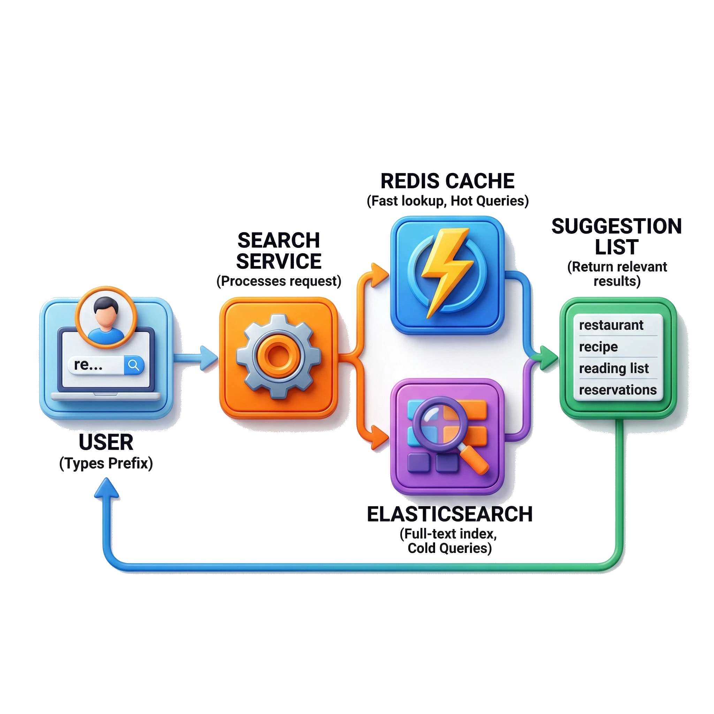

> 💡 **Giải thích:** Typeahead có ở mọi search bar hiện đại: Google gợi ý khi bạn gõ, Shopee gợi ý tên sản phẩm. Kỹ thuật phổ biến nhất: lưu prefix vào Elasticsearch với **completion suggester**, kết hợp **Redis cache** cho các query phổ biến. Latency < 100ms là điều kiện bắt buộc để UX không bị "lag" (vì request bắn ra theo từng phím gõ).
>
> 📌 **Mở rộng:** Ví dụ n-gram (n = 3) của "iphone": `iph`, `pho`, `hon`, `one` → gõ "hone" vẫn tìm ra "iphone". Edge n-gram chỉ lấy các tiền tố (`i`, `ip`, `iph`, ...) — chuyên dùng cho autocomplete.

---

## 2. Replication & Sharding

### Tại sao cần Replication?

> **Replication** là quá trình sao chép dữ liệu từ một node sang các node khác để tăng **availability** và **read throughput**.

- **Single point of failure**: nếu chỉ có 1 DB node → hệ thống sập khi node đó lỗi
- **Read scalability**: nhiều replica phục vụ read → giảm tải master
- **Geographic distribution**: đặt replica gần người dùng → giảm latency
- **Disaster recovery**: replica ở data center khác → khôi phục sau thảm họa

> 💡 **Giải thích:** Hình dung một ứng dụng e-commerce có 10,000 request đọc mỗi giây — một DB đơn lẻ sẽ quá tải. Replication giải quyết cả hai vấn đề: (1) nếu master chết thì **promote** một replica lên làm master mới; (2) phân tán read traffic ra nhiều replica. Đây là pattern cơ bản nhất của mọi hệ thống production.

### Master-Slave Replication

> Một **master** nhận tất cả write, sao chép sang một hoặc nhiều **slave** chỉ phục vụ read.

| Ưu điểm | Nhược điểm |
|---|---|
| Đơn giản, dễ triển khai | Master là single point of failure cho write |
| Slave scale read tuyến tính | **Replication lag**: slave có thể đọc dữ liệu cũ |
| Master tập trung xử lý write → nhất quán | Failover thủ công tốn thời gian |

> 💡 **Giải thích:** MySQL, PostgreSQL đều hỗ trợ Master-Slave sẵn (out of the box). Thực tế khoảng 80% traffic là read, nên có 3–4 slave đọc song song giảm tải đáng kể. Nhưng **replication lag** rất hay gặp: sau khi write vào master, slave có thể mất vài giây mới cập nhật. Nếu user đọc ngay sau khi write, họ có thể nhận dữ liệu cũ — gọi là **stale read**.
>
> 📌 **Mở rộng:** Cách giảm stale read hay dùng là *read-your-writes*: ngay sau khi user ghi, các lần đọc của chính user đó (trong vài giây) được route về master. Ngày nay thuật ngữ thường dùng là *primary/replica* hoặc *leader/follower* thay cho master/slave.

### Sơ đồ Master-Slave Replication

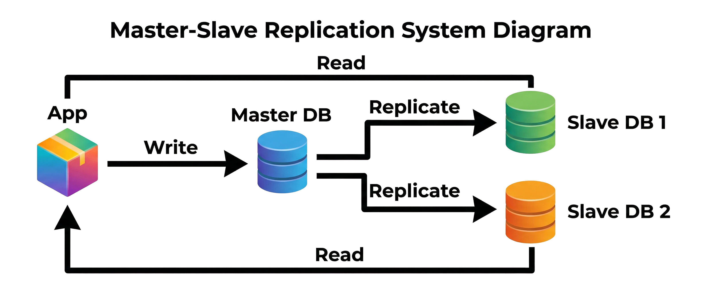

Hình minh họa: App ghi (Write) vào một Master DB; Master sao chép (Replicate) sang hai Slave DB; App đọc (Read) từ các Slave.

### Master-Master Replication

> Hai (hoặc nhiều) node **đều** nhận write và sao chép lẫn nhau — không có node nào là slave.

| Ưu điểm | Nhược điểm |
|---|---|
| Không có single point of failure cho write | **Write conflict**: hai node ghi cùng row đồng thời → xung đột |
| Write có thể phân tán địa lý | Phức tạp hơn, cần conflict resolution strategy |
| Tự động failover dễ hơn | Nguy cơ mất tính nhất quán (**consistency**) |

> 💡 **Giải thích:** Master-Master nghe lý tưởng nhưng **write conflict** là bài toán rất khó. Giả sử user A và user B cùng update balance của cùng một account trên 2 master khác nhau trong cùng 1 giây — hệ thống phải quyết định giá trị nào thắng. Các chiến lược phổ biến:
> - **Last-write-wins**: đơn giản nhưng có thể mất dữ liệu;
> - **Custom merge logic**: tự viết luật gộp;
> - **Tránh conflict**: route mỗi user cố định về một master.

### Sơ đồ Master-Master Replication

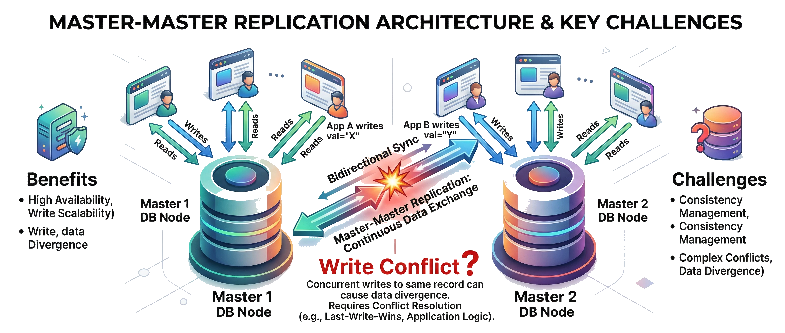

Hình minh họa: hai Master DB đồng bộ hai chiều ("Bidirectional Sync"); mỗi Master đều nhận cả write lẫn read từ các instance App, kèm câu hỏi "Write Conflict?".

### So sánh Master-Slave vs Master-Master

| Tiêu chí | Master-Slave | Master-Master |
|---|---|---|
| Write | chỉ master | tất cả node |
| Read | master + slave | tất cả node |
| Consistency | cao | thấp hơn |
| Complexity | thấp | cao |
| Failover | thủ công / bán tự động | tự động |
| Dùng khi | read-heavy, cần consistency | write cần HA, multi-region |

> 💡 **Giải thích:** Thực tế hầu hết hệ thống dùng **Master-Slave** vì đơn giản và đủ dùng. Master-Master chỉ cần khi yêu cầu cao về write availability ở nhiều data center. CockroachDB và Google Spanner dùng biến thể của Master-Master kết hợp **distributed consensus** để tự động giải quyết conflict.

### 📌 Mở rộng — Sharding

Sharding được dùng trong phần *Tổng kết* và Bài tập 2, nên tóm tắt ngắn:

- **Sharding (horizontal partitioning)**: chia *dữ liệu* của một bảng ra nhiều DB node, mỗi node (shard) giữ một phần các dòng. Khác với replication (mỗi node giữ *bản sao đầy đủ*).
- Mục đích: tăng **write throughput** và vượt **giới hạn storage** của một máy — điều replication không làm được (vì mọi write vẫn dồn về master).
- **Shard key** quyết định dòng nào nằm ở shard nào:
  - *Hash-based* (vd. `hash(user_id) % N`): phân bố đều, nhưng truy vấn theo khoảng (range) phải hỏi mọi shard.
  - *Range-based* (vd. theo `timestamp`): truy vấn theo khoảng tốt, nhưng dữ liệu mới luôn dồn vào shard cuối → **hotspot**.
- Thường kết hợp: mỗi shard lại có replica riêng (sharding + replication).

---

## 3. ACID vs BASE

### ACID Transactions — 4 tính chất

> **ACID** đảm bảo tính toàn vẹn dữ liệu tuyệt đối — mọi transaction hoặc thành công hoàn toàn, hoặc không xảy ra gì.

- **Atomicity** (Tính nguyên tử): transaction là một đơn vị — tất cả thành công hoặc tất cả rollback
- **Consistency** (Nhất quán): DB luôn ở trạng thái hợp lệ trước và sau transaction
- **Isolation** (Cô lập): các transaction song song không can thiệp lẫn nhau
- **Durability** (Bền vững): dữ liệu đã commit không bao giờ bị mất, dù server crash

> 💡 **Giải thích:** Ví dụ kinh điển là chuyển tiền ngân hàng. Bước 1: trừ 100k ở tài khoản A. Bước 2: cộng 100k vào tài khoản B. Nếu server crash sau bước 1, **Atomicity** đảm bảo bước 1 bị rollback — A không mất tiền. **Durability** đảm bảo nếu cả 2 bước thành công và đã commit, thì dù server restart ngay sau đó dữ liệu vẫn còn.

### Ví dụ: ACID trong chuyển tiền ngân hàng

```sql
BEGIN TRANSACTION;

-- Bước 1: Trừ tiền từ tài khoản A
UPDATE accounts SET balance = balance - 100000
WHERE account_id = 'A' AND balance >= 100000;

-- Bước 2: Cộng tiền vào tài khoản B
UPDATE accounts SET balance = balance + 100000
WHERE account_id = 'B';

-- Nếu cả 2 bước OK → commit
COMMIT;

-- Nếu có lỗi ở bước nào → rollback toàn bộ
-- ROLLBACK;
```

- Nếu server crash sau `UPDATE A` nhưng trước `UPDATE B` → **tự động ROLLBACK**
- Không thể xảy ra trạng thái: A bị trừ tiền nhưng B không nhận được

> 💡 **Giải thích:** Transaction bao bọc cả hai `UPDATE`. Có bất cứ sự cố gì giữa chừng thì database engine tự động rollback mọi thay đổi. Điều kiện `AND balance >= 100000` đảm bảo **Consistency**: không thể chuyển nếu số dư không đủ. PostgreSQL, MySQL InnoDB đều đảm bảo ACID đầy đủ.
>
> 📌 **Mở rộng:** Lưu ý trong code thật: nếu A không đủ tiền, `UPDATE` đầu tiên không lỗi mà chỉ cập nhật **0 dòng**. Ứng dụng phải kiểm tra số dòng bị ảnh hưởng và tự gọi `ROLLBACK`, nếu không B vẫn được cộng tiền.

### BASE Transactions — 3 tính chất

> **BASE** ưu tiên **availability** và **performance** hơn consistency tuyệt đối — chấp nhận dữ liệu *eventually* nhất quán.

- **Basically Available**: hệ thống luôn phản hồi, dù có thể trả về dữ liệu cũ
- **Soft state**: trạng thái hệ thống có thể thay đổi theo thời gian dù không có input mới (do propagation)
- **Eventually Consistent**: dữ liệu sẽ nhất quán *cuối cùng* — không phải ngay lập tức
- Phổ biến trong **NoSQL** (Cassandra, DynamoDB, CouchDB)

> 💡 **Giải thích:** BASE là phía đối lập của ACID. Cassandra (Netflix, Discord dùng) là ví dụ điển hình. Khi bạn like một video YouTube, số like không cập nhật ngay cho mọi người xem — người thấy 1,000,000, người thấy 999,999 — nhưng sau vài giây tất cả đồng nhất. Đó là **Eventually Consistent**. Đổi lại, YouTube phục vụ được hàng tỉ request mà không bị nghẽn bởi distributed locking.

### So sánh ACID vs BASE

> Lựa chọn giữa ACID và BASE là đánh đổi giữa **consistency** và **availability/performance**.

| Tiêu chí | ACID | BASE |
|---|---|---|
| Consistency | ***tuyệt đối*** | ***eventually*** |
| Availability | có thể giảm (locks) | ***cao*** |
| Latency | cao hơn | thấp hơn |
| Scale | vertical chủ yếu | horizontal tốt |
| Dùng | tài chính, y tế, ngân hàng | social media, analytics, IoT |
| VD | PostgreSQL, MySQL, Oracle | Cassandra, DynamoDB, MongoDB |

> 💡 **Giải thích:** Đây là một quyết định kiến trúc quan trọng, không có đáp án đúng tuyệt đối — tùy yêu cầu nghiệp vụ. Hệ thống ngân hàng **không được** dùng BASE cho giao dịch tiền: mất nhất quán = mất tiền thật. Nhưng với gợi ý sản phẩm hay số người đang xem livestream, BASE là lựa chọn đúng. Nhiều hệ thống lớn dùng **cả hai**: ACID cho core financial data, BASE cho analytics và social features.

### Khi nào dùng ACID? Khi nào dùng BASE?

> Chọn mô hình phù hợp với **yêu cầu nghiệp vụ**, không phải theo xu hướng công nghệ.

| Dùng ACID khi | Dùng BASE khi |
|---|---|
| Dữ liệu tài chính, y tế, pháp lý — sai sót gây hậu quả nghiêm trọng | Scale hàng triệu write/giây (logs, events, IoT sensor data) |
| Cần foreign key constraint và relational integrity | Chấp nhận stale read (feed mạng xã hội, số like, view count) |
| Write volume không quá lớn (< vài nghìn TPS) | Cần geo-distributed write với latency thấp |

> 💡 **Giải thích:** Nguyên tắc thực tế: nếu sai dữ liệu gây **mất tiền thật** hoặc **ảnh hưởng pháp lý** → ACID. Nếu sai sót chỉ ảnh hưởng UX nhỏ (số like sai vài giây) → BASE để có performance tốt hơn. Stripe và PayPal dùng PostgreSQL (ACID) cho transactions; Netflix dùng Cassandra (BASE) cho viewing history và recommendations.

### Sơ đồ chọn ACID hay BASE

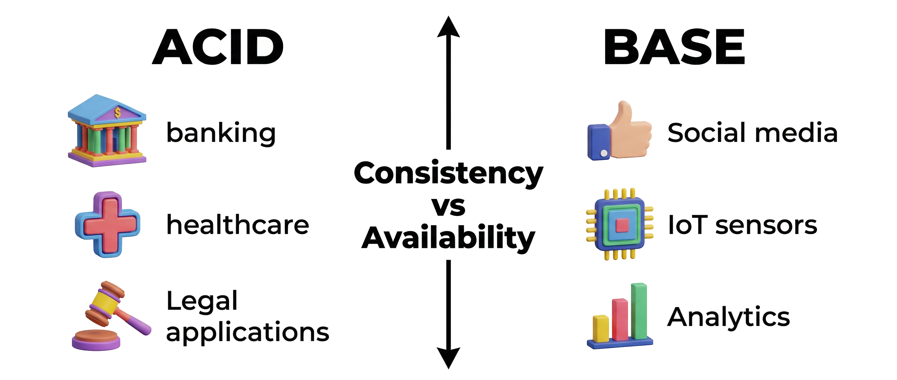

Hình minh họa: bên trái là ACID với biểu tượng ngân hàng, y tế, pháp lý; bên phải là BASE với mạng xã hội, cảm biến IoT, analytics; ở giữa là trục "Consistency vs Availability".

> 💡 **Giải thích:** Sơ đồ nêu đánh đổi giữa hai nhóm tính chất. **ACID** (Atomicity, Consistency, Isolation, Durability) ưu tiên tính nhất quán và toàn vẹn dữ liệu → hợp với hệ thống mà độ chính xác là sống còn: giao dịch ngân hàng, hồ sơ y tế, ứng dụng pháp lý. **BASE** (Basically Available, Soft state, Eventual consistency) ưu tiên tính sẵn sàng và khả năng mở rộng → chạy nhanh hơn trong hệ phân tán nơi chấp nhận được bất nhất tạm thời: feed mạng xã hội, dữ liệu cảm biến IoT, analytics quy mô lớn.

---

## 4. Giao dịch phân tán

### Thách thức của giao dịch phân tán

> Trong hệ thống phân tán, một *business transaction* có thể span nhiều service và database — đảm bảo ACID trở nên ***cực kỳ khó***.

- **Network partition**: các node không thể liên lạc với nhau (CAP theorem)
- **Partial failure**: một số service thành công, một số fail → dữ liệu không nhất quán
- **No global clock**: các node không có đồng hồ chung → khó xác định thứ tự sự kiện
- **2PC blocking**: giao thức cổ điển có thể block toàn hệ thống nếu coordinator crash

> 💡 **Giải thích:** Đây là bài toán nổi tiếng nhất của distributed systems. Ví dụ đặt vé máy bay online gồm 3 bước: thanh toán qua **Payment Service**, đặt chỗ qua **Booking Service**, gửi email qua **Notification Service**. Nếu Payment thành công mà Booking fail thì phải hoàn tiền. Làm sao đảm bảo tính nguyên tử khi 3 service độc lập với nhau, mỗi cái có DB riêng? Đó là bài toán **distributed transaction**.
>
> 📌 **Mở rộng:** *CAP theorem*: khi có network partition (P), hệ phân tán chỉ có thể chọn giữ Consistency (C) hoặc Availability (A), không giữ được cả hai.

### Two-Phase Commit (2PC)

> **2PC** dùng một **Coordinator** trung tâm điều phối 2 pha — *Prepare* và *Commit* — để đảm bảo tất cả participant đồng ý trước khi commit.

**Pha 1 — Prepare:**

- Coordinator gửi `PREPARE` tới tất cả participant
- Mỗi participant chuẩn bị transaction, ghi redo log, trả lời `VOTE_COMMIT` hoặc `VOTE_ABORT`

**Pha 2 — Commit:**

- Nếu **tất cả** vote `VOTE_COMMIT` → Coordinator gửi `COMMIT`
- Nếu **bất kỳ** vote `VOTE_ABORT` → Coordinator gửi `ABORT` tới tất cả

> 💡 **Giải thích:** 2PC là giao thức đồng thuận phân tán cổ điển, được dùng trong **XA transactions** của JDBC. Điểm mấu chốt: Coordinator phải nhận "yes" từ **TẤT CẢ** participant mới commit — chỉ cần một node từ chối là cả transaction bị abort. Điều này bảo đảm atomicity nhưng sinh ra **blocking problem** (xem *Hạn chế của 2PC* bên dưới).

### Sơ đồ luồng 2PC

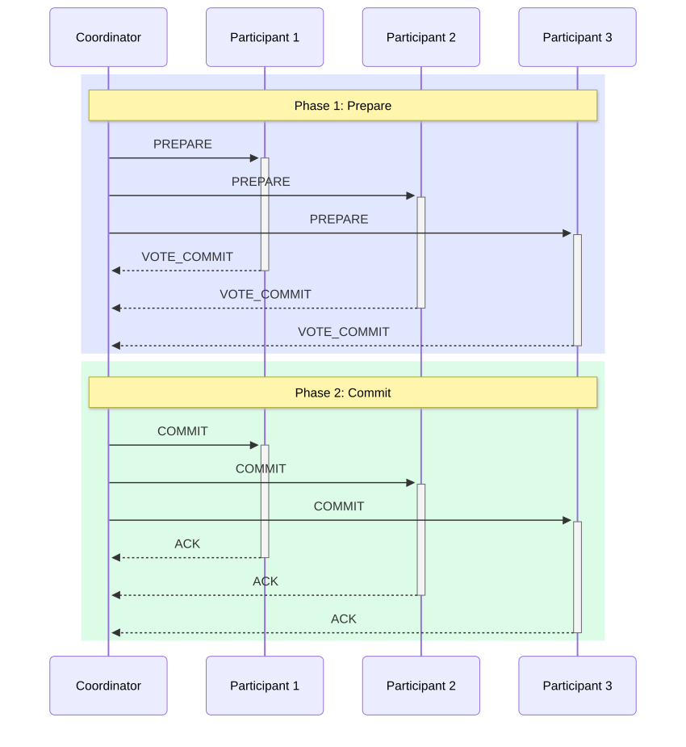

<details><summary>🔧 Mã nguồn sơ đồ (mermaid)</summary>

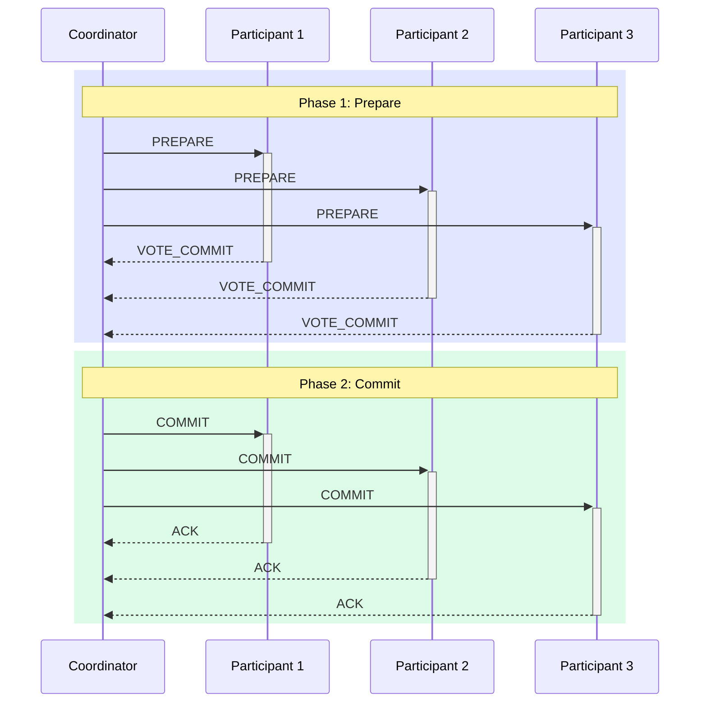

</details>

> 💡 **Giải thích:** Quan sát luồng: theo một cách đếm hay gặp, tổng cộng có **2N + 2** message (N = số participant), mỗi message là một network round-trip. Với latency mạng 10ms/hop, một transaction trải trên 5 service mất tối thiểu **~100ms** chỉ riêng cho overhead của 2PC. Đây là lý do 2PC hiếm khi dùng trong microservices có SLA latency thấp.
>
> 📌 **Lưu ý:** Cách đếm phổ biến là **2N + 2**; nhưng nếu đếm theo sơ đồ trên (PREPARE, VOTE, COMMIT, ACK cho mỗi participant) thì có **4N** message, còn nhiều giáo trình ghi 3N (không đếm ACK). Con số chính xác phụ thuộc cách đếm — điều cần nhớ là chi phí tăng tuyến tính theo N và cần **2 round-trip**.

### Hạn chế của 2PC

> 2PC có vấn đề ***blocking*** nghiêm trọng: nếu Coordinator crash sau pha Prepare, toàn hệ thống bị treo.

- **Blocking protocol**: participant giữ lock trong suốt quá trình → block resource
- **Single point of failure**: Coordinator crash → tất cả participant chờ vô thời hạn
- **Performance**: 2 round-trip network cho mỗi transaction → latency cao
- **Không phù hợp** cho microservices với hundreds of service instances

> 💡 **Giải thích:** Đây là lý do hệ thống hiện đại tránh 2PC. Tưởng tượng: Coordinator gửi PREPARE tới 5 participant, nhận đủ 5 `VOTE_COMMIT`, rồi **crash trước khi gửi COMMIT**. 5 participant đang giữ lock và chờ Coordinator... mãi mãi (chúng không dám tự commit hay abort vì không biết các node khác đã vote gì). Hệ thống "đông cứng". 3PC được thiết kế để giải quyết vấn đề này.

### Three-Phase Commit (3PC)

> **3PC** thêm pha **Pre-Commit** giữa Prepare và Commit, cho phép participant tự quyết định nếu Coordinator fail — giải quyết blocking problem.

**Ba pha:**

1. **CanCommit**: Coordinator hỏi "bạn có thể commit không?" — không lock resource
2. **PreCommit**: nếu tất cả đồng ý → gửi `PREPARE_COMMIT`, participant giữ lock
3. **DoCommit**: Coordinator gửi `COMMIT` → participant thực hiện commit

**Cải tiến so với 2PC:**

- Participant biết rằng ***tất cả đã sẵn sàng*** trước khi lock resource
- Nếu Coordinator timeout ở pha 3, participant có thể tự commit (safe)
- Giảm blocking khi Coordinator crash

> 💡 **Giải thích:** 3PC giải quyết blocking bằng cách thêm một bước thông tin trung gian. Sau PreCommit, mỗi participant biết "tất cả các node khác đã sẵn sàng commit". Nếu lúc này mất liên lạc với Coordinator, participant có thể hỏi nhau và tự quyết định commit — không cần đợi Coordinator. Tuy vậy 3PC có latency cao hơn 2PC và vẫn có edge case khi **network partition**. Trong thực tế, **SAGA Pattern** phổ biến hơn cả 2PC lẫn 3PC.

### Sơ đồ luồng 3PC

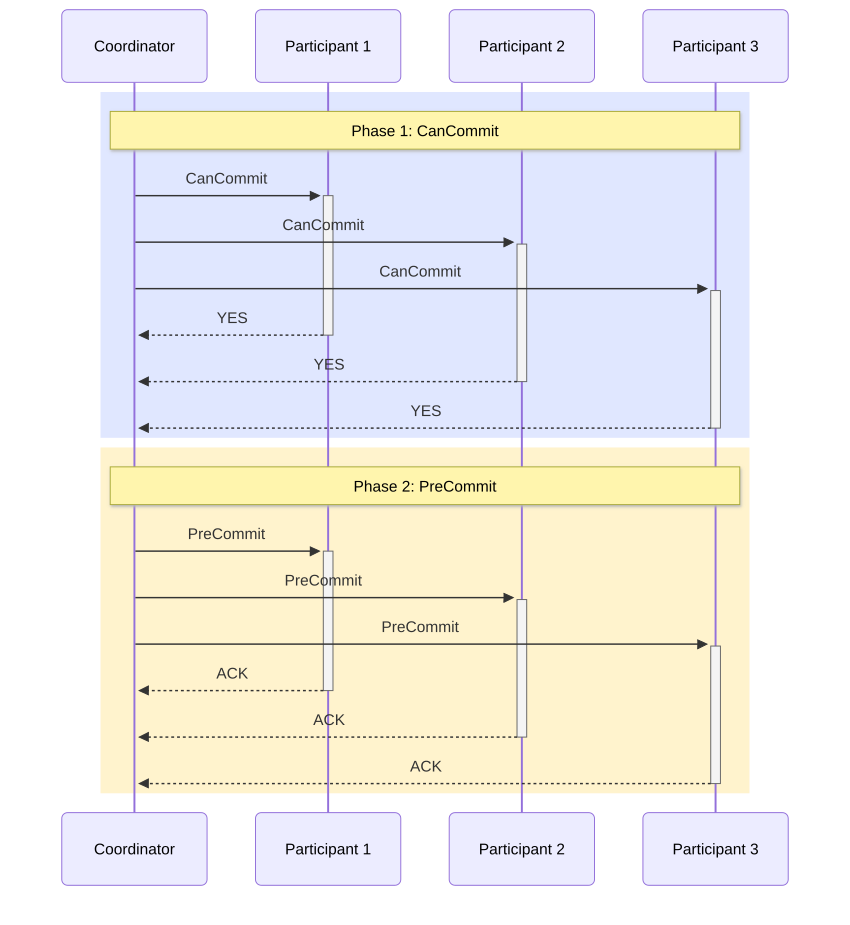

<details><summary>🔧 Mã nguồn sơ đồ (mermaid)</summary>

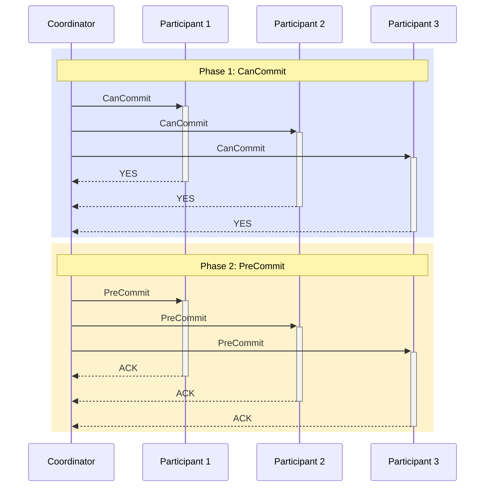

</details>

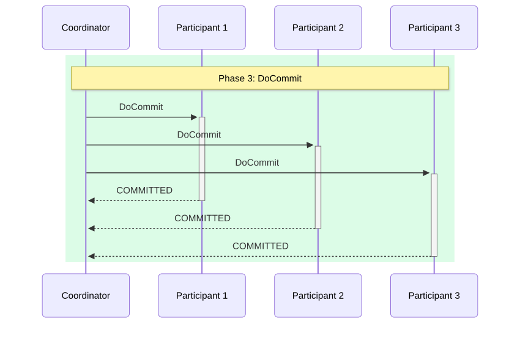

<details><summary>🔧 Mã nguồn sơ đồ (mermaid)</summary>

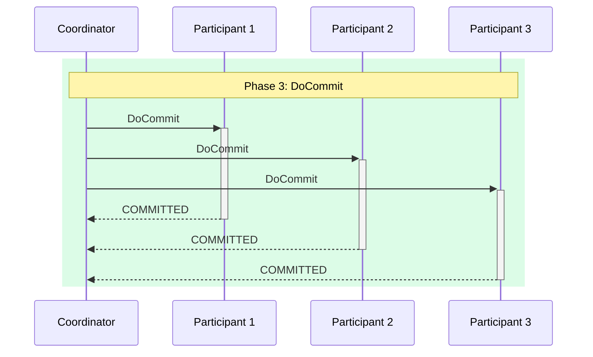

</details>

> 💡 **Giải thích:** So với 2PC, 3PC tách "Prepare" thành hai bước: **CanCommit** (chỉ hỏi, chưa khóa) và **PreCommit** (khóa và báo cho mọi người biết ai cũng đã đồng ý). Nhờ vậy ở pha DoCommit, nếu Coordinator biến mất, participant đã ở trạng thái "pre-committed" có thể yên tâm tự commit.

### So sánh 2PC vs 3PC

> Cả hai đều đảm bảo atomicity nhưng có đánh đổi khác nhau về blocking và complexity.

| Tiêu chí | 2PC | 3PC |
|---|---|---|
| Số pha | 2 | 3 |
| Blocking | ***có*** (coordinator fail) | ***ít hơn*** |
| Message count | 2N + 2 | 3N + 3 |
| Complexity | trung bình | cao hơn |
| Recovery | cần manual hoặc log | tự động hơn |
| Mức sử dụng | dùng phổ biến trong: XA, JDBC | ít dùng trong thực tế (replaced by SAGA) |

> 💡 **Giải thích:** Về lý thuyết 3PC tốt hơn 2PC nhưng thực tế ít dùng vì: phức tạp hơn, latency cao hơn, và vẫn không giải quyết trọn vẹn network partition. Trong microservices hiện đại, **SAGA Pattern** được ưu tiên vì: không có distributed lock, mỗi service tự quản lý transaction local, và dùng **compensating transaction** thay cho rollback.

### SAGA Pattern — tổng quan

> **SAGA** chia một distributed transaction thành chuỗi **local transaction** trên từng service, mỗi bước có một **compensating transaction** để hoàn tác nếu lỗi.

- Không dùng distributed lock → không blocking
- Mỗi service chỉ dùng local ACID transaction
- **Compensating transaction**: nghịch đảo của bước trước — hoàn tiền thay vì rollback
- Hai triển khai: **Orchestration** (điều phối tập trung) và **Choreography** (phân tán)

> 💡 **Giải thích:** SAGA được đề xuất từ năm 1987 nhưng chỉ thực sự phổ biến trong thời kỳ microservices. Ý tưởng cốt lõi: thay vì một transaction lớn ôm nhiều service, chia thành nhiều transaction nhỏ. Nếu bước 3 fail, ta **không rollback** bước 1 và 2 (chúng đã commit rồi) mà chạy **compensating transaction**: "hủy đặt chỗ", "hoàn tiền". Kết quả là **eventually consistent** — không phải ACID, nhưng đủ cho hầu hết business use case.

### SAGA Orchestration

> **Orchestration SAGA** dùng một **Orchestrator** trung tâm ra lệnh và giám sát từng bước — giống như nhạc trưởng điều phối dàn nhạc.

- Orchestrator gọi từng service theo thứ tự, nhận kết quả
- Nếu bước N fail → Orchestrator gọi compensating transaction của bước N-1, N-2...
- Logic workflow tập trung tại Orchestrator → dễ debug, dễ monitor
- Nhược điểm: Orchestrator là central dependency

> 💡 **Giải thích:** Ví dụ đặt vé máy bay. Orchestrator gọi: (1) `PaymentService.charge()` → thành công; (2) `BookingService.reserve()` → thành công; (3) `NotificationService.sendEmail()` → fail. Khi đó Orchestrator gọi `BookingService.cancel()` rồi `PaymentService.refund()`. Toàn bộ logic kiểu "nếu A thành công thì làm B; nếu C fail thì hoàn tác B rồi A" nằm trong Orchestrator. **Netflix Conductor** và **Uber Cadence** là các Orchestration engine.

### Ví dụ: SAGA Orchestration — đặt vé máy bay

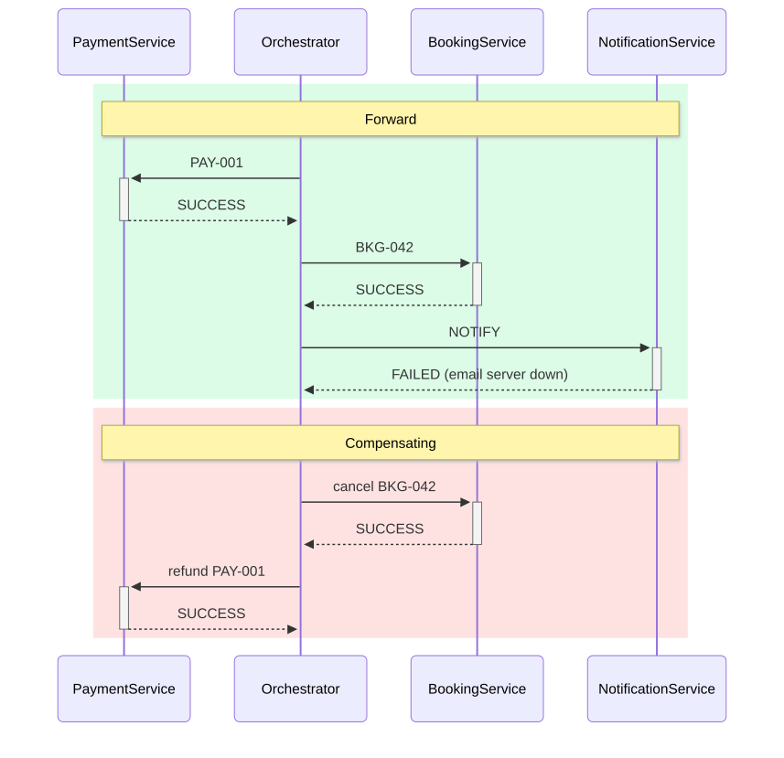

<details><summary>🔧 Mã nguồn sơ đồ (mermaid)</summary>

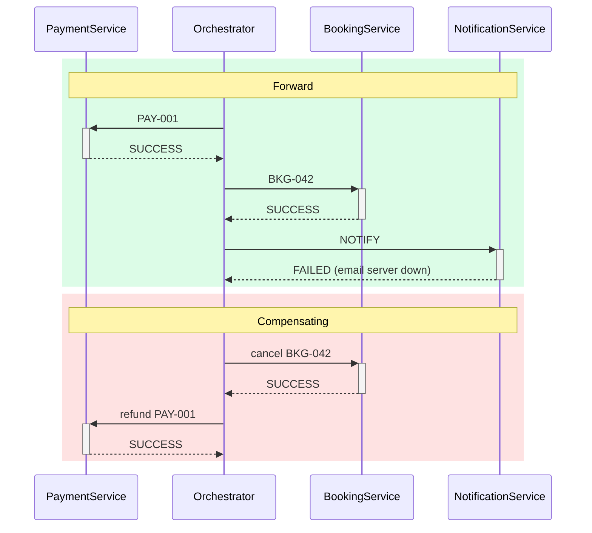

</details>

- Compensating transactions chạy ***ngược chiều*** khi có lỗi
- Mỗi bước lưu ID để compensating transaction biết phải hoàn tác gì

> 💡 **Giải thích:** Orchestrator lưu **trạng thái của SAGA** (bước nào đã chạy, kết quả ra sao) vào persistent storage. Nếu Orchestrator crash giữa chừng, khi khởi động lại nó biết phải tiếp tục từ bước nào — gọi là **durable execution**. **Temporal.io** là nền tảng hiện đại phổ biến cho Orchestration SAGA, có sẵn durable execution. Các ID như `PAY-001`, `BKG-042` chính là thứ được lưu để biết cần hủy/hoàn cái gì.

### SAGA Choreography

> **Choreography SAGA** không có Orchestrator — mỗi service tự lắng nghe event và quyết định hành động tiếp theo — như vũ công nhảy theo nhịp chung.

- Mỗi service publish event sau khi hoàn thành local transaction
- Service tiếp theo subscribe event và tự xử lý
- Compensating event được publish khi cần hoàn tác
- Không có central controller → không có single point of failure

> 💡 **Giải thích:** Ví dụ: PaymentService xử lý xong → publish `PaymentCompleted`. BookingService nghe event này → đặt chỗ → publish `BookingConfirmed`. NotificationService nghe `BookingConfirmed` → gửi email. Nếu BookingService fail → publish `BookingFailed`; PaymentService nghe `BookingFailed` → hoàn tiền. **Event bus** (Kafka, RabbitMQ) là xương sống của Choreography.

### Ví dụ: SAGA Choreography — luồng event

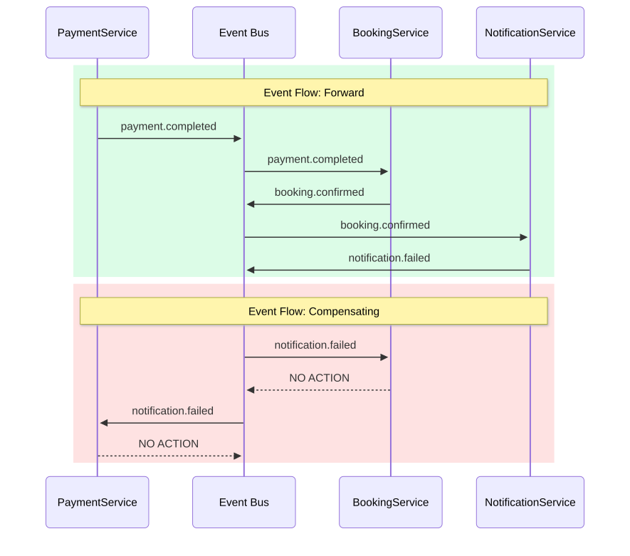

<details><summary>🔧 Mã nguồn sơ đồ (mermaid)</summary>

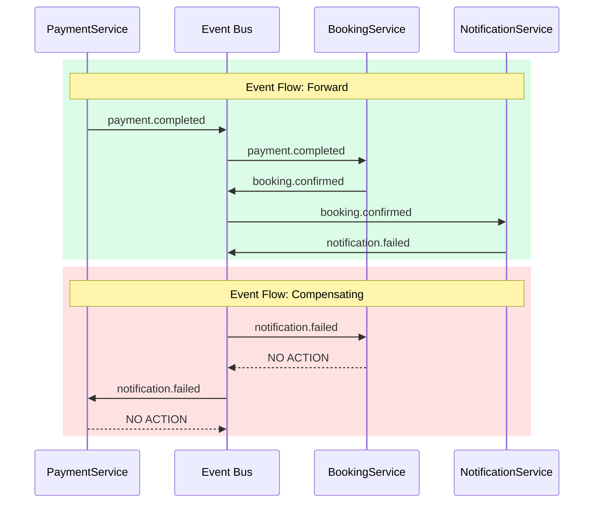

</details>

- Mỗi service chỉ quan tâm event liên quan đến mình
- Business rules phân tán vào từng service

> 💡 **Giải thích:** Ví dụ này cho thấy một điểm quan trọng: **không phải failure nào cũng cần compensate**. Email gửi lỗi không có nghĩa là phải hủy vé — chỉ cần **retry**. Vì thế Booking và Payment nhận `notification.failed` nhưng *không làm gì* (NO ACTION). Logic "phản ứng thế nào" nằm rải rác ở từng service subscriber — vừa là ưu điểm (service tự chủ) vừa là nhược điểm (khó nắm luồng tổng thể khi hệ thống phức tạp). Lưu ý: khác với ví dụ *SAGA Orchestration — đặt vé máy bay* phía trên (ở đó email fail thì hủy booking và hoàn tiền) — đây là hai cách thiết kế nghiệp vụ khác nhau cho cùng tình huống.

### So sánh Orchestration vs Choreography

| Tiêu chí | Orchestration | Choreography |
|---|---|---|
| Control | tập trung tại Orchestrator | phân tán qua events |
| Visibility | dễ trace luồng | khó trace (event chain) |
| Coupling | service gọi Orchestrator | loose coupling qua event bus |
| Debug | dễ | khó hơn |
| SPOF | Orchestrator | event bus |
| Tốt khi | workflow phức tạp, nhiều bước | service ít, workflow đơn giản |

> 💡 **Giải thích:** Rule of thumb: **dưới 5 service** và luồng đơn giản → Choreography là đủ, giữ được loose coupling. **Trên 5 service** hoặc có conditional logic phức tạp → Orchestration cho dễ quản lý. Uber dùng Choreography cho các event đơn giản, nhưng dùng Orchestration (Cadence) cho business workflow phức tạp như driver onboarding với hàng chục bước.

### Distributed Consensus — Paxos

> **Paxos** là giao thức đồng thuận cho phép cluster các node đạt được thỏa thuận về một giá trị dù có node bị lỗi — ***nền tảng lý thuyết*** của distributed systems.

- Gồm 3 vai: **Proposer** (đề xuất giá trị), **Acceptor** (chấp nhận hoặc từ chối), **Learner** (học giá trị đã đồng thuận)
- **Phase 1 (Prepare/Promise)**: Proposer gửi ballot number, Acceptor hứa không accept ballot cũ hơn
- **Phase 2 (Accept/Accepted)**: Proposer gửi giá trị, Acceptor accept nếu không có ballot mới hơn
- Đảm bảo safety dù minority node fail (chịu được < N/2 failures)

> 💡 **Giải thích:** Paxos do Leslie Lamport công bố năm 1989, là nền tảng lý thuyết của nhiều hệ thống phân tán. Google Chubby lock service và Apache Zookeeper dựa trên Paxos. Nhưng Paxos nổi tiếng là "rất khó hiểu và khó implement đúng" — chính Lamport cũng thừa nhận. Vì vậy Raft ra đời với mục tiêu dễ hiểu hơn và đang thay Paxos trong nhiều implementation mới.
>
> 📌 **Mở rộng:** "Ballot number" là số hiệu đề xuất tăng dần; nhờ nó, các đề xuất cũ/đến muộn bị loại. Chính xác hơn, Zookeeper dùng giao thức **ZAB** (Zookeeper Atomic Broadcast) — một họ hàng gần của Paxos. Paxos cần đa số (majority) Acceptor đồng ý, nên cluster 5 node chịu được 2 node lỗi.

### Distributed Consensus — Raft

> **Raft** được thiết kế với mục tiêu ***dễ hiểu*** hơn Paxos trong khi đảm bảo cùng tính đúng đắn — phân chia rõ thành Leader Election, Log Replication, Safety.

- **Leader Election**: cluster bầu một Leader duy nhất qua voting (term-based)
- **Log Replication**: Leader nhận write request, replicate sang tất cả Follower trước khi commit
- **Safety**: một log entry chỉ commit khi được majority (>N/2) node xác nhận
- Chịu được (N-1)/2 node failure với cluster N node

**Ứng dụng thực tế:** etcd (Kubernetes), CockroachDB, TiKV (TiDB), Consul

> 💡 **Giải thích:** Raft chia bài toán thành 3 câu hỏi rõ ràng: *ai là leader*, *log được replicate thế nào*, và *khi nào thì an toàn để commit*. Leader xử lý mọi write request nên đảm bảo nhất quán. Nếu Leader crash, các Follower bầu Leader mới trong vài giây. **etcd** — thành phần lõi của Kubernetes — dùng Raft để lưu cluster state: khi bạn chạy `kubectl apply`, Kubernetes dùng Raft để mọi node đồng ý về trạng thái mới của cluster.
>
> 📌 **Mở rộng:** Leader *gửi* log tới tất cả Follower, nhưng chỉ cần **đa số** xác nhận là commit được (không phải đợi tất cả). Ví dụ cluster N = 5: cần 3 xác nhận, chịu được (5−1)/2 = 2 node lỗi. Vì vậy cluster consensus thường có số node lẻ (3, 5, 7).

### Ví dụ: Raft Leader Election

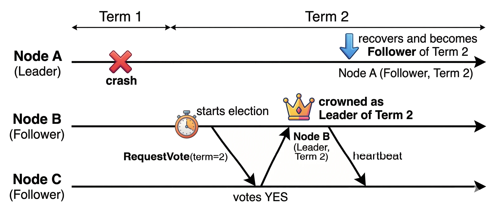

Hình minh họa: ở Term 1, Node A là Leader, B và C là Follower; A crash; B hết timer, tự ứng cử và gửi `RequestVote(term=2)` tới C; C vote YES; B trở thành Leader của Term 2 và gửi heartbeat cho C; A hồi phục và trở thành Follower của Term 2.

- **Term**: logical clock trong Raft — tăng mỗi khi có election mới
- Node vote cho candidate đầu tiên có log ***ít nhất bằng*** log của mình

> 💡 **Giải thích:** **Term** là khái niệm then chốt của Raft. Mỗi node có một bộ đếm term. Khi nhận message từ node có term **cao hơn**, node lập tức "step down" về Follower. Điều này ngăn **split-brain**: dù network partition tạm thời tạo ra 2 leader, khi partition được nối lại thì leader có term cao hơn sẽ thắng. **Election timeout ngẫu nhiên (150–300ms)** giảm xác suất hai node cùng bắt đầu election một lúc (gây chia phiếu).

### So sánh Paxos vs Raft

> Cả hai đều giải quyết bài toán distributed consensus nhưng Raft được thiết kế để *dễ implement đúng hơn*.

| Tiêu chí | Paxos | Raft |
|---|---|---|
| Thiết kế | lý thuyết tối ưu | ưu tiên ***dễ hiểu*** |
| Understandability | ***khó*** | tốt hơn nhiều |
| Leader | không bắt buộc có leader cố định | có Leader rõ ràng |
| Log | không tường minh | replicated log tường minh |
| Implementation | error-prone | nhiều reference impl |
| Dùng | Zookeeper, Chubby (Google) | etcd, CockroachDB, Consul, TiKV |

> 💡 **Giải thích:** Diego Ongaro (tác giả Raft) đã đo đạc: sinh viên học Raft làm bài kiểm tra tốt hơn sinh viên học Paxos — đó là khác biệt có chủ đích. Thực tế Raft đang dần thay Paxos trong các implementation mới vì dễ làm đúng hơn. Nếu bạn xây hệ phân tán mới cần consensus, Raft là lựa chọn đầu tiên nên cân nhắc.

---

## 5. Bài tập áp dụng

### Bài tập 1: Thiết kế hệ thống tìm kiếm sản phẩm

> Bạn được giao thiết kế tính năng tìm kiếm cho sàn thương mại điện tử có **50 triệu sản phẩm**, **2 triệu DAU**.

**Yêu cầu:**

- Tìm kiếm full-text theo tên, mô tả, thương hiệu
- Hỗ trợ gõ sai chính tả (fuzzy) và gợi ý (typeahead)
- Latency: < 200ms cho search, < 100ms cho typeahead
- Ranking theo relevance và popularity

### Bài tập 1 (tiếp): Câu hỏi thiết kế

1. Bạn sẽ dùng công nghệ gì cho search layer? Tại sao không dùng SQL `LIKE`?
2. Shard key cho Elasticsearch index là gì?
3. Làm thế nào để sync dữ liệu từ primary DB (PostgreSQL) sang Elasticsearch?
4. Thiết kế cache layer cho typeahead như thế nào?

> 💡 **Giải thích:** Bài này kiểm tra khả năng kết nối các khái niệm: inverted index, fuzzy search, typeahead, caching.

### Bài tập 2: Chọn chiến lược Replication và Sharding

> Hệ thống **mạng xã hội** với đặc điểm: 100 triệu user, 80% traffic là đọc (timeline, profile), 20% là ghi (post, like, comment). Database hiện tại: PostgreSQL đơn node, đang quá tải.

**Câu hỏi:**

1. Nên dùng Replication hay Sharding trước? Tại sao?
2. Nếu Sharding — chọn shard key là `user_id` hay `timestamp`? Phân tích trade-off.
3. Vấn đề gì xảy ra khi user có 10 triệu follower (celebrity problem)?

### Bài tập 2 (tiếp): Tình huống

| Metric | Hiện tại | Mục tiêu |
|---|---|---|
| Read QPS | 50,000 | 500,000 |
| Write QPS | 12,000 | 120,000 |
| Data size | 2TB | 20TB |
| Latency p99 | 800ms | 100ms |

### Bài tập 3: ACID hay BASE? Phân tích tình huống

> Với mỗi tình huống dưới đây, hãy quyết định nên dùng **ACID** hay **BASE**, và giải thích lý do.

**Thảo luận:** Với tình huống đặt hàng — nếu dùng BASE, vấn đề gì có thể xảy ra? Giải pháp?

### Bài tập 3 (tiếp): Bảng tình huống

| Tình huống | Yêu cầu nghiệp vụ | ACID hay BASE? |
|---|---|---|
| Chuyển tiền giữa 2 tài khoản ngân hàng | Tuyệt đối không được mất tiền | ??? |
| Số lượng view của video YouTube | Hiển thị gần đúng, cập nhật mỗi 30s | ??? |
| Đặt hàng trên sàn thương mại (trừ kho, tạo đơn) | Không oversell, nhất quán inventory | ??? |
| Lưu lịch sử xem phim (Netflix history) | Cần lưu, chấp nhận delay vài giây | ??? |
| Bỏ phiếu bầu cử điện tử | Mỗi user chỉ được vote 1 lần | ??? |

### Bài tập 4: Thiết kế giao dịch đặt vé máy bay phân tán

> Hệ thống đặt vé gồm 4 microservice độc lập. Khi user đặt vé, cần đảm bảo tính toàn vẹn dù bất kỳ service nào fail.

**Luồng nghiệp vụ:**

1. **InventoryService**: kiểm tra và giữ chỗ ngồi (seat reservation)
2. **PaymentService**: trừ tiền từ tài khoản user
3. **BookingService**: tạo booking record, generate e-ticket
4. **NotificationService**: gửi email xác nhận

### Bài tập 4 (tiếp): Câu hỏi thiết kế

1. Vẽ sơ đồ SAGA Orchestration cho luồng trên (bao gồm compensating transactions)
2. Vẽ sơ đồ SAGA Choreography tương đương (event names, subscribers)
3. Bạn chọn Orchestration hay Choreography? Lập luận dựa trên đặc điểm bài toán
4. Nếu PaymentService fail sau khi InventoryService đã giữ chỗ — compensating transaction cụ thể là gì?

---

## 6. Tổng kết

### Tóm tắt

- **Tìm kiếm dữ liệu lớn**: Inverted Index là nền tảng → Elasticsearch cho full-text search, Fuzzy Search và Typeahead cho UX tốt
- **Replication & Sharding**: Replication tăng availability và read throughput; Sharding tăng write throughput và vượt giới hạn storage
- **ACID vs BASE**: chọn theo yêu cầu nghiệp vụ — tài chính/y tế dùng ACID; scale lớn/chấp nhận stale dùng BASE
- **Giao dịch phân tán**: 2PC/3PC cho strong consistency; SAGA (Orchestration/Choreography) cho microservices; Paxos/Raft cho distributed consensus

---

## 🧠 Tóm tắt nhanh

**Tìm kiếm:** `LIKE '%x%'` = full scan O(n × m) → dùng **Inverted Index** (term → doc IDs) qua **Elasticsearch** (shard + replica, BM25). Gõ sai → **Fuzzy** (Levenshtein). Gợi ý khi gõ → **Typeahead** (prefix / n-gram + Redis cache, < 100ms). Elasticsearch là search layer, **không** phải source of truth.

**Master-Slave vs Master-Master**

| | Master-Slave | Master-Master |
|---|---|---|
| Ai nhận write | chỉ master | mọi node |
| Consistency | cao (nhưng có replication lag → stale read) | thấp hơn (write conflict) |
| Complexity | thấp | cao (cần conflict resolution) |
| Failover | thủ công / bán tự động | tự động |
| Dùng khi | read-heavy, cần nhất quán | write cần HA, multi-region |

**ACID vs BASE**

| | ACID | BASE |
|---|---|---|
| Thành phần | Atomicity, Consistency, Isolation, Durability | Basically Available, Soft state, Eventually consistent |
| Ưu tiên | tính đúng tuyệt đối | availability, performance |
| Scale | chủ yếu vertical | horizontal tốt |
| Ví dụ DB | PostgreSQL, MySQL, Oracle | Cassandra, DynamoDB, MongoDB |
| Dùng cho | tiền, y tế, pháp lý | like/view, feed, log, IoT, analytics |

**2PC vs 3PC vs SAGA**

| | 2PC | 3PC | SAGA |
|---|---|---|---|
| Ý tưởng | Coordinator: Prepare → Commit | CanCommit → PreCommit → DoCommit | chuỗi local transaction + compensating transaction |
| Consistency | strong (atomic) | strong (atomic) | eventual |
| Lock phân tán | có | có (từ PreCommit) | không |
| Blocking khi coordinator chết | có | ít hơn (vẫn lỗi khi partition) | không |
| Message (một cách đếm hay gặp) | 2N + 2 | 3N + 3 | tùy số bước |
| Thực tế | XA / JDBC | hiếm dùng | phổ biến trong microservices |

**Orchestration vs Choreography (SAGA)**

| | Orchestration | Choreography |
|---|---|---|
| Điều khiển | Orchestrator trung tâm ra lệnh | các service tự phản ứng với event |
| Trace / Debug | dễ | khó (chuỗi event) |
| Coupling | service phụ thuộc Orchestrator | loose coupling qua event bus |
| SPOF | Orchestrator | event bus |
| Hợp với | > 5 service, nhiều nhánh điều kiện | < 5 service, luồng đơn giản |
| Công cụ | Temporal, Netflix Conductor, Uber Cadence | Kafka, RabbitMQ |

**Paxos vs Raft**

| | Paxos | Raft |
|---|---|---|
| Vai trò | Proposer / Acceptor / Learner | Leader / Follower (Candidate khi bầu) |
| Cơ chế | Prepare/Promise → Accept/Accepted (ballot number) | Leader Election (term) → Log Replication → Safety (majority) |
| Độ dễ hiểu | khó, dễ implement sai | dễ hơn nhiều |
| Chịu lỗi | < N/2 node | (N−1)/2 node |
| Dùng ở | Chubby, Zookeeper | etcd, CockroachDB, TiKV, Consul |

---

## ❓ Câu hỏi tự kiểm tra

**1.** Vì sao `LIKE '%keyword%'` chậm trên bảng lớn, và Inverted Index cải thiện điều đó ra sao?

<details><summary>Đáp án</summary>

`LIKE` với `%` ở đầu không dùng được index nên phải full table scan, độ phức tạp O(n × m). Inverted Index lưu sẵn ánh xạ "term → danh sách doc ID" (sau tokenization và normalization), nên tìm kiếm chỉ là tra cứu như hash map (~O(1)) rồi giao/hợp các danh sách doc ID.
</details>

**2.** Với ví dụ Inverted Index ở mục 1, truy vấn "tìm kiếm database" trả về document nào?

<details><summary>Đáp án</summary>

`tìm kiếm` → {2, 3}; `database` → {1, 3}. Giao = **{3}** → Doc 3 ("tìm kiếm database hiệu quả").
</details>

**3.** Trong query Elasticsearch, `"name^3"` và `"fuzziness": "AUTO"` có ý nghĩa gì?

<details><summary>Đáp án</summary>

`^3` tăng trọng số field `name` gấp 3 khi tính điểm relevance (ưu tiên sản phẩm khớp ở tên). `fuzziness: AUTO` cho phép khớp gần đúng: từ ngắn sai được 1 ký tự, từ dài sai được 2 ký tự (dựa trên Levenshtein Distance).
</details>

**4.** Replication lag là gì và gây ra hiện tượng gì cho người dùng?

<details><summary>Đáp án</summary>

Là độ trễ giữa lúc write vào master và lúc slave nhận được thay đổi (có thể vài giây). Nếu user đọc ngay sau khi ghi và request rơi vào slave, họ thấy dữ liệu cũ — **stale read**.
</details>

**5.** Nêu 3 chiến lược xử lý write conflict trong Master-Master Replication.

<details><summary>Đáp án</summary>

(1) **Last-write-wins** — đơn giản nhưng có thể mất dữ liệu; (2) **custom merge logic**; (3) **tránh conflict** bằng cách route mỗi user cố định về một master.
</details>

**6.** Trong ví dụ chuyển tiền, phần nào của code thể hiện Consistency, và điều gì xảy ra nếu server crash giữa hai `UPDATE`?

<details><summary>Đáp án</summary>

Điều kiện `AND balance >= 100000` giữ Consistency (không cho số dư âm). Nếu crash giữa hai `UPDATE`, transaction chưa `COMMIT` nên bị tự động `ROLLBACK` (Atomicity) — không thể có trạng thái A bị trừ mà B không được cộng.
</details>

**7.** "Soft state" và "Eventually consistent" trong BASE nghĩa là gì? Cho ví dụ.

<details><summary>Đáp án</summary>

Soft state: trạng thái hệ thống có thể tự thay đổi theo thời gian dù không có input mới, do dữ liệu đang lan truyền giữa các node. Eventually consistent: các node sẽ nhất quán *cuối cùng*, không phải ngay lập tức. Ví dụ: số like YouTube — người thấy 1,000,000, người thấy 999,999, vài giây sau mọi người thấy như nhau.
</details>

**8.** Mô tả kịch bản khiến 2PC bị "treo" vô thời hạn.

<details><summary>Đáp án</summary>

Coordinator gửi PREPARE, mọi participant vote `VOTE_COMMIT` và đang giữ lock; Coordinator crash trước khi gửi COMMIT/ABORT. Participant không biết quyết định cuối nên không dám tự commit hay abort → giữ lock và chờ mãi (blocking + single point of failure).
</details>

**9.** 3PC giảm blocking như thế nào? Vì sao nó vẫn ít được dùng?

<details><summary>Đáp án</summary>

Thêm pha **PreCommit**: sau pha này mỗi participant biết *tất cả* đều đã sẵn sàng, nên nếu Coordinator timeout ở pha 3, participant có thể (hỏi nhau và) tự commit an toàn. Vẫn ít dùng vì phức tạp hơn, latency cao hơn (3N + 3 message theo một cách đếm hay gặp) và vẫn có edge case khi network partition; SAGA thường được chọn thay thế.
</details>

**10.** Compensating transaction khác rollback ở điểm nào? Cho ví dụ.

<details><summary>Đáp án</summary>

Rollback hủy thay đổi **chưa commit** bên trong một transaction. Compensating transaction là một transaction **mới** thực hiện thao tác nghịch đảo cho bước **đã commit** ở service khác — ví dụ `PaymentService.refund()` cho bước `charge()`, `BookingService.cancel()` cho bước `reserve()`. Kết quả là eventually consistent chứ không phải ACID.
</details>

**11.** Khi nào chọn SAGA Orchestration, khi nào chọn Choreography?

<details><summary>Đáp án</summary>

Rule of thumb: dưới 5 service, luồng đơn giản → Choreography (loose coupling qua event bus). Trên 5 service hoặc nhiều logic điều kiện → Orchestration (logic tập trung, dễ trace/debug; Orchestrator lưu trạng thái để durable execution, vd. Temporal).
</details>

**12.** Trong Raft, "term" là gì và nó giúp chống split-brain thế nào? Cluster 5 node chịu được bao nhiêu node lỗi?

<details><summary>Đáp án</summary>

Term là logical clock, tăng mỗi lần có election mới. Node nhận message có term cao hơn sẽ lập tức step down về Follower, nên khi partition được nối lại, leader có term cũ hơn tự nhường quyền → không còn 2 leader. Cluster 5 node chịu được (5 − 1)/2 = **2** node lỗi (commit cần majority 3/5).
</details>

---

## 📝 Bài tập

### Bài tập 1 — Thiết kế hệ thống tìm kiếm sản phẩm

<details><summary>Đề bài + lời giải gợi ý</summary>

**Đề:** Thiết kế tính năng tìm kiếm cho sàn TMĐT có **50 triệu sản phẩm**, **2 triệu DAU**. Yêu cầu: full-text theo tên, mô tả, thương hiệu; hỗ trợ fuzzy và typeahead; latency < 200ms (search), < 100ms (typeahead); ranking theo relevance và popularity.

Câu hỏi:
1. Công nghệ gì cho search layer? Tại sao không dùng SQL `LIKE`?
2. Shard key cho Elasticsearch index là gì?
3. Sync dữ liệu từ PostgreSQL sang Elasticsearch thế nào?
4. Thiết kế cache layer cho typeahead thế nào?

**Lời giải gợi ý:**

1. **Elasticsearch làm search layer, PostgreSQL làm source of truth.** Không dùng `LIKE` vì full table scan O(n × m) trên 50 triệu dòng không thể đạt < 200ms, lại không có fuzzy, typeahead hay relevance scoring. Elasticsearch có inverted index, BM25, `fuzziness`, completion suggester.
2. **Shard Elasticsearch theo product category** để phân tán đều.
   📌 *Mở rộng:* cần để ý category quá lớn (vd. "Điện thoại") có thể thành shard nóng; cách khác là để Elasticsearch route theo hash `_id` (mặc định) cho phân bố đều, và dùng filter theo category trong query.
3. **Change Data Capture (CDC) bằng Debezium**: đọc WAL của PostgreSQL → đẩy thay đổi qua Kafka → consumer index vào Elasticsearch. Không phải sửa code ghi của ứng dụng; dữ liệu search là eventually consistent (trễ vài giây).
4. **Redis cache các hot typeahead query với TTL 60 giây.** Key = prefix đã normalize (vd. `ta:iph`), value = top-N gợi ý. Cache miss → hỏi completion suggester của Elasticsearch rồi ghi lại vào Redis.

📌 *Mở rộng cho yêu cầu ranking theo popularity:* lưu thêm field `sold_count` / `view_count` trong document và dùng `function_score` để kết hợp điểm BM25 với popularity.


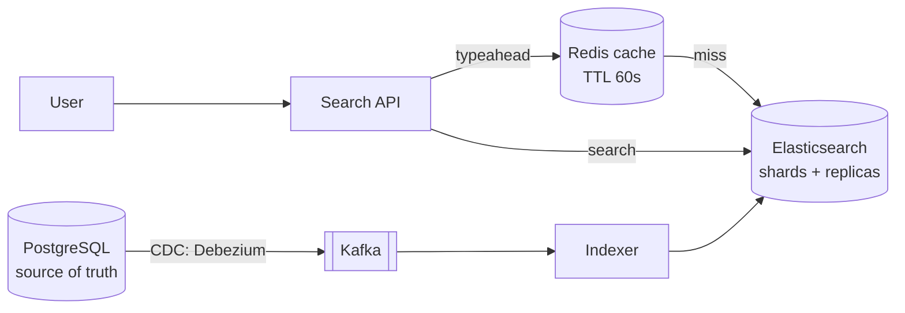

</details>

### Bài tập 2 — Chọn chiến lược Replication và Sharding

<details><summary>Đề bài + lời giải gợi ý</summary>

**Đề:** Mạng xã hội 100 triệu user, 80% traffic đọc (timeline, profile), 20% ghi (post, like, comment). DB hiện tại: PostgreSQL đơn node, đang quá tải.

| Metric | Hiện tại | Mục tiêu |
|---|---|---|
| Read QPS | 50,000 | 500,000 |
| Write QPS | 12,000 | 120,000 |
| Data size | 2TB | 20TB |
| Latency p99 | 800ms | 100ms |

Câu hỏi:
1. Replication hay Sharding trước? Tại sao?
2. Nếu Sharding — shard key `user_id` hay `timestamp`? Phân tích trade-off.
3. Vấn đề gì khi user có 10 triệu follower (celebrity problem)?

**Lời giải gợi ý:**

1. **Replication trước**: 80% là read → thêm **4–5 replica** giải quyết ngay nút cổ chai đọc, ít rủi ro, không đổi data model. **Sau đó Sharding** để giải quyết write và storage.
   📌 *Mở rộng (đối chiếu bảng):* mục tiêu 120,000 write QPS và 20TB dữ liệu vượt khả năng một master duy nhất — replication không tăng được write (mọi write vẫn vào master) nên chắc chắn phải sharding ở giai đoạn 2. Để đạt 500,000 read QPS và p99 100ms nên thêm cache (Redis) cho timeline/profile hot, chứ không chỉ dựa vào replica.
2. **Shard key = `user_id` (hash)**: dữ liệu phân bố đều, mọi dữ liệu của một user (profile, post) nằm cùng shard. `timestamp` gây **hotspot**: mọi bài viết mới đều ghi vào shard "hiện tại", các shard cũ thì nhàn rỗi. Trade-off của `user_id`: truy vấn kiểu "bài mới nhất toàn hệ thống" phải hỏi mọi shard (scatter-gather).
3. **Celebrity problem**: nếu dùng **fan-out on write** (khi đăng bài thì ghi vào timeline của từng follower), một bài của user 10 triệu follower sinh ra 10 triệu lượt ghi → quá tải shard/hệ thống. **Giải pháp hybrid (cách Twitter làm)**: user thường → fan-out on write; celebrity → **fan-out on read** (khi follower mở timeline mới kéo bài của celebrity về và trộn vào).

</details>

### Bài tập 3 — ACID hay BASE? Phân tích tình huống

<details><summary>Đề bài + lời giải gợi ý</summary>

**Đề:** Với mỗi tình huống, chọn ACID hay BASE và giải thích. Thảo luận: với tình huống đặt hàng, nếu dùng BASE thì có vấn đề gì? Giải pháp?

**Lời giải gợi ý:**

| Tình huống | Yêu cầu nghiệp vụ | ACID hay BASE? | Lý do |
|---|---|---|---|
| Chuyển tiền giữa 2 tài khoản ngân hàng | Tuyệt đối không được mất tiền | **ACID (bắt buộc)** | sai = mất tiền thật |
| Số lượng view của video YouTube | Hiển thị gần đúng, cập nhật mỗi 30s | **BASE** | eventually consistent là đủ, cần scale ghi rất lớn |
| Đặt hàng trên sàn TMĐT (trừ kho, tạo đơn) | Không oversell, nhất quán inventory | **ACID** cho bước trừ kho + tạo đơn | phải nhất quán tồn kho |
| Lưu lịch sử xem phim (Netflix history) | Cần lưu, chấp nhận delay vài giây | **BASE** (Cassandra phù hợp) | ghi nhiều, chấp nhận trễ |
| Bỏ phiếu bầu cử điện tử | Mỗi user chỉ được vote 1 lần | **ACID + idempotency check** | không được đếm trùng phiếu |

**Thảo luận:** Nếu dùng BASE cho đặt hàng: 2 user cùng mua **món cuối cùng** trong kho, cả hai đọc thấy "còn hàng" (stale read), cả hai đặt thành công → **oversell**. Giải pháp: **optimistic locking**, hoặc **reserve stock** bằng ACID transaction cho bước decrement inventory.

📌 *Mở rộng — ví dụ trừ kho an toàn bằng một câu lệnh nguyên tử:*

```sql
UPDATE inventory
SET stock = stock - 1, version = version + 1
WHERE product_id = 42 AND stock >= 1 AND version = 7;  -- 0 dòng bị ảnh hưởng => hết hàng hoặc bị người khác cập nhật trước
```

</details>

### Bài tập 4 — Thiết kế giao dịch đặt vé máy bay phân tán

<details><summary>Đề bài + lời giải gợi ý</summary>

**Đề:** Hệ thống đặt vé gồm 4 microservice độc lập; cần đảm bảo toàn vẹn dù service nào fail. Luồng: (1) **InventoryService** giữ chỗ; (2) **PaymentService** trừ tiền; (3) **BookingService** tạo booking, sinh e-ticket; (4) **NotificationService** gửi email xác nhận.

Câu hỏi:
1. Vẽ sơ đồ SAGA Orchestration (gồm compensating transactions).
2. Vẽ sơ đồ SAGA Choreography tương đương (event names, subscribers).
3. Chọn Orchestration hay Choreography? Lập luận.
4. Nếu PaymentService fail sau khi InventoryService đã giữ chỗ — compensating transaction cụ thể là gì?

**Lời giải gợi ý:**

Compensating transactions: `InventoryService.releaseHold()`, `PaymentService.refund()`, `BookingService.cancelBooking()`. Event names gợi ý: `seat.held`, `payment.charged`, `booking.created`, `notification.sent`, `seat.hold_released`, `payment.refunded`.

**1. Orchestration** (ví dụ BookingService fail ở bước 3):

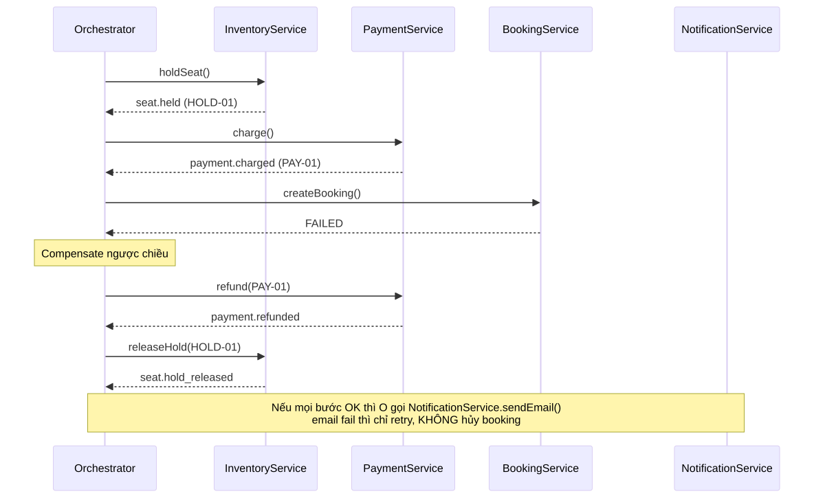

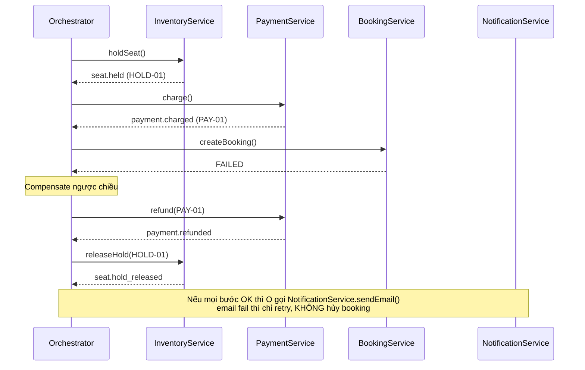

**2. Choreography:**

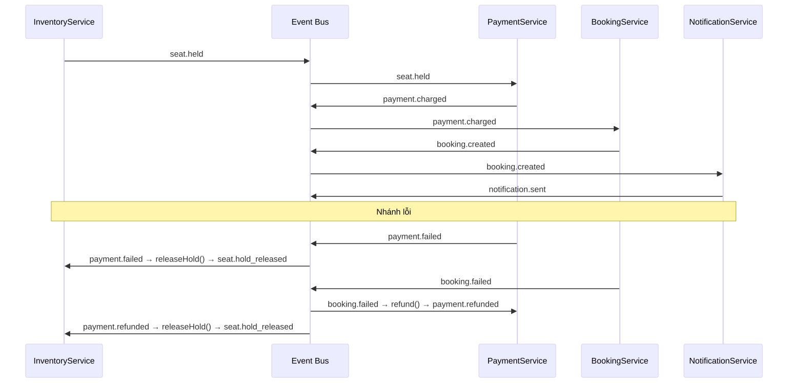

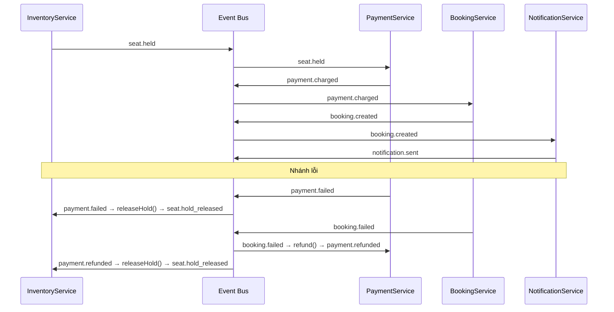

| Event | Publisher | Subscriber |
|---|---|---|
| `seat.held` | InventoryService | PaymentService |
| `payment.charged` | PaymentService | BookingService |
| `booking.created` | BookingService | NotificationService |
| `notification.sent` | NotificationService | — (kết thúc) |
| `payment.failed` 📌 | PaymentService | InventoryService (releaseHold) |
| `booking.failed` 📌 | BookingService | PaymentService (refund) |
| `payment.refunded` | PaymentService | InventoryService (releaseHold) |
| `seat.hold_released` | InventoryService | — (kết thúc, có thể báo user) |

(📌 `payment.failed`, `booking.failed` là hai event cho nhánh lỗi, thêm vào ngoài danh sách event gợi ý ở trên.)

**3. Chọn Orchestration**: có 4 service và luồng **có điều kiện** (notification fail thì *không* hủy booking, chỉ retry; payment fail chỉ cần nhả ghế; booking fail cần hoàn tiền + nhả ghế) → logic phức tạp nên quản lý tập trung ở Orchestrator dễ trace, dễ debug hơn.

**4.** PaymentService fail sau khi đã giữ chỗ → compensating transaction là **`InventoryService.releaseHold()`** (phát `seat.hold_released`) để nhả ghế cho người khác. Không cần `refund()` vì chưa trừ tiền thành công.
📌 *Mở rộng:* nếu lỗi là timeout (không rõ đã trừ tiền hay chưa), nên kiểm tra trạng thái giao dịch hoặc gọi `refund()` theo kiểu **idempotent** (không có giao dịch thì không làm gì).

</details>
