# Bài 6 — Mở rộng hệ thống & tối ưu hiệu suất: Load Balancer, Cache, Message Queue

## 🎯 Mục tiêu

Sau bài này, bạn cần:

- Giải thích được **Load Balancer** là gì, có những vai trò nào, và các thuật toán phân phối (Round Robin, Weighted Round Robin, Least Connections, IP Hash, Least Response Time, Geo-location).
- Phân biệt **Load Balancer tầng 4 (L4)** và **tầng 7 (L7)**, biết khi nào dùng loại nào.
- Hiểu **cache** (cache hit/miss), lợi ích, các **vị trí đặt cache** và **4 chiến lược cache**: Cache-Aside, Write-Through, Write-Back, Refresh-Ahead.
- Hiểu **cache eviction policy**, so sánh **LRU** và **LFU**.
- Hiểu **Message Queue** (Producer – Queue – Consumer), khi nào dùng, cơ chế **backpressure**, và so sánh **RabbitMQ / Kafka / AWS SQS**.
- Vận dụng cả ba kỹ thuật để thiết kế hệ thống chịu tải cao (bài tập đặt vé xem phim, Shopee Flash Sale).

## 📑 Mục lục

1. [Cân bằng tải (Load Balancer)](#1-cân-bằng-tải-load-balancer)
2. [Bộ nhớ đệm (Caching)](#2-bộ-nhớ-đệm-caching)
3. [Hàng đợi thông điệp (Message Queue)](#3-hàng-đợi-thông-điệp-message-queue)
4. [Bài tập thực hành](#4-bài-tập-thực-hành)
5. [🧠 Tóm tắt nhanh](#-tóm-tắt-nhanh)
6. [❓ Câu hỏi tự kiểm tra](#-câu-hỏi-tự-kiểm-tra)
7. [📝 Bài tập](#-bài-tập)

---

## 1. Cân bằng tải (Load Balancer)

### Load Balancer là gì?

> **Load Balancer** là thành phần đứng trước một cụm máy chủ, phân phối lưu lượng đến các máy chủ phía sau để không máy nào bị quá tải.

- Đóng vai trò như *nhân viên điều phối* tại quầy giao dịch ngân hàng
- Mỗi request từ người dùng được hướng đến một máy chủ còn trống
- Người dùng chỉ biết một **địa chỉ duy nhất** — không biết số máy chủ phía sau
- Toàn bộ cụm máy chủ hoạt động như ***một máy chủ ảo duy nhất***

> 💡 **Giải thích:** Load Balancer là **điểm vào duy nhất** của hệ thống, che giấu toàn bộ cụm máy chủ bên trong. Hãy hình dung nhân viên điều phối ở ngân hàng: khách đến thì được chỉ tới quầy đang trống, thay vì tất cả dồn vào một quầy. Nhờ vậy không quầy nào bị tắc, khách được phục vụ mượt mà. Người dùng không cần biết phía sau có 3 hay 300 máy chủ — với họ chỉ có một địa chỉ.

### Vai trò của Load Balancer

> Load Balancer giúp hệ thống **chịu tải tốt hơn**, **ổn định hơn** và **dễ mở rộng hơn**.

- **Phân phối đều tải** — tránh một máy gánh hết trong khi các máy khác rảnh rỗi
- **Tăng khả năng mở rộng** — thêm máy chủ mới, Load Balancer tự phân phối thêm
- **Tăng độ sẵn sàng** — nếu một máy chủ lỗi, lưu lượng được chuyển sang máy khác
- **Đơn giản hóa kiến trúc** — người dùng kết nối qua một URL/IP duy nhất

> 💡 **Giải thích:** Bốn vai trò này khiến Load Balancer gần như bắt buộc trong mọi hệ thống lớn. Đặc biệt là **tính sẵn sàng cao**: nếu một máy chủ hỏng lúc 2 giờ sáng, Load Balancer tự chuyển hướng traffic mà không cần ai can thiệp. Khi đi phỏng vấn, nhớ nhấn mạnh đủ 3 khía cạnh: **phân tải, mở rộng, dự phòng**.

### Các thuật toán phân phối (1/2)

> Load Balancer dùng **thuật toán phân phối** để quyết định máy chủ nào nhận request tiếp theo.

- **Round Robin** — chia lượt theo vòng tròn: A → B → C → A → ..., đơn giản và đều
- **Weighted Round Robin** — như Round Robin nhưng máy mạnh nhận nhiều request hơn theo *trọng số*
- **Least Connections** — gửi request đến máy chủ đang xử lý **ít kết nối nhất**

> 💡 **Giải thích:**
> - **Round Robin** đơn giản nhất và thường là mặc định: cứ xoay vòng chia đều.
> - **Weighted Round Robin** dùng khi các máy chủ có cấu hình không đồng đều: máy mạnh hơn nhận nhiều việc hơn theo tỷ lệ trọng số đã đặt (ví dụ trọng số 3:1 thì máy mạnh nhận 3 request trong khi máy yếu nhận 1).
> - **Least Connections** thông minh hơn khi các request có thời gian xử lý khác nhau: tránh dồn request vào một máy đang bận chỉ vì "đến lượt nó" theo vòng tròn.

### Các thuật toán phân phối (2/2)

- **IP Hash** — dùng địa chỉ IP của client để gán cố định vào một máy chủ cụ thể
- **Least Response Time** — ưu tiên máy chủ phản hồi *nhanh nhất* tại thời điểm đó
- **Geo-location** — phân phối theo *vị trí địa lý*, gần máy chủ nào thì vào máy đó

> IP Hash hữu ích khi cần duy trì **session stickiness** — cùng một người dùng luôn vào cùng một máy chủ.

> 💡 **Giải thích:** IP Hash giải quyết trường hợp **session được lưu trong bộ nhớ của từng máy chủ** (thay vì database dùng chung). Nếu dùng Round Robin, request tiếp theo của người dùng có thể rơi vào máy khác → mất phiên đăng nhập. Tuy vậy, cách **tốt hơn** là lưu session vào database hoặc **Redis dùng chung**, khi đó máy chủ nào cũng phục vụ được (máy chủ trở thành *stateless*). **Geo-location** thường gặp ở CDN và các hệ thống toàn cầu.

### Hình minh họa: Load Balancer phân phối theo Round Robin

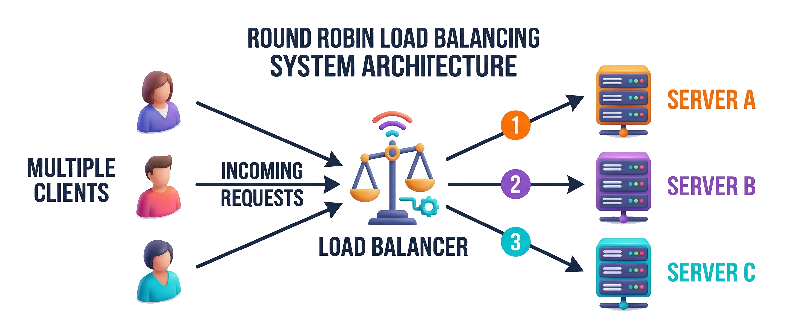

Hình minh họa: nhiều Client gửi request vào Load Balancer ở giữa, Load Balancer lần lượt chuyển request 1, 2, 3 đến Server A, Server B, Server C (Round Robin).

> 💡 **Giải thích:** Đây là luồng cơ bản: mọi request từ client đều đi qua Load Balancer trước, rồi được chia lần lượt cho 3 máy chủ. Người dùng không biết mình đang được máy nào phục vụ. Nếu Server A bị lỗi, Load Balancer ngừng gửi request đến A và chỉ chia cho B và C.

### Load Balancer tầng 4 vs tầng 7

> Phân loại dựa trên **mô hình OSI**: tầng 4 hoạt động ở mức mạng, tầng 7 hiểu nội dung ứng dụng.

- **Layer 4 (Transport)** — chỉ thấy địa chỉ IP và port của gói tin TCP/UDP
- **Layer 7 (Application)** — đọc được URL, HTTP header, cookie, và nội dung body
- Layer 4: nhanh hơn, ít tốn tài nguyên, không cần hiểu giao thức ứng dụng
- Layer 7: thông minh hơn, hỗ trợ *content-based routing* và terminate SSL

> 💡 **Giải thích:** Layer 4 giống **người bảo vệ chỉ nhìn địa chỉ trên phong bì** — nhanh nhưng không biết bên trong viết gì. Layer 7 giống **nhân viên bưu điện mở thư ra đọc** để quyết định chuyển đi đâu. Hai tầng có sự đánh đổi rõ ràng giữa **tốc độ** và **tính năng**.
>
> 📌 **Mở rộng:** *Terminate SSL* (SSL/TLS termination) nghĩa là Load Balancer giải mã HTTPS ngay tại nó, rồi chuyển request (thường là HTTP thường trong mạng nội bộ) đến app server. Nhờ vậy app server không phải tốn CPU giải mã, và chứng chỉ chỉ cần quản lý ở một nơi. L7 phải giải mã thì mới đọc được URL/header/cookie.

### Hình minh họa: so sánh Layer 4 và Layer 7

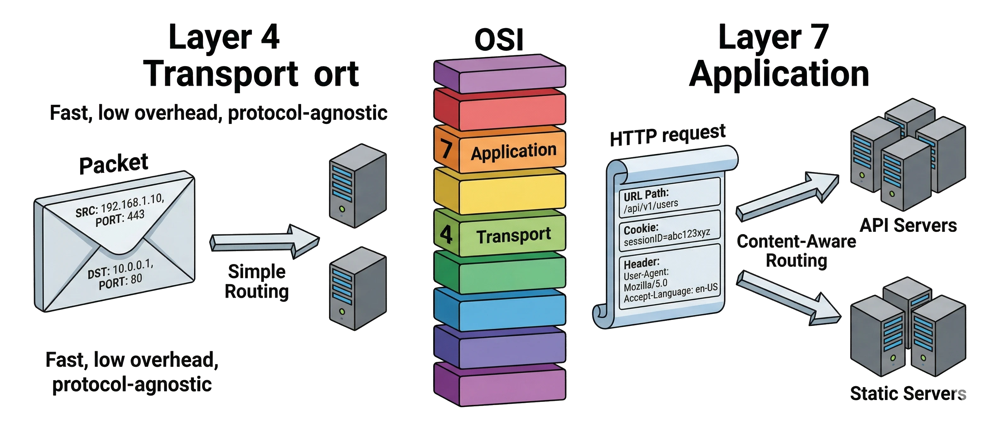

Hình minh họa: bên trái là Layer 4 chỉ thấy IP và port trên "phong bì" gói tin, định tuyến đơn giản tới một trong hai server ("Fast, low overhead, protocol-agnostic"); bên phải là Layer 7 đọc được URL, cookie, header của HTTP request và định tuyến thông minh tới nhóm "API Servers" hoặc "Static Servers" theo nội dung URL; ở giữa là chồng tầng OSI với tầng 4 và 7 được tô nổi.

### Khi nào dùng Layer 4, khi nào dùng Layer 7?

> Chọn theo **nhu cầu thực tế**: Layer 4 cho tốc độ tối đa, Layer 7 cho điều phối thông minh.

| Layer 4 — phù hợp khi | Layer 7 — phù hợp khi |
|---|---|
| Chỉ cần phân tải đơn thuần | Web app cần routing theo URL hoặc cookie |
| Giao thức không phải HTTP (UDP, VPN, game server) | Cần tách traffic tĩnh/động hoặc mobile/PC |
| Yêu cầu độ trễ cực thấp | Cần terminate SSL tại Load Balancer |
| Không cần routing theo nội dung | Hầu hết website và API lớn dùng Layer 7 |

> 💡 **Giải thích:** Ví dụ Layer 7 thực tế:
> - Request vào `/video/1080p` → chuyển đến cụm server xử lý video HD;
> - Request vào `/api/` → chuyển đến cụm API server;
> - Request từ mobile → chuyển đến server tối ưu cho mobile.
>
> Layer 4 hợp với ứng dụng **real-time** như game online dùng UDP — nơi từng millisecond đều quan trọng và không cần routing phức tạp.

### Khi nào cần sử dụng Load Balancer?

> Bất kỳ hệ thống nào cần **mở rộng quy mô** hoặc **nâng cao tính ổn định** đều sẽ cần Load Balancer.

- **Lượng người dùng tăng** — hàng ngàn/triệu lượt truy cập, một máy chủ không đủ
- **High Availability** — muốn hệ thống hoạt động liên tục dù có máy chủ bị lỗi
- **Tách biệt chức năng** — phân loại traffic theo URL để gửi đến đúng nhóm server
- **Hiệu năng và bảo mật** — tích hợp nén nội dung, cache tạm, tường lửa ứng dụng (WAF)

> 💡 **Giải thích:** Dấu hiệu rõ nhất cần thêm Load Balancer: một máy chủ đơn lẻ bắt đầu chậm và bạn muốn **scale out** (thêm máy) thay vì **scale up** (nâng cấp máy). Trong phỏng vấn thiết kế hệ thống, khi nói đến kiến trúc nhiều server, người phỏng vấn gần như luôn chờ bạn nhắc tới Load Balancer. Ghi nhớ: Load Balancer không chỉ để phân tải — nó còn là **lớp bảo vệ** và **điểm kiểm soát trung tâm**.
>
> 📌 **Mở rộng:** *Scale up* (vertical scaling) = mua máy mạnh hơn (thêm CPU/RAM), có giới hạn phần cứng và vẫn là một điểm lỗi duy nhất. *Scale out* (horizontal scaling) = thêm nhiều máy cùng loại, cần Load Balancer để chia việc. *WAF* (Web Application Firewall) = tường lửa lọc các tấn công tầng ứng dụng như SQL injection, XSS.

---

## 2. Bộ nhớ đệm (Caching)

### Cache là gì?

> **Cache** là cơ chế lưu trữ tạm thời dữ liệu để phục vụ các yêu cầu truy xuất **nhanh hơn** mà không cần đến nguồn gốc mỗi lần.

- Dữ liệu được lưu ở nơi truy xuất nhanh — thường là **RAM**
- Tương tự việc *nhớ đường* sau lần đầu đi: lần sau không cần mở bản đồ
- **Cache hit** — tìm thấy dữ liệu trong cache, trả về ngay lập tức
- **Cache miss** — không có trong cache, lấy từ nguồn gốc rồi lưu lại vào cache

> 💡 **Giải thích:** Lần đầu đến một khu phố mới, bạn phải hỏi đường, mất thời gian. Từ lần thứ hai, bạn đã nhớ nên đi nhanh hơn — cache hoạt động y như vậy. Điểm quan trọng: **cache hit** là kịch bản lý tưởng; **cache miss** thì chậm như không có cache, nhưng với mỗi dữ liệu thường chỉ xảy ra ở lần đầu.

### Lợi ích của caching

> Caching ***tăng tốc độ phản hồi***, ***giảm tải backend***, và ***tiết kiệm chi phí hạ tầng***.

- **Tăng tốc độ** — cache trong RAM nhanh hơn đọc từ database hàng trăm lần
- **Giảm tải database** — ít truy vấn đến database gốc hơn, phục vụ được nhiều người dùng hơn
- **Tiết kiệm chi phí** — thêm lớp cache (Redis) thay vì mua thêm database server mạnh hơn
- **Trải nghiệm tốt hơn** — thời gian phản hồi nhanh, ứng dụng mượt mà cho người dùng

> 💡 **Giải thích:** Caching là một trong những kỹ thuật tối ưu hiệu suất **rẻ và hiệu quả nhất**. Thay vì scale database theo chiều dọc (mua máy mạnh hơn), ta thêm một lớp cache Redis với chi phí thấp hơn nhiều. Nhưng cache **không miễn phí hoàn toàn**: cần bộ nhớ để lưu, và phải quản lý **tính hợp lệ** của dữ liệu trong cache (tránh dữ liệu cũ).

### Các vị trí đặt cache

> Mục tiêu chung: đưa dữ liệu **càng gần người dùng càng tốt**, trong môi trường **truy xuất nhanh nhất** có thể.

- **Client cache** — trình duyệt lưu file tĩnh (CSS, JS, ảnh); điện thoại lưu dữ liệu offline
- **CDN cache** — máy chủ biên phân phối nội dung tĩnh từ vị trí địa lý gần người dùng
- **Reverse Proxy cache** — Nginx/Varnish cache kết quả response trước khi đến app server
- **Application cache** — lưu kết quả truy vấn tốn kém vào Redis/Memcached trong ứng dụng
- **Database cache** — buffer pool trong DBMS hoặc Redis như lớp đọc nhanh trước database

> 💡 **Giải thích:** Trong hệ thống lớn, cả 5 tầng cache này có thể cùng tồn tại. Ví dụ: người dùng ở Việt Nam truy cập một website có server đặt ở Mỹ — hình ảnh được phục vụ từ **CDN tại Việt Nam** (nhanh), dữ liệu sản phẩm lấy từ **Redis** (application cache, nhanh), và chỉ khi cache miss mới phải truy vấn **PostgreSQL**. Nắm được các tầng này giúp bạn trả lời câu "bạn sẽ tối ưu hiệu suất ở đâu?" một cách toàn diện.

### Hình minh họa: các tầng cache trong hệ thống

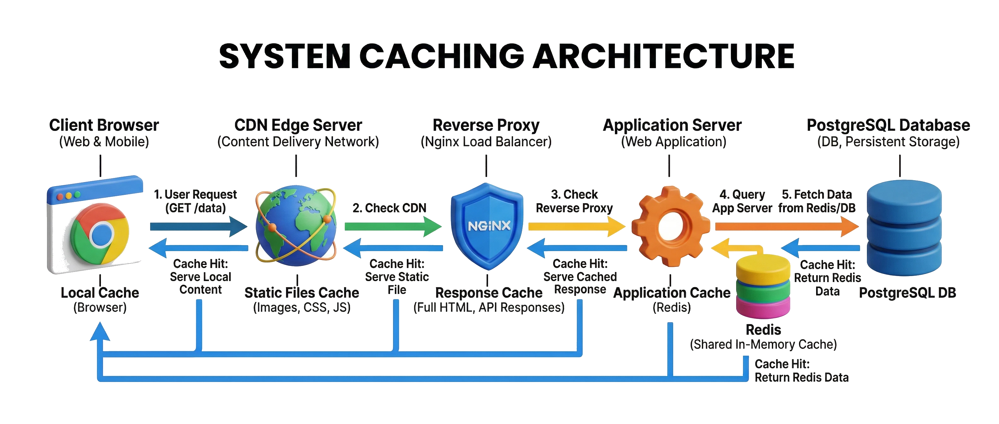

Hình minh họa: request đi từ trái sang phải qua Client Browser (local cache) → CDN Edge Server (cached static files) → Reverse Proxy Nginx (response cache) → Application Server kèm Redis (cache) → PostgreSQL (DB); ở mỗi tầng có mũi tên "cache hit" quay ngược lại, trả kết quả sớm.

> 💡 **Giải thích:** Một request có thể được đáp ứng ở nhiều điểm khác nhau trước khi phải chạm tới database. Mỗi tầng cache là một cơ hội tiết kiệm thời gian và giảm tải. Trong thực tế, phần lớn request phổ biến được trả ngay từ CDN hoặc Redis; chỉ một tỷ lệ nhỏ thực sự cần truy cập database.

### Cache-Aside (Lazy Loading)

> Chỉ nạp dữ liệu vào cache **khi cần** — đây là chiến lược phổ biến và dễ triển khai nhất.

- **Đọc:** kiểm tra cache trước → cache hit trả về ngay; cache miss lấy từ DB rồi lưu cache
- **Ghi:** ghi vào database, sau đó **xóa cache** cũ để tránh dữ liệu cũ (stale data)
- Ứng dụng kiểm soát hoàn toàn khi nào đọc và ghi cache
- Nhược điểm: lần đầu tiên cache miss vẫn chậm; phải tự quản lý *invalidation*

> 💡 **Giải thích:** Gọi là **lazy loading** vì cache chỉ được nạp khi có người hỏi, không nạp trước. Đây là chiến lược mặc định tốt cho hầu hết trường hợp vì đơn giản và hiệu quả. Lưu ý: khi ghi dữ liệu mới vào DB phải **xóa cache tương ứng ngay**, nếu không người dùng tiếp theo sẽ nhận dữ liệu cũ từ cache.
>
> 📌 **Mở rộng — mã giả minh họa:**
>
> ```python
> def get_product(product_id):
>     key = f"product:{product_id}"
>     data = cache.get(key)
>     if data is not None:          # cache hit
>         return data
>     data = db.query_product(product_id)   # cache miss -> lấy từ DB
>     cache.set(key, data, ttl=600)          # lưu lại vào cache
>     return data
>
> def update_product(product_id, new_data):
>     db.update_product(product_id, new_data)  # ghi DB trước
>     cache.delete(f"product:{product_id}")    # rồi xóa cache (invalidate)
> ```

### Hình minh họa: luồng đọc/ghi của Cache-Aside

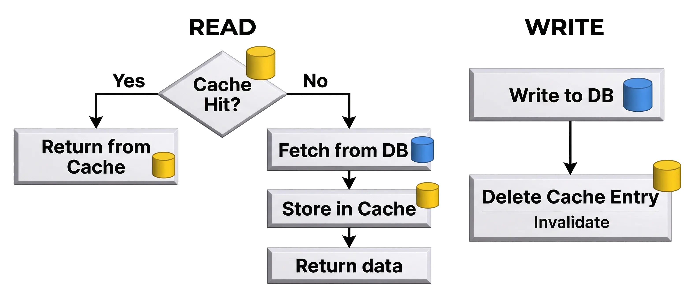

Hình minh họa: luồng READ — nút quyết định "Cache Hit?": Yes → "Return from Cache"; No → "Fetch from DB" → "Store in Cache" → "Return data". Luồng WRITE — "Write to DB" → "Delete Cache Entry" (Invalidate).

### Write-Through

> Mỗi lần **ghi dữ liệu**, cập nhật đồng thời **cả database lẫn cache** — đảm bảo cache luôn mới nhất.

- Ghi X → ghi vào database **và** cập nhật cache ngay lập tức trong cùng một thao tác
- Cache luôn chứa dữ liệu mới nhất sau mỗi lần ghi
- Phù hợp: ứng dụng *đọc nhiều, ghi ít*, yêu cầu tính nhất quán cao
- Nhược điểm: mỗi lần ghi cần **hai thao tác** (DB + cache) → ghi chậm hơn

> 💡 **Giải thích:** Write-Through đảm bảo cache **không bao giờ cũ** — mọi thay đổi được phản ánh ngay. Đổi lại, mỗi lần ghi tốn hơn vì phải ghi hai nơi. Ví dụ phù hợp: cache **cấu hình hệ thống** hoặc danh sách tham số ít thay đổi — khi thay đổi thì mọi người phải đọc được giá trị đúng ngay. Nếu ghi rất thường xuyên, Write-Through có thể trở thành **bottleneck**.

### Hình minh họa: Write-Through

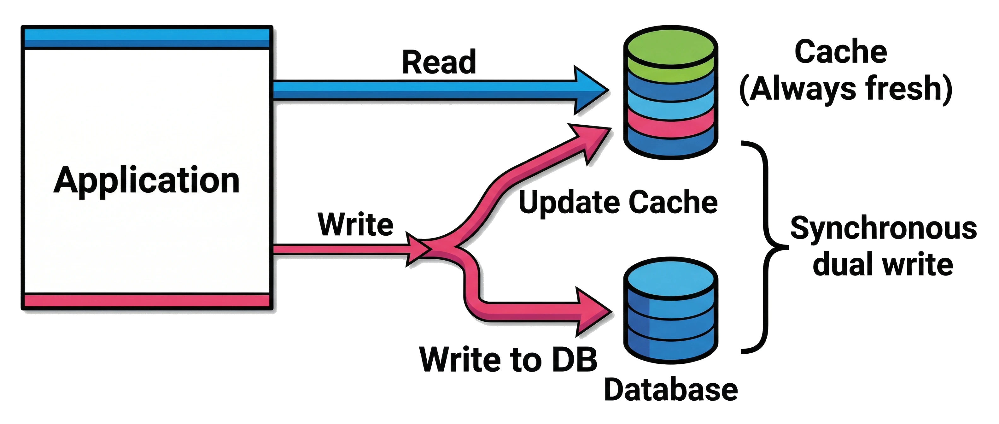

Hình minh họa: Application gửi một lệnh Write tách thành hai mũi tên đồng thời — "Update Cache" và "Write to DB" (ghi kép đồng bộ – "Synchronous dual write"); lệnh Read chỉ đi tới Cache với nhãn "Always fresh".

### Write-Back (Write-Behind)

> Ghi vào **cache trước**, ghi xuống database **sau** theo lịch trình — ưu tiên tốc độ ghi cao.

- Ghi X → lưu vào cache ngay, đánh dấu là *dirty*; database được cập nhật theo batch sau
- Ghi rất nhanh vì không chờ database tại thời điểm người dùng tương tác
- Nhiều lần cập nhật cùng một dữ liệu → chỉ cần ghi database một lần cuối
- ***Rủi ro mất dữ liệu*** nếu cache (RAM) bị lỗi trước khi kịp flush xuống database

> 💡 **Giải thích:** Write-Back hợp với hệ thống cần **tốc độ ghi rất cao**, như game server lưu điểm số, hệ thống analytics nhận hàng triệu sự kiện mỗi giây. Điểm yếu lớn nhất là **rủi ro mất dữ liệu**, nên cần biện pháp bảo vệ bổ sung như **WAL (Write-Ahead Log)** hoặc **cluster cache có replica**. CPU cache trong máy tính cũng dùng cơ chế write-back tương tự.
>
> 📌 **Mở rộng:** *Dirty* = mục trong cache đã bị sửa nhưng chưa được ghi xuống DB. *Flush* = đẩy các mục dirty xuống DB. *WAL* = trước khi thay đổi dữ liệu, ghi nhật ký thao tác ra đĩa (ghi nối đuôi, rất nhanh), để nếu sập thì có thể phát lại nhật ký và khôi phục.

### Hình minh họa: Write-Back

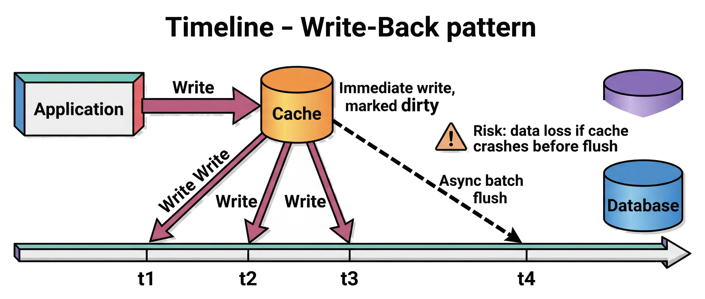

Hình minh họa: Application ghi ngay vào Cache ("Immediate write, marked dirty"); trên dòng thời gian các lần ghi t1, t2, t3 chỉ đi vào cache; đến thời điểm t4 mới có mũi tên nét đứt "Async batch flush" từ Cache xuống Database; biểu tượng cảnh báo "Risk: data loss if cache crashes before flush".

### Refresh-Ahead (Prefetching)

> Chủ động **làm mới cache trước khi hết hạn** để người dùng không bao giờ gặp cache miss.

- Cache có TTL (thời gian sống); hệ thống tự làm mới *trước khi TTL hết*
- Ví dụ: cache hết hạn sau 10 phút → hệ thống tự fetch dữ liệu mới ở phút thứ 9
- Phù hợp: dữ liệu có thể dự đoán được nhu cầu — trang chủ báo lúc 7 giờ sáng cao điểm
- Nhược điểm: *lãng phí tài nguyên* nếu dự đoán sai — cập nhật dữ liệu không ai hỏi đến

> 💡 **Giải thích:** Đây là chiến lược **chủ động nhất** — không đợi cache miss mà chuẩn bị trước. Ví dụ: một trang tin tức biết lượng truy cập tăng vọt lúc 7 giờ sáng mỗi ngày, nên tự động refresh cache trang chủ lúc 6 giờ 55. Khi người dùng đổ vào lúc 7 giờ, tất cả được phục vụ từ cache "nóng" sẵn. Nhược điểm: phải biết trước dữ liệu nào sẽ được hỏi — đoán sai thì phí công refresh.
>
> 📌 **Mở rộng:** *TTL (Time To Live)* = thời gian một mục được phép sống trong cache; hết TTL thì mục đó bị coi là hết hạn và sẽ bị xóa/nạp lại.

### Cache Eviction Policy là gì?

> **Cache Eviction Policy** là quy tắc quyết định **dữ liệu nào bị xóa khỏi cache** khi cache đầy và cần chỗ cho dữ liệu mới.

- Cache có kích thước giới hạn — không thể lưu mọi thứ mãi mãi
- Khi cache đầy, hệ thống phải chọn *hy sinh* một mục để nhường chỗ
- Chọn sai mục để xóa → tỷ lệ cache miss tăng → hiệu suất giảm
- Hai chính sách phổ biến nhất: **LRU** (Least Recently Used) và **LFU** (Least Frequently Used)

> 💡 **Giải thích:** Eviction policy hay bị bỏ qua khi thiết kế nhưng ảnh hưởng lớn đến hiệu suất thực tế. Hãy nghĩ cache như **cái bàn làm việc có kích thước cố định**: muốn đặt thêm tài liệu mới thì phải cất bớt tài liệu cũ. Câu hỏi là cất cái nào? LRU và LFU là hai "triết lý" khác nhau để trả lời câu hỏi đó.

### LRU — Least Recently Used

> **LRU** xóa mục được truy cập **lâu nhất mà chưa dùng lại** — ưu tiên giữ lại những gì mới được sử dụng gần đây.

- Nguyên lý: dữ liệu vừa dùng *có khả năng cao* sẽ được dùng lại sớm
- Mỗi lần truy cập một mục → đưa mục đó lên **đầu danh sách ưu tiên**
- Khi cache đầy → xóa mục ở **cuối danh sách** (lâu nhất không được dùng)
- Triển khai điển hình: **HashMap + Doubly Linked List** — O(1) cho cả đọc lẫn ghi

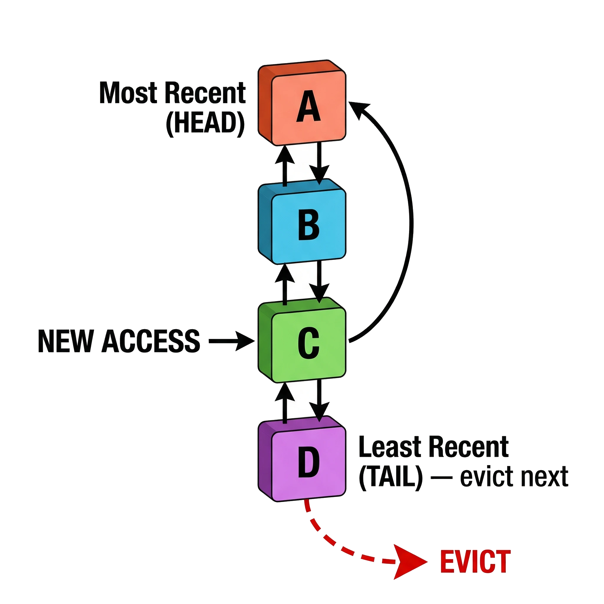

Hình minh họa: danh sách liên kết đôi gồm 4 node A, B, C, D; đầu danh sách là "Most Recent (HEAD)", cuối là "Least Recent (TAIL) — evict next"; khi C được truy cập, C được đưa lên đầu; node D ở cuối bị loại bỏ (EVICT).

> 💡 **Giải thích:** LRU phổ biến nhất vì khớp với hành vi thực tế: dữ liệu vừa truy cập thường có **tính locality cao** — người đang xem trang một sản phẩm thường tiếp tục thao tác với chính sản phẩm đó. **HashMap** lưu vị trí của node trong linked list nên tìm và di chuyển node đều O(1). **Redis** dùng **xấp xỉ LRU** (dựa trên lấy mẫu – sampling) thay vì LRU chính xác để tiết kiệm bộ nhớ.
>
> 📌 **Mở rộng — ví dụ chạy tay:** cache dung lượng 3, chuỗi truy cập `A, B, C, A, D`:
> - Sau `A, B, C`: danh sách (đầu → cuối) = `C, B, A`
> - Truy cập `A` (hit) → `A, C, B`
> - Truy cập `D` (miss, cache đầy) → loại mục cuối là `B` → `D, A, C`

### LFU — Least Frequently Used

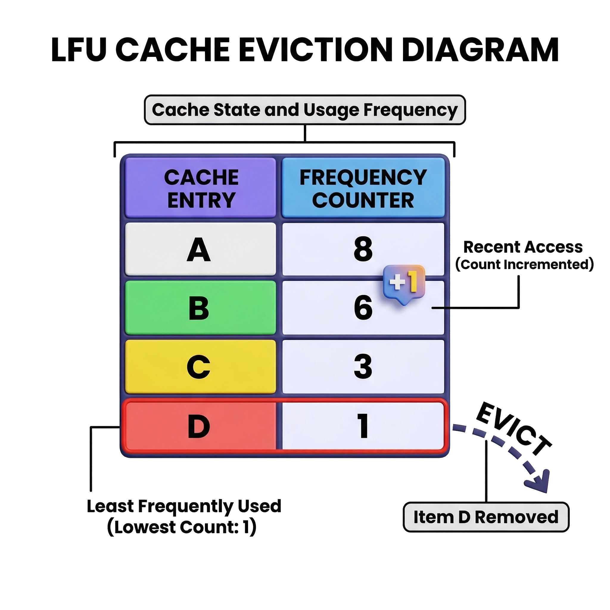

Hình minh họa: bảng 4 mục A, B, C, D với bộ đếm tần suất lần lượt 8, 6, 3, 1; mục D (đếm = 1) được tô đỏ và bị loại (EVICT); mục B có huy hiệu "+1" thể hiện vừa được truy cập nên bộ đếm tăng.

> **LFU** xóa mục được truy cập **ít lần nhất** trong toàn bộ lịch sử — ưu tiên giữ lại những gì được hỏi đến nhiều nhất.

- Nguyên lý: dữ liệu được truy cập nhiều lần *có giá trị lâu dài* hơn dữ liệu chỉ mới dùng một lần
- Mỗi mục có **bộ đếm tần suất**; mỗi lần truy cập tăng bộ đếm lên 1
- Khi cache đầy → xóa mục có **bộ đếm thấp nhất** (nếu bằng nhau, dùng LRU làm tie-breaker)
- Nhược điểm: dữ liệu cũ được dùng nhiều trong quá khứ có thể chiếm cache dù hiện không còn cần

> 💡 **Giải thích:** LFU hợp hơn LRU khi có một **tập dữ liệu "hot" ổn định**, được truy cập đều đặn — ví dụ top 100 sản phẩm bán chạy nhất. Nhược điểm lớn nhất là **cache pollution**: một mục được dùng 1000 lần tháng trước nhưng giờ không ai hỏi vẫn nằm lì trong cache rất lâu vì bộ đếm cao. Giải pháp: **LFU với time decay** — bộ đếm giảm dần theo thời gian.

### LRU vs LFU — so sánh và lựa chọn

> Không có chính sách nào tốt hơn tuyệt đối — chọn dựa trên **đặc điểm truy cập** của hệ thống.

| LRU — phù hợp khi | LFU — phù hợp khi |
|---|---|
| Dữ liệu có tính *temporal locality* cao | Có tập dữ liệu "hot" ổn định, ít thay đổi |
| Người dùng thường xem lại nội dung vừa truy cập | Tần suất truy cập phản ánh giá trị lâu dài |
| Workload thay đổi theo thời gian (trending content) | Muốn tránh cache bị chiếm bởi dữ liệu chỉ dùng một lần |
| Redis mặc định dùng xấp xỉ LRU | Memcached hỗ trợ LFU tùy cấu hình |

> 💡 **Giải thích:** Ví dụ phân biệt:
> - **Trang tin tức → LRU**: bài báo vừa đăng sẽ được rất nhiều người đọc ngay — temporal locality rõ ràng.
> - **Streaming phim → LFU**: các phim kinh điển được xem đều đặn suốt nhiều tháng — tần suất phản ánh giá trị thực.
>
> Trong phỏng vấn, chỉ cần nêu được trade-off này là đã đủ ấn tượng.
>
> 📌 **Mở rộng:** *Temporal locality* (tính cục bộ theo thời gian) = thứ vừa được dùng thì nhiều khả năng sắp được dùng lại. Lưu ý thêm: Redis cho phép cấu hình chính sách qua `maxmemory-policy` (ví dụ `allkeys-lru`, `allkeys-lfu`); mặc định của Redis hiện nay là `noeviction` (báo lỗi khi đầy), nhưng khi dùng Redis làm cache người ta thường đặt `allkeys-lru` — đó là ý của câu "Redis mặc định dùng xấp xỉ LRU" trong bảng so sánh phía trên.

### So sánh các chiến lược cache

> Mỗi chiến lược có đánh đổi riêng — chọn dựa trên **đặc điểm đọc/ghi** của hệ thống.

| Chiến lược | Điểm mạnh | Điểm yếu |
|---|---|---|
| **Cache-Aside** | Đơn giản, linh hoạt | Miss chậm lần đầu |
| **Write-Through** | Cache luôn mới nhất | Ghi chậm hơn |
| **Write-Back** | Ghi cực nhanh | Rủi ro mất dữ liệu |
| **Refresh-Ahead** | Không có cache miss | Lãng phí nếu sai |

> 💡 **Giải thích:** Thực tế người ta thường **kết hợp** các chiến lược: dùng Cache-Aside cho đọc, Write-Through cho ghi các dữ liệu quan trọng cần nhất quán cao. Không có chiến lược nào tốt nhất cho mọi trường hợp — phải phân tích workload: **đọc nhiều hay ghi nhiều? có chấp nhận mất dữ liệu không? có dự đoán được nhu cầu không?**

### Ví dụ thực tế: cache tỷ giá ngoại tệ

> Cache hiệu quả nhất khi dữ liệu **thay đổi ít** nhưng được **đọc rất thường xuyên**.

- Tỷ giá USD cập nhật 2 lần/ngày nhưng hàng nghìn người hỏi mỗi phút
- Lần đầu tiên trong ngày: gọi API ngân hàng → lưu kết quả vào cache với TTL phù hợp
- Mọi request sau: phục vụ từ cache ngay lập tức, không gọi thêm API
- Hệ thống chịu được hàng nghìn người dùng dù ngân hàng chỉ được gọi 2 lần/ngày

> 💡 **Giải thích:** Đây là ví dụ điển hình của **Cache-Aside với TTL**. Tỷ giá rất hợp để cache vì tần suất thay đổi thấp nhưng tần suất đọc cực cao. Khi TTL hết hạn, lần truy cập đầu tiên sau đó sẽ gọi API ngân hàng để làm mới cache. Đây là ví dụ cụ thể, dễ hiểu để minh họa giá trị của caching khi phỏng vấn.

---

## 3. Hàng đợi thông điệp (Message Queue)

### Message Queue là gì?

> **Message Queue** là thành phần trung gian giữ các thông điệp, cho phép xử lý công việc **bất đồng bộ** — không cần kết quả ngay lập tức.

- **Producer** — gửi thông điệp (nhiệm vụ cần làm) vào hàng đợi rồi tiếp tục việc khác
- **Queue** — lưu trữ thông điệp cho đến khi có consumer nhận xử lý (nguyên tắc *FIFO*)
- **Consumer** — lấy thông điệp từ queue và thực hiện công việc tương ứng
- Producer và consumer ***không giao tiếp trực tiếp*** — hoàn toàn tách biệt qua queue

> 💡 **Giải thích:** Hình dung quán ăn lấy số: bạn **đặt món** (producer), **nhận số thứ tự** (queue), **đầu bếp lần lượt nấu** (consumer). Bạn không phải đứng chờ ở quầy mà có thể về bàn ngồi. Đó chính là bản chất của xử lý bất đồng bộ: **tách rời thời điểm yêu cầu khỏi thời điểm xử lý**.

### Minh họa: mô hình Producer - Queue - Consumer

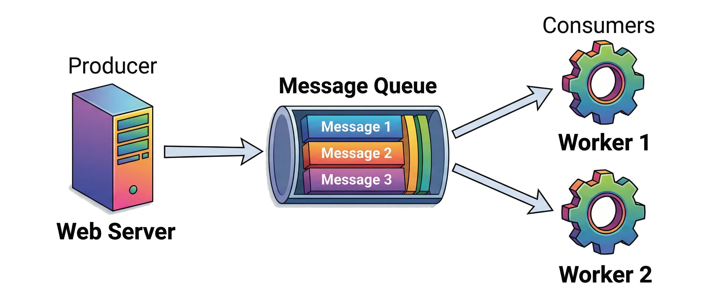

Hình minh họa: Producer (Web Server) bên trái đẩy message vào Message Queue ở giữa (Message 1, 2, 3 xếp hàng), hai Consumer Worker (Worker 1, Worker 2) bên phải kéo message ra xử lý; luồng một chiều Producer → Queue → Consumer.

> 💡 **Giải thích:** Sơ đồ thể hiện tính **decoupling**: Producer không cần biết Consumer xử lý nhanh hay chậm, chỉ cần đẩy message vào queue là xong việc. Consumer cũng không cần biết ai gửi, chỉ việc lấy message và xử lý. Có thể **tăng số Consumer** để xử lý song song mà không phải sửa gì ở Producer.

### Khi nào nên dùng Message Queue?

> Dùng Message Queue khi cần **tách công việc xử lý sau** hoặc **điều hòa nhịp độ** giữa các thành phần hệ thống.

- **Background jobs** — gửi email xác nhận đăng ký, tạo báo cáo, gửi thông báo push
- **Giảm tải đỉnh điểm** — flash sale, livestream: queue làm bộ đệm tránh server bị sập đột ngột
- **Giao tiếp microservices** — service A gửi event, service B và C lắng nghe và tự xử lý
- **Tracking và logging** — thu thập sự kiện người dùng (click, view) xử lý hàng loạt sau

> 💡 **Giải thích:** Quy tắc nhận biết đơn giản: **công việc nào không cần kết quả tức thì và tốn thời gian → đưa vào queue**. Ví dụ điển hình là gửi email: người dùng không cần chờ email thực sự gửi xong, chỉ cần thấy "đăng ký thành công". Queue giải quyết sự **lệch tốc độ** giữa hai hệ thống: producer nhanh, consumer chậm.

### Các hệ thống Message Queue phổ biến

> Biết tên các hệ thống cụ thể giúp câu trả lời phỏng vấn **thực tế và đáng tin cậy hơn**.

- **RabbitMQ** — message broker mã nguồn mở, giao thức AMQP, routing linh hoạt qua exchange
- **Apache Kafka** — nền tảng streaming phân tán, *throughput rất cao*, lưu message bền vững lâu dài
- **AWS SQS** — dịch vụ queue được AWS quản lý hoàn toàn, tự động mở rộng, không cần vận hành

> 💡 **Giải thích:**
> - **RabbitMQ** tốt cho các **hàng đợi tác vụ truyền thống** — đảm bảo mỗi message được xử lý đúng một lần, hỗ trợ **retry** và **dead letter queue**.
> - **Kafka** khác ở chỗ message được **giữ lại lâu dài** và **nhiều consumer có thể đọc lại** — hợp với **event sourcing** và **analytics**.
> - **SQS** hợp nếu bạn đã dùng AWS và muốn **managed service**, không phải tự vận hành.
>
> Trong phỏng vấn, nêu được tên cụ thể và trade-off của từng hệ thống là điểm cộng lớn.
>
> 📌 **Mở rộng:** *Dead letter queue (DLQ)* = hàng đợi riêng chứa các message xử lý thất bại quá số lần retry, để kiểm tra sau mà không làm tắc hàng đợi chính. Về "đúng một lần": trên thực tế RabbitMQ (và SQS standard) đảm bảo **at-least-once** (ít nhất một lần, có thể trùng); để đạt hiệu ứng "exactly-once" người ta thường kết hợp với consumer **idempotent** (xử lý trùng không gây hậu quả, ví dụ kiểm tra mã đơn hàng đã xử lý chưa).

### Mô hình Producer - Queue - Consumer (chi tiết)

> Tính **decoupling** là giá trị cốt lõi: các thành phần không cần biết nhau, chỉ giao tiếp qua queue.

- **Producer** — tạo thông điệp và đẩy vào queue; không cần chờ consumer xử lý xong
- **Queue** — hoạt động theo *FIFO*; có thể lưu trong RAM (nhanh) hoặc trên đĩa (bền vững)
- **Consumer** — poll hoặc subscribe queue; nhiều consumer chạy song song để tăng tốc
- Muốn xử lý nhanh hơn: **tăng số consumer** mà không cần thay đổi bất kỳ gì ở producer

> 💡 **Giải thích:** Decoupling là lợi ích quan trọng nhất. Khi service A và B giao tiếp qua queue thay vì gọi trực tiếp, service B có thể **tạm chậm hoặc restart** mà không ảnh hưởng A — message vẫn nằm trong queue chờ. Khả năng **scale consumer độc lập** cũng rất giá trị: queue đang tồn đọng thì chỉ cần bật thêm worker.
>
> 📌 **Mở rộng:** *Poll* = consumer chủ động hỏi queue định kỳ "có message mới không?"; *subscribe* = consumer đăng ký và được queue/broker đẩy message tới khi có.

### Cơ chế backpressure

> **Backpressure** là cách hệ thống phản ứng khi queue đầy — tránh để producer gửi quá nhanh làm sập hệ thống.

- Vấn đề: producer gửi nhanh hơn consumer xử lý → message ùn ứ → hết bộ nhớ → sập
- **Chặn producer** — queue báo đầy, không nhận thêm message cho đến khi consumer xử lý bớt
- **Điều chỉnh tốc độ gửi** — service phát hiện queue dài → tự giảm tần suất gửi message
- **Scale-out consumer** — tự động thêm worker để xử lý nhanh hơn khi queue quá dài

> 💡 **Giải thích:** Backpressure giống cửa hàng **tạm ngừng nhận khách** khi nhà bếp đã quá tải. Trong RabbitMQ có thể đặt **ngưỡng bộ nhớ** — vượt ngưỡng thì queue từ chối nhận thêm message. Khi phỏng vấn không cần đi sâu trừ khi được hỏi; chỉ cần nói: *"Em sẽ theo dõi độ dài queue và thêm consumer hoặc giới hạn producer khi cần thiết."*

### Hình minh họa: các cơ chế backpressure

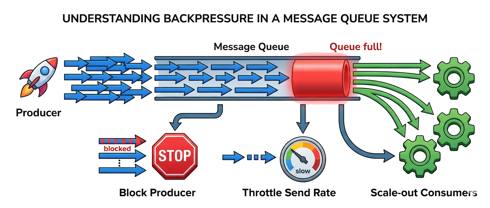

Hình minh họa: Producer rất nhanh đẩy nhiều message vào queue đang đầy dần (tô đỏ, "Queue full!"), với ba nhánh phản ứng: "Block Producer" (biển báo dừng), "Throttle Send Rate" (núm vặn giảm tốc độ gửi) và "Scale-out Consumers" (thêm worker để rút queue nhanh hơn).

### Ví dụ thực tế: xử lý video upload

> Message Queue cho phép hệ thống **phản hồi người dùng ngay lập tức** trong khi xử lý tác vụ nặng ở hậu trường.

- Người dùng upload video → server lưu file và đẩy message "video 123, hãy chuyển đổi" vào queue
- Server phản hồi ngay: *"Video đang được xử lý, bạn sẽ nhận thông báo khi xong"*
- Worker nhận message → chuyển đổi định dạng video → cập nhật trạng thái → thông báo người dùng
- Nhiều video upload cùng lúc → xếp hàng trong queue → worker xử lý lần lượt hoặc song song

> 💡 **Giải thích:** Ai cũng hiểu chuyển đổi video tốn thời gian. Không dùng queue thì server phải giữ kết nối HTTP mở cả phút để chờ — không thực tế. Có queue thì người dùng nhận phản hồi trong vài trăm millisecond, việc nặng được đẩy ra background. Khi tải tăng đột biến, queue làm **bộ đệm** và các worker xử lý dần theo khả năng.

### Minh họa: xử lý video với Message Queue

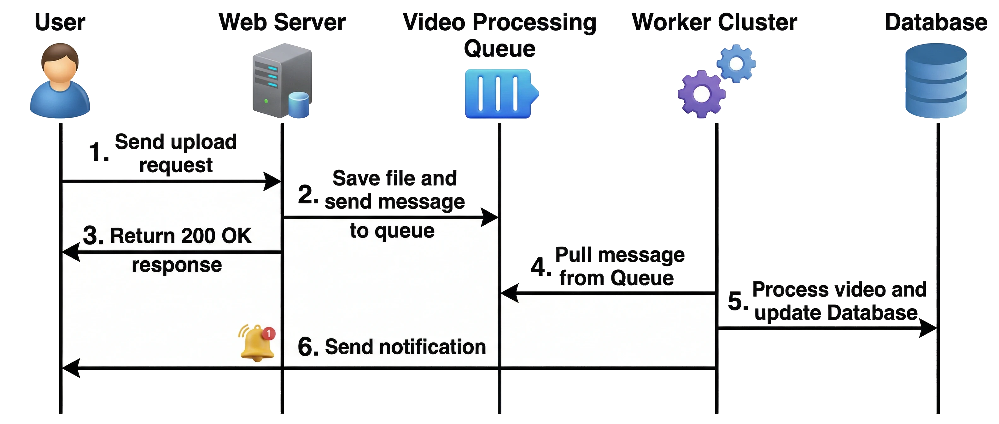

Hình minh họa: (1) User upload lên Web Server → (2) Web Server lưu file và gửi message vào Video Processing Queue → (3) Web Server trả ngay 200 OK cho User → (4) Worker Cluster kéo message từ queue → (5) Worker xử lý video và cập nhật Database → (6) Worker gửi thông báo về cho User.

> 💡 **Giải thích:** Tính bất đồng bộ thể hiện rõ: bước **phản hồi người dùng (bước 3)** xảy ra ngay sau khi message vào queue (bước 2), **không chờ** worker làm xong. Người dùng thấy kết quả tức thì trong khi việc thật đang chạy ở background. Đây là mô hình **"fire and forget"** phổ biến trong hệ thống web hiện đại.

---

## 4. Bài tập thực hành

### Bài tập 1: Thiết kế hệ thống đặt vé xem phim

Tóm tắt đề: nền tảng bán vé phim chịu 500.000 người truy cập đồng thời khi mở bán phim bom tấn; cần xử lý thanh toán + email xác nhận; dữ liệu suất chiếu/giá vé ít đổi nhưng đọc liên tục. Thiết kế kiến trúc dùng **Load Balancer, Cache, Message Queue**.

### Bài tập 2: Lựa chọn chiến lược cache

Tóm tắt đề: chọn chiến lược cache cho 4 tình huống (tỷ giá, game lưu điểm, trang cấu hình, trang chủ báo lúc 7h sáng) và thảo luận khi nào **không nên** cache.

### Bài tập 3: Phân tích case study — Shopee Flash Sale

Tóm tắt đề: phân tích vì sao Shopee không sập khi hàng triệu người truy cập flash sale, cách hiển thị nhanh thông tin sản phẩm, và cơ chế xử lý đơn hàng.

### Bài tập 4: So sánh và lựa chọn Message Queue

Tóm tắt đề: ba nhóm A, B, C với nhu cầu khác nhau, mỗi nhóm chọn một trong AWS SQS, RabbitMQ, Apache Kafka và nêu trade-off.

---

## 🧠 Tóm tắt nhanh

### Thuật toán Load Balancing

| Thuật toán | Cách chọn server | Khi nào dùng |
|---|---|---|
| Round Robin | Xoay vòng A → B → C → A… | Mặc định; các server đồng đều, request tương tự nhau |
| Weighted Round Robin | Xoay vòng theo trọng số | Server có cấu hình không đều |
| Least Connections | Server đang có ít kết nối nhất | Request có thời gian xử lý chênh lệch |
| IP Hash | Hash IP client → server cố định | Cần session stickiness (session lưu trên từng server) |
| Least Response Time | Server phản hồi nhanh nhất lúc đó | Ưu tiên độ trễ thấp |
| Geo-location | Server gần vị trí người dùng nhất | CDN, hệ thống toàn cầu |

### Load Balancer Layer 4 vs Layer 7

| Tiêu chí | Layer 4 (Transport) | Layer 7 (Application) |
|---|---|---|
| Thấy được gì | IP, port (TCP/UDP) | URL, HTTP header, cookie, body |
| Tốc độ / tài nguyên | Nhanh hơn, ít tốn tài nguyên | Chậm hơn chút, tốn tài nguyên hơn |
| Routing theo nội dung | Không | Có (content-based routing) |
| Terminate SSL | Không | Có |
| Hợp với | UDP, VPN, game server, độ trễ cực thấp | Web app, API, tách tĩnh/động, mobile/PC |
| Ví dụ ví von | Bảo vệ chỉ nhìn địa chỉ phong bì | Nhân viên bưu điện đọc cả thư |

### 4 chiến lược cache

| Chiến lược | Cơ chế | Điểm mạnh | Điểm yếu | Ví dụ phù hợp |
|---|---|---|---|---|
| Cache-Aside (Lazy Loading) | Đọc: hỏi cache, miss thì lấy DB rồi lưu cache. Ghi: ghi DB rồi xóa cache | Đơn giản, linh hoạt | Miss chậm lần đầu; tự quản lý invalidation | Tỷ giá ngoại tệ (kèm TTL) |
| Write-Through | Ghi đồng thời DB + cache | Cache luôn mới nhất | Ghi chậm hơn (2 thao tác) | Cấu hình hệ thống |
| Write-Back (Write-Behind) | Ghi cache trước (dirty), flush DB theo batch sau | Ghi cực nhanh | Rủi ro mất dữ liệu | Game lưu điểm, analytics |
| Refresh-Ahead (Prefetching) | Làm mới cache trước khi TTL hết | Không có cache miss | Lãng phí nếu dự đoán sai | Trang chủ báo lúc 7h sáng |

### LRU vs LFU

| Tiêu chí | LRU | LFU |
|---|---|---|
| Loại bỏ mục | Lâu nhất chưa được dùng lại | Được dùng ít lần nhất |
| Dữ liệu theo dõi | Thứ tự truy cập gần đây | Bộ đếm tần suất |
| Triển khai | HashMap + Doubly Linked List, O(1) | Bộ đếm; hòa thì dùng LRU làm tie-breaker |
| Hợp khi | Temporal locality cao, trending content (tin tức) | Tập "hot" ổn định (top sản phẩm, phim kinh điển) |
| Nhược điểm | Có thể đẩy ra mục hay dùng nhưng vừa lâu chưa dùng | Cache pollution → khắc phục bằng time decay |
| Trong thực tế | Redis (xấp xỉ LRU, sampling) | Memcached hỗ trợ tùy cấu hình |

### RabbitMQ vs Kafka vs AWS SQS

| Tiêu chí | RabbitMQ | Apache Kafka | AWS SQS |
|---|---|---|---|
| Bản chất | Message broker mã nguồn mở, AMQP | Nền tảng streaming phân tán | Queue managed của AWS |
| Điểm mạnh | Routing linh hoạt qua exchange; retry, dead letter queue | Throughput rất cao; lưu message lâu dài; nhiều consumer đọc lại (replay) | Không cần vận hành, tự mở rộng, trả theo dùng |
| Hợp với | Hàng đợi tác vụ truyền thống, xử lý đơn hàng | Event sourcing, analytics, thu thập sự kiện lớn | Team nhỏ đã dùng AWS, cần triển khai nhanh |
| Trade-off | Phải tự vận hành; throughput thấp hơn Kafka | Phức tạp vận hành, hơi "nặng" cho tác vụ đơn giản | Phụ thuộc AWS (vendor lock-in), ít tính năng routing |

*(Hàng "Trade-off" là phần 📌 Mở rộng.)*

---

## ❓ Câu hỏi tự kiểm tra

**1.** Load Balancer có 4 vai trò chính nào?

<details><summary>Đáp án</summary>

Phân phối đều tải; tăng khả năng mở rộng (thêm máy là LB tự chia thêm); tăng độ sẵn sàng (máy lỗi thì chuyển traffic sang máy khác); đơn giản hóa kiến trúc (người dùng chỉ kết nối qua một URL/IP).

</details>

**2.** Các request có thời gian xử lý rất chênh lệch (có cái 10 ms, có cái 5 s). Nên dùng Round Robin hay Least Connections? Vì sao?

<details><summary>Đáp án</summary>

Least Connections. Round Robin chia theo lượt nên có thể tiếp tục giao request cho máy đang bận với các request nặng; Least Connections gửi đến máy đang có ít kết nối nhất nên tránh dồn việc vào máy bận.

</details>

**3.** IP Hash giải quyết vấn đề gì? Có cách nào tốt hơn?

<details><summary>Đáp án</summary>

Giải quyết session stickiness: khi session lưu trong bộ nhớ từng server, IP Hash giúp một người dùng luôn vào cùng server nên không mất đăng nhập. Cách tốt hơn là lưu session vào database hoặc Redis dùng chung, để server nào cũng phục vụ được.

</details>

**4.** Khác biệt cốt lõi giữa Load Balancer Layer 4 và Layer 7? Cho một ví dụ cần Layer 7 và một ví dụ hợp Layer 4.

<details><summary>Đáp án</summary>

L4 chỉ thấy IP/port (TCP/UDP) → nhanh, ít tốn tài nguyên. L7 đọc được URL, header, cookie, body → routing theo nội dung, terminate SSL. Ví dụ L7: `/api/` vào cụm API server, `/video/1080p` vào cụm video HD. Ví dụ L4: game online dùng UDP cần độ trễ cực thấp.

</details>

**5.** Cache hit và cache miss là gì? Kể 5 vị trí có thể đặt cache.

<details><summary>Đáp án</summary>

Hit: dữ liệu có sẵn trong cache, trả về ngay. Miss: không có, phải lấy từ nguồn gốc rồi lưu lại vào cache. Năm vị trí: Client cache (trình duyệt/điện thoại), CDN cache, Reverse Proxy cache (Nginx/Varnish), Application cache (Redis/Memcached), Database cache (buffer pool hoặc Redis trước DB).

</details>

**6.** Trong Cache-Aside, khi ghi dữ liệu thì làm gì với cache? Quên bước đó thì sao?

<details><summary>Đáp án</summary>

Ghi vào database, sau đó xóa (invalidate) mục cache tương ứng. Nếu quên thì cache vẫn giữ giá trị cũ → người dùng tiếp theo đọc phải stale data.

</details>

**7.** So sánh Write-Through và Write-Back về tốc độ ghi, độ nhất quán và rủi ro.

<details><summary>Đáp án</summary>

Write-Through ghi đồng thời DB + cache → cache luôn mới, nhất quán cao, nhưng ghi chậm hơn (2 thao tác) và có thể thành bottleneck nếu ghi nhiều. Write-Back ghi cache trước, flush DB theo batch sau → ghi cực nhanh, gộp được nhiều lần cập nhật, nhưng có rủi ro mất dữ liệu nếu cache (RAM) lỗi trước khi flush; cần WAL hoặc cache có replica.

</details>

**8.** Refresh-Ahead khác Cache-Aside với TTL ở điểm nào? Nhược điểm của nó?

<details><summary>Đáp án</summary>

Cache-Aside đợi TTL hết rồi request kế tiếp bị miss mới nạp lại; Refresh-Ahead chủ động làm mới trước khi TTL hết (ví dụ TTL 10 phút thì refresh ở phút 9) nên người dùng không gặp miss. Nhược điểm: lãng phí tài nguyên nếu dự đoán sai, làm mới dữ liệu không ai hỏi.

</details>

**9.** Cache dung lượng 3, dùng LRU, chuỗi truy cập: `A, B, C, A, D, B`. Mục nào bị loại ở mỗi lần cache đầy?

<details><summary>Đáp án</summary>

Sau A, B, C: (mới → cũ) C, B, A. Truy cập A (hit) → A, C, B. D (miss, đầy) → loại **B** → D, A, C. B (miss, đầy) → loại **C** → B, D, A. Vậy lần lượt loại B rồi C.

</details>

**10.** "Cache pollution" trong LFU là gì và khắc phục thế nào? Trang tin tức nên dùng LRU hay LFU?

<details><summary>Đáp án</summary>

Một mục từng được dùng rất nhiều trong quá khứ (bộ đếm cao) nhưng nay không ai hỏi vẫn chiếm chỗ trong cache rất lâu. Khắc phục: LFU với time decay (bộ đếm giảm dần theo thời gian). Trang tin tức nên dùng LRU vì bài mới đăng được đọc nhiều ngay (temporal locality).

</details>

**11.** Vai trò của Producer, Queue, Consumer? Lợi ích cốt lõi của Message Queue là gì?

<details><summary>Đáp án</summary>

Producer tạo message, đẩy vào queue rồi làm việc khác; Queue lưu message theo FIFO (trong RAM hoặc trên đĩa) đến khi có consumer nhận; Consumer poll/subscribe để lấy và xử lý. Lợi ích cốt lõi là decoupling: hai bên không gọi nhau trực tiếp, consumer có thể chậm/restart mà không ảnh hưởng producer, và có thể tăng số consumer mà không sửa producer.

</details>

**12.** Backpressure là gì? Nêu 3 cách xử lý.

<details><summary>Đáp án</summary>

Là cách hệ thống phản ứng khi producer gửi nhanh hơn consumer xử lý khiến queue đầy (nguy cơ hết bộ nhớ, sập). Ba cách: chặn producer (queue từ chối nhận thêm), điều chỉnh/giảm tốc độ gửi (throttle), scale-out consumer (thêm worker).

</details>

---

## 📝 Bài tập

<details><summary><b>Bài tập 1: Thiết kế hệ thống đặt vé xem phim</b></summary>

**Đề bài:**

Một nền tảng bán vé xem phim trực tuyến cần xử lý **lượng truy cập tăng đột biến** khi phim bom tấn mở bán.

**Tình huống:**

- 500,000 người dùng truy cập đồng thời khi mở bán vé phim bom tấn
- Xử lý thanh toán và gửi email xác nhận cho từng giao dịch
- Dữ liệu suất chiếu và giá vé ít thay đổi nhưng được đọc liên tục

**Yêu cầu:** Thiết kế kiến trúc có sử dụng *Load Balancer*, *Cache*, và *Message Queue*. Giải thích lý do chọn từng thành phần và cách chúng phối hợp với nhau.

**Lời giải gợi ý:**

- **Load Balancer**: phân phối 500k người dùng đồng thời đến một cụm web/app server (scale out). Dùng **Layer 7** để tách traffic: file tĩnh, API xem suất chiếu, API đặt vé/thanh toán đến các nhóm server khác nhau. Server nên stateless, session lưu ở Redis dùng chung. *(Phần L7/stateless là 📌 Mở rộng.)*
- **Cache**: lưu thông tin **suất chiếu, giá vé, sơ đồ ghế** — đọc rất nhiều, ít thay đổi. Dùng **Cache-Aside** (+ TTL) cho dữ liệu đọc; có thể dùng **Refresh-Ahead** để làm nóng cache ngay trước giờ mở bán. Ảnh poster, trailer, CSS/JS qua **CDN**. *(Phần chọn chiến lược cụ thể là 📌 Mở rộng.)*
- **Message Queue**: xử lý **thanh toán bất đồng bộ** và **gửi email xác nhận**. Người dùng đặt vé → hệ thống ghi nhận và đẩy message vào queue → phản hồi ngay "đang xử lý" → worker xử lý thanh toán, gửi email. Queue cũng làm bộ đệm khi lượng đặt vé tăng đột biến.
- **Chú ý quan trọng — đặt vé trùng (oversell):** hai người cùng chọn một ghế. Cần **cơ chế khóa (lock)** hoặc **transaction** để tránh bán một ghế hai lần. 📌 Mở rộng: một cách phổ biến là "giữ ghế" tạm thời (ví dụ khóa ghế trong Redis bằng lệnh nguyên tử, có TTL 5–10 phút); nếu thanh toán không xong trong thời gian đó thì nhả ghế; khi xác nhận cuối cùng, ghi vào DB trong transaction với ràng buộc unique (suất chiếu, ghế).

**Cách phối hợp:** Người dùng → (CDN cho nội dung tĩnh) → Load Balancer → App server → đọc suất chiếu/ghế từ Redis (miss mới vào DB) → giữ ghế bằng lock → đẩy yêu cầu thanh toán vào queue → worker thanh toán → cập nhật DB → đẩy message "gửi email" → worker email.

</details>

<details><summary><b>Bài tập 2: Lựa chọn chiến lược cache</b></summary>

**Đề bài:** Cho các tình huống sau, hãy chọn **chiến lược cache phù hợp nhất** và giải thích lý do.

| Tình huống | Chiến lược phù hợp |
|---|---|
| Hiển thị tỷ giá ngoại tệ, cập nhật 2 lần/ngày | ? |
| Hệ thống game lưu điểm số hàng triệu lần/giây | ? |
| Trang cấu hình hệ thống, cần đồng bộ ngay khi thay đổi | ? |
| Trang chủ báo điện tử, cao điểm 7h sáng mỗi ngày | ? |

**Thảo luận:** Trường hợp nào *không nên* dùng cache? Tại sao?

**Đáp án gợi ý:**

| Tình huống | Chiến lược | Lý do |
|---|---|---|
| Tỷ giá ngoại tệ, cập nhật 2 lần/ngày | **Cache-Aside với TTL dài** | Thay đổi ít, đọc cực nhiều; hết TTL thì lần đọc kế tiếp tự làm mới |
| Game lưu điểm số hàng triệu lần/giây | **Write-Back** | Cần tốc độ ghi rất cao; gộp nhiều lần cập nhật thành một lần ghi DB |
| Trang cấu hình hệ thống, cần đồng bộ ngay | **Write-Through** | Cần nhất quán ngay; ghi ít, đọc nhiều |
| Trang chủ báo điện tử, cao điểm 7h sáng | **Refresh-Ahead** | Biết trước cao điểm → làm nóng cache trước (ví dụ lúc 6h55) |

**Không nên dùng cache khi:**

- Dữ liệu **thay đổi liên tục** theo từng request (ví dụ số người online real-time) — cache gần như luôn cũ, không có lợi.
- Dữ liệu **nhạy cảm** (OTP, password reset token) — rủi ro bảo mật, và các giá trị này thường chỉ dùng một lần.
- Dữ liệu **cá nhân hóa cao** — mỗi người một kiểu, tỷ lệ hit thấp, tốn bộ nhớ.

Câu hỏi thảo luận nhằm giúp bạn suy nghĩ ngược lại về **giới hạn của caching**.

</details>

<details><summary><b>Bài tập 3: Phân tích case study — Shopee Flash Sale</b></summary>

**Đề bài:**

Mỗi đợt flash sale của **Shopee**, hàng triệu người dùng truy cập đồng thời để mua hàng giảm giá 90% trong vài phút đầu.

**Phân tích các vấn đề kỹ thuật:**

- Tại sao server Shopee không bị sập dù có hàng triệu request đồng thời?
- Thông tin sản phẩm, giá sale được hiển thị nhanh như thế nào?
- Đơn hàng được xử lý theo thứ tự nào và bằng cơ chế gì?

**Thảo luận:** Nếu bạn là kỹ sư thiết kế hệ thống flash sale này, bạn sẽ sử dụng kết hợp những kỹ thuật nào? Tại sao?

**Gợi ý phân tích:**

- **Không sập vì:** **Load Balancer** phân phối traffic đến hàng trăm server; **Rate limiting** ngăn bot mua hàng quá nhanh; **Message Queue** làm bộ đệm hấp thụ đỉnh tải.
- **Hiển thị nhanh vì:** **CDN** cache hình ảnh sản phẩm và trang web tĩnh; **Redis** cache thông tin sản phẩm và tồn kho (được đọc cực nhiều).
- **Xử lý đơn hàng:** qua **Message Queue** theo thứ tự **FIFO** để tránh oversell.
- **Quan trọng:** dùng **atomic operations** (ví dụ **Redis `DECR`**) để trừ tồn kho chính xác khi nhiều người mua cùng lúc.
- Đây là bài toán kết hợp nhiều kỹ thuật, **không có đáp án duy nhất đúng** — mục tiêu là kích thích thảo luận.

📌 **Mở rộng — vì sao cần thao tác nguyên tử:** nếu làm kiểu "đọc tồn kho = 1 → kiểm tra > 0 → ghi tồn kho = 0" bằng nhiều lệnh rời rạc, hai người có thể cùng đọc thấy 1 và cùng mua thành công (race condition). `DECR` trên Redis giảm và trả về giá trị mới trong một bước duy nhất; nếu kết quả < 0 thì coi như hết hàng (và cộng trả lại).

</details>

<details><summary><b>Bài tập 4: So sánh và lựa chọn Message Queue</b></summary>

**Đề bài:**

Công ty khởi nghiệp của bạn đang xây dựng nền tảng thương mại điện tử và cần chọn giải pháp Message Queue.

**Tình huống cụ thể:**

- **Nhóm A:** Startup nhỏ, 3 kỹ sư, ngân sách hạn chế, cần triển khai nhanh trên AWS
- **Nhóm B:** Nền tảng analytics, thu thập 10 triệu sự kiện người dùng mỗi ngày, cần replay lại event
- **Nhóm C:** Hệ thống đặt hàng, cần đảm bảo mỗi đơn hàng được xử lý đúng một lần

**Yêu cầu:** Mỗi nhóm chọn *một trong ba giải pháp* (AWS SQS, RabbitMQ, Apache Kafka) và trình bày lý do chọn cũng như các trade-off phải chấp nhận.

**Đáp án gợi ý:**

| Nhóm | Lựa chọn | Lý do | Trade-off phải chấp nhận (📌 Mở rộng) |
|---|---|---|---|
| A | **AWS SQS** | Managed service, không cần vận hành, trả theo mức dùng, dễ tích hợp với AWS | Phụ thuộc AWS; ít tính năng routing; SQS standard có thể giao trùng/không đúng thứ tự (FIFO queue thì giới hạn throughput hơn) |
| B | **Apache Kafka** | Throughput cao, lưu message lâu dài, consumer group có thể replay event | Vận hành phức tạp (cluster, partition), cần đội ngũ có kinh nghiệm hoặc dùng bản managed |
| C | **RabbitMQ** | Đảm bảo at-least-once hoặc exactly-once delivery, dead letter queue cho lỗi, routing linh hoạt | Phải tự vận hành; throughput thấp hơn Kafka; để thực sự "đúng một lần" vẫn cần consumer idempotent |

Mỗi lựa chọn đều có trade-off rõ ràng — **không có giải pháp nào hoàn hảo cho mọi trường hợp**. Bạn nên tự lập luận và bảo vệ quan điểm của mình.

📌 **Mở rộng:** về mặt kỹ thuật, RabbitMQ đảm bảo **at-least-once** (dùng ack thủ công); "exactly-once" theo nghĩa nghiệp vụ thường đạt bằng cách kết hợp at-least-once với **consumer idempotent** (ví dụ lưu mã đơn hàng đã xử lý, gặp lại thì bỏ qua).

</details>
