# Bài 7A — Khả năng chịu lỗi & phục hồi hệ thống (Fault Tolerance & Resilience)

## 🎯 Mục tiêu

Sau bài này, bạn cần:

- Hiểu **fault tolerance** là gì và tại sao nó là yêu cầu bắt buộc trong hệ thống phân tán.
- Phân loại được các nhóm sự cố phổ biến: phần cứng, phần mềm, mạng, con người, quá tải.
- Nắm và biết kết hợp 8 chiến lược tăng **resilience**: Redundancy, Failover, Load Balancing, Retry + Exponential Backoff, Circuit Breaker, Bulkhead, Graceful Degradation, Health Check & Monitoring.
- Phân biệt **High Availability (HA)** và **Fault Tolerance (FT)**, biết khi nào chọn cái nào.
- Hiểu và tính được các chỉ số độ tin cậy: **Uptime ("số 9"), SLA, SLO, SLI, MTBF, MTTR**.
- Biết cách trình bày thiết kế chịu lỗi trong phỏng vấn system design (best practices).

## 📑 Mục lục

1. [Khả năng chịu lỗi](#1-khả-năng-chịu-lỗi)
2. [Các sự cố phổ biến trong hệ thống phân tán](#2-các-sự-cố-phổ-biến-trong-hệ-thống-phân-tán)
3. [Chiến lược tăng độ bền vững (resilience)](#3-chiến-lược-tăng-độ-bền-vững-resilience)
4. [High Availability vs Fault Tolerance](#4-high-availability-vs-fault-tolerance)
5. [Đánh giá độ tin cậy](#5-đánh-giá-độ-tin-cậy--uptime-sla-slo-sli-mttr-mtbf)
6. [Best Practices](#6-best-practices)
7. [Bài tập phân tích và áp dụng](#7-bài-tập-phân-tích-và-áp-dụng)
8. [🧠 Tóm tắt nhanh](#-tóm-tắt-nhanh) · [❓ Câu hỏi tự kiểm tra](#-câu-hỏi-tự-kiểm-tra) · [📝 Bài tập](#-bài-tập)

---

## 1. Khả năng chịu lỗi

### Định nghĩa fault tolerance

> **Fault tolerance** là khả năng hệ thống tiếp tục hoạt động bình thường dù một hoặc nhiều thành phần gặp sự cố.

- Hệ thống ***không sập hoàn toàn*** khi có lỗi — có thể giảm hiệu năng nhưng vẫn vận hành.
- Đặc biệt quan trọng với **hệ thống phân tán** và dịch vụ yêu cầu **độ sẵn sàng cao**.
- Vài phút — thậm chí vài giây — ngừng phục vụ có thể gây thiệt hại lớn về tài chính và uy tín.
- Nguyên tắc thực tế: *"mọi thứ có thể hỏng sẽ hỏng"*.

> 💡 **Giải thích:** Fault tolerance **không đòi hỏi hệ thống phải hoàn hảo**, mà đòi hỏi hệ thống đủ linh hoạt để tiếp tục chạy dù gặp sự cố. Trong môi trường phân tán, lỗi **không phải ngoại lệ mà là điều tất yếu**. Câu "mọi thứ có thể hỏng sẽ hỏng" là triết lý cốt lõi dẫn tới *thiết kế phòng thủ* (defensive design). Với dịch vụ quy mô lớn, downtime dù ngắn cũng có thể gây hậu quả nghiêm trọng.

### Tại sao fault tolerance quan trọng

> Không có hệ thống nào đảm bảo **100% uptime** mãi mãi — lường trước sự cố là yêu cầu bắt buộc.

- **Tính liên tục dịch vụ:** người dùng không bị gián đoạn khi sự cố xảy ra.
- **Trải nghiệm tin cậy:** xây dựng niềm tin lâu dài từ người dùng và đối tác.
- **Tránh hậu quả nghiêm trọng:** thiệt hại tài chính, mất uy tín, vi phạm SLA.
- Chuẩn bị **phương án phục hồi** chủ động thay vì phản ứng bị động sau sự cố.

> 💡 **Giải thích:** Fault tolerance không phải "tùy chọn" mà là **yêu cầu thiết kế bắt buộc** với mọi hệ thống nghiêm túc. Khi phục vụ hàng triệu người dùng, mỗi giây downtime đều có chi phí đo được. Chuẩn bị phương án phục hồi từ trước giúp đội vận hành phản ứng nhanh, giảm tác động, thay vì mò mẫm xử lý trong hoảng loạn.

### Kiến trúc chịu lỗi cơ bản (hình minh họa)

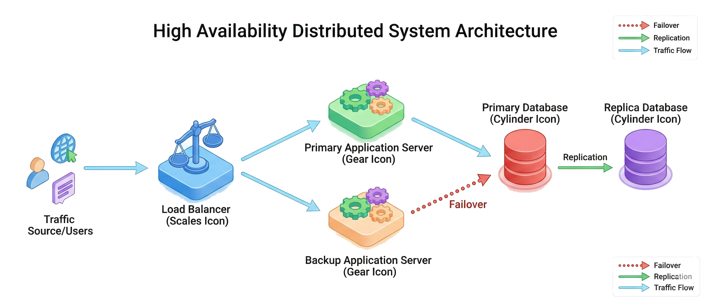

Hình minh họa: hệ thống phân tán có các node dự phòng — primary server, backup server, load balancer, database primary và database replica — nối với nhau bằng các mũi tên "failover" và "replication".

> 💡 **Giải thích:** Mỗi thành phần quan trọng đều có **bản sao dự phòng**. Load balancer vừa phân phối tải vừa phát hiện node hỏng. Khi server chính gặp sự cố, backup server tiếp quản ngay. Dữ liệu được **nhân bản liên tục** giữa database primary và replica nên không bị mất khi chuyển đổi.

---

## 2. Các sự cố phổ biến trong hệ thống phân tán

### Phân loại sự cố (hình minh họa)

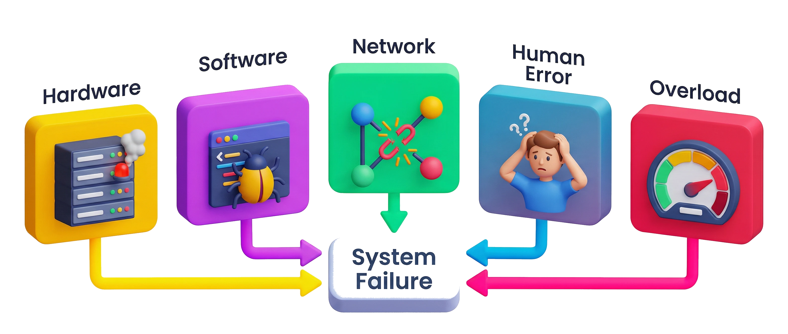

Hình minh họa: năm nhóm sự cố — **Hardware**, **Software**, **Network**, **Human Error**, **Overload** — cùng trỏ về một nút trung tâm "System Failure".

> 💡 **Giải thích:** Mỗi loại sự cố có đặc trưng riêng và cần biện pháp ứng phó khác nhau. Hiểu rõ phân loại giúp kỹ sư **thiết kế phòng thủ đúng lớp** thay vì áp dụng giải pháp chung chung. Thực tế, nhiều sự cố nghiêm trọng là **sự kết hợp của nhiều loại lỗi xảy ra đồng thời**.

### Lỗi phần cứng và phần mềm

> Lỗi có thể xảy ra ở ***bất kỳ tầng nào*** của hệ thống — phần cứng, phần mềm, hay mạng.

- **Lỗi phần cứng:** máy chủ hỏng đột ngột, cháy nguồn, lỗi CPU/RAM, ổ đĩa hỏng mất dữ liệu.
- **Lỗi phần mềm:** *memory leak* khiến server chậm dần và treo; bug logic trả kết quả sai.
- Lỗi phần mềm có thể gây **hiệu ứng dây chuyền** — một service con hỏng kéo theo các phần khác.
- Lỗi phần cứng khó tránh khi vận hành nhiều máy trong thời gian dài.

> 💡 **Giải thích:** Lỗi phần cứng (vật lý) thường **bất ngờ, không báo trước** — một node trong cluster có thể crash mà không có cảnh báo. Lỗi phần mềm (logic) **nguy hiểm hơn** vì thường tiềm ẩn và chỉ lộ ra trong điều kiện nhất định, ví dụ memory leak chỉ rõ sau vài giờ chạy liên tục. Hiệu ứng dây chuyền (cascade) là rủi ro đặc trưng của **microservices** khi các service phụ thuộc lẫn nhau.

### Sự cố mạng và lỗi con người

> **Network partition** có thể khiến các thành phần hệ thống mất khả năng giao tiếp với nhau.

- **Sự cố mạng:** mất gói tin, mất kết nối, đường truyền chậm, *timeout*.
- **Network partition:** một nhóm máy bị tách khỏi nhóm còn lại do lỗi mạng.
- **Lỗi con người:** cấu hình sai, xóa nhầm dữ liệu, tắt nhầm server.
- Lỗi người dùng không phải lỗi kỹ thuật nhưng ***phải tính đến*** khi thiết kế cơ chế phục hồi.

> 💡 **Giải thích:** Khi mạng bị chia cắt (partition), các node không phối hợp được, dẫn đến **trạng thái không nhất quán**. Lỗi con người hay bị bỏ qua khi thiết kế nhưng thực tế lại là **nguyên nhân phổ biến của những sự cố nghiêm trọng nhất**. Vì vậy cơ chế phục hồi phải có **backup dữ liệu** và **khả năng rollback** để xử lý thao tác nhầm.

### Quá tải hệ thống

> Quá tải gây ra triệu chứng ***giống hệt*** lỗi kỹ thuật — dịch vụ không phản hồi và có thể sập.

- Khi lưu lượng vượt dự kiến: CPU 100%, đầy bộ nhớ, hết kết nối.
- Dịch vụ trở nên **không phản hồi** — người dùng trải nghiệm tương tự như lỗi hoàn toàn.
- Quá tải không phải lỗi đơn lẻ nhưng cần được xử lý như một sự cố thực sự.
- Giải pháp: *auto-scaling*, **rate limiting**, **circuit breaker** để bảo vệ hệ thống.

> 💡 **Giải thích:** Quá tải hay bị coi nhẹ vì không phải lỗi "kỹ thuật" theo nghĩa truyền thống, nhưng **từ góc nhìn người dùng, hệ thống quá tải và hệ thống bị lỗi trông y như nhau**. Một sự kiện viral hay chiến dịch marketing bất ngờ có thể tạo lưu lượng **gấp 10–100 lần** bình thường chỉ trong vài phút. *Auto-scaling* giúp hệ thống co giãn theo tải; *rate limiting* và *circuit breaker* bảo vệ các thành phần phía sau khỏi bị kéo sập theo.

---

## 3. Chiến lược tăng độ bền vững (resilience)

### Single Point of Failure (SPOF)

> ***SPOF*** là thành phần duy nhất trong hệ thống mà nếu hỏng sẽ khiến ***toàn bộ hệ thống ngừng hoạt động***.

- Bất kỳ thành phần nào không có bản sao dự phòng đều là một SPOF tiềm ẩn.
- Ví dụ: một database duy nhất, một server duy nhất, một kết nối mạng duy nhất.
- Câu hỏi kiểm tra: *"Nếu thành phần X hỏng lúc 3 giờ sáng, điều gì xảy ra?"*
- Mục tiêu thiết kế: **xác định và loại bỏ mọi SPOF** trong kiến trúc.

> 💡 **Giải thích:** SPOF là khái niệm nền tảng khi phân tích độ tin cậy. Cách tìm SPOF hiệu quả nhất: **vẽ sơ đồ kiến trúc đầy đủ** rồi hỏi với từng node *"nếu thành phần này biến mất, hệ thống còn chạy được không?"*. Những SPOF hay bị bỏ sót: **load balancer đơn lẻ, DNS server, kết nối mạng giữa hai datacenter**, thậm chí **một kỹ sư duy nhất biết cách vận hành hệ thống**. Tức là SPOF không chỉ là vấn đề kỹ thuật — **con người và quy trình** cũng có thể là SPOF.

### Dự phòng và nhân bản (Redundancy)

> ***Không để trứng vào một giỏ*** — luôn có thành phần dự phòng sẵn sàng thay thế khi cần.

- Triển khai **nhiều máy chủ ứng dụng** giống nhau thay vì chỉ một.
- **Nhân bản dữ liệu** sang nhiều máy/ổ đĩa — khi máy chủ chính hỏng, bản sao tiếp quản.
- Mỗi thành phần quan trọng đều có bản sao → không còn SPOF nào.
- Áp dụng cả ở tầng ứng dụng, tầng dữ liệu, và tầng hạ tầng mạng.

> 💡 **Giải thích:** Redundancy là chiến lược **trực tiếp để loại bỏ SPOF**: nếu một thành phần có thể hỏng, hãy có ít nhất một bản sao sẵn sàng thay thế. **Replication dữ liệu** đặc biệt quan trọng vì dữ liệu mất thường **không thể phục hồi**. Chi phí dự phòng thường thấp hơn nhiều so với chi phí khôi phục sau sự cố — "thà tốn thêm một máy chủ còn hơn mất dịch vụ lúc nửa đêm".

### SPOF vs Redundancy (hình minh họa)

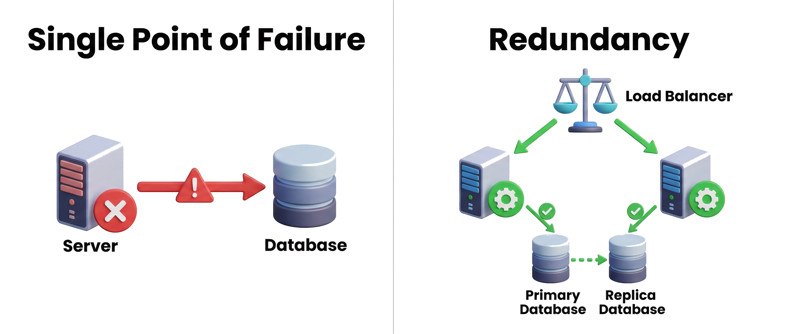

Hình minh họa: bên trái "Single Point of Failure" — một server nối một database, có dấu cảnh báo đỏ; bên phải "Redundancy" — load balancer phân tải cho hai server, mỗi server nối với database primary và replica, có dấu tích xanh.

> 💡 **Giải thích:** Bên trái, khi server **hoặc** database hỏng thì toàn bộ dịch vụ sập. Bên phải, mọi thành phần đều có bản sao nên không có điểm nào khi hỏng làm toàn hệ thống ngừng. Đây là nguyên tắc **đơn giản nhất nhưng quan trọng nhất** trong thiết kế hệ thống đáng tin cậy.

### Chuyển đổi dự phòng (Failover)

> **Failover** là cơ chế ***tự động*** chuyển sang hệ thống backup khi hệ thống chính gặp trục trặc.

- Mô hình **active-passive:** server chính xử lý toàn bộ tải, server dự phòng chỉ "stand by".
- Khi server chính sập, failover chuyển người dùng sang server dự phòng ngay lập tức.
- Ví dụ thực tế: datacenter A hỏng → traffic tự động chuyển sang datacenter B.
- Failover phụ thuộc vào **health-check** liên tục để phát hiện sự cố nhanh.

> 💡 **Giải thích:** Failover tự động hóa việc chuyển đổi, **không cần can thiệp thủ công**. Tốc độ phát hiện sự cố quyết định trực tiếp thời gian ngừng dịch vụ: health check mỗi vài giây phát hiện nhanh hơn nhưng tốn tài nguyên hơn (trade-off). **Active-passive** đơn giản hơn **active-active** nhưng có thể có **vài giây downtime** khi chuyển đổi — với nhiều hệ thống, vài giây này chấp nhận được để đổi lấy sự đơn giản trong thiết kế.

### Quy trình failover tự động

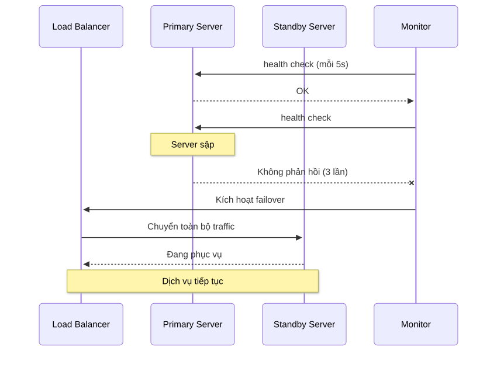

<details><summary>🔧 Mã nguồn sơ đồ (mermaid)</summary>

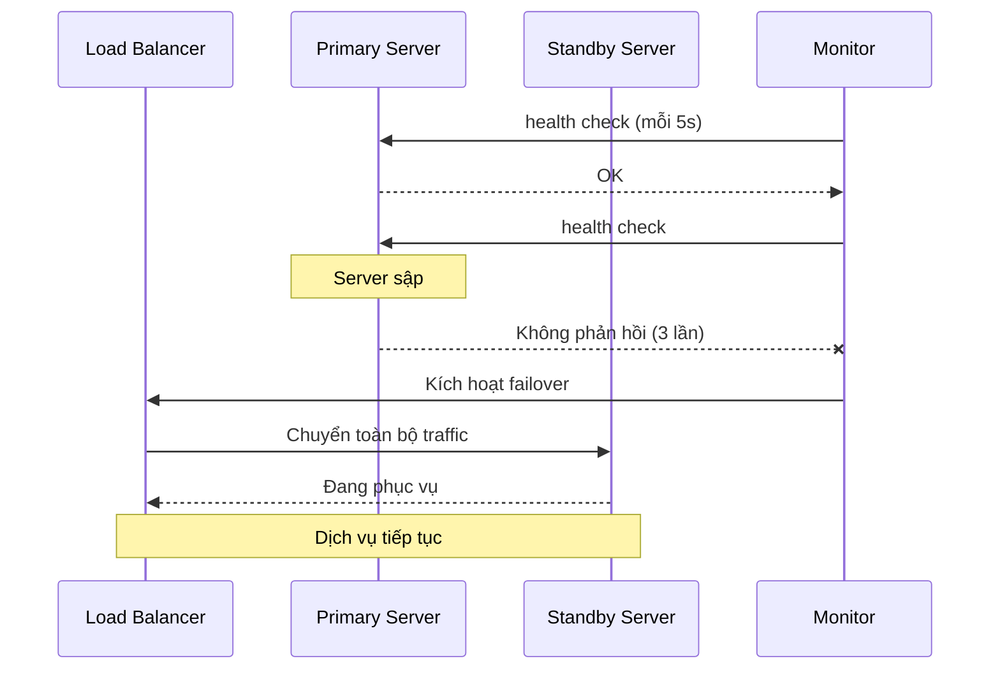

</details>

> 💡 **Giải thích:** Monitor gửi health check định kỳ (mỗi 5 giây). Khi Primary **không phản hồi 3 lần liên tiếp**, hệ thống xác nhận có sự cố (tránh báo động nhầm do một gói tin lạc) và kích hoạt failover. Load balancer chuyển toàn bộ traffic sang Standby Server, **không cần con người can thiệp**. Toàn bộ quy trình thường mất **vài giây đến dưới một phút** tùy cấu hình.

### Cân bằng tải (Load Balancing)

> **Load balancer** phân phối yêu cầu giữa nhiều máy chủ, tránh quá tải và tăng khả năng chịu lỗi.

- Nhiều máy chủ chạy song song xử lý cùng 1 loại yêu cầu.
- Khi một máy hỏng, load balancer loại khỏi vòng và chuyển sang máy còn lại.
- Hiệu năng giảm chút ít nhưng ***dịch vụ không ngừng hẳn***.
- Ví dụ: 5 server — mất 1 server, 4 server còn lại tiếp tục phục vụ.

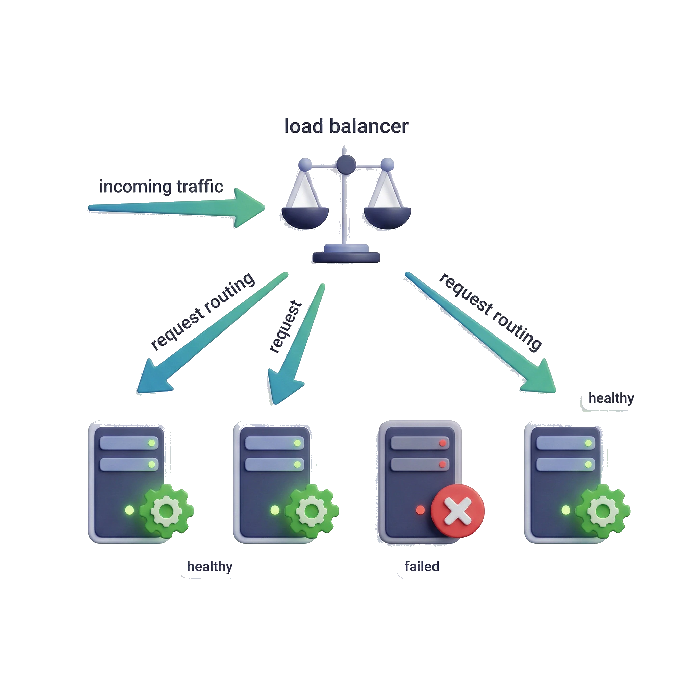

> 💡 **Giải thích:** Load balancing mang lại **hai lợi ích cùng lúc**: phân tán tải để tối ưu hiệu năng và tăng khả năng chịu lỗi khi có node hỏng. Load balancer health check định kỳ và tự loại node không phản hồi. Người dùng có thể không nhận ra sự cố — chỉ thấy trang phản hồi chậm hơn một chút. Đây là một trong những kỹ thuật phổ biến nhất của hệ thống web lớn vì **vừa đơn giản vừa hiệu quả**.

### Thử lại khi lỗi (Retry logic)

> Nhiều lỗi trong hệ thống phân tán mang tính ***tạm thời*** — thử lại sau khoảng thời gian thường giải quyết được.

- Tự động thử lại yêu cầu thất bại thay vì từ bỏ ngay.
- Dùng ***exponential backoff***: khoảng chờ tăng gấp đôi sau mỗi lần thử.
- Phải có **giới hạn số lần retry** để tránh chờ vô hạn.
- Kết hợp với **circuit breaker** khi lỗi có khả năng kéo dài.

> 💡 **Giải thích:** Retry hiệu quả nhất với **lỗi thoáng qua (transient)**: timeout mạng, dịch vụ đang khởi động lại, quá tải tạm thời. Không được retry ngay lập tức liên tục — hãy tưởng tượng **hàng nghìn client cùng retry mỗi giây** vào một service đang quá tải: tình hình chỉ tệ hơn. Khoảng nghỉ tăng dần cho service thời gian phục hồi. Cần phân biệt **lỗi tạm thời** (nên retry) và **lỗi lâu dài** (nên dừng retry và dùng circuit breaker).

### Exponential Backoff

> ***Exponential backoff*** là chiến lược tăng thời gian chờ theo cấp số nhân sau mỗi lần thử lại thất bại.

- Lần 1 thất bại → chờ **2 giây** rồi thử lại.
- Lần 2 thất bại → chờ **4 giây** rồi thử lại.
- Lần 3 thất bại → chờ **8 giây** rồi thử lại.
- Sau *N* lần tối đa → từ bỏ hoặc chuyển sang circuit breaker.

> 💡 **Giải thích:** Exponential backoff giải quyết vấn đề **"thundering herd"** — sau một sự cố, tất cả client đồng loạt retry cùng lúc, tạo làn sóng tải khổng lồ đúng lúc service đang cố phục hồi. Khoảng chờ tăng dần giúp **phân tán các retry theo thời gian**. Thực tế thường thêm **jitter** (nhiễu ngẫu nhiên) để các client không vô tình retry đồng bộ, ví dụ chờ **2s ± 0,5s** thay vì đúng 2s.

> 📌 **Mở rộng:** Công thức tổng quát thường dùng: `delay(n) = min(base × 2^(n−1), maxDelay) + jitter`. Với base = 2s: 2s, 4s, 8s, 16s… Ví dụ minh họa:
>
> ```python
> import random, time
>
> def call_with_retry(fn, max_retries=3, base=2.0, max_delay=60.0):
>     for attempt in range(1, max_retries + 2):   # 1 lần gọi đầu + max_retries lần thử lại
>         try:
>             return fn()
>         except TransientError:                   # chỉ retry lỗi tạm thời (vd: 503, timeout)
>             if attempt > max_retries:
>                 raise                            # hết lượt → báo lỗi / chuyển circuit breaker
>             delay = min(base * 2 ** (attempt - 1), max_delay)
>             time.sleep(delay + random.uniform(-0.5, 0.5))   # jitter ±0.5s
> ```

### Exponential Backoff — quy trình retry

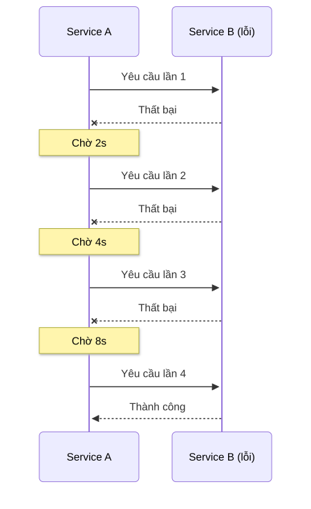

<details><summary>🔧 Mã nguồn sơ đồ (mermaid)</summary>

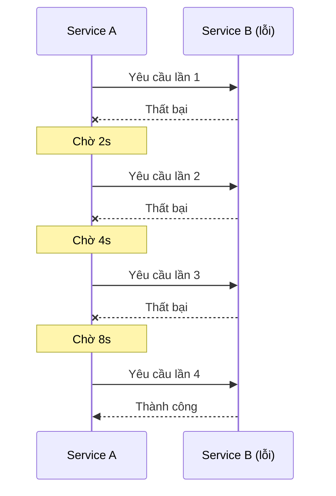

</details>

> 💡 **Giải thích:** Khoảng chờ tăng gấp đôi sau mỗi lần thất bại: 2s → 4s → 8s… Trong ví dụ, **lần thử thứ 4 thành công** vì Service B đã kịp phục hồi. Nếu đạt giới hạn số lần retry mà vẫn thất bại, hệ thống **từ bỏ và báo lỗi** hoặc chuyển sang **luồng xử lý dự phòng**. Tổng thời gian chờ tối đa thường được giới hạn (ví dụ **tối đa 60s**) để người dùng không phải chờ quá lâu.

### Circuit Breaker

> **Circuit breaker** là cơ chế ***tự động ngắt*** luồng yêu cầu đến service đang lỗi, ngăn lỗi lan rộng.

- Lấy cảm hứng từ cầu dao điện: khi quá tải, ngắt mạch để bảo vệ hệ thống.
- **Trạng thái Closed:** hoạt động bình thường, mọi yêu cầu được chuyển tiếp.
- **Trạng thái Open:** service đang lỗi, ***tất cả yêu cầu bị từ chối ngay*** — không thử nữa.
- **Trạng thái Half-Open:** thử một số yêu cầu để kiểm tra service đã phục hồi chưa.

> 💡 **Giải thích:** Circuit breaker giải quyết **cascade failure**: khi một service lỗi, các service phụ thuộc vẫn tiếp tục gửi yêu cầu và **chờ timeout**, cuối cùng tất cả đều bị treo theo. Circuit breaker ngắt luồng ngay khi **tỉ lệ lỗi vượt ngưỡng**, trả lỗi **nhanh** (fail fast) thay vì để caller chờ timeout. Half-Open là cơ chế tự kiểm tra phục hồi: cho một số yêu cầu thử đi qua — thành công thì về **Closed**, thất bại thì quay lại **Open**.

### Ba trạng thái của circuit breaker

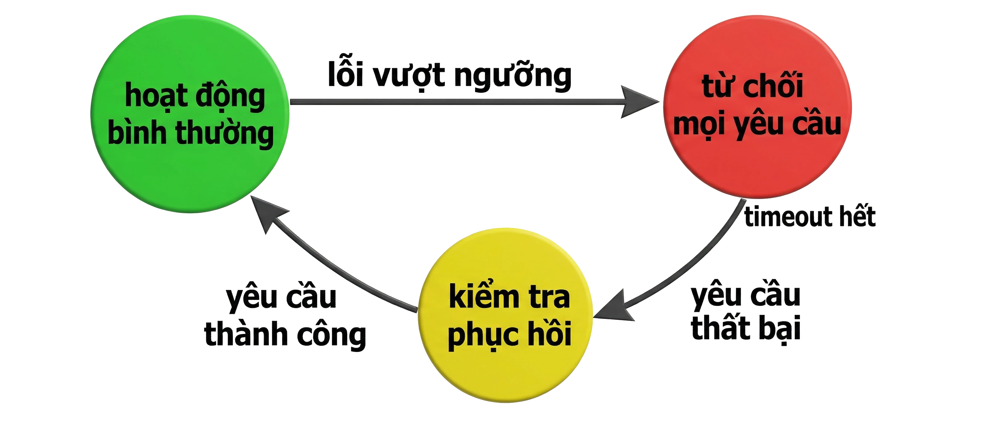

Hình minh họa: máy trạng thái gồm Closed (xanh — hoạt động bình thường), Open (đỏ — từ chối mọi yêu cầu), Half-Open (vàng — kiểm tra phục hồi), nối bằng các mũi tên chuyển trạng thái.

Sơ đồ chuyển trạng thái (dựng lại từ mô tả hình):


<details><summary>🔧 Mã nguồn sơ đồ (mermaid)</summary>

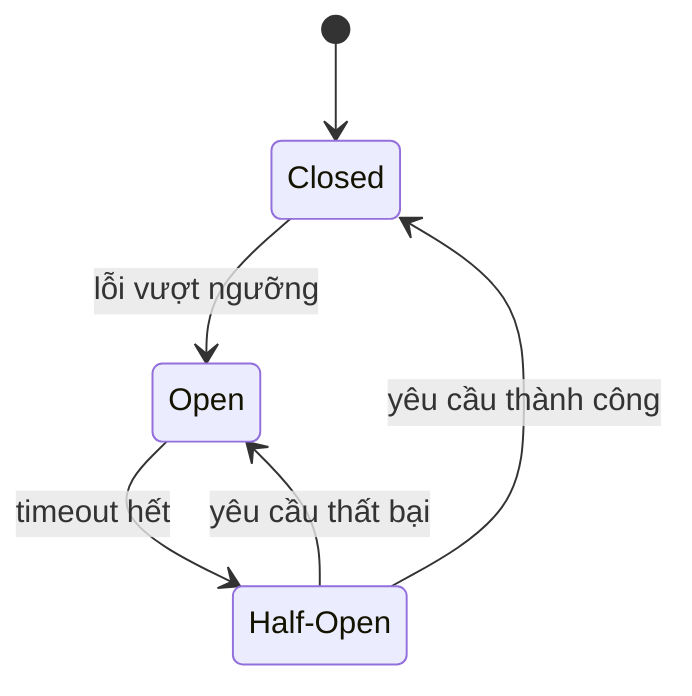

</details>

| Trạng thái | Hành vi | Chuyển sang |
|---|---|---|
| **Closed** | Hoạt động bình thường, chuyển tiếp mọi yêu cầu | → Open khi lỗi vượt ngưỡng (vd: 50% yêu cầu lỗi trong 10 giây) |
| **Open** | Từ chối mọi yêu cầu ngay, không chờ timeout | → Half-Open khi hết thời gian chờ (vd: 30 giây) |
| **Half-Open** | Cho một số yêu cầu thăm dò đi qua | → Closed nếu thành công; → Open nếu thất bại |

> 💡 **Giải thích:** Khi số lỗi vượt ngưỡng cấu hình (ví dụ **50% yêu cầu trong 10 giây** bị lỗi), breaker chuyển sang **Open** — mọi yêu cầu bị từ chối ngay. Sau một khoảng thời gian (ví dụ **30 giây**), chuyển sang **Half-Open** để thăm dò. Thăm dò thành công → **Closed** (service đã phục hồi); thất bại → quay lại **Open** và tiếp tục chờ.

### Bulkhead Pattern

> **Bulkhead** cách ly các phần của hệ thống vào các "khoang độc lập" để lỗi ***không lan sang khoang khác***.

- Lấy cảm hứng từ vách ngăn khoang của tàu biển: một khoang bị thủng, tàu không chìm.
- Mỗi service hoặc nhóm tính năng có **pool tài nguyên riêng** (thread pool, connection pool).
- Khi một khoang quá tải hoặc hỏng, chỉ khoang đó bị ảnh hưởng — các khoang khác vẫn bình thường.
- Ví dụ: tách riêng thread pool cho API thanh toán và API tìm kiếm sản phẩm.

> 💡 **Giải thích:** Bulkhead giải quyết **resource exhaustion** (cạn kiệt tài nguyên). Nếu mọi service dùng **chung một thread pool**, một service bị lỗi và treo có thể **chiếm hết thread**, khiến các service khác — dù hoàn toàn bình thường — cũng không còn thread để xử lý. Phân bổ tài nguyên riêng cho từng nhóm đảm bảo sự cố ở một khoang không "rò rỉ" sang khoang khác. Đây là pattern quan trọng trong microservices để **độc lập về lỗi** giữa các service.

### Bulkhead (hình minh họa)

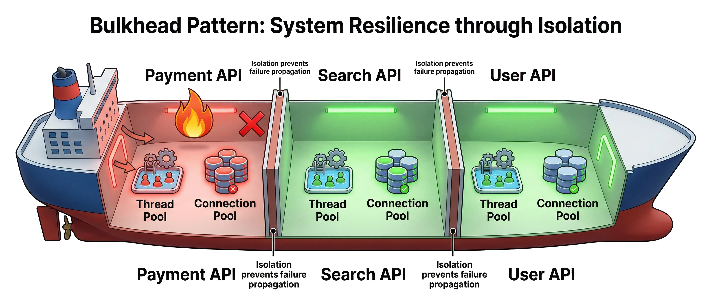

Hình minh họa: mặt cắt thân tàu chia ba khoang cách ly — "Payment API" (đỏ, quá tải), "Search API" và "User API" (xanh, khỏe mạnh) — mỗi khoang có thread pool và connection pool riêng; vách ngăn chặn lỗi của Payment lan sang khoang khác.

> 💡 **Giải thích:** Payment API đang quá tải nhưng vách ngăn giữ cho Search API và User API vẫn phục vụ bình thường. Nếu **không có Bulkhead**, thread pool chung bị Payment chiếm hết sẽ khiến cả Search và User cũng không phản hồi. Với Bulkhead, **thiệt hại được giới hạn trong một khoang**.

### Giảm thiểu dịch vụ (Graceful Degradation)

> ***Thà chạy hạn chế còn hơn chết hẳn*** — ưu tiên duy trì chức năng cốt lõi khi có lỗi xảy ra.

- Khi tính năng phụ trợ hỏng, tắt nó đi và giữ phần chính hoạt động.
- Mạng xã hội: tắt cập nhật bình luận real-time, nhưng giữ news feed hoạt động.
- Dịch vụ phim: giảm chất lượng video HD xuống SD thay vì để người dùng mất kết nối hoàn toàn.
- Thường kết hợp với **circuit breaker** để cách ly thành phần lỗi, ngăn lan rộng.

> 💡 **Giải thích:** Graceful degradation buộc kỹ sư **xác định trước** đâu là tính năng **"must-have"** và đâu là **"nice-to-have"**. Thiết kế này phải **lên kế hoạch từ đầu**, không thể "thêm vào sau" khi hệ thống đã chạy. Circuit breaker là cơ chế bổ trợ: khi một service liên tục thất bại, breaker mở ra chặn mọi yêu cầu đến service đó (tránh cascade failure), rồi sau một khoảng thời gian cho thử lại để kiểm tra phục hồi.

### Kim tự tháp ưu tiên tính năng (hình minh họa)

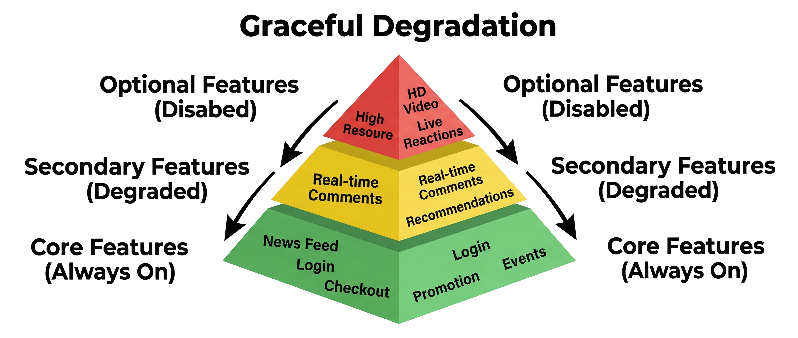

Hình minh họa: kim tự tháp ba tầng — đáy "Core Features" (xanh, luôn bật: news feed, login, checkout), giữa "Secondary Features" (vàng, giảm cấp: bình luận real-time, gợi ý), đỉnh "Optional Features" (đỏ, tắt: video HD, live reactions); tính năng bị tắt dần từ đỉnh xuống khi có sự cố.

| Tầng | Ví dụ | Khi có sự cố |
|---|---|---|
| Core Features (đáy) | News feed, login, checkout | **Luôn bật** — bảo toàn đến cùng |
| Secondary Features (giữa) | Bình luận real-time, gợi ý (recommendations) | **Giảm cấp** |
| Optional Features (đỉnh) | Video HD, live reactions | **Tắt trước tiên** |

> 💡 **Giải thích:** Khi tài nguyên khan hiếm hoặc có lỗi, hệ thống **tắt dần từ đỉnh xuống**: tắt tính năng tùy chọn trước, rồi giảm cấp tính năng thứ yếu, và giữ tầng cốt lõi đến cùng. Thứ tự này phải được **xác định và mã hóa sẵn trong logic hệ thống**, không phải quyết định tùy hứng lúc sự cố xảy ra.

### Kiểm tra tình trạng và giám sát

> Không thể khắc phục sự cố nếu không biết nó ***đang xảy ra*** — giám sát liên tục là bắt buộc.

- **Health check tự động:** ping định kỳ giữa các node; không phản hồi → kích hoạt failover.
- Thu thập **chỉ số runtime:** CPU, bộ nhớ, độ trễ, tỉ lệ lỗi — cảnh báo khi vượt ngưỡng.
- Công cụ phổ biến: *Prometheus/Grafana* (dashboard), *Datadog* (APM), *PagerDuty* (alert).
- Phát hiện sự cố **trước khi người dùng nhận ra** — rút ngắn thời gian phản ứng.

> 💡 **Giải thích:** Monitoring là **lớp quan sát** để mọi chiến lược khác hoạt động được: không có monitoring, failover không biết khi nào kích hoạt, retry không biết khi nào dừng, đội vận hành không biết đang có sự cố. Health check + load balancer cho phép tự động loại node hỏng khỏi vòng phục vụ. Dữ liệu monitoring còn là **bằng chứng để phân tích nguyên nhân** sau sự cố (post-mortem) và cải thiện hệ thống.

### Các chiến lược tăng độ bền vững (tổng hợp)

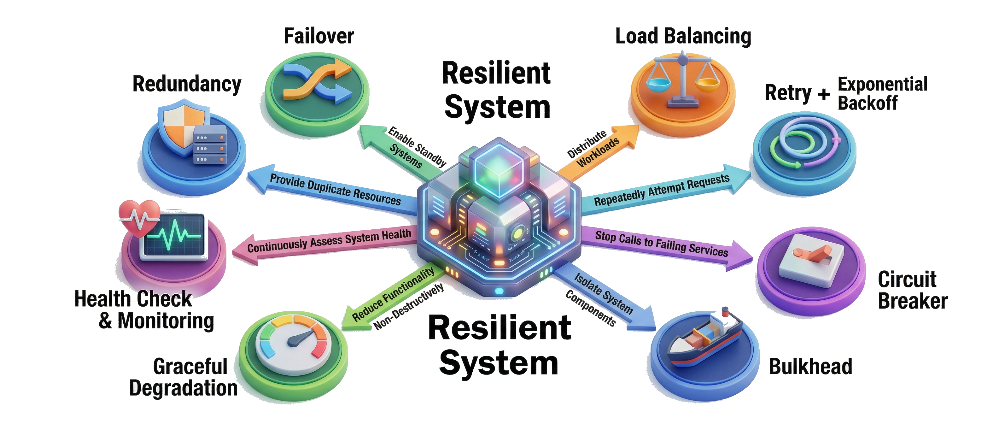

Hình minh họa: bản đồ khái niệm với trung tâm "Resilient System" nối tới 8 chiến lược — Redundancy, Failover, Load Balancing, Retry + Exponential Backoff, Circuit Breaker, Bulkhead, Graceful Degradation, Health Check & Monitoring.

> 💡 **Giải thích:** Tám chiến lược **không hoạt động độc lập** mà phối hợp với nhau: redundancy đi cùng failover, load balancer tích hợp health check, retry phối hợp với circuit breaker, bulkhead bổ sung cho graceful degradation. Kỹ sư giỏi biết **chọn và kết hợp** chiến lược phù hợp yêu cầu cụ thể, thay vì áp dụng tất cả một cách cứng nhắc.

---

## 4. High Availability vs Fault Tolerance

### High Availability (HA)

> **HA** thiết kế để giảm thiểu tối đa downtime, nhưng ***chấp nhận*** thỉnh thoảng có gián đoạn nhỏ.

- Mục tiêu: hầu hết thời gian hệ thống ở trạng thái phục vụ bình thường.
- Khi có sự cố: khôi phục nhanh hoặc chuyển đổi sang dự phòng — thường có **vài giây đến vài phút** ngừng dịch vụ.
- Ưu điểm: **dễ triển khai hơn**, chi phí thấp hơn so với FT.
- Phù hợp với phần lớn ứng dụng web — downtime ngắn có thể chấp nhận được.

> 💡 **Giải thích:** HA là **lựa chọn thực tế cho phần lớn hệ thống** vì cân bằng tốt giữa độ tin cậy và chi phí. HA **không** có nghĩa là hệ thống không bao giờ lỗi, mà là **phục hồi rất nhanh** khi lỗi xảy ra. Downtime trong lúc failover thường chấp nhận được nếu đủ ngắn — người dùng thấy trang load chậm hoặc phải refresh, thay vì mất dịch vụ hoàn toàn.

### Fault Tolerance (FT)

> **FT** hướng tới ***không gián đoạn dịch vụ*** dù xảy ra bất kỳ lỗi nào — người dùng không nhận thấy sự cố.

- Nhân đôi toàn bộ hệ thống chạy song song: thành phần hỏng được thay thế ***tức thì***.
- Ví dụ: database **active-active** — hai máy cùng xử lý, luôn đồng bộ; một hỏng, cái kia tiếp tục ngay.
- Chi phí rất cao: phải nhân bản mọi thứ, tài nguyên dự phòng lớn.
- Không xử lý được lỗi phần mềm chung (bug): nhân bản bao nhiêu cũng bị lỗi như nhau.

> 💡 **Giải thích:** FT yêu cầu mọi thao tác xảy ra **đồng thời trên cả hai hệ thống song song**, không có khoảng trống thời gian nào. Điều này rất phức tạp với **dữ liệu có trạng thái** (stateful) vì phải đồng bộ tức thì giữa các node. Chi phí không chỉ là phần cứng gấp đôi mà còn là **băng thông đồng bộ** và **độ phức tạp vận hành**. Nhược điểm quan trọng: FT **không bảo vệ khỏi lỗi phần mềm**, vì cả hai bản sao chạy cùng code nên cùng dính một bug.

### So sánh HA và FT

> Chọn **HA hay FT** phụ thuộc vào yêu cầu kinh doanh — không phải lúc nào cũng cần FT tuyệt đối.

| Tiêu chí | High Availability | Fault Tolerance |
|---|---|---|
| Downtime | Chấp nhận downtime ngắn (giây–phút) | Không downtime — liên tục tuyệt đối |
| Kiến trúc | Đơn giản hơn | Phức tạp (active-active) |
| Chi phí | Thấp hơn | Rất cao |
| Phù hợp | Ứng dụng web thông thường | Điều khiển không lưu, tài chính |

> 💡 **Giải thích:** Điểm khác biệt quan trọng nhất: FT **loại bỏ hoàn toàn downtime** nhưng với giá rất đắt về chi phí và độ phức tạp; HA là lựa chọn thực tế cho đại đa số hệ thống. Quyết định HA hay FT phải dựa trên **phân tích chi phí–lợi ích** cụ thể, không phải theo xu hướng hay vì "nghe có vẻ tốt hơn".

### HA vs FT (hình minh họa)

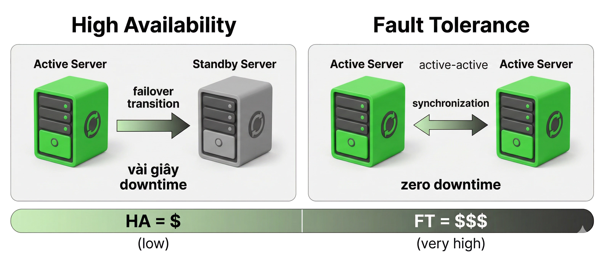

Hình minh họa: bên trái HA — server active (xanh) và standby (xám), có khoảng trống "vài giây downtime" khi failover; bên phải FT — hai server active-active chạy song song, đồng bộ, "zero downtime"; chỉ báo chi phí HA = $ (thấp), FT = $$$ (rất cao).

> 💡 **Giải thích:** HA có **một khoảnh khắc chuyển đổi (gap)** khi failover; FT **không có** vì cả hai server luôn chạy song song và đồng bộ. Chỉ báo chi phí nhắc rằng FT không phải lúc nào cũng tốt hơn — nó đắt hơn nhiều và chỉ đáng đầu tư cho hệ thống cần **liên tục tuyệt đối**.

### Ví dụ minh hoạ HA và FT

- **HA — nhà hàng nhiều đầu bếp:** một đầu bếp nghỉ → nhà hàng vẫn mở, phục vụ chậm hơn chút.
- **FT — máy phát điện dự phòng:** lưới điện mất → máy phát lên ngay, nhà hàng không tắt đèn một giây.
- **FT — máy bay hai động cơ:** một động cơ hỏng → động cơ kia tiếp tục bay và hạ cánh an toàn.
- **Không có FT — trực thăng một động cơ:** hỏng động cơ là rớt, toàn bộ hệ thống ngừng.

> 💡 **Giải thích:** Máy bay hai động cơ là ví dụ kinh điển về FT: yêu cầu an toàn tuyệt đối buộc phải có dự phòng hoàn toàn. Với **điều khiển không lưu hay tài chính**, một giây downtime có thể gây hậu quả không khắc phục được. Ngược lại, ứng dụng **mạng xã hội** chịu được vài giây refresh mà không ảnh hưởng nghiêm trọng đến người dùng.

---

## 5. Đánh giá độ tin cậy — Uptime, SLA, SLO, SLI, MTTR, MTBF

### Uptime và các mức độ sẵn sàng

> **Uptime** đo tỉ lệ thời gian hệ thống hoạt động tốt — thường biểu thị bằng "số 9".

- **99,9% (ba số 9):** downtime ~8,8 giờ mỗi năm.
- **99,99% (bốn số 9):** downtime ~53 phút mỗi năm.
- **99,999% (năm số 9):** downtime ~5 phút mỗi năm.
- Đạt uptime càng cao thì ***chi phí xây dựng càng lớn*** — cần cân nhắc với yêu cầu thực tế.

**Công thức:**

```text
Uptime (%) = Thời gian hoạt động / Tổng thời gian × 100%
Downtime cho phép = (1 − Uptime) × Tổng thời gian
```

> 💡 **Giải thích:** "Số 9" là chuẩn ngành để biểu thị độ sẵn sàng. Khác biệt giữa ba số 9 và bốn số 9 nghe nhỏ nhưng tương đương **hơn 8 giờ downtime mỗi năm** — quá lớn với dịch vụ ngân hàng, nhưng hoàn toàn chấp nhận được với blog cá nhân. Cloud provider lớn như **AWS S3** cam kết **99,99%**. Kỹ sư cần hiểu đúng yêu cầu uptime để thiết kế **đúng mức — không over-engineer** khi không cần.

### Các mức uptime và downtime tương ứng

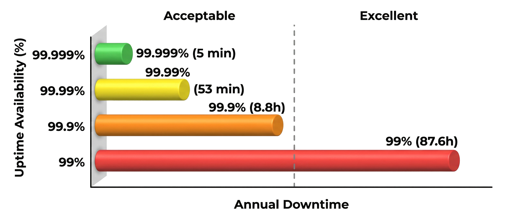

Hình minh họa: biểu đồ thanh ngang so sánh 4 mức uptime và downtime/năm tương ứng, màu từ đỏ (kém) đến xanh (xuất sắc), có đường gạch phân tách "acceptable" và "excellent".

| Uptime | Downtime/năm (theo hình) | 📌 Tính chính xác (năm = 8.760 giờ) | 📌 Downtime/tháng (30 ngày) |
|---|---|---|---|
| 99% | 87,6 giờ | 0,01 × 8.760 = 87,6 giờ | 7,2 giờ |
| 99,9% | 8,8 giờ | 0,001 × 8.760 = 8,76 giờ | 43,2 phút |
| 99,99% | 53 phút | 0,0001 × 8.760 = 0,876 giờ ≈ 52,6 phút | 4,32 phút |
| 99,999% | 5 phút | 0,00001 × 8.760 = 0,0876 giờ ≈ 5,26 phút | ≈ 26 giây |

> 💡 **Giải thích:** Con số trừu tượng như 99,99% trở nên có ý nghĩa khi thấy nó tương đương **53 phút mỗi năm**. Đây là công cụ hữu ích khi thảo luận với stakeholder: chuyển từ "muốn 99,99%" thành **"chấp nhận được 53 phút downtime mỗi năm"** giúp quyết định thực tế hơn.

### SLA — Thỏa thuận mức dịch vụ

> **SLA** (Service Level Agreement) là ***cam kết pháp lý*** về mức độ dịch vụ giữa nhà cung cấp và khách hàng.

- Quy định: *availability* tối thiểu, hiệu năng, thời gian phản hồi sự cố.
- Vi phạm SLA → khách hàng được bồi thường hoặc hoàn tiền dịch vụ.
- **AWS S3 Standard** và **Azure Blob Storage:** đều cam kết 99,99% availability.
- SLA của nhà cung cấp hạ tầng đặt ***giới hạn trên*** cho uptime hệ thống bạn xây dựng trên đó.

> 💡 **Giải thích:** SLA vừa là con số kỹ thuật, vừa là **cam kết pháp lý và thương mại**. Khi hệ thống dùng dịch vụ bên thứ ba, SLA của bên đó là **trần** cho uptime của bạn: nếu database cloud có SLA 99,99% thì hệ thống xây trên đó không thể đảm bảo cao hơn 99,99%. Đội kỹ thuật cần nắm SLA của **tất cả dependencies** để đặt kỳ vọng đúng với người dùng và quản lý.

> 📌 **Mở rộng:** Khi hệ thống phụ thuộc **nối tiếp** vào nhiều thành phần, availability tổng ≈ **tích** availability từng thành phần. Ví dụ app 99,99% gọi DB 99,99% → 0,9999 × 0,9999 ≈ 99,98%. Ngược lại, khi có **N bản sao song song** độc lập, availability ≈ 1 − (1 − A)^N — đây là lý do redundancy làm tăng uptime.

### SLO và SLI

> **SLO** và **SLI** là công cụ nội bộ để đo lường và kiểm soát chất lượng dịch vụ ***trước khi vi phạm SLA***.

- **SLI** (Service Level Indicator) — *chỉ số đo lường thực tế:* tỉ lệ yêu cầu thành công, độ trễ trung vị, tỉ lệ lỗi.
- **SLO** (Service Level Objective) — *mục tiêu nội bộ cần đạt:* "99,5% yêu cầu phải hoàn thành trong 200ms".
- SLO thường ***chặt hơn SLA*** để tạo vùng đệm an toàn trước khi vi phạm cam kết với khách hàng.
- Ví dụ: SLA cam kết 99,9% — SLO nội bộ đặt 99,95% — nếu SLO bị vi phạm thì cảnh báo trước khi SLA bị phá.

> 💡 **Giải thích:** SLA, SLO, SLI tạo thành một hệ thống quản lý độ tin cậy hoàn chỉnh — được Google phổ biến trong cuốn ***Site Reliability Engineering***. **SLI** là số liệu đo được, **SLO** là mục tiêu tự đặt ra, **SLA** là cam kết với khách hàng. Đặt SLO chặt hơn SLA tạo **vùng đệm** để đội kỹ thuật kịp phát hiện và xử lý trước khi vi phạm cam kết pháp lý — tức là **chủ động** thay vì phản ứng bị động.

### SLA, SLO, SLI (hình minh họa)

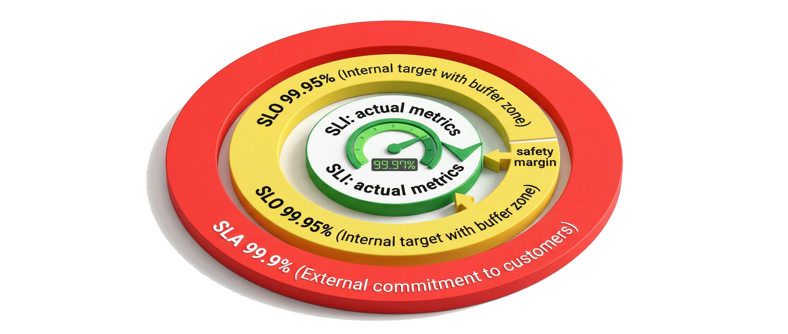

Hình minh họa: các vòng đồng tâm — ngoài cùng "SLA 99.9%" (cam kết với khách hàng), giữa "SLO 99.95%" (mục tiêu nội bộ, có vùng đệm "safety margin"), trong cùng "SLI" (số liệu thực tế đo được), SLI được đưa vào so sánh với SLO.

> 💡 **Giải thích:** SLI ở trung tâm là dữ liệu thực tế. SLO là mục tiêu nội bộ chặt hơn SLA. SLA là lớp ngoài cùng — cam kết với khách hàng. Khi SLI **rơi xuống dưới mức SLO** (tức chất lượng thực tế kém hơn mục tiêu nội bộ), đội kỹ thuật nhận cảnh báo và hành động **trước khi SLA bị vi phạm**. Đây là nền tảng của thực hành **SRE**.

### MTBF — Thời gian trung bình giữa các lần hỏng

> **MTBF** đo độ ***ổn định***: trung bình bao lâu hệ thống gặp một sự cố.

- MTBF cao = các lần hỏng cách xa nhau = hệ thống đáng tin cậy hơn.
- Công thức: **MTBF = Tổng thời gian hoạt động / Số lần sự cố**.
- Ví dụ: 168 giờ/tuần, sập 3 lần, downtime 3 giờ → uptime 165 giờ → **MTBF ≈ 55 giờ**.
- **MTTF** (Mean Time To Failure): dùng cho thiết bị không thể khắc phục, phải thay thế.

```text
Ví dụ:
Tổng thời gian       = 168 giờ (1 tuần)
Downtime             = 3 giờ
Thời gian hoạt động  = 168 − 3 = 165 giờ
MTBF                 = 165 / 3 = 55 giờ
```

> 💡 **Giải thích:** MTBF giúp **định lượng tần suất sự cố** thay vì nói chung chung "hệ thống hay lỗi", từ đó lên kế hoạch bảo trì phòng ngừa và dự đoán khi nào cần can thiệp. Phân biệt: **MTBF** dùng cho hệ thống **sửa chữa/khởi động lại được** (như server phần mềm); **MTTF** dùng cho phần cứng **hỏng vĩnh viễn** như ổ cứng, transistor. Kỹ sư vận hành thường theo dõi cả hai.

### MTTR — Thời gian khôi phục trung bình

> **MTTR** đo tốc độ ***phục hồi***: mỗi lần hệ thống sập mất bao lâu để "sống lại".

- Công thức: **MTTR = Tổng thời gian downtime / Số lần sự cố**.
- Ví dụ: 4 sự cố trong tháng, tổng downtime 2 giờ → **MTTR = 30 phút** (120 phút / 4).
- MTTR càng thấp càng tốt — failover tự động, đội vận hành giỏi, phụ tùng dự phòng đều giảm MTTR.
- SLA có thể quy định MTTR tối đa: *"MTTR không được vượt quá 1 giờ"*.

> 💡 **Giải thích:** MTTR phản ánh hiệu quả của **quy trình phản ứng sự cố**, không chỉ là chuyện kỹ thuật. Có failover tự động → MTTR tính bằng **giây**; phải can thiệp thủ công → có thể mất **hàng giờ**. MTTR gồm 4 bước: **phát hiện → chẩn đoán nguyên nhân → khôi phục → xác nhận hệ thống bình thường**. Monitoring tốt rút ngắn bước phát hiện và chẩn đoán; **runbook** sẵn có giúp đội vận hành hành động nhanh mà không phải nghĩ từ đầu.

> 📌 **Mở rộng:** Hai chỉ số liên hệ với uptime qua công thức gần đúng: **Availability ≈ MTBF / (MTBF + MTTR)**. Với ví dụ ở phần *MTBF* phía trên: MTBF = 55 giờ, MTTR = 3 giờ / 3 = 1 giờ → Availability ≈ 55 / 56 ≈ 98,2% (khớp với 165/168 ≈ 98,2%). Muốn tăng uptime: **tăng MTBF** (ít hỏng hơn) hoặc **giảm MTTR** (phục hồi nhanh hơn).

### Tổng hợp các chỉ số độ tin cậy

> Hệ thống lý tưởng: **MTBF cao** (ít khi hỏng) và ***MTTR thấp*** (hỏng là phục hồi ngay).

- **SLI:** chỉ số đo thực tế — tỉ lệ lỗi, độ trễ, throughput.
- **SLO:** mục tiêu nội bộ — chặt hơn SLA để tạo vùng đệm an toàn.
- **SLA:** cam kết pháp lý với khách hàng — uptime, hiệu năng, thời gian phản hồi.
- **MTBF / MTTR:** đo tần suất sự cố và tốc độ phục hồi.

> 💡 **Giải thích:** Các nhóm chỉ số bổ sung cho nhau: **SLI/SLO/SLA** là góc nhìn từ phía người dùng và cam kết thương mại; **MTBF/MTTR** là góc nhìn kỹ thuật về tần suất và tốc độ xử lý sự cố. Khi thảo luận thiết kế, nêu mục tiêu cụ thể như *"MTTR dưới 15 phút, MTBF ít nhất 1 tháng, SLO 99,95%"* thể hiện tư duy **định lượng**. Đây cũng là **ngôn ngữ chung** giữa kỹ thuật và quản lý.

### Bảng điều khiển các chỉ số (hình minh họa)

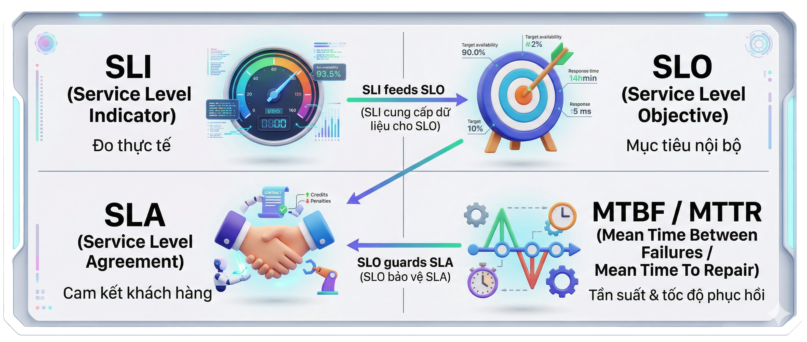

Hình minh họa: dashboard 4 ô — SLI ("Đo thực tế"), SLO ("Mục tiêu nội bộ"), SLA ("Cam kết khách hàng"), MTBF/MTTR ("Tần suất & tốc độ phục hồi"); mũi tên cho thấy SLI đưa vào SLO, SLO bảo vệ SLA.

> 💡 **Giải thích:** SLI là dữ liệu đầu vào, được so với SLO để phát hiện nguy cơ vi phạm SLA. MTBF và MTTR cho **góc nhìn lịch sử** về tần suất và tốc độ xử lý sự cố. Bốn nhóm cùng tạo bức tranh toàn diện về sức khỏe hệ thống, phục vụ cả kỹ thuật lẫn báo cáo kinh doanh.

---

## 6. Best Practices

### Xác định yêu cầu và nhận diện SPOF

> Bắt đầu bằng câu hỏi đúng — ***yêu cầu kinh doanh*** quyết định mức độ chịu lỗi cần thiết.

- Làm rõ mức độ availability cần thiết: downtime chấp nhận được là bao lâu?
- Dữ liệu có được phép mất một chút không? Cần *consistency* hay *availability*?
- Vẽ kiến trúc và tìm từng **SPOF**: "Nếu X hỏng thì sao?"
- Đề xuất dự phòng cho mỗi SPOF: database replica, nhiều instance service.

> 💡 **Giải thích:** Trong phỏng vấn system design, **đặt câu hỏi làm rõ yêu cầu** thể hiện tư duy kiến trúc trưởng thành. Không có câu trả lời đúng tuyệt đối về mức fault tolerance — **tất cả phụ thuộc bối cảnh**. Áp dụng câu hỏi "nếu X hỏng thì sao?" cho **mọi** thành phần: load balancer, web server, application server, cache, database. Phát hiện và xử lý SPOF **có hệ thống** gây ấn tượng tốt với người phỏng vấn.

### Áp dụng chiến lược chịu lỗi trong phỏng vấn

> Trình bày ***cụ thể, có cấu trúc*** — nêu từng chiến lược kèm lý do và ví dụ.

- **Load balancing** + health check cho tầng ứng dụng.
- **Ít nhất 2 instance** ở hai Availability Zone khác nhau (redundancy).
- **Database replication** master-slave + failover tự động khi node chính gặp sự cố.
- **Retry + exponential backoff** + **circuit breaker** cho giao tiếp giữa các service.
- **Monitoring** (CloudWatch/PagerDuty) để phát hiện và cảnh báo sự cố.

| Tầng | Chiến lược |
|---|---|
| Ứng dụng | Load balancing + health check |
| Hạ tầng | Multi-AZ (≥ 2 instance ở 2 AZ) |
| Dữ liệu | Replication master-slave + failover tự động |
| Giao tiếp | Retry + exponential backoff + circuit breaker |
| Quan sát | Monitoring (CloudWatch/PagerDuty) |

> 💡 **Giải thích:** Câu trả lời mẫu **kết hợp nhiều chiến lược** thay vì chỉ nêu một, và trình bày **theo tầng** (bảng trên). Người phỏng vấn đánh giá cao ứng viên dùng **thuật ngữ chính xác** và **liên kết các chiến lược** với nhau mạch lạc.

### Nhấn mạnh phục hồi nhanh và cân bằng trade-off

> Thiết kế tốt không phải là *"càng nhiều dự phòng càng tốt"* mà là ***phù hợp với yêu cầu thực tế***.

- Đề cập thời gian failover dự kiến: vài giây hay một phút?
- **Auto-scaling group** để tự động thay node hỏng bằng node mới.
- Nhắc đến *disaster recovery* nếu câu hỏi liên quan đến mất nguyên datacenter.
- Thể hiện nhận thức về **trade-off:** HA vs FT, chi phí vs độ phức tạp.

> 💡 **Giải thích:** Phần hay bị bỏ qua nhất là **trade-off**. Nói "tôi sẽ dùng active-active ở hai region" mà không nhắc chi phí và độ phức tạp cho thấy **thiếu kinh nghiệm thực tế**. Ngược lại, câu như *"với yêu cầu này, HA với downtime dưới 30 giây là đủ, không cần FT hoàn toàn vì chi phí không tương xứng"* cho thấy tư duy chín chắn. Người phỏng vấn muốn thấy bạn **cân bằng kỹ thuật và kinh doanh**, không chạy theo giải pháp "hoàn hảo" trên lý thuyết.

---

## 7. Bài tập phân tích và áp dụng

> Đề bài đầy đủ và lời giải chi tiết nằm ở mục [📝 Bài tập](#-bài-tập) cuối file. Phần này chỉ tóm tắt đề.

### Bài tập 1 — Phân tích SPOF

> Cho sơ đồ kiến trúc: một web server duy nhất kết nối đến một database duy nhất, không có load balancer.

- **Câu hỏi 1:** Hãy xác định tất cả *single point of failure* trong kiến trúc này.
- **Câu hỏi 2:** Đề xuất ít nhất ba thay đổi kiến trúc để loại bỏ từng SPOF.
- **Câu hỏi 3:** Sau khi thay đổi, hệ thống đạt HA hay FT? Tại sao?
- **Gợi ý:** xem xét cả tầng ứng dụng, tầng dữ liệu và tầng mạng.

### Kiến trúc khởi đầu — Bài tập 1


<details><summary>🔧 Mã nguồn sơ đồ (mermaid)</summary>

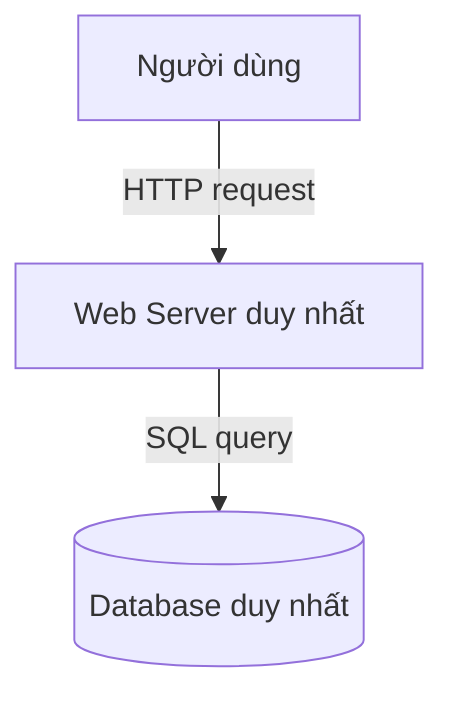

</details>

> 💡 **Giải thích:** Kiến trúc đơn giản nhất với hai điểm lỗi rõ ràng: **Web Server** và **Database** đều là SPOF. Web Server sập → không request nào được xử lý; Database sập → ứng dụng không đọc/ghi được dữ liệu. Nhiệm vụ: thiết kế lại để loại bỏ cả hai SPOF, cân nhắc load balancer, replica và multi-AZ deployment.

### Bài tập 2 — Thiết kế retry với exponential backoff

> Service A gọi Service B để lấy dữ liệu người dùng. Service B thỉnh thoảng bị quá tải và trả về lỗi 503.

- **Câu hỏi 1:** Thiết kế chiến lược retry phù hợp: bao nhiêu lần, khoảng chờ như thế nào?
- **Câu hỏi 2:** Khi nào nên dừng retry và kích hoạt circuit breaker?
- **Câu hỏi 3:** Nếu Service B bị lỗi hoàn toàn trong 10 phút, hệ thống nên graceful degrade như thế nào?
- **Gợi ý:** phân biệt lỗi tạm thời (503) và lỗi vĩnh viễn (404) khi thiết kế retry.

### Bài tập 3 — Tính toán chỉ số độ tin cậy

> Hệ thống trong một tháng (30 ngày = 720 giờ) có nhật ký sự cố: Sự cố 1 lúc giờ thứ 14, kéo dài 45 phút; Sự cố 2 lúc giờ thứ 72, kéo dài 20 phút; Sự cố 3 lúc giờ thứ 350, kéo dài 2 giờ.

- **Câu hỏi 1:** Tính MTBF. **Câu hỏi 2:** Tính MTTR. **Câu hỏi 3:** Tính uptime % — có đạt SLA 99,9% không? **Câu hỏi 4:** SLO nội bộ 99,95% có bị vi phạm không?

### Bài tập 4 — Thiết kế hệ thống đặt vé máy bay

> Yêu cầu: phục vụ 1 triệu người dùng đồng thời, không được mất dữ liệu giao dịch, downtime tối đa 1 phút mỗi tháng.

- **Câu hỏi 1:** HA hay FT? **Câu hỏi 2:** SLA, SLO phù hợp? **Câu hỏi 3:** Chiến lược cho tầng ứng dụng, tầng dữ liệu, tầng thanh toán? **Câu hỏi 4:** Bulkhead nên áp dụng ở đâu và tại sao?

---

## 🧠 Tóm tắt nhanh

### 8 chiến lược resilience

| Chiến lược | Ý tưởng cốt lõi | Giải quyết vấn đề | Hay đi cùng |
|---|---|---|---|
| **Redundancy** | Có bản sao dự phòng cho mọi thành phần quan trọng | SPOF | Failover, replication |
| **Failover** | Tự động chuyển sang backup khi primary hỏng (active-passive) | Thành phần chính sập | Health check, redundancy |
| **Load Balancing** | Phân phối yêu cầu cho nhiều server, loại node hỏng | Quá tải + node hỏng | Health check |
| **Retry + Exponential Backoff** | Thử lại lỗi tạm thời, khoảng chờ 2s → 4s → 8s (+ jitter), có giới hạn | Lỗi thoáng qua, thundering herd | Circuit breaker |
| **Circuit Breaker** | Closed → Open → Half-Open; fail fast khi service lỗi | Cascade failure | Retry, graceful degradation |
| **Bulkhead** | Tách pool tài nguyên (thread/connection pool) theo khoang | Resource exhaustion | Graceful degradation |
| **Graceful Degradation** | Tắt tính năng phụ, giữ tính năng cốt lõi | Mất toàn bộ dịch vụ | Circuit breaker |
| **Health Check & Monitoring** | Ping định kỳ, thu metric, cảnh báo | Không biết có sự cố | Mọi chiến lược khác |

### HA vs FT

| | High Availability | Fault Tolerance |
|---|---|---|
| Downtime | Vài giây – vài phút khi failover | Zero downtime |
| Mô hình | Active-passive + failover | Active-active, chạy song song, đồng bộ |
| Chi phí / độ phức tạp | Thấp hơn / đơn giản hơn | Rất cao / phức tạp |
| Hạn chế | Có gap khi chuyển đổi | Không chống được bug phần mềm chung |
| Ví dụ | Web app thông thường; nhà hàng nhiều đầu bếp | Điều khiển không lưu, tài chính; máy bay hai động cơ |

### SLI / SLO / SLA

| Khái niệm | Là gì | Ví dụ | Đối tượng |
|---|---|---|---|
| **SLI** | Chỉ số đo thực tế | Tỉ lệ request thành công, độ trễ trung vị, tỉ lệ lỗi | Nội bộ (dữ liệu) |
| **SLO** | Mục tiêu nội bộ, chặt hơn SLA | 99,95%; "99,5% request < 200ms" | Nội bộ (mục tiêu) |
| **SLA** | Cam kết pháp lý, vi phạm phải bồi thường | 99,9%; AWS S3 / Azure Blob 99,99% | Khách hàng |

### MTBF / MTTR / Uptime

| Chỉ số | Công thức | Ý nghĩa | Mong muốn |
|---|---|---|---|
| **MTBF** | Tổng thời gian hoạt động / Số lần sự cố | Bao lâu hỏng một lần (độ ổn định) | Cao |
| **MTTR** | Tổng thời gian downtime / Số lần sự cố | Mỗi lần hỏng mất bao lâu để phục hồi | Thấp |
| **MTTF** | (thiết bị không sửa được) thời gian trung bình đến khi hỏng | Tuổi thọ phần cứng | Cao |
| **Uptime %** | Thời gian hoạt động / Tổng thời gian × 100% | 99,9% ≈ 8,8 giờ/năm; 99,99% ≈ 53 phút/năm; 99,999% ≈ 5 phút/năm | Đủ dùng, không over-engineer |

---

## ❓ Câu hỏi tự kiểm tra

**1.** Fault tolerance có đòi hỏi hệ thống không bao giờ lỗi không? Hãy định nghĩa lại bằng lời của bạn.

<details><summary>Đáp án</summary>

Không. Fault tolerance là khả năng hệ thống **tiếp tục hoạt động** dù một hoặc nhiều thành phần gặp sự cố — có thể giảm hiệu năng nhưng không sập hoàn toàn. Triết lý gốc: "mọi thứ có thể hỏng sẽ hỏng", nên phải thiết kế phòng thủ thay vì kỳ vọng hệ thống hoàn hảo.
</details>

**2.** Kể 5 nhóm sự cố phổ biến trong hệ thống phân tán. Vì sao quá tải được xếp ngang hàng với lỗi kỹ thuật?

<details><summary>Đáp án</summary>

Hardware, Software, Network (gồm network partition), Human Error, Overload. Quá tải gây triệu chứng **giống hệt** lỗi kỹ thuật (CPU 100%, hết bộ nhớ/kết nối → không phản hồi); từ góc nhìn người dùng, không có khác biệt giữa hệ thống quá tải và hệ thống lỗi.
</details>

**3.** SPOF là gì? Kể 3 SPOF "hay bị bỏ sót".

<details><summary>Đáp án</summary>

SPOF là thành phần duy nhất mà nếu hỏng sẽ khiến toàn bộ hệ thống ngừng hoạt động. Hay bị bỏ sót: load balancer đơn lẻ, DNS server, kết nối mạng giữa hai datacenter, và cả **một kỹ sư duy nhất** biết vận hành hệ thống (SPOF về con người/quy trình).
</details>

**4.** Tại sao retry phải dùng exponential backoff và jitter thay vì retry ngay lập tức?

<details><summary>Đáp án</summary>

Retry ngay liên tục từ hàng nghìn client sẽ dồn tải vào service đang quá tải → làm tình hình tệ hơn ("thundering herd"). Exponential backoff (2s, 4s, 8s…) cho service thời gian phục hồi và phân tán retry theo thời gian; jitter (vd 2s ± 0,5s) tránh các client vô tình retry đồng bộ cùng một thời điểm. Ngoài ra phải giới hạn số lần retry.
</details>

**5.** Mô tả 3 trạng thái của circuit breaker và điều kiện chuyển giữa chúng.

<details><summary>Đáp án</summary>

- **Closed:** bình thường, chuyển tiếp mọi request → sang **Open** khi lỗi vượt ngưỡng (vd 50% request lỗi trong 10s).
- **Open:** từ chối ngay mọi request (fail fast) → sau timeout (vd 30s) sang **Half-Open**.
- **Half-Open:** cho một số request thăm dò → thành công thì về **Closed**, thất bại thì về **Open**.
</details>

**6.** Bulkhead khác circuit breaker thế nào? Cho ví dụ Bulkhead.

<details><summary>Đáp án</summary>

Circuit breaker **ngắt luồng gọi** tới service đang lỗi để tránh cascade failure (bảo vệ caller khỏi chờ timeout). Bulkhead **cách ly tài nguyên** (thread pool, connection pool riêng) để một phần bị quá tải không chiếm hết tài nguyên của phần khác (chống resource exhaustion). Ví dụ: thread pool riêng cho Payment API và Search API — Payment quá tải thì Search vẫn chạy.
</details>

**7.** Graceful degradation là gì? Cho 2 ví dụ.

<details><summary>Đáp án</summary>

"Thà chạy hạn chế còn hơn chết hẳn" — khi có lỗi, tắt/giảm cấp tính năng phụ để giữ tính năng cốt lõi. Ví dụ: mạng xã hội tắt bình luận real-time nhưng giữ news feed; dịch vụ phim giảm HD xuống SD thay vì mất kết nối. Thứ tự tắt (optional → secondary, giữ core) phải được xác định trước và mã hóa trong logic.
</details>

**8.** Nêu khác biệt cốt lõi giữa HA và FT. Vì sao FT không chống được bug phần mềm?

<details><summary>Đáp án</summary>

HA chấp nhận downtime ngắn (giây–phút) khi failover, kiến trúc active-passive, rẻ và đơn giản hơn. FT hướng tới zero downtime bằng active-active chạy song song và đồng bộ, rất đắt và phức tạp. FT không chống được bug vì mọi bản sao **chạy cùng code** — một bug sẽ ảnh hưởng tất cả bản sao như nhau.
</details>

**9.** Uptime 99,99% tương ứng bao nhiêu downtime mỗi năm? Mỗi tháng (30 ngày)?

<details><summary>Đáp án</summary>

Năm: 0,0001 × 8.760 giờ = 0,876 giờ ≈ **52,6 phút ≈ 53 phút**. Tháng: 0,0001 × 720 giờ = 0,072 giờ = **4,32 phút**.
</details>

**10.** Phân biệt SLI, SLO, SLA. Vì sao SLO phải chặt hơn SLA?

<details><summary>Đáp án</summary>

SLI = chỉ số đo thực tế (tỉ lệ thành công, độ trễ…); SLO = mục tiêu nội bộ; SLA = cam kết pháp lý với khách hàng (vi phạm phải bồi thường). SLO chặt hơn SLA (vd SLA 99,9%, SLO 99,95%) để tạo **vùng đệm an toàn**: khi SLI rơi dưới SLO, đội kỹ thuật được cảnh báo và xử lý **trước khi** vi phạm SLA.
</details>

**11.** Một hệ thống có 4 sự cố trong tháng, tổng downtime 2 giờ. Tính MTTR. Kể 3 yếu tố giúp giảm MTTR.

<details><summary>Đáp án</summary>

MTTR = 120 phút / 4 = **30 phút**. Giảm MTTR bằng: failover tự động, monitoring tốt (phát hiện và chẩn đoán nhanh), runbook sẵn có, đội vận hành giỏi, phụ tùng dự phòng.
</details>

**12.** MTBF và MTTF khác nhau ở điểm nào?

<details><summary>Đáp án</summary>

MTBF dùng cho hệ thống **sửa chữa/khởi động lại được** (vd server phần mềm) — đo thời gian trung bình giữa các lần hỏng. MTTF dùng cho thiết bị **không khắc phục được, phải thay thế** (ổ cứng, transistor) — đo thời gian trung bình đến khi hỏng.
</details>

---

## 📝 Bài tập

### Bài tập 1 — Phân tích SPOF

**Đề:** Cho sơ đồ kiến trúc sau: một web server duy nhất kết nối đến một database duy nhất, không có load balancer (Người dùng → HTTP request → Web Server duy nhất → SQL query → Database duy nhất).

1. Hãy xác định tất cả *single point of failure* trong kiến trúc này.
2. Đề xuất ít nhất ba thay đổi kiến trúc để loại bỏ từng SPOF.
3. Sau khi thay đổi, hệ thống đạt HA hay FT? Tại sao?

*Gợi ý: xem xét cả tầng ứng dụng, tầng dữ liệu và tầng mạng.*

<details><summary>Lời giải</summary>

**Câu 1 — Các SPOF** (ít nhất ba SPOF):

| SPOF | Tầng | Hậu quả khi hỏng |
|---|---|---|
| Web server đơn lẻ | Ứng dụng | Không request nào được xử lý |
| Database đơn lẻ | Dữ liệu | Không đọc/ghi được dữ liệu, có thể mất dữ liệu |
| Kết nối mạng không có dự phòng (một đường mạng / một datacenter / một AZ) | Mạng / hạ tầng | Người dùng không truy cập được dù server và DB vẫn chạy |

📌 Mở rộng: sau khi thêm load balancer, nếu chỉ có **một** load balancer thì chính nó lại thành SPOF mới — cần cặp LB dự phòng (hoặc LB managed của cloud vốn đã đa AZ). DNS cũng nên dùng dịch vụ có dự phòng.

**Câu 2 — Thay đổi kiến trúc** (giải pháp tối thiểu):

1. **Thêm load balancer + ít nhất 2 web server** (có health check) → loại SPOF tầng ứng dụng.
2. **Thêm database replica + failover tự động** (replication primary/master → replica/slave) → loại SPOF tầng dữ liệu.
3. **Triển khai ở ít nhất 2 Availability Zone** → loại SPOF tầng mạng/hạ tầng (mất một AZ vẫn còn AZ kia).

Có thể bổ sung: monitoring + cảnh báo (CloudWatch/PagerDuty), auto-scaling group để thay node hỏng.


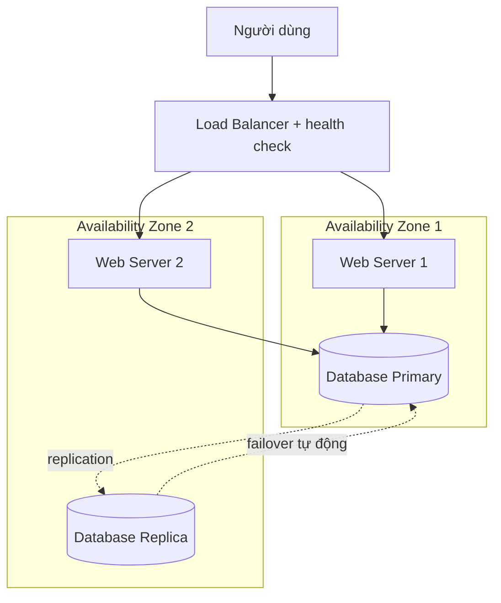

**Câu 3 — HA hay FT?** Hệ thống đạt **HA**, chưa phải FT. Lý do: khi database primary hỏng vẫn có **khoảng thời gian ngắn** để phát hiện sự cố và promote replica (failover active-passive) → có downtime vài giây đến dưới một phút. Muốn đạt **FT** cần **active-active trên cả hai tầng** (ứng dụng và dữ liệu), luôn đồng bộ để không có khoảnh khắc gián đoạn nào — đổi lại chi phí và độ phức tạp rất cao.
</details>

### Bài tập 2 — Thiết kế retry với exponential backoff

**Đề:** Service A gọi Service B để lấy dữ liệu người dùng. Service B thỉnh thoảng bị quá tải và trả về lỗi 503.

1. Thiết kế chiến lược retry phù hợp: bao nhiêu lần, khoảng chờ như thế nào?
2. Khi nào nên dừng retry và kích hoạt circuit breaker?
3. Nếu Service B bị lỗi hoàn toàn trong 10 phút, hệ thống nên graceful degrade như thế nào?

*Gợi ý: phân biệt lỗi tạm thời (503) và lỗi vĩnh viễn (404) khi thiết kế retry.*

<details><summary>Lời giải</summary>

**Câu 1 — Chiến lược retry:**

- **Retry tối đa 3 lần** với exponential backoff **2s → 4s → 8s**, thêm **jitter ±0,5s** để các instance của A không retry đồng loạt.
- Chỉ retry **lỗi tạm thời**: 503 (Service Unavailable), timeout, lỗi kết nối.
- **Không retry lỗi 404** (Not Found): đây là lỗi logic — dữ liệu không tồn tại — retry bao nhiêu lần cũng ra kết quả như cũ, chỉ tốn tài nguyên.
- Đặt giới hạn tổng thời gian chờ (vd tối đa ~60s, như ở phần *Exponential Backoff — quy trình retry*) để người dùng không chờ quá lâu.

```text
Lần 1 gọi  → 503 → chờ 2s ± 0,5s
Lần 2 gọi  → 503 → chờ 4s ± 0,5s
Lần 3 gọi  → 503 → chờ 8s ± 0,5s
Lần 4 gọi  → 503 → dừng, báo lỗi / chuyển luồng dự phòng
Tổng thời gian chờ tối đa ≈ 2 + 4 + 8 = 14s (± jitter)
```

**Câu 2 — Khi nào dừng retry, bật circuit breaker:** khi lỗi không còn là thoáng qua — cụ thể **tỉ lệ lỗi vượt 50% trong cửa sổ 10 giây** → breaker chuyển sang **Open**: A trả lỗi ngay (fail fast), không gọi B nữa, tránh dồn thêm tải lên B và tránh thread của A bị treo chờ timeout (cascade failure). Sau một khoảng thời gian (vd 30s) chuyển sang **Half-Open** cho vài request thăm dò; thành công → **Closed**, thất bại → lại **Open**.

**Câu 3 — Graceful degradation khi B lỗi hoàn toàn 10 phút:**

- Trả về **dữ liệu người dùng từ cache** (có thể hơi cũ) thay vì lỗi.
- Nếu không có cache: hiển thị thông báo **"tính năng tạm thời không khả dụng"** thay vì trả lỗi 500, đồng thời giữ các chức năng khác của A hoạt động bình thường.
- Trong 10 phút đó circuit breaker ở trạng thái Open/Half-Open luân phiên, tự phát hiện khi B phục hồi để trở lại bình thường.
- 📌 Mở rộng: có thể kết hợp Bulkhead — gọi B qua một thread/connection pool riêng để B lỗi không làm cạn tài nguyên của các luồng khác trong A.
</details>

### Bài tập 3 — Tính toán chỉ số độ tin cậy

**Đề:** Hệ thống trong một tháng (30 ngày = 720 giờ) có nhật ký sự cố sau:

| Sự cố | Thời điểm xảy ra | Thời gian kéo dài |
|---|---|---|
| 1 | Giờ thứ 14 | 45 phút |
| 2 | Giờ thứ 72 | 20 phút |
| 3 | Giờ thứ 350 | 2 giờ |

1. Tính MTBF của hệ thống trong tháng này.
2. Tính MTTR của hệ thống trong tháng này.
3. Tính uptime % trong tháng. Hệ thống có đạt SLA 99,9% không?
4. SLO nội bộ là 99,95% — SLO có bị vi phạm không?

<details><summary>Lời giải</summary>

**Bước 0 — Tổng downtime và thời gian hoạt động**

```text
Tổng downtime = 45 + 20 + 120 (2 giờ) = 185 phút
              = 185 / 60 ≈ 3,083 giờ (≈ 3,08 giờ)
Số lần sự cố  = 3
Thời gian hoạt động (uptime) = 720 − 3,083 = 716,917 giờ (≈ 716,92 giờ)
```

**Câu 1 — MTBF**

```text
MTBF = Tổng thời gian hoạt động / Số lần sự cố
     = 716,92 / 3
     ≈ 238,97 giờ   (≈ 9,96 ngày)
```

→ Trung bình khoảng **239 giờ** (gần 10 ngày) hệ thống gặp một sự cố.

**Câu 2 — MTTR**

```text
MTTR = Tổng thời gian downtime / Số lần sự cố
     = 185 phút / 3
     ≈ 61,7 phút   (≈ 1,03 giờ)
```

→ Mỗi lần sập mất trung bình khoảng **1 giờ** để phục hồi (sự cố 3 kéo dài 2 giờ kéo MTTR lên cao).

**Câu 3 — Uptime % và SLA 99,9%**

```text
Uptime % = 716,92 / 720 × 100% ≈ 99,57%

Downtime cho phép theo SLA 99,9%:
  (1 − 0,999) × 720 giờ = 0,001 × 720 = 0,72 giờ = 43,2 phút

So sánh: thực tế 185 phút > 43,2 phút cho phép
```

→ 99,57% < 99,9% ⇒ **SLA bị vi phạm** (downtime thực tế gấp ~4,3 lần mức cho phép).

**Câu 4 — SLO 99,95%**

```text
Downtime cho phép theo SLO 99,95%:
  (1 − 0,9995) × 720 giờ = 0,0005 × 720 = 0,36 giờ = 21,6 phút

So sánh: thực tế 185 phút > 21,6 phút cho phép
```

→ 99,57% < 99,95% ⇒ **SLO cũng bị vi phạm**.

**Tổng kết:** Tổng downtime 185 phút ≈ 3,08 giờ; uptime 716,92 giờ; MTBF ≈ 238,97 giờ; MTTR ≈ 61,7 phút; Uptime ≈ 99,57%; SLA 99,9% bị vi phạm (cho phép 43,2 phút/tháng, thực tế 185 phút); SLO 99,95% cũng bị vi phạm. Kết luận: đây là **tình huống đáng lo ngại, cần điều tra nguyên nhân** (đặc biệt sự cố 3 kéo dài 2 giờ).

📌 Mở rộng — kiểm tra chéo: Availability ≈ MTBF / (MTBF + MTTR) = 238,97 / (238,97 + 1,028) ≈ 238,97 / 240,0 ≈ 99,57% — khớp với kết quả câu 3. (Lưu ý: "giờ thứ 14/72/350" là **thời điểm** xảy ra sự cố; theo công thức ở phần *MTBF*, MTBF chỉ dùng tổng uptime chia số sự cố, không cần dùng các mốc thời điểm này.)
</details>

### Bài tập 4 — Thiết kế hệ thống đặt vé máy bay

**Đề:** Thiết kế hệ thống đặt vé máy bay với yêu cầu: phục vụ **1 triệu người dùng đồng thời**, **không được mất dữ liệu giao dịch**, **downtime tối đa 1 phút mỗi tháng**.

1. Hệ thống cần HA hay FT? Tại sao?
2. Xác định SLA, SLO phù hợp dựa trên yêu cầu đề bài.
3. Chiến lược nào áp dụng cho: tầng ứng dụng, tầng dữ liệu, tầng thanh toán?
4. Bulkhead pattern nên áp dụng ở đâu và tại sao?

<details><summary>Lời giải</summary>

**Đổi yêu cầu downtime ra uptime %:**

```text
1 tháng = 30 ngày × 24 giờ × 60 phút = 43.200 phút
Uptime  = (43.200 − 1) / 43.200 = 43.199 / 43.200 ≈ 0,999977 ≈ 99,998%
```

**Câu 1 — HA hay FT?** 1 phút/tháng ≈ **99,998% uptime → yêu cầu gần FT** (nằm giữa bốn số 9 = 4,32 phút/tháng và năm số 9 ≈ 26 giây/tháng — tức là chặt hơn bốn số 9 rất nhiều). Kết hợp yêu cầu "không mất dữ liệu giao dịch" ⇒ không thể dùng HA thuần với failover vài phút. Giải pháp hợp lý là **kết hợp**:

- **Tầng thanh toán / giao dịch: FT** — database **active-active**, ghi đồng bộ để không mất giao dịch.
- **Tầng ứng dụng: HA** — load balancer + multi-AZ; ứng dụng stateless nên failover gần như tức thì, chi phí hợp lý.

**Câu 2 — SLA, SLO:**

| Chỉ số | Giá trị đề xuất | Giải thích |
|---|---|---|
| SLA (cam kết khách hàng) | ≈ **99,998%** / tháng (≤ 1 phút downtime) | Trực tiếp từ yêu cầu đề bài |
| SLO (mục tiêu nội bộ) | **99,999%** | Chặt hơn SLA → tạo vùng đệm; tương đương ≈ 26 giây/tháng |
| SLI cần đo | Tỉ lệ request đặt vé thành công, độ trễ, tỉ lệ lỗi thanh toán | Dữ liệu thực tế so với SLO |

📌 Mở rộng: có thể thêm SLO về hiệu năng, vd "99,5% request đặt vé hoàn thành < 200ms" (theo dạng ví dụ ở phần *SLO và SLI*), và chỉ số MTTR mục tiêu tính bằng giây (nhờ failover tự động).

**Câu 3 — Chiến lược theo tầng:**

| Tầng | Chiến lược |
|---|---|
| **Ứng dụng** | HA: load balancer + health check, nhiều instance ở ≥ 2 AZ, auto-scaling (chịu 1 triệu người dùng đồng thời và thay node hỏng), retry + exponential backoff giữa các service |
| **Dữ liệu** | Replication + failover tự động; không mất dữ liệu ⇒ dữ liệu giao dịch cần nhân bản đồng bộ; monitoring liên tục |
| **Thanh toán** | FT: database **active-active**; **circuit breaker** bảo vệ tích hợp cổng thanh toán bên ngoài (đối tác lỗi thì fail fast, không kéo sập hệ thống) |

Thêm **graceful degradation**: khi tính năng phụ (gợi ý chuyến bay, chọn ghế…) lỗi thì tắt đi, giữ tìm kiếm – đặt chỗ – thanh toán.

**Câu 4 — Bulkhead:** **tách riêng tầng thanh toán khỏi tầng tìm kiếm và đặt chỗ** (thread pool / connection pool / thậm chí cụm server riêng). Lý do: tìm kiếm chuyến bay có lưu lượng rất lớn và dễ tăng đột biến (mùa cao điểm, săn vé giá rẻ); nếu dùng chung tài nguyên, tìm kiếm quá tải sẽ chiếm hết thread và làm thanh toán — phần quan trọng nhất — ngừng hoạt động. Với Bulkhead, lỗi ở một tầng **không kéo sập tầng khác**.
</details>
