# Bài 7B — Hàng đợi thông điệp (Message Queues): Producer-Consumer, Pub/Sub, Backpressure, Kafka & RabbitMQ

## 🎯 Mục tiêu

Sau bài này, bạn cần:

- Hiểu **message queue** là gì và vì sao nó giúp hệ thống phân tán **tách rời (decoupling)** và **đàn hồi (resilience)**.
- Phân biệt hai mô hình **Producer-Consumer** (phân phối tác vụ, mỗi thông điệp xử lý một lần) và **Publish-Subscribe** (phát sóng sự kiện, mỗi subscriber nhận một bản sao), và biết kết hợp chúng trong một hệ thống thực tế.
- Hiểu **backpressure**, các chiến lược xử lý (blocking, dropping, sampling, buffering có giới hạn, scale consumer) và hậu quả **cascade failure** khi bỏ qua nó.
- Nắm các khái niệm cốt lõi của **Apache Kafka** (topic, partition, offset, consumer group) và **RabbitMQ** (exchange, queue, binding), và biết khi nào chọn cái nào.

## 📑 Mục lục

1. Mô hình Producer-Consumer & Publish-Subscribe
2. Backpressure — xử lý khi hệ thống bị quá tải
3. Các hệ thống thực tế: Kafka & RabbitMQ
4. Tổng kết
5. 🧠 Tóm tắt nhanh · ❓ Câu hỏi tự kiểm tra · 📝 Bài tập luyện thêm

---

## Phần 1 — Mô hình Producer-Consumer & Publish-Subscribe

### Message queue là gì?

> **Message queue** là một bộ đệm trung gian lưu trữ thông điệp giữa các thành phần hệ thống, cho phép giao tiếp ***bất đồng bộ*** và tách rời.

- **Producer** gửi thông điệp vào hàng đợi mà không cần chờ phản hồi
- **Consumer** lấy và xử lý thông điệp theo tốc độ của mình
- Đảm bảo *độ bền* (durability): thông điệp không bị mất khi consumer ngừng hoạt động
- Cho phép hệ thống **mở rộng theo chiều ngang** độc lập ở từng tầng

> 💡 **Giải thích:** Message queue là nền tảng của kiến trúc phân tán hiện đại. Thay vì các dịch vụ gọi nhau trực tiếp và chờ nhau (đồng bộ — synchronous), chúng nói chuyện **gián tiếp** qua một lớp trung gian. Có hai lợi ích cốt lõi:
> - **Tách rời (decoupling):** producer không cần biết consumer là ai, có bao nhiêu consumer.
> - **Đàn hồi (resilience):** nếu consumer sập, thông điệp vẫn nằm trong queue, chờ consumer phục hồi rồi xử lý tiếp.

### (Hình) Producer → Queue → Consumer

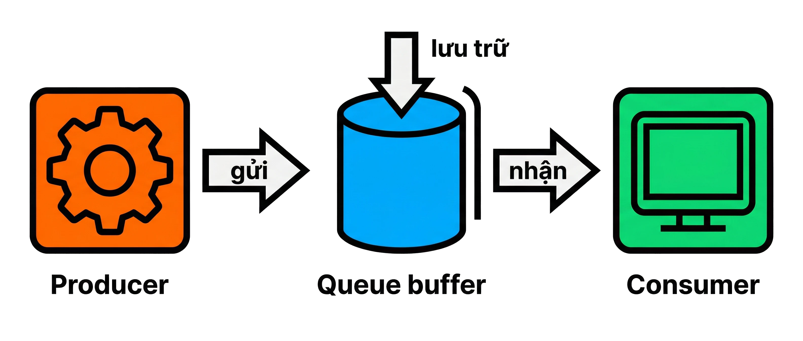

Hình minh họa: Producer (biểu tượng bánh răng) "gửi" thông điệp vào bộ đệm Queue (hình trụ) — nơi "lưu trữ" — rồi Consumer (màn hình) "nhận" thông điệp ra xử lý.

### Mô hình Producer-Consumer

> Một hoặc nhiều **producer** tạo thông điệp; một hoặc nhiều **consumer** tranh giành nhau để lấy và xử lý — mỗi thông điệp chỉ được xử lý ***đúng một lần***.

- Producer và consumer hoạt động **độc lập** về tốc độ và vòng đời
- Queue hoạt động theo cơ chế **FIFO** (First In, First Out)
- Nhiều consumer có thể cùng kéo từ một queue để **tăng throughput**
- Thông điệp bị **xóa khỏi queue** sau khi consumer xác nhận đã xử lý (*acknowledgement*)
- Phù hợp với tác vụ nặng cần phân phối công việc: xử lý ảnh, gửi email, thanh toán

> 💡 **Giải thích:** Mô hình này giải bài toán **phân phối công việc**. Hình dung hệ thống xử lý đơn hàng: frontend là producer đẩy đơn vào queue, các worker service là consumer lấy ra xử lý. Khi lượng đơn tăng đột biến, chỉ cần **thêm consumer**, không phải sửa producer. Cơ chế **acknowledgement (ACK)** đảm bảo không bỏ sót thông điệp: consumer phải xác nhận sau khi xử lý thành công; nếu không có ACK (ví dụ consumer chết giữa chừng), queue sẽ tự giao lại thông điệp đó cho consumer khác.

> 📌 **Mở rộng:** "Đúng một lần" ở đây nên hiểu là *mỗi thông điệp chỉ giao cho một consumer* (không chia bản sao như Pub/Sub). Về mặt kỹ thuật, vì thông điệp có thể được giao lại khi thiếu ACK, đa số broker cho đảm bảo **at-least-once** (ít nhất một lần) — consumer nên được viết **idempotent** (xử lý lặp lại không gây sai, ví dụ kiểm tra mã đơn đã thanh toán chưa) để tránh xử lý trùng. Ngoài ra, khi có nhiều consumer song song thì thứ tự *xử lý xong* không còn đảm bảo FIFO tuyệt đối, dù thứ tự *lấy ra* vẫn là FIFO.

### Sơ đồ: luồng Producer → Queue → Consumer

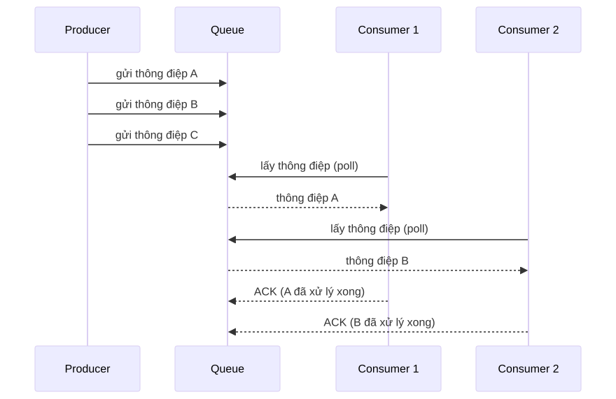

<details><summary>🔧 Mã nguồn sơ đồ (mermaid)</summary>

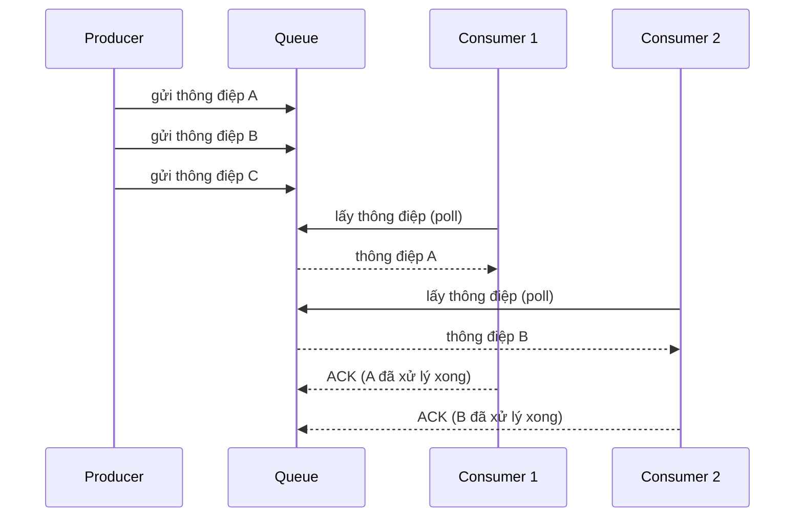

</details>

> 💡 **Giải thích:** Đây là cơ chế **competing consumers** (các consumer cạnh tranh). Producer đẩy ba thông điệp A, B, C vào queue theo thứ tự. Consumer 1 và Consumer 2 cùng poll queue và **mỗi người nhận một thông điệp khác nhau** — không trùng lặp. Xử lý xong, mỗi consumer gửi ACK để queue biết có thể xóa thông điệp đó. Thông điệp C vẫn nằm trong queue, chờ consumer tiếp theo poll.

### Mô hình Publish-Subscribe

> **Publisher** phát thông điệp lên một ***topic/channel***; tất cả **subscriber** đang lắng nghe đều nhận được ***bản sao*** của thông điệp đó.

- Một thông điệp có thể đến **nhiều subscriber** cùng lúc (fan-out)
- Publisher **không biết** subscriber là ai — tách rời hoàn toàn
- Subscriber đăng ký nhận theo *topic* hoặc *pattern* phù hợp với nhu cầu
- Phù hợp với: thông báo sự kiện, cập nhật real-time, đồng bộ dữ liệu đa dịch vụ

> 💡 **Giải thích:** Pub/Sub giải bài toán **phát sóng sự kiện**. Ví dụ: khi người dùng đặt hàng thành công, hệ thống phát sự kiện `order.created` lên một topic. Dịch vụ email, analytics và kho hàng đều subscribe topic này — mỗi dịch vụ nhận một bản sao và xử lý theo nghiệp vụ riêng. Sau này muốn thêm dịch vụ tích điểm (loyalty points)? Chỉ cần cho nó subscribe topic đó, **không phải sửa dòng code nào ở publisher**. (📌 Mở rộng: đây là tinh thần của nguyên lý Open/Closed, áp dụng ở cấp kiến trúc — mở rộng bằng cách thêm subscriber, không sửa code cũ.)

### (Hình) Publisher → Topic → nhiều Subscriber

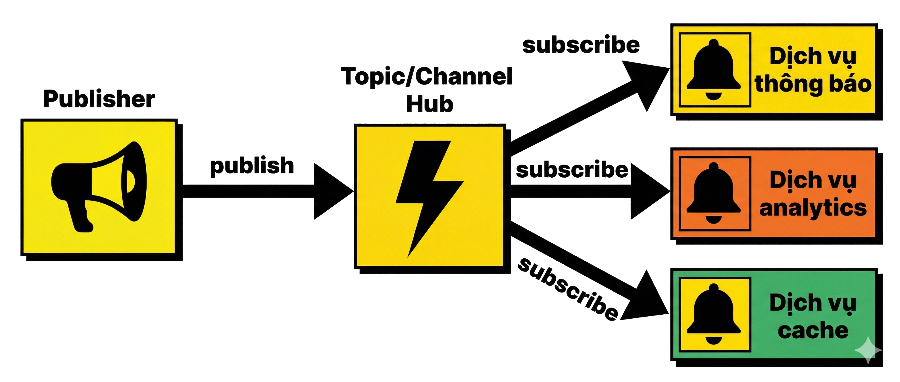

Hình minh họa: Publisher (cái loa) "publish" lên một Topic/Channel trung tâm, từ đó thông điệp fan-out tới ba subscriber đã "subscribe": "Dịch vụ thông báo", "Dịch vụ analytics", "Dịch vụ cache".

### So sánh Producer-Consumer và Publish-Subscribe

> Hai mô hình giải quyết hai bài toán khác nhau — chọn đúng mô hình quyết định thiết kế hệ thống.

| Tiêu chí | Producer-Consumer | Publish-Subscribe |
|---|---|---|
| Số người nhận mỗi thông điệp | Mỗi thông điệp xử lý *đúng một lần* | Mỗi thông điệp đến *tất cả* subscriber |
| Quan hệ giữa các bên nhận | Consumer **cạnh tranh** nhau lấy thông điệp | Subscriber nhận **bản sao độc lập** |
| Mục đích | **Phân phối tác vụ** (task distribution) | **Phát sóng sự kiện** (event broadcasting) |
| Ví dụ | Hàng đợi xử lý đơn hàng, encode video | Thông báo real-time, đồng bộ cache |

> 💡 **Giải thích:** Câu hỏi then chốt là: **thông điệp này dành cho ai?** Chỉ cần *một* người xử lý → Producer-Consumer. *Nhiều* bên cần biết → Pub/Sub. Hệ thống thực tế thường dùng **cả hai**: một sự kiện được phát qua Pub/Sub đến nhiều dịch vụ, và bên trong mỗi dịch vụ lại có queue nội bộ theo kiểu Producer-Consumer để chia tải cho nhiều worker.

### (Hình) 1 → 1 consumer vs 1 → N subscriber

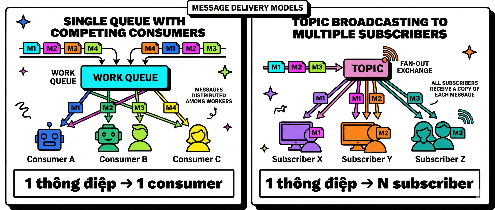

Hình minh họa: hai panel — bên trái là một queue với các consumer cạnh tranh, ghi "1 thông điệp → 1 consumer"; bên phải là một topic phát tới nhiều subscriber, ghi "1 thông điệp → N subscriber".

### Hệ thống đặt hàng e-commerce

> Kết hợp cả hai mô hình giúp hệ thống đặt hàng ***mở rộng tốt*** và ***chịu lỗi tốt***.

- Khách đặt hàng → **API** đẩy sự kiện `order.created` vào message broker
- **Pub/Sub**: dịch vụ email, analytics, kho hàng đều nhận được sự kiện
- **Producer-Consumer**: dịch vụ thanh toán có queue riêng, nhiều worker xử lý song song
- Nếu dịch vụ email sập → thông điệp vẫn chờ trong queue, không mất dữ liệu
- Ngày sale lớn: chỉ cần **scale thêm worker** mà không đụng đến API hay frontend

> 💡 **Giải thích:** Đây là sức mạnh thật sự của message queue trong môi trường production. Thay vì API gọi **đồng bộ** tới 5–6 dịch vụ (mỗi cuộc gọi đều có thể thất bại và làm chậm/hỏng cả request), API chỉ làm **một việc duy nhất**: đẩy sự kiện vào queue. Mỗi dịch vụ sau đó xử lý theo nhịp của riêng mình. Đây là nền tảng của **kiến trúc hướng sự kiện (event-driven architecture)** mà các công ty lớn như Amazon, Shopify hay Tiki áp dụng.

### Sơ đồ: hệ thống đặt hàng e-commerce

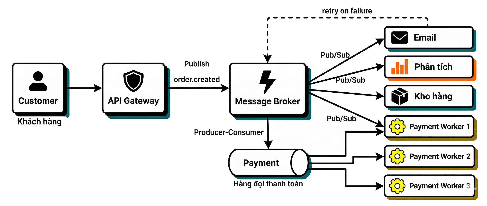

Hình minh họa: "Khách hàng" gửi đơn tới "API Gateway", API Gateway publish sự kiện `order.created` lên "Message Broker"; từ broker có ba nhánh Pub/Sub tới "Email", "Analytics", "Kho hàng", và một nhánh Producer-Consumer xuống "Hàng đợi thanh toán" nối với "Worker 1/2/3"; một đường nét đứt từ Email quay về broker thể hiện "retry on failure".

> 💡 **Giải thích:** Sơ đồ cho thấy hai mô hình chạy **đồng thời**. Phần trên là Pub/Sub — broker phát sự kiện đến ba dịch vụ độc lập. Phần dưới là Producer-Consumer — Payment Queue nhận tác vụ và chia đều cho các worker song song. Mũi tên retry thể hiện tính bền vững: Email Service sập thì thông điệp không mất, chỉ chờ dịch vụ phục hồi.

> 📌 **Mở rộng:** Có thể vẽ lại ý chính của sơ đồ bằng mermaid như sau:
>


<details><summary>🔧 Mã nguồn sơ đồ (mermaid)</summary>

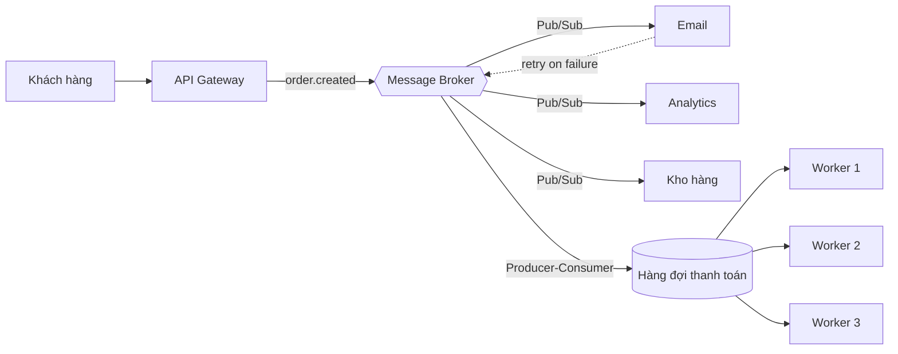

</details>

---

## Phần 2 — Backpressure: xử lý khi hệ thống bị quá tải

### Backpressure là gì?

> **Backpressure** là cơ chế ***phản hồi ngược*** từ consumer về producer khi consumer không thể xử lý thông điệp đủ nhanh, buộc producer phải giảm tốc độ gửi.

- Xảy ra khi **tốc độ producer > tốc độ consumer** kéo dài
- Không có backpressure → queue phình to → **hết bộ nhớ** hoặc **latency tăng vọt**
- Backpressure là tín hiệu: "***Tôi đang quá tải — hãy chậm lại***"
- Khác với **rate limiting** (giới hạn từ phía trên); backpressure là áp lực từ phía dưới

> 💡 **Giải thích:** Hình dung **vòi nước và bể chứa**: nước chảy vào nhanh hơn chảy ra thì bể sẽ tràn. Backpressure chính là cơ chế **khóa bớt van** khi bể gần đầy. Trong hệ thống phân tán, bỏ qua backpressure thường dẫn đến **cascade failure**: queue đầy tràn, producer vẫn tiếp tục gửi, bộ nhớ cạn kiệt, cả hệ thống sập theo dây chuyền.

> 📌 **Mở rộng:** Phân biệt nhanh — **rate limiting** là giới hạn *cố định, đặt trước* ở phía nhận request (ví dụ "tối đa 100 request/giây mỗi user"), không quan tâm hệ thống phía sau đang rảnh hay bận. **Backpressure** là tín hiệu *động*, phát sinh từ trạng thái thực tế của consumer phía dưới (downstream) và lan ngược lên producer (upstream).

### (Hình) Producer nhanh, Consumer chậm

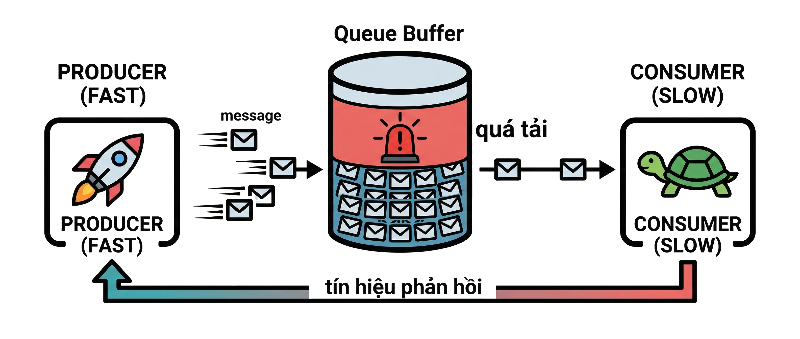

Hình minh họa: Producer nhanh (tên lửa) đổ thông điệp vào một Queue gần tràn có cảnh báo đỏ ("quá tải"); Consumer chậm (con rùa) gửi mũi tên "tín hiệu phản hồi" (backpressure signal) ngược về Producer.

### Các chiến lược xử lý backpressure

> Không có chiến lược nào tốt nhất cho mọi tình huống — lựa chọn phụ thuộc vào ***yêu cầu nghiệp vụ***.

- **Blocking (chặn)**: producer bị dừng lại cho đến khi có chỗ trong queue — đảm bảo không mất dữ liệu
- **Dropping (bỏ)**: loại bỏ thông điệp mới khi queue đầy — chấp nhận mất dữ liệu để bảo vệ hệ thống
- **Sampling (lấy mẫu)**: chỉ giữ lại một phần thông điệp (ví dụ: 1 trong 10) — dùng cho metrics, logs
- **Buffering có giới hạn**: cho phép queue tăng đến ngưỡng tối đa, sau đó áp dụng blocking hoặc dropping
- **Scale consumer**: tự động thêm consumer khi queue vượt ngưỡng (*auto-scaling*)

> 💡 **Giải thích:** Mỗi chiến lược là một **trade-off** khác nhau:
> - **Blocking** hợp với dữ liệu tài chính — không được mất một giao dịch nào.
> - **Dropping** hợp với log hệ thống — mất vài dòng log không ảnh hưởng nghiêm trọng.
> - **Sampling** dùng nhiều trong hệ thống monitoring và tracing.
> - **Auto-scaling** là giải pháp lý tưởng nhất, nhưng cần hạ tầng cloud, và thời gian khởi động (spin-up) instance mới có thể **không kịp** với những đợt tăng đột biến (spike) ngắn.
>
> Trong thực tế thường **kết hợp buffering có giới hạn với auto-scaling**: buffer hấp thụ spike ngắn trong lúc chờ consumer mới khởi động xong.

### Hậu quả khi bỏ qua backpressure

> Bỏ qua backpressure dẫn đến ***cascade failure*** — sự cố lan rộng không kiểm soát được.

**Chuỗi sự kiện thường gặp:**

- Queue tăng không giới hạn → **OOM** (Out of Memory)
- Latency tăng → *timeout* lan sang các dịch vụ upstream
- Consumer bị quá tải → crash → queue tích lũy thêm
- Hệ thống sập theo ***hiệu ứng domino***

**Dấu hiệu cần theo dõi (metrics):**

- *Queue depth* tăng liên tục
- *Consumer lag* ngày càng lớn
- *Memory usage* của broker tăng bất thường

> 💡 **Ví dụ thực tế:** Một sự cố năm 2021 tại hệ thống thanh toán của một công ty thương mại điện tử lớn, xảy ra đúng giờ cao điểm ngày sale, chính vì không có backpressure: queue tăng từ **vài nghìn lên vài triệu thông điệp trong 10 phút**, broker hết RAM, consumer crash liên tiếp, latency toàn hệ thống leo thang đến mức timeout. **Bài học:** luôn **đặt giới hạn kích thước queue** và **thiết lập alert** khi consumer lag vượt ngưỡng.
>
> 📌 **Mở rộng:** *Queue depth* = số thông điệp đang chờ trong queue. *Consumer lag* = khoảng cách giữa thông điệp mới nhất được ghi vào và thông điệp consumer đã xử lý tới (trong Kafka đo bằng hiệu offset). Cả hai tăng đều đặn là dấu hiệu consumer không theo kịp producer.

### (Hình) Hiệu ứng domino

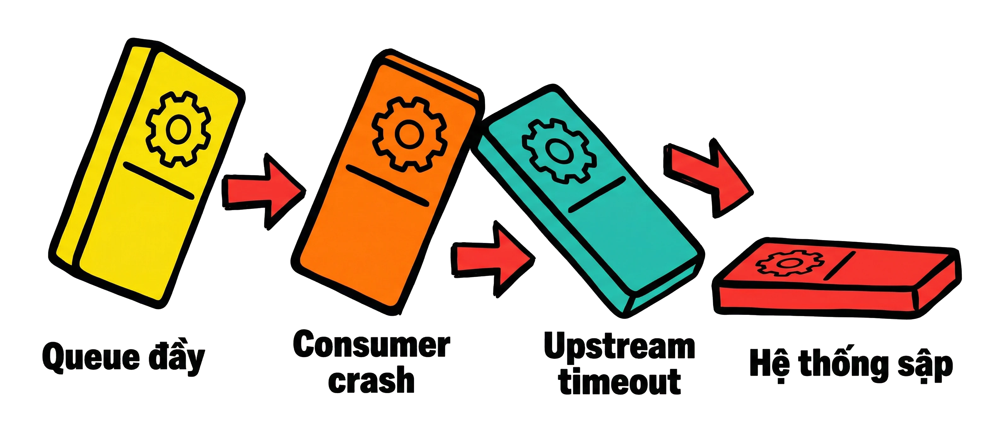

Hình minh họa: bốn node dịch vụ đổ theo chuỗi domino với mũi tên cảnh báo đỏ: "Queue đầy" → "Consumer crash" → "Upstream timeout" → "Hệ thống sập".

```

</details>mermaid
flowchart LR
    A[Queue đầy] --> B[Consumer crash] --> C[Upstream timeout] --> D[Hệ thống sập]
```

---

## Phần 3 — Các hệ thống thực tế: Kafka & RabbitMQ

### Apache Kafka — giới thiệu

> Kafka là ***distributed event streaming platform*** được thiết kế cho ***throughput cực cao*** và lưu trữ sự kiện bền vững theo thời gian.

- Phát triển bởi LinkedIn năm 2011, mã nguồn mở qua Apache Foundation
- Xử lý **hàng triệu thông điệp mỗi giây** với độ trễ thấp
- Thông điệp được lưu trên **đĩa** và giữ trong thời gian cấu hình (mặc định 7 ngày)
- Consumer **không xóa** thông điệp sau khi đọc — có thể đọc lại (*replay*)
- Ứng dụng: event sourcing, data pipeline, real-time analytics, log aggregation

> 💡 **Giải thích:** Kafka ra đời để giải một bài toán cụ thể của LinkedIn: theo dõi hành vi người dùng ở quy mô **hàng tỉ sự kiện mỗi ngày**. Khác biệt căn bản so với message queue truyền thống: **Kafka không phải queue — nó là một log phân tán bất biến** (append-only, chỉ ghi nối thêm). Vì thông điệp không bị xóa khi đọc nên:
> - nhiều **consumer group** có thể đọc cùng một luồng dữ liệu một cách độc lập;
> - có thể **replay** lịch sử sự kiện khi cần debug hoặc backfill (bổ sung/tính lại) dữ liệu.

### (Hình) Kiến trúc Kafka cluster

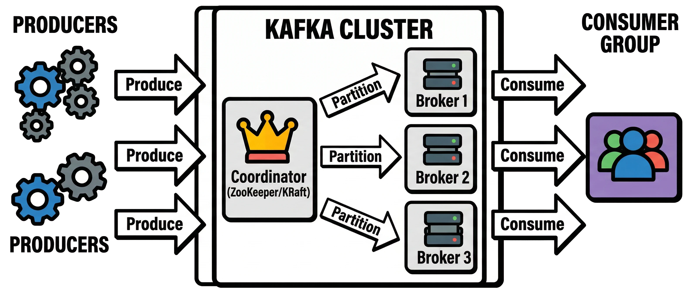

Hình minh họa: một Kafka cluster gồm ba broker, một bộ điều phối ZooKeeper/KRaft, các Producer bên trái và một Consumer Group bên phải; dữ liệu đi theo các mũi tên "produce" → "partition" → "consume".

> 📌 **Mở rộng:** ZooKeeper là thành phần điều phối (quản lý metadata, bầu leader) mà Kafka dùng từ đầu; các phiên bản Kafka mới thay nó bằng cơ chế **KRaft** tích hợp sẵn trong chính các broker (Kafka 4.0 đã bỏ hẳn ZooKeeper).

### Kafka: Topic, Partition và Consumer Group

> **Topic** là kênh dữ liệu; **Partition** là đơn vị song song hóa; **Consumer Group** là cơ chế phân phối tải giữa các consumer.

- **Topic**: luồng dữ liệu có tên, ví dụ `order.created`, `user.login`
- **Partition**: topic được chia thành nhiều partition để xử lý song song — mỗi partition là một log tuần tự
- **Offset**: vị trí của thông điệp trong partition; consumer tự quản lý offset của mình
- **Consumer Group**: nhiều consumer cùng group chia nhau các partition — *scale ngang tự nhiên*
- Số consumer tối đa hiệu quả = số partition của topic

> 💡 **Giải thích:** Partition là chìa khóa giúp Kafka đạt throughput cao. Ví dụ topic `order.created` có **6 partition**:
>
> | Số consumer trong group | Phân chia | Ghi chú |
> |---|---|---|
> | 6 | Mỗi consumer đọc đúng 1 partition | Song song tối đa |
> | 7 | 6 consumer có partition, consumer thứ 7 **nhàn rỗi** | Hết partition để nhận |
> | 2 | Mỗi consumer đọc 3 partition | Vẫn chạy, ít song song hơn |
>
> **Offset** cho phép consumer **tiếp tục (resume) đúng chỗ đã dừng** sau khi restart — đây là nền tảng của tính bền vững (durability) trong Kafka.

> 📌 **Mở rộng:** Kafka chỉ đảm bảo thứ tự **bên trong một partition**, không đảm bảo thứ tự giữa các partition. Vì vậy các thông điệp cần giữ thứ tự (ví dụ mọi sự kiện của cùng một đơn hàng) thường được gửi kèm cùng một **key** (như `orderId`) để rơi vào cùng partition. Hai consumer group khác nhau đọc cùng topic thì **mỗi group nhận đủ toàn bộ** thông điệp — đó là cách Kafka làm Pub/Sub; còn bên trong một group thì các consumer chia nhau partition — đó là Producer-Consumer.

### RabbitMQ — giới thiệu

> RabbitMQ là ***message broker*** truyền thống, linh hoạt về **routing**, tối ưu cho các luồng thông điệp ***phức tạp*** và ***đòi hỏi độ tin cậy cao***.

- Phát triển bởi Pivotal (nay là VMware), dựa trên giao thức **AMQP**
- Hỗ trợ nhiều kiểu routing: *direct*, *fanout*, *topic*, *headers*
- Thông điệp **bị xóa** sau khi consumer ACK — không có cơ chế replay mặc định
- Hỗ trợ **priority queue**, **dead letter queue**, **message TTL** linh hoạt
- Phù hợp với: task queue, RPC qua message, workflow phức tạp nhiều bước

> 💡 **Giải thích:** RabbitMQ xuất thân từ thế giới **enterprise messaging**, thiết kế cho độ tin cậy theo kiểu truyền thống: giao thức AMQP đảm bảo thông điệp đến đúng nơi, đúng thứ tự, không bị mất. Điểm mạnh nhất là **routing linh hoạt** — thành phần **Exchange** điều hướng thông điệp theo nhiều tiêu chí trước khi vào queue. Đây là lợi thế lớn khi có nhiều consumer cần nhận những phần thông điệp khác nhau từ cùng một nguồn.

> 📌 **Mở rộng:**
> - **Dead letter queue (DLQ):** queue chứa các thông điệp "chết" — bị consumer từ chối, hết hạn TTL, hoặc vượt quá số lần thử — để xem xét/xử lý lại sau thay vì làm tắc queue chính.
> - **Message TTL:** thời gian sống của thông điệp; quá hạn thì bị bỏ hoặc chuyển sang DLQ.
> - **Priority queue:** thông điệp có độ ưu tiên cao được giao trước.
> - Về lịch sử: RabbitMQ ban đầu do Rabbit Technologies phát triển (2007), sau đó lần lượt thuộc SpringSource/VMware và Pivotal; hiện thuộc VMware Tanzu (Broadcom). Các phiên bản mới còn có tính năng *RabbitMQ Streams* cho phép đọc lại, nhưng đây không phải hành vi mặc định của queue thông thường.

### (Hình) Kiến trúc RabbitMQ

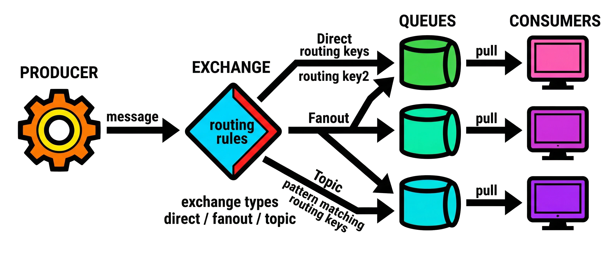

Hình minh họa: Producer → Exchange (hình thoi, ghi "routing rules", các loại "direct / fanout / topic") → nhiều Queue → các Consumer, với mũi tên thể hiện đường routing.

### RabbitMQ: Exchange, Queue và Binding

> **Exchange** nhận thông điệp từ producer và quyết định ***routing*** đến queue nào dựa trên **binding key**.

- **Exchange** là điểm nhận trung tâm — không lưu thông điệp, chỉ điều hướng
- **Binding**: quy tắc liên kết exchange với queue theo *routing key* hoặc *pattern*
- **Direct exchange**: routing key khớp chính xác → đúng một queue
- **Fanout exchange**: phát đến ***tất cả*** queue đang bind — không cần routing key
- **Topic exchange**: routing key theo *pattern* (`*.error`, `payment.#`) — linh hoạt nhất

> 💡 **Giải thích:** Hãy coi Exchange như một **bưu cục thông minh**. Producer gửi thư (thông điệp) đến bưu cục (Exchange) kèm địa chỉ (routing key). Bưu cục tra bảng phân loại (binding) rồi bỏ thư vào đúng hộp thư (queue).
> - **Direct** giống địa chỉ nhà cụ thể.
> - **Fanout** giống thông báo cho toàn khu phố.
> - **Topic** giống mã vùng — linh hoạt nhất vì một pattern có thể khớp nhiều queue.
>
> Nhờ đó, cùng một thông điệp có thể được phân phối theo nhiều chiều logic khác nhau.

> 📌 **Mở rộng:** Trong topic exchange, routing key gồm các từ ngăn bởi dấu chấm; `*` khớp **đúng một** từ, `#` khớp **không hoặc nhiều** từ. Ví dụ `*.error` khớp `payment.error` nhưng không khớp `payment.card.error`; `payment.#` khớp `payment`, `payment.error`, `payment.card.error`. **Headers exchange** (có nhắc ở phần *RabbitMQ — giới thiệu* phía trên) định tuyến theo các trường trong header của thông điệp thay vì routing key. Lưu ý: direct exchange gửi tới **mọi** queue có binding key khớp chính xác — thường là một queue, nhưng nếu nhiều queue bind cùng key thì tất cả đều nhận.

### So sánh Kafka và RabbitMQ

> Kafka và RabbitMQ không phải đối thủ — chúng giải quyết ***hai lớp bài toán khác nhau***.

| Tiêu chí | Apache Kafka | RabbitMQ |
|---|---|---|
| Mô hình | *Distributed log* (log phân tán) | *Message broker* truyền thống |
| Throughput | ***Cực cao*** (triệu msg/giây) | *Cao* (chục nghìn msg/giây) |
| Lưu trữ | ***Bền vững***, có thể replay | Xóa sau khi ACK |
| Consumer | Tự quản lý offset | Broker quản lý trạng thái |
| Phù hợp | Data pipeline, event sourcing, analytics | Task queue, RPC, workflow phức tạp |

> 💡 **Giải thích:** Câu hỏi "Kafka hay RabbitMQ?" thường bị đặt sai. **Kafka là nền tảng streaming** — dữ liệu là luồng liên tục cần được phân tích và lưu trữ. **RabbitMQ là broker tác vụ** — thông điệp là công việc cần thực thi xong rồi "quên đi". Nhiều kiến trúc dùng **cả hai**: Kafka làm **event bus trung tâm** để lưu và phân phối sự kiện quy mô lớn, RabbitMQ làm **task queue nội bộ** trong từng microservice.

### Kafka? RabbitMQ?

> Lựa chọn dựa trên **bản chất của dữ liệu** và **yêu cầu về throughput, replay, routing**.

| Chọn Kafka khi | Chọn RabbitMQ khi |
|---|---|
| Cần xử lý **lượng sự kiện rất lớn** (log, clickstream, IoT) | Cần **routing phức tạp** (direct, topic, headers exchange) |
| Cần **replay** lại lịch sử sự kiện hoặc nhiều consumer group đọc cùng data | Cần **priority queue** hoặc **dead letter queue** linh hoạt |
| Xây dựng *data pipeline* hoặc *event sourcing* | Tác vụ cần xác nhận (*acknowledgement*) nghiêm ngặt và không cần replay |

> 💡 **Giải thích:** Nguyên tắc thực tế:
> - Nếu bạn nghĩ về dữ liệu như **"sự kiện đã xảy ra"** và muốn nhiều hệ thống phân tích nó theo nhiều cách → **Kafka**.
> - Nếu bạn nghĩ về dữ liệu như **"công việc cần làm"** và quan tâm việc route chính xác từng thông điệp đến đúng worker → **RabbitMQ**.
>
> Cả hai đều hỗ trợ high availability và clustering, nên quyết định chủ yếu dựa vào **use case**, không phải khả năng vận hành.

---

## Tổng kết

### Tóm tắt

> **Message queue** là nền tảng không thể thiếu của hệ thống phân tán hiện đại — từ decoupling đến scaling đến fault tolerance.

- **Producer-Consumer**: phân phối tác vụ, mỗi thông điệp xử lý *đúng một lần*
- **Publish-Subscribe**: phát sóng sự kiện, mỗi subscriber nhận *bản sao độc lập*
- **Backpressure**: tín hiệu quan trọng — phải có chiến lược xử lý khi queue đầy
- **Kafka**: throughput cao, replay được, phù hợp *data streaming & event sourcing*
- **RabbitMQ**: routing linh hoạt, phù hợp *task queue & workflow phức tạp*

---

## 🧠 Tóm tắt nhanh

**Producer-Consumer vs Pub/Sub**

| | Producer-Consumer | Publish-Subscribe |
|---|---|---|
| Câu hỏi then chốt | Chỉ **một** bên cần xử lý | **Nhiều** bên cần biết |
| Giao thông điệp | 1 thông điệp → 1 consumer (competing consumers) | 1 thông điệp → N subscriber (fan-out, bản sao độc lập) |
| Mục đích | Phân phối tác vụ | Phát sóng sự kiện |
| Scale | Thêm consumer để tăng throughput | Thêm subscriber mà không sửa publisher |
| Ví dụ | Xử lý đơn hàng, encode video, thanh toán | `order.created` → email, analytics, kho; đồng bộ cache |

**Các chiến lược backpressure**

| Chiến lược | Cách làm | Mất dữ liệu? | Hợp với |
|---|---|---|---|
| Blocking | Dừng producer đến khi queue có chỗ | Không | Dữ liệu tài chính, giao dịch |
| Dropping | Bỏ thông điệp mới khi queue đầy | Có | Log hệ thống |
| Sampling | Chỉ giữ một phần (vd. 1/10) | Có (có chủ đích) | Metrics, monitoring, tracing |
| Buffering có giới hạn | Cho queue tăng tới ngưỡng, rồi block hoặc drop | Tùy bước sau | Hấp thụ spike ngắn |
| Scale consumer | Auto-scaling khi queue vượt ngưỡng | Không | Tải tăng kéo dài; cần cloud, có độ trễ spin-up |

Thực tế: **buffering có giới hạn + auto-scaling**. Theo dõi *queue depth*, *consumer lag*, *memory usage* của broker; bỏ qua backpressure → OOM → timeout → crash → **cascade failure**.

**Kafka vs RabbitMQ**

| | Kafka | RabbitMQ |
|---|---|---|
| Bản chất | Distributed log bất biến, event streaming | Message broker truyền thống (AMQP) |
| Throughput | Triệu msg/giây | Chục nghìn msg/giây |
| Sau khi đọc | Giữ lại (mặc định 7 ngày), replay được | Xóa sau ACK |
| Trạng thái đọc | Consumer tự quản lý offset | Broker quản lý |
| Khái niệm chính | Topic, Partition, Offset, Consumer Group | Exchange (direct/fanout/topic/headers), Queue, Binding |
| Điểm mạnh | Quy mô lớn, nhiều group đọc độc lập, replay | Routing linh hoạt, priority queue, DLQ, TTL |
| Dữ liệu là | "Sự kiện đã xảy ra" | "Công việc cần làm" |

---

## ❓ Câu hỏi tự kiểm tra

**1.** Nêu hai lợi ích cốt lõi của việc dùng message queue thay vì gọi đồng bộ giữa các dịch vụ.

<details><summary>Đáp án</summary>

**Decoupling** — producer không cần biết consumer là ai; và **resilience** — consumer sập thì thông điệp vẫn nằm trong queue chờ xử lý khi consumer phục hồi. Ngoài ra còn cho phép scale ngang độc lập từng tầng.
</details>

**2.** Trong mô hình Producer-Consumer, điều gì xảy ra nếu một consumer lấy thông điệp nhưng crash trước khi gửi ACK?

<details><summary>Đáp án</summary>

Queue không nhận được ACK nên **không xóa** thông điệp, và sẽ giao lại thông điệp đó cho consumer khác. Nhờ vậy không thông điệp nào bị bỏ sót (nhưng có thể bị xử lý lặp → consumer nên idempotent — 📌 Mở rộng).
</details>

**3.** Câu hỏi then chốt để chọn giữa Producer-Consumer và Pub/Sub là gì? Cho ví dụ mỗi loại.

<details><summary>Đáp án</summary>

"**Thông điệp này dành cho ai?**" Chỉ cần một bên xử lý → Producer-Consumer (vd. encode video, xử lý thanh toán). Nhiều bên cần biết → Pub/Sub (vd. sự kiện `order.created` gửi tới email, analytics, kho hàng; đồng bộ cache).
</details>

**4.** Trong ví dụ hệ thống đặt hàng e-commerce, phần nào dùng Pub/Sub, phần nào dùng Producer-Consumer? Vì sao thiết kế này chịu tải tốt ngày sale lớn?

<details><summary>Đáp án</summary>

Pub/Sub: broker phát `order.created` tới dịch vụ email, analytics, kho hàng. Producer-Consumer: dịch vụ thanh toán có queue riêng, nhiều worker xử lý song song. Ngày sale chỉ cần **scale thêm worker** mà không đụng tới API hay frontend; API chỉ làm một việc là đẩy sự kiện vào queue thay vì gọi đồng bộ 5–6 dịch vụ.
</details>

**5.** Backpressure là gì và khác rate limiting ở điểm nào?

<details><summary>Đáp án</summary>

Backpressure là cơ chế **phản hồi ngược** từ consumer về producer khi consumer xử lý không kịp, buộc producer giảm tốc ("Tôi đang quá tải — hãy chậm lại"). Rate limiting là giới hạn đặt **từ phía trên**; backpressure là áp lực **từ phía dưới**, phản ánh trạng thái thực tế của consumer.
</details>

**6.** Vì sao auto-scaling consumer không phải lúc nào cũng đủ để xử lý backpressure? Thực tế thường kết hợp với gì?

<details><summary>Đáp án</summary>

Auto-scaling cần hạ tầng cloud và **thời gian spin-up** instance mới có thể không kịp với spike ngắn. Thực tế thường kết hợp với **buffering có giới hạn**: buffer hấp thụ spike trong khi chờ consumer mới khởi động.
</details>

**7.** Nêu chuỗi cascade failure khi bỏ qua backpressure và 3 metrics cần theo dõi.

<details><summary>Đáp án</summary>

Queue tăng không giới hạn → OOM; latency tăng → timeout lan sang upstream; consumer quá tải → crash → queue tích lũy thêm → hệ thống sập theo hiệu ứng domino. Metrics: **queue depth**, **consumer lag**, **memory usage của broker**. Bài học: giới hạn kích thước queue và đặt alert khi consumer lag vượt ngưỡng.
</details>

**8.** Tại sao nói "Kafka không phải queue"? Điều này mang lại khả năng gì?

<details><summary>Đáp án</summary>

Kafka là **log phân tán bất biến**: thông điệp được lưu trên đĩa trong thời gian cấu hình (mặc định 7 ngày) và **không bị xóa khi đọc**. Nhờ đó nhiều consumer group đọc cùng luồng dữ liệu độc lập, và có thể **replay** lịch sử để debug hoặc backfill dữ liệu.
</details>

**9.** Topic `order.created` có 6 partition. Consumer group có 7 consumer thì sao? Có 2 consumer thì sao? Offset dùng để làm gì?

<details><summary>Đáp án</summary>

7 consumer: 6 consumer mỗi người một partition, consumer thứ 7 **nhàn rỗi** (số consumer hiệu quả tối đa = số partition). 2 consumer: mỗi người xử lý 3 partition. Offset là vị trí thông điệp trong partition, consumer tự quản lý để **resume đúng chỗ** sau khi restart.
</details>

**10.** Phân biệt direct, fanout và topic exchange trong RabbitMQ (dùng phép so sánh bưu cục).

<details><summary>Đáp án</summary>

- **Direct**: routing key khớp chính xác → đúng queue (như địa chỉ nhà cụ thể).
- **Fanout**: phát tới tất cả queue đang bind, không cần routing key (như thông báo toàn khu).
- **Topic**: routing key theo pattern như `*.error`, `payment.#` (như mã vùng) — linh hoạt nhất vì một pattern khớp nhiều queue.

Exchange không lưu thông điệp, chỉ điều hướng dựa trên binding.
</details>

**11.** Nêu nguyên tắc thực tế để chọn Kafka hay RabbitMQ.

<details><summary>Đáp án</summary>

Dữ liệu là **"sự kiện đã xảy ra"**, khối lượng rất lớn, cần replay hoặc nhiều hệ thống phân tích theo nhiều cách → **Kafka**. Dữ liệu là **"công việc cần làm"**, cần routing chính xác tới đúng worker, priority queue/DLQ, ACK nghiêm ngặt, không cần replay → **RabbitMQ**. Quyết định dựa vào use case, vì cả hai đều hỗ trợ HA và clustering; nhiều hệ thống dùng cả hai.
</details>

---

## 📝 Bài tập luyện thêm

> 📌 **Mở rộng** — Các tình huống dưới đây giúp luyện kỹ năng chọn công cụ và chiến lược backpressure.

**Tình huống 1 — Clickstream cho hệ thống gợi ý.** Một sàn thương mại điện tử ghi lại mọi click, lượt xem, thêm-vào-giỏ của người dùng (khoảng 500.000 sự kiện/giây giờ cao điểm). Dữ liệu được đội Data dùng cho real-time analytics, đội ML dùng để huấn luyện mô hình gợi ý, và khi mô hình mới ra đời thì cần chạy lại trên dữ liệu 5 ngày trước. Chọn Kafka hay RabbitMQ? Nếu consumer analytics không theo kịp, nên dùng chiến lược backpressure nào?

<details><summary>Lời giải</summary>

- **Kafka.** Lượng sự kiện rất lớn (clickstream), nhiều hệ thống độc lập đọc cùng dữ liệu → mỗi đội một **consumer group**; cần **replay** dữ liệu cũ → Kafka giữ thông điệp trên đĩa (mặc định 7 ngày, đủ cho 5 ngày). Đây là dữ liệu kiểu "sự kiện đã xảy ra".
- **Backpressure:** vì Kafka giữ dữ liệu trên đĩa nên consumer chậm chỉ làm **consumer lag** tăng, không làm tràn RAM broker. Có thể **scale consumer** (tăng số consumer trong group, tối đa bằng số partition — nên tạo đủ partition từ đầu). Với dashboard real-time chỉ cần xu hướng, có thể dùng **sampling**. Cần alert khi consumer lag vượt ngưỡng, và chú ý lag không được vượt thời gian retention, nếu không dữ liệu chưa đọc sẽ bị xóa.
</details>

**Tình huống 2 — Xử lý thanh toán và hoàn tiền.** Hệ thống nhận lệnh thanh toán; lệnh của khách VIP phải được xử lý trước; lệnh thất bại sau 3 lần thử phải được tách riêng để nhân viên kiểm tra; lệnh thanh toán thẻ đi tới worker thẻ, lệnh ví điện tử đi tới worker ví. Không được mất bất kỳ lệnh nào. Chọn Kafka hay RabbitMQ? Chiến lược backpressure?

<details><summary>Lời giải</summary>

- **RabbitMQ.** Đây là "công việc cần làm", cần **priority queue** (VIP), **dead letter queue** (lệnh thất bại sau 3 lần), **routing** theo loại thanh toán — dùng direct exchange (`payment.card`, `payment.wallet`) hoặc topic exchange (`payment.#` cho dịch vụ audit muốn nhận tất cả), và **ACK nghiêm ngặt**; không cần replay.
- **Backpressure:** dữ liệu tài chính không được mất → **không dùng dropping/sampling**. Dùng **buffering có giới hạn** (đặt max length cho queue) + khi chạm ngưỡng thì **blocking** producer (RabbitMQ có cơ chế publisher confirms / flow control), kết hợp **auto-scaling** worker khi queue depth vượt ngưỡng.
</details>

**Tình huống 3 — Thu thập log và metrics từ 2.000 server.** Mỗi server gửi log ứng dụng và CPU/RAM metrics mỗi giây về hệ thống tập trung. Trong một sự cố, lượng log tăng gấp 20 lần trong 3 phút và hệ thống lưu trữ phía sau không kịp ghi. Ưu tiên số 1 là không để hệ thống giám sát sập theo. Nên làm gì?

<details><summary>Lời giải</summary>

- **Công cụ:** **Kafka** là lựa chọn phổ biến cho **log aggregation** (throughput cực cao, lưu trên đĩa nên đệm được đợt tăng đột biến) — đúng với các ứng dụng của Kafka đã liệt kê ở phần *Apache Kafka — giới thiệu*.
- **Backpressure:** spike chỉ kéo dài 3 phút → auto-scaling có thể **không kịp spin-up**. Dùng **buffering có giới hạn** để hấp thụ spike; khi vượt ngưỡng thì **dropping** cho log mức thấp (debug/info) và **sampling** cho metrics (vd. giữ 1 trong 10 mẫu) — mất một phần log/metrics chấp nhận được, còn để hệ thống giám sát sập (cascade failure) thì không. Không dùng blocking, vì chặn producer ở đây đồng nghĩa với làm chậm chính các server ứng dụng đang gặp sự cố.
- Theo dõi queue depth, consumer lag và memory usage của broker để phát hiện sớm.
</details>
