# Bài 8 — Bảo mật, Phân quyền & Cơ chế Khóa

## 🎯 Mục tiêu

Sau bài này, bạn cần:

- Hiểu vì sao bảo mật phải được **thiết kế từ đầu** và nguyên tắc **defense in depth** (phòng thủ nhiều lớp).
- Phân biệt **Authentication** (xác thực: *bạn là ai*) và **Authorization** (phân quyền: *bạn được làm gì*).
- So sánh **Session-based auth** và **JWT**; biết khi nào dùng cái nào.
- Nắm các mô hình phân quyền **RBAC**, **ABAC** và chuẩn ủy quyền **OAuth2** (cùng luồng Authorization Code).
- Biết cách bảo vệ API: **API Key**, **CORS**, **Input Validation**, chống **SQL Injection / XSS / CSRF**, cấu hình **HTTPS/TLS** và **cookie flag**.
- Hiểu **Rate Limiting**, 4 thuật toán (Fixed Window, Sliding Window, Token Bucket, Leaky Bucket) và cách làm **distributed rate limiting** với Redis.
- Hiểu **Idempotency** (idempotency key), **Pessimistic Locking** và **Optimistic Locking**; biết chọn kỹ thuật phù hợp với nghiệp vụ.

## 📑 Mục lục

1. [Vai trò của bảo mật trong hệ thống phân tán](#1-vai-trò-của-bảo-mật-trong-hệ-thống-phân-tán)
2. [Xác thực (Authentication)](#2-xác-thực-authentication)
3. [Phân quyền (Authorization)](#3-phân-quyền-authorization)
4. [Bảo mật API](#4-bảo-mật-api)
5. [Rate Limiting](#5-rate-limiting)
6. [Bảo vệ dữ liệu](#6-bảo-vệ-dữ-liệu)
7. [Idempotency](#7-idempotency)
8. [Pessimistic Locking](#8-pessimistic-locking)
9. [Optimistic Locking](#9-optimistic-locking)
10. [Khi nào dùng và lựa chọn](#10-khi-nào-dùng-và-lựa-chọn)
11. [Ví dụ minh họa thực tế](#11-ví-dụ-minh-họa-thực-tế)
12. [Best Practices](#12-best-practices)
13. [🧠 Tóm tắt nhanh](#-tóm-tắt-nhanh) · [📝 Tình huống thảo luận](#-tình-huống-thảo-luận) · [❓ Câu hỏi tự kiểm tra](#-câu-hỏi-tự-kiểm-tra)

---

## 1. Vai trò của bảo mật trong hệ thống phân tán

### Tại sao bảo mật là yếu tố sống còn

> Trong hệ thống phân tán hiện đại, bảo mật bảo vệ dữ liệu và tài nguyên quan trọng khỏi truy cập trái phép.

- **Xác thực** đảm bảo chỉ người dùng hoặc dịch vụ hợp lệ được phép truy cập.
- **Phân quyền** kiểm soát chính xác ai có thể làm gì trong hệ thống.
- Thiếu bảo mật ngay từ đầu → hệ thống dễ bị tấn công và lộ dữ liệu nhạy cảm.
- Bảo mật tốt tăng tính **tin cậy**, khả năng **theo dõi** và **tuân thủ quy định**.
- Áp dụng cho mọi kiến trúc: microservices, cloud, monolith.

> 💡 **Giải thích:** Bảo mật **không phải tính năng gắn thêm vào sau**, mà phải được thiết kế ngay từ đầu. Trong hệ thống phân tán, *mỗi service đều là một điểm tấn công tiềm năng*. Xác thực trả lời câu hỏi "bạn là ai?", phân quyền trả lời "bạn được làm gì?". Thiếu một trong hai đều dẫn tới lỗ hổng nghiêm trọng.

### Kiến trúc bảo mật nhiều lớp (hình minh họa)

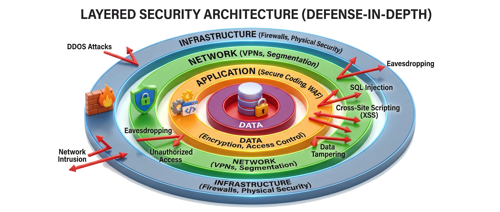

Hình minh họa: bốn vòng đồng tâm — Hạ tầng (firewall), Mạng (VPN), Ứng dụng (bánh răng), Dữ liệu (ổ đĩa có khóa) — với các mũi tên tấn công bị chặn lại ở từng lớp.

> 💡 **Giải thích:** **Defense in depth** (bảo mật nhiều lớp) nghĩa là *không phụ thuộc vào một biện pháp duy nhất*:
> - Lớp **hạ tầng**: firewall, phân vùng mạng.
> - Lớp **ứng dụng**: xác thực, phân quyền, kiểm tra đầu vào.
> - Lớp **dữ liệu**: mã hóa, kiểm soát truy cập.
>
> Nếu một lớp bị vượt qua, các lớp còn lại vẫn tiếp tục bảo vệ hệ thống.

---

## 2. Xác thực (Authentication)

### Đăng nhập và mật khẩu

> Phương pháp xác thực truyền thống nhất — cần được triển khai đúng cách để an toàn.

- Người dùng cung cấp **tên đăng nhập** và **mật khẩu** để xác minh danh tính.
- Mật khẩu ***không bao giờ*** được lưu dạng plaintext trên server.
- Lưu dưới dạng **hash + salt** bằng thuật toán hiện đại (Argon2, bcrypt, PBKDF2).
- Giới hạn số lần đăng nhập sai để chống **brute-force**.
- Kết hợp với **MFA** để tăng cường bảo mật.

> 💡 **Giải thích:** Dù đơn giản, đăng nhập bằng mật khẩu vẫn là nền tảng của hầu hết hệ thống. Điểm mấu chốt: **không lưu mật khẩu gốc**. **Salt** ngẫu nhiên khiến hai người dùng cùng mật khẩu vẫn có hash khác nhau → chặn được **rainbow table attack**. Giới hạn số lần đăng nhập sai kết hợp **lockout tạm thời** là biện pháp cơ bản chống brute-force. (Chi tiết về hash + salt ở phần [*Lưu mật khẩu an toàn — Hash + Salt*](#lưu-mật-khẩu-an-toàn--hash--salt) phía dưới.)

### Xác thực đa yếu tố (MFA / 2FA)

> MFA yêu cầu ít nhất hai yếu tố độc lập, tăng đáng kể khả năng bảo vệ tài khoản.

- Kết hợp **mật khẩu** (*something you know*) + **mã OTP** (*something you have*).
- OTP có thể qua *SMS*, *email*, hoặc ứng dụng xác thực (Google Authenticator, Authy).
- **Ví dụ**: dịch vụ ngân hàng yêu cầu OTP cho mỗi giao dịch quan trọng.
- Nên bắt buộc với tài khoản **admin** và người dùng có quyền cao.
- Hardware token (*YubiKey*) là lựa chọn mạnh hơn cho môi trường nhạy cảm.

> 💡 **Giải thích:** MFA là một trong những biện pháp bảo mật **hiệu quả nhất**: dù kẻ tấn công có mật khẩu, họ vẫn cần thêm yếu tố thứ hai. OTP qua **ứng dụng xác thực an toàn hơn SMS**, vì SMS có thể bị tấn công **SIM-swapping** (kẻ gian chiếm số điện thoại của bạn). Bắt buộc MFA cho tài khoản đặc quyền là thực hành tốt nhất trong bảo mật doanh nghiệp.

### Session-based authentication

> Session lưu trạng thái phiên làm việc trên server — stateful nhưng dễ kiểm soát và thu hồi.

- Sau đăng nhập, server tạo **session ID** duy nhất và lưu trạng thái trên server.
- Client nhận và gửi kèm session ID (thường trong **cookie**) ở mỗi request.
- Server tra cứu session để xác định người dùng hiện tại.
- Dễ **revoke** (hủy) ngay lập tức khi logout hoặc phát hiện bất thường.
- Nhược điểm: *stateful* — khó scale ngang khi nhiều server phải chia sẻ session store.

> 💡 **Giải thích:** Đây là cách tiếp cận truyền thống, vẫn phù hợp với nhiều ứng dụng web. **Điểm mạnh**: thu hồi tức thì — admin có thể "kick" user ra bất kỳ lúc nào chỉ bằng cách xóa session. **Điểm yếu**: khi scale ra nhiều server cần một **shared session store** (Redis, DB). Đây là đánh đổi giữa *khả năng quản lý phiên linh hoạt* và *khả năng mở rộng*.

### JWT (JSON Web Token)

> JWT là self-contained token, không cần server lưu trạng thái — phù hợp cho microservices và hệ thống phân tán.

- Gồm ba phần: **header** (thuật toán), **payload** (claims), **signature** (chữ ký).
- Server ký token bằng secret key; client gửi kèm trong **HTTP Authorization header**.
- *Stateless*: server không cần lưu session, dễ *scale out*.
- Payload ***có thể đọc được*** (chỉ ký, không mã hóa) — không lưu dữ liệu nhạy cảm.
- Khó thu hồi giữa chừng → short TTL + refresh token.

> 💡 **Giải thích:** JWT giải quyết bài toán scale của session-based auth bằng cách **chuyển trạng thái sang phía client**. Mỗi service trong microservices chỉ cần **verify chữ ký** mà không phải gọi về một trung tâm. Điểm yếu quan trọng là **không thu hồi ngay được** → giải pháp: access token ngắn hạn (ví dụ **15 phút**) kết hợp **refresh token**. Không bao giờ để mật khẩu hay số thẻ trong payload JWT (vì ai cũng decode được).

> 📌 **Mở rộng:** Một JWT có dạng `xxxxx.yyyyy.zzzzz` (base64url của header, payload, signature), được gửi trong header `Authorization: Bearer <token>`. Payload chỉ được *base64url-encode*, không phải mã hóa — dán token vào jwt.io là đọc được ngay.

### So sánh Session và JWT

> Chọn Session hay JWT tùy thuộc vào yêu cầu về khả năng thu hồi và quy mô hệ thống.

| Tiêu chí | **Session** | **JWT** |
|---|---|---|
| Trạng thái | Stateful — lưu trên server | Stateless — lưu ở client |
| Thu hồi (revoke) | Dễ revoke tức thì | Khó revoke giữa chừng |
| Khả năng scale | Khó scale khi nhiều server | Scale dễ dàng (microservices) |
| Phù hợp | Ứng dụng web truyền thống | API, hệ thống phân tán |

> 💡 **Giải thích:** Đây là đánh đổi kinh điển khi thiết kế hệ thống xác thực. **Session** hợp khi cần kiểm soát phiên chặt chẽ, ví dụ ứng dụng ngân hàng cần *đăng xuất từ xa*. **JWT** hợp khi cần scale ngang hoặc nhiều service phải xác thực độc lập. Nhiều hệ thống **kết hợp cả hai**: JWT cho API, session cho giao diện web.

---

## 3. Phân quyền (Authorization)

### RBAC — Phân quyền theo role

> RBAC gán quyền thông qua role, đơn giản hóa quản lý nhưng kém linh hoạt với yêu cầu phức tạp.

- Mỗi người dùng được gán một hoặc nhiều **vai trò** (role): `admin`, `editor`, `viewer`...
- Mỗi vai trò có tập **quyền** (permissions) riêng xác định hành động được phép.
- **Ví dụ**: vai trò *Editor* được chỉnh sửa bài viết; *Viewer* chỉ được xem.
- Đơn giản, rõ ràng, dễ kiểm tra và audit.
- Rủi ro **"role explosion"** khi hệ thống có quá nhiều vai trò chi tiết.

> 💡 **Giải thích:** RBAC (Role-Based Access Control) là mô hình phân quyền **phổ biến nhất**, phù hợp đa số ứng dụng doanh nghiệp (CMS, ERP, SaaS). Thiết kế tốt = **ít vai trò nhưng đủ bao quát**. Khi số vai trò tăng theo cấp số nhân vì phải tổ hợp nhiều điều kiện (ví dụ "editor-phòng-A-giờ-hành-chính"...) — đó là **role explosion**, dấu hiệu nên chuyển sang **ABAC**.

### RBAC — Ví dụ cài đặt (Node.js / Express)

> Middleware kiểm tra role từ JWT và so sánh với danh sách role được phép.

```typescript
// Định nghĩa quyền theo role
const ROLE_PERMISSIONS: Record<string, string[]> = {
  admin:  ['read', 'write', 'delete', 'manage_users'],
  editor: ['read', 'write'],
  viewer: ['read'],
};

// Middleware kiểm tra role
function requireRole(...allowedRoles: string[]) {
  return (req: Request, res: Response, next: NextFunction) => {
    const userRole = req.user?.role;           // lấy từ JWT đã verify
    if (!userRole || !allowedRoles.includes(userRole)) {
      return res.status(403).json({ error: 'Forbidden' });
    }
    next();
  };
}

// Áp dụng trên route
router.delete('/posts/:id', requireRole('admin', 'editor'), deletePost);
router.get('/posts',        requireRole('admin', 'editor', 'viewer'), getPosts);
```

Code này định nghĩa bảng quyền theo role, rồi tạo middleware `requireRole(...)` đọc `role` của user (đã được giải mã từ JWT) và trả **403 Forbidden** nếu role không nằm trong danh sách được phép. Mỗi route khai báo role nào được gọi nó.

> 💡 **Giải thích:** Đây là cách cài RBAC đơn giản nhất. Gom định nghĩa quyền vào một chỗ (`ROLE_PERMISSIONS`) giúp đổi quyền mà không phải sửa từng route. **Lưu ý**: luôn **verify JWT trước** middleware này (nếu không, `req.user` có thể bị giả mạo). Với hệ thống phức tạp hơn, role và permission nên lưu trong **database** để quản lý động.

### ABAC — Phân quyền theo thuộc tính

> ABAC cho phép kiểm soát truy cập dựa trên nhiều điều kiện kết hợp, linh hoạt hơn RBAC nhưng phức tạp hơn.

- Quyết định dựa trên **thuộc tính** của người dùng, tài nguyên và môi trường.
- **Ví dụ**: cho phép truy cập nếu *người dùng thuộc phòng kế toán* AND *file có độ nhạy cảm thấp* AND *trong giờ hành chính*.
- Biểu diễn bằng các quy tắc if-then linh hoạt (policy engine).
- Phù hợp cho hệ thống tài chính, y tế — cần kiểm soát **ngữ cảnh** chi tiết.
- Phức tạp khi thiết lập và kiểm tra — cần tooling quản lý policy tốt.

> 💡 **Giải thích:** ABAC (Attribute-Based Access Control) là bước tiến hóa của RBAC khi yêu cầu phân quyền phức tạp hơn. Thay vì *"user có role X thì được làm Y"*, ABAC cho phép *"user có thuộc tính A, B, C; tài nguyên có thuộc tính D; thời điểm là E → được làm Y"*. Ví dụ: ngân hàng dùng ABAC để **chặn giao dịch ngoài giờ hoặc từ IP lạ**. Công cụ như **OPA (Open Policy Agent)** giúp quản lý policy ABAC.

### ABAC — Ví dụ cài đặt (Node.js / Express)

Hàm policy thuần túy:

```typescript
interface AbacContext {
  user:     { department: string; role: string };
  resource: { sensitivity: 'low' | 'medium' | 'high'; ownerId: string };
  env:      { hour: number; ipTrusted: boolean };
}

function canAccess(ctx: AbacContext, action: string): boolean {
  const { user, resource, env } = ctx;

  // Chặn hoàn toàn ngoài giờ hành chính
  if (env.hour < 8 || env.hour > 18) return false;

  // Admin từ IP tin cậy: quyền đầy đủ
  if (user.role === 'admin' && env.ipTrusted) return true;

  // Phòng kế toán chỉ xem tài liệu độ nhạy thấp
  if (user.department === 'accounting' && action === 'read')
    return resource.sensitivity === 'low';

  return false;
}
```

Middleware gắn policy vào Express:

```typescript
// Middleware
function abacMiddleware(action: string) {
  return (req: Request, res: Response, next: NextFunction) => {
    const allowed = canAccess({
      user:     req.user,
      resource: req.resource,          // gắn từ middleware trước
      env:      { hour: new Date().getHours(), ipTrusted: isTrustedIp(req.ip) },
    }, action);
    if (!allowed) return res.status(403).json({ error: 'Forbidden' });
    next();
  };
}
```

`canAccess` nhận ngữ cảnh gồm 3 nhóm thuộc tính (user, resource, env) và trả `true/false` theo các luật: ngoài 8h–18h thì chặn hết; admin từ IP tin cậy thì cho phép; kế toán chỉ được *đọc* tài liệu độ nhạy `low`; còn lại mặc định **từ chối** (deny by default). `abacMiddleware` dựng ngữ cảnh từ request (giờ hiện tại, IP) rồi gọi `canAccess`.

> 💡 **Giải thích:** Ví dụ tích hợp **ba chiều thuộc tính**: người dùng (department, role), tài nguyên (sensitivity), môi trường (giờ, IP). Hàm `canAccess` là một **policy engine thuần túy** → rất dễ unit-test. Trong thực tế, **OPA** là công cụ chuyên cho ABAC, dùng ngôn ngữ policy **Rego**, giúp **tách policy ra khỏi code ứng dụng**.

### OAuth2 — Chuẩn ủy quyền phổ biến

> OAuth2 cho phép ứng dụng được ủy quyền truy cập tài nguyên thay mặt người dùng mà không cần biết mật khẩu.

- Ứng dụng thứ ba nhận **access token** từ *authorization server* thay vì mật khẩu.
- Token giới hạn phạm vi (**scope**) — chỉ quyền thực sự cần.
- **Ví dụ**: app đọc Google Drive nhận token Google chỉ cho phép đọc file, không được xóa.
- **OpenID Connect** bổ sung trên OAuth2 để xác thực danh tính người dùng (ID token).
- Không thay thế authentication — OAuth2 chỉ là *authorization protocol*.

> 💡 **Giải thích:** OAuth2 giải quyết vấn đề **"password sharing"**: thay vì đưa mật khẩu cho app thứ ba, người dùng **ủy quyền** thông qua authorization server. **Scope** rất quan trọng — luôn xin phạm vi quyền *tối thiểu cần thiết*. **OpenID Connect (OIDC)** thêm khả năng xác thực danh tính (*ai* là người dùng) trên nền OAuth2 (người dùng *cho phép làm gì*). Đây là nền tảng của nút **"Login with Google/Facebook"**.

### Luồng hoạt động OAuth2

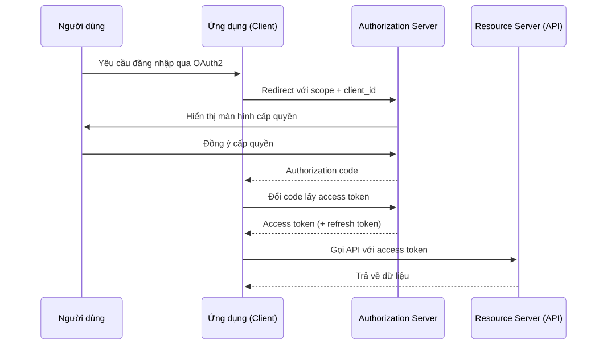

<details><summary>🔧 Mã nguồn sơ đồ (mermaid)</summary>

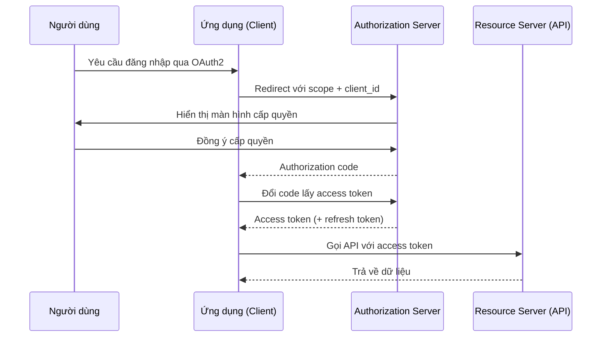

</details>

> 💡 **Giải thích:** **Authorization Code Grant** là luồng phổ biến nhất của OAuth2. Bước then chốt: *authorization code* được **đổi thành token ở phía server** (back-channel), nên token không bị lộ qua trình duyệt. **Authorization server** xác minh và cấp quyền; **resource server** xác minh token khi nhận request. **Refresh token** cho phép lấy access token mới mà không phải đăng nhập lại.

---

## 4. Bảo mật API

### Bảo vệ API Key

> API Key là mật khẩu gọi API — cần được bảo vệ với mức độ tương đương mật khẩu.

- ***Không bao giờ*** nhúng API Key trực tiếp trong mã nguồn phía client (dễ bị lộ).
- Lưu trên server hoặc **biến môi trường** (environment variables), không commit vào git.
- Giới hạn **phạm vi quyền** của mỗi key — chỉ những API thực sự cần.
- **Luân chuyển** (rotate) key định kỳ và xóa key không còn sử dụng.
- **Giám sát bất thường**: số lượng request tăng đột biến có thể là dấu hiệu key bị lộ.

> 💡 **Giải thích:** Lộ API Key là một trong những sự cố bảo mật **phổ biến nhất**, thường do **commit nhầm lên GitHub**. Các công cụ như **AWS Secrets Manager**, **HashiCorp Vault** giúp quản lý secret an toàn. Nguyên tắc **least privilege** áp dụng cho key: key chỉ dùng để đọc dữ liệu thì không nên có quyền xóa. **Rotation** định kỳ đảm bảo key cũ hết giá trị dù có bị lộ.

### CORS — Kiểm soát truy cập đa nguồn gốc

> CORS cho phép server chỉ định origin nào được phép gọi API — cơ chế bảo mật của trình duyệt.

- Theo *same-origin policy*, trình duyệt chặn request đến domain khác theo mặc định.
- Server cần trả về header `Access-Control-Allow-Origin` để cho phép origin cụ thể.
- Ví dụ: `app.example.com` gọi API tại `api.example.com` cần CORS được cấu hình đúng.
- ***Không*** dùng wildcard `*` cho API có xác thực — luôn chỉ định origin rõ ràng.
- **CORS** chỉ bảo vệ trình duyệt — không thay thế xác thực và phân quyền ở server.

> 💡 **Giải thích:** CORS hay gây nhầm lẫn vì nó **hoạt động ở phía trình duyệt**, không phải server. Server vẫn nhận được request từ bất kỳ nguồn nào (ví dụ gọi bằng `curl`) — CORS chỉ ngăn *trình duyệt* đưa phản hồi cho script độc hại ở origin khác. Cấu hình sai (dùng `*` kèm cookie) là lỗ hổng nghiêm trọng. Với request "phức tạp" (method khác GET/POST đơn giản, header tùy chỉnh...), trình duyệt tự gửi **preflight request** (`OPTIONS`) để hỏi server trước.

### Kiểm tra đầu vào (Input Validation)

> Mọi dữ liệu từ client đều phải được kiểm tra và lọc kỹ — không tin tưởng input từ bên ngoài.

- Áp dụng **whitelist**: chỉ chấp nhận định dạng đã biết là hợp lệ.
- Kiểm tra sớm nhất có thể trong luồng xử lý — trước khi data chạm vào logic nghiệp vụ.
- Loại bỏ hoặc escape ký tự nguy hiểm: `<`, `>`, `'`, `"`, `;` trước khi xử lý hoặc hiển thị.
- Phòng chống **SQL Injection**: dùng parameterized queries, không nối chuỗi trực tiếp.
- Phòng chống **XSS**: escape HTML output; dùng Content Security Policy (CSP).

> 💡 **Giải thích:** Input validation là biện pháp phòng thủ cơ bản nhất nhưng hay bị bỏ qua. **OWASP Top 10** liên tục ghi nhận **injection** và **XSS** là các lỗ hổng phổ biến nhất. **Parameterized query là cách đúng duy nhất** để chống SQL Injection — ORM thường tự làm việc này. **CSP header** khiến trình duyệt từ chối chạy script không được phép, giảm tác động của XSS.

> 📌 **Mở rộng — ví dụ SQL Injection:**
> ```javascript
> // ❌ Nối chuỗi: nhập email = "' OR '1'='1" sẽ trả về mọi user
> db.query("SELECT * FROM users WHERE email = '" + email + "'");
>
> // ✅ Parameterized query: giá trị luôn được coi là dữ liệu, không phải code SQL
> db.query("SELECT * FROM users WHERE email = $1", [email]);
> ```

---

## 5. Rate Limiting

### Rate Limit

> Rate limit giới hạn số lượng request một client có thể gửi trong một khoảng thời gian — bảo vệ hệ thống khỏi bị quá tải và tấn công.

- Ngăn chặn **DoS/DDoS**: kẻ tấn công không thể làm tê liệt server bằng request ồ ạt.
- Chống **brute-force**: giới hạn số lần thử mật khẩu hoặc OTP sai.
- Bảo vệ **tài nguyên chi phí cao**: API gọi LLM, xử lý ảnh, thanh toán.
- Đảm bảo **công bằng** giữa các client — không client nào chiếm toàn bộ capacity.
- Áp dụng theo: **IP**, **user ID**, **API token**, hoặc kết hợp nhiều chiều.

> 💡 **Giải thích:** Rate limiting là **tuyến phòng thủ đầu tiên** và không thể thiếu với bất kỳ API công khai nào. Không có nó, một client độc hại (hoặc đơn giản là bị bug vòng lặp) có thể gửi hàng triệu request và làm sập hệ thống. Ngoài bảo mật, rate limiting còn là **công cụ quản lý chi phí** — ví dụ giới hạn số lần gọi API trả phí mỗi ngày theo **tier** người dùng.

### Các thuật toán rate limit (1/2): Fixed Window & Sliding Window

> Mỗi thuật toán có cách đếm và kiểm soát request khác nhau — chọn theo yêu cầu về độ chính xác và đơn giản.

**Fixed Window**
- Đếm request trong cửa sổ cố định (vd: 0–60 giây).
- Đơn giản, nhưng dễ bị **burst tại ranh giới** window.

**Sliding Window**
- Cửa sổ trượt theo thời gian thực.
- Chính xác hơn, tránh burst; tốn bộ nhớ hơn.

> 💡 **Giải thích:**
> - **Fixed window** đơn giản nhất nhưng có điểm yếu: với giới hạn 100 request/phút, client có thể gửi 100 request ở **cuối** window này và 100 request ở **đầu** window kế tiếp → **200 request trong khoảng 2 giây**.
> - **Sliding window** khắc phục bằng cách luôn đếm trong **60 giây ngay trước thời điểm hiện tại**.
> - **Token bucket** phổ biến nhất vì cho phép *burst hợp lý* — giống cách người dùng thật dùng app (lúc rảnh, lúc bấm dồn dập).
> - **Leaky bucket** phù hợp khi cần bảo vệ một **service downstream có tốc độ xử lý cố định**.

### Các thuật toán rate limit (2/2): Token Bucket & Leaky Bucket

**Token Bucket**
- Bucket chứa token, mỗi request tiêu 1 token.
- Token tái nạp đều đặn — cho phép **burst ngắn** hợp lý.

**Leaky Bucket**
- Request xếp hàng và được xử lý với tốc độ cố định.
- Tốc độ đầu ra **hoàn toàn đều đặn** — phù hợp downstream nhạy cảm.

> 📌 **Mở rộng — hình dung nhanh:**
> - *Token bucket*: một xô chứa tối đa N token, cứ mỗi giây được bơm thêm r token. Request đến lấy 1 token; hết token → bị từ chối (429). Nếu xô đang đầy, client có thể "xài dồn" N request cùng lúc (burst).
> - *Leaky bucket*: một xô có lỗ thủng ở đáy. Request đổ vào xô (hàng đợi), nước rỉ ra với tốc độ cố định r request/giây; xô tràn → request bị bỏ. Đầu ra luôn đều dù đầu vào dồn dập.

### Distributed Rate Limiting

> Trong hệ thống phân tán nhiều server, rate limit phải được đồng bộ trên tất cả node — không thể đếm local.

- Mỗi server xử lý request độc lập → cần **kho lưu trữ trung tâm** (Redis) để đồng bộ counter.
- Redis `INCR` + `EXPIRE` cho fixed window; **sorted set** (`ZADD`/`ZRANGEBYSCORE`) cho sliding window.
- Thách thức: **độ trễ** khi gọi Redis (thêm ~1ms round-trip mỗi request).
- Giải pháp tối ưu: **local cache + sync** — đếm local, đồng bộ về Redis định kỳ (eventual).
- Dịch vụ sẵn có: Cloudflare Rate Limiting, AWS WAF, Kong, Nginx `limit_req_zone`.

> 💡 **Giải thích:** Điểm hay bị bỏ qua: **rate limit đếm local chỉ đúng khi có một server**. Khi scale lên 10 server, mỗi server đếm riêng → client có thể gửi 100 request tới *mỗi* server, tức vượt giới hạn tổng **10 lần**. **Redis + Lua script** cho phép tăng counter và kiểm tra trong **một bước atomic**, tránh race condition. **Local + eventual sync** là trade-off thực tế: chấp nhận vượt giới hạn một chút để đổi lấy latency thấp hơn.

> 📌 **Mở rộng — Fixed window với `INCR` + `EXPIRE`** (minh họa ý thứ 2 trong danh sách trên):
> ```javascript
> const windowKey = `rate:${ip}:${Math.floor(Date.now() / 60_000)}`; // mỗi phút 1 key
> const count = await redis.incr(windowKey);          // tăng counter (atomic)
> if (count === 1) await redis.expire(windowKey, 60); // key tự xóa sau 60s
> if (count > 100) return res.status(429).end();
> ```

### Rate Limit — Ví dụ cài đặt (Redis Sliding Window)

> Dùng Redis `Sorted Set` để đếm request trong cửa sổ trượt, atomic và chính xác.

Hàm kiểm tra giới hạn:

```typescript
import { createClient } from 'redis';
const redis = createClient();

async function isRateLimited(
  key: string, limit: number, windowMs: number
): Promise<{ limited: boolean; remaining: number }> {
  const now    = Date.now();
  const from   = now - windowMs;
  const multi  = redis.multi();

  multi.zRemRangeByScore(key, '-inf', from);          // xóa entry cũ
  multi.zAdd(key, { score: now, value: `${now}` });   // thêm request hiện tại
  multi.zCard(key);                                   // đếm tổng
  multi.expire(key, Math.ceil(windowMs / 1000));      // TTL tự dọn

  const [,, count] = await multi.exec() as number[];
  const remaining  = Math.max(0, limit - count);
  return { limited: count > limit, remaining };
}
```

Middleware Express:

```typescript
// Express middleware — 100 req / 60s theo IP
async function rateLimitMiddleware(req: Request, res: Response, next: NextFunction) {
  const key = `rate:${req.ip}:${req.path}`;
  const { limited, remaining } = await isRateLimited(key, 100, 60_000);

  res.set('X-RateLimit-Limit', '100');
  res.set('X-RateLimit-Remaining', String(remaining));
  if (limited) return res.status(429).json({ error: 'Too Many Requests' });
  next();
}
```

`isRateLimited` gom 4 lệnh Redis vào một `multi()`: xóa các request cũ hơn cửa sổ, thêm request hiện tại (score = timestamp), đếm số phần tử còn lại, đặt TTL để key tự dọn. Kết quả thứ 3 (`count`) cho biết có vượt `limit` hay không. Middleware dùng key `rate:{ip}:{path}`, gắn header `X-RateLimit-*` và trả **429** khi vượt 100 request/60 giây.

> 💡 **Giải thích:** Sorted Set của Redis lưu mỗi request như một *member* với *score* là timestamp. `zRemRangeByScore` loại bỏ request nằm ngoài cửa sổ, `zCard` trả về số request hiện có. `multi()` (pipeline/transaction) gộp 4 lệnh vào **một round-trip**, giảm latency. **Lua script** sẽ tốt hơn khi cần atomic tuyệt đối, nhưng pipeline đủ cho hầu hết trường hợp.

> 📌 **Mở rộng:** Trong code mẫu, `value` là `${now}` nên hai request đến cùng một mili-giây sẽ trùng member và chỉ được đếm 1 lần. Thực tế người ta thường thêm hậu tố ngẫu nhiên, ví dụ `` `${now}-${Math.random()}` ``.

### Thiết kế schema và response chuẩn

**Rate limit key phổ biến:**

| Key | Ý nghĩa |
|---|---|
| `rate:{ip}:{endpoint}` | Theo IP và API |
| `rate:{user_id}:{tier}` | Theo user và gói dịch vụ |
| `rate:{api_token}:global` | Theo token toàn cục |

**Response headers chuẩn:**

| Header / Status | Ý nghĩa |
|---|---|
| `X-RateLimit-Limit` | Giới hạn tối đa |
| `X-RateLimit-Remaining` | Số request còn lại |
| `X-RateLimit-Reset` | Thời điểm reset (Unix timestamp) |
| HTTP **429 Too Many Requests** + `Retry-After` | Báo đã vượt giới hạn và bao lâu nữa thì thử lại |

> 💡 **Giải thích:** Thiết kế key linh hoạt rất quan trọng — kết hợp nhiều chiều cho phép áp chính sách khác nhau theo endpoint và user tier. Ví dụ: endpoint `/login` giới hạn **chặt hơn** `/search`; user gói **premium** có giới hạn cao hơn gói **free**. Header chuẩn giúp client SDK **tự chờ trước khi retry** thay vì gọi lại ngay và tiếp tục bị 429 — đây là trải nghiệm tốt cho developer dùng API.

### Kiến trúc distributed rate limit (hình minh họa)

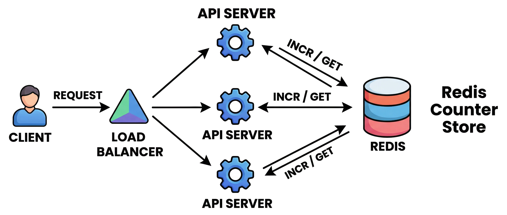

Hình minh họa: client gửi request tới load balancer, load balancer phân phối tới ba API server; cả ba server cùng gọi `INCR / GET` vào một **Redis Counter Store** chung để đồng bộ bộ đếm.

---

## 6. Bảo vệ dữ liệu

### Mã hóa khi truyền và lưu trữ

> Dữ liệu nhạy cảm phải được mã hóa cả khi truyền qua mạng lẫn khi lưu trữ trên đĩa.

- Mọi kết nối phải qua **HTTPS** (HTTP over TLS) — mã hóa kênh giao tiếp, chống nghe lén.
- Bật **HSTS** (HTTP Strict Transport Security) để ép buộc dùng HTTPS.
- Mã hóa **cơ sở dữ liệu** và ổ đĩa cho dữ liệu nhạy cảm (thẻ, CMND, số tài khoản).
- Mã hóa cả **bản sao lưu** (backup) — dữ liệu backup thường bị bỏ qua.
- Dùng thuật toán hiện đại: **AES-256** cho mã hóa đối xứng, **RSA/ECC** cho bất đối xứng.

> 💡 **Giải thích:**
> - Mã hóa **in transit** (khi truyền) chống **Man-in-the-Middle**: kẻ tấn công nghe được traffic nhưng không đọc được nội dung.
> - **HSTS** chặn **downgrade attack** (ép trình duyệt hạ từ HTTPS xuống HTTP).
> - Mã hóa **at rest** (khi lưu) bảo vệ khi database bị đánh cắp — nếu không mã hóa, toàn bộ dữ liệu trong file dump đều lộ.
> - **HSM** (Hardware Security Module) được ngân hàng dùng để bảo vệ khóa mã hóa.

### Lưu mật khẩu an toàn — Hash + Salt

> Mật khẩu không bao giờ được lưu dạng plaintext — chỉ lưu hash với salt ngẫu nhiên.

- **Salt** là chuỗi ngẫu nhiên thêm vào mật khẩu trước khi băm — mỗi user một salt riêng.
- Hai người cùng mật khẩu sẽ có **hash khác nhau** nhờ salt khác nhau.
- Ngăn chặn tấn công **rainbow table** (bảng tra hash pre-computed).
- Dùng thuật toán chậm có chủ đích: **Argon2** (khuyến nghị), **bcrypt**, **PBKDF2**.
- Không dùng *MD5* hay *SHA-1* để hash mật khẩu — quá nhanh, dễ brute-force.

> 💡 **Giải thích:** Hash **chậm có chủ đích** là điều kiện bắt buộc: bcrypt với *cost factor 12* mất khoảng **0,3 giây** cho một lần hash — đủ chậm để brute-force trở nên bất khả thi, nhưng người dùng hợp lệ không cảm nhận được. **Argon2** thắng cuộc thi *Password Hashing Competition* năm 2015 và là lựa chọn tốt nhất hiện tại. Khi database bị lộ, attacker chỉ thấy hash — cần hàng triệu năm để crack nếu dùng đúng thuật toán.

> 📌 **Mở rộng — ví dụ với bcrypt:**
> ```javascript
> import bcrypt from 'bcrypt';
> const hash = await bcrypt.hash(password, 12);       // tự sinh salt, cost = 12; salt nằm luôn trong chuỗi hash
> const ok   = await bcrypt.compare(input, hash);     // so khớp khi đăng nhập
> ```

### Ngăn XSS (Cross-Site Scripting)

> XSS cho phép kẻ tấn công chèn script độc hại chạy với quyền của trang tin cậy, đánh cắp cookie và session.

- Luôn **escape/encode** dữ liệu người dùng khi hiển thị ra HTML, JavaScript, CSS.
- Dùng thư viện template an toàn có tính năng auto-escape mặc định.
- Thiết lập **Content Security Policy** (CSP) để giới hạn nguồn script được phép chạy.
- Đánh dấu cookie với flag **HttpOnly** — JavaScript không thể đọc session cookie.
- Phân biệt **Stored XSS** (lưu trong DB) và **Reflected XSS** (phản chiếu từ URL).

> 💡 **Giải thích:** XSS là lỗ hổng phổ biến nhất trên web. Kịch bản điển hình: kẻ tấn công đăng một comment chứa `<script>`; khi nạn nhân xem comment, script chạy và gửi cookie về server của attacker. **HttpOnly** ngăn JavaScript đọc cookie → XSS không lấy được session token. **CSP** là lớp phòng thủ thứ hai — kể cả khi đã inject được script, CSP vẫn có thể chặn nó chạy nếu không đến từ nguồn tin cậy.

### XSS — Ví dụ cài đặt (Node.js / Express)

> Escape output, thiết lập CSP header và đánh dấu cookie HttpOnly để ngăn XSS.

```typescript
import helmet from 'helmet';
import { escape } from 'html-escaper';
import cookieParser from 'cookie-parser';

// 1. Helmet tự động thêm CSP và các security header
app.use(helmet({
  contentSecurityPolicy: {
    directives: {
      defaultSrc: ["'self'"],
      scriptSrc:  ["'self'"],          // chỉ cho phép script cùng origin
      styleSrc:   ["'self'", "'unsafe-inline'"],
      imgSrc:     ["'self'", 'data:'],
      objectSrc:  ["'none'"],
    },
  },
}));
```

```typescript
// 2. Session cookie với HttpOnly — JavaScript không đọc được
app.use(cookieParser());
res.cookie('session_id', token, {
  httpOnly: true,   // chặn document.cookie
  secure:   true,   // chỉ gửi qua HTTPS
  sameSite: 'strict',
});

// 3. Escape dữ liệu người dùng trước khi render
function renderComment(userInput: string): string {
  return `<p class="comment">${escape(userInput)}</p>`;
  // "<script>alert(1)</script>" → "&lt;script&gt;alert(1)&lt;/script&gt;"
}
```

Phần 1 dùng `helmet` để gắn header **CSP**: mặc định chỉ cho phép tài nguyên cùng origin, cấm `<object>`. Phần 2 đặt session cookie với `httpOnly`, `secure`, `sameSite`. Phần 3 escape input của user trước khi chèn vào HTML, nên `<script>` chỉ hiển thị như văn bản chứ không chạy. (Dòng `res.cookie(...)` ở đây chỉ là đoạn minh họa — thực tế nó nằm trong handler đăng nhập.)

> 💡 **Giải thích:** **Ba lớp bảo vệ XSS**:
> 1. **Escape output** — script không được render thành HTML.
> 2. **CSP header** — trình duyệt không chạy script không được phép, kể cả khi attacker đã inject được.
> 3. **HttpOnly cookie** — dù XSS xảy ra cũng không đánh cắp được session.
>
> Khi buộc phải render HTML do người dùng nhập (rich text editor), dùng thư viện như **DOMPurify** ở frontend để lọc.

### Ngăn CSRF (Cross-Site Request Forgery)

> CSRF ép người dùng đã đăng nhập thực hiện hành động trái ý bằng cách lợi dụng cookie tự động.

- Trình duyệt tự gửi cookie khi request — server không phân biệt được request giả và thật.
- Giải pháp chính: **CSRF token** bí mật gắn trong form, kiểm tra ở phía server.
- Đặt cookie với thuộc tính **SameSite=Strict** hoặc **SameSite=Lax** — ngăn cookie gửi kèm request từ site khác.
- Yêu cầu **xác nhận lại** (mật khẩu hoặc OTP) cho hành động quan trọng: chuyển tiền, đổi email.
- Kiểm tra `Origin` và `Referer` header như lớp bảo vệ bổ sung.

> 💡 **Giải thích:** CSRF khác XSS ở chỗ **không cần inject script** — chỉ cần lừa người dùng (đang đăng nhập) click link hoặc mở một trang độc hại; trang đó gửi request tới site thật và trình duyệt tự đính kèm cookie. **SameSite cookie** là giải pháp hiệu quả nhất hiện nay, được mọi trình duyệt hiện đại hỗ trợ. **CSRF token** cũ hơn nhưng vẫn cần cho trình duyệt cũ. Với hành động **không thể đảo ngược** như chuyển tiền, luôn yêu cầu xác nhận lại dù đã có SameSite.

### CSRF — Ví dụ cài đặt (Node.js / Express)

> Kết hợp SameSite cookie và CSRF token để bảo vệ toàn diện trên mọi trình duyệt.

```typescript
import csrf from 'csurf';
import cookieParser from 'cookie-parser';

app.use(cookieParser());

// 1. SameSite=Strict — trình duyệt hiện đại tự động chặn cross-site request
res.cookie('session_id', sessionToken, {
  sameSite: 'strict',  // không gửi cookie theo request từ site khác
  httpOnly: true,
  secure: true,
});
```

```typescript
// 2. CSRF token — bảo vệ bổ sung cho browser cũ
const csrfProtection = csrf({ cookie: true });

// Gửi token về client (nhúng vào HTML form)
app.get('/transfer', csrfProtection, (req, res) => {
  res.render('transfer', { csrfToken: req.csrfToken() });
});

// Kiểm tra token tự động — sai token → 403 ForbiddenError
app.post('/transfer', csrfProtection, (req, res) => {
  processTransfer(req.body);
  res.json({ success: true });
});

// Xử lý lỗi CSRF
app.use((err: any, req: Request, res: Response, next: NextFunction) => {
  if (err.code === 'EBADCSRFTOKEN')
    return res.status(403).json({ error: 'Invalid CSRF token' });
  next(err);
});
```

Phần 1 đặt session cookie `SameSite=Strict`. Phần 2 dùng middleware `csurf`: khi `GET /transfer` thì sinh token và nhúng vào form; khi `POST /transfer` thì tự kiểm tra token, sai token sẽ ném lỗi `EBADCSRFTOKEN` và error handler trả **403**.

> 💡 **Giải thích:** **Hai lớp phòng thủ CSRF**: SameSite cookie ngăn trình duyệt hiện đại gửi cookie theo request từ origin khác; CSRF token lo cho trình duyệt cũ không hỗ trợ SameSite. Token được nhúng trong form HTML — trang độc hại ở domain khác **không đọc được** token này nhờ *same-origin policy*, nên không giả mạo được request hợp lệ. Với **SPA** (React, Vue), gửi CSRF token qua *meta tag* hoặc một endpoint riêng, rồi đính kèm trong header `X-CSRF-Token`.

> 📌 **Mở rộng:** Package `csurf` đã bị tác giả đánh dấu *deprecated* (2022). Ý tưởng ở ví dụ trên vẫn đúng, nhưng dự án mới nên dùng thư viện thay thế còn được bảo trì (ví dụ `csrf-csrf`) hoặc tự cài pattern *double-submit cookie*.

### HTTPS, TLS và bảo mật cookie

> Cấu hình đúng HTTPS và cookie flag là nền tảng bảo mật cho mọi ứng dụng web.

- **HTTPS/TLS**: dùng certificate hợp lệ, cipher mạnh (AES-GCM, ECC); tắt TLS 1.0/1.1.
- Cookie **Secure**: chỉ gửi qua kết nối HTTPS — ngăn lộ qua HTTP.
- Cookie **HttpOnly**: chặn JavaScript đọc cookie — bảo vệ khỏi XSS.
- Cookie **SameSite**: ngăn gửi cookie theo request từ site khác — bảo vệ khỏi CSRF.
- Dùng prefix `__Host-` hoặc `__Secure-` trong tên cookie để tăng tính an toàn.

> 💡 **Giải thích:** **Secure + HttpOnly + SameSite** là bộ ba **bắt buộc** cho mọi session cookie:
>
> | Thiếu flag | Hậu quả |
> |---|---|
> | Secure | Cookie lộ qua HTTP |
> | HttpOnly | XSS đọc được cookie |
> | SameSite | Dễ bị CSRF |
>
> **TLS 1.3** là phiên bản nên dùng hiện nay, cải thiện cả bảo mật lẫn tốc độ handshake. Công cụ như **SSL Labs** giúp kiểm tra cấu hình TLS.

---

## 7. Idempotency

### Idempotency là gì?

> Thực hiện cùng một yêu cầu nhiều lần cho kết quả như chỉ thực hiện một lần.

- **Idempotency** đảm bảo không có tác động phụ khi retry.
- Quan trọng trong **hệ thống phân tán** nơi lỗi mạng thường xảy ra.
- Ví dụ: trừ 100k từ tài khoản ngân hàng — dù gửi 3 lần, chỉ trừ **một lần duy nhất**.
- Tránh double-charge, tạo đơn hàng lặp lại, hoặc cập nhật trùng.

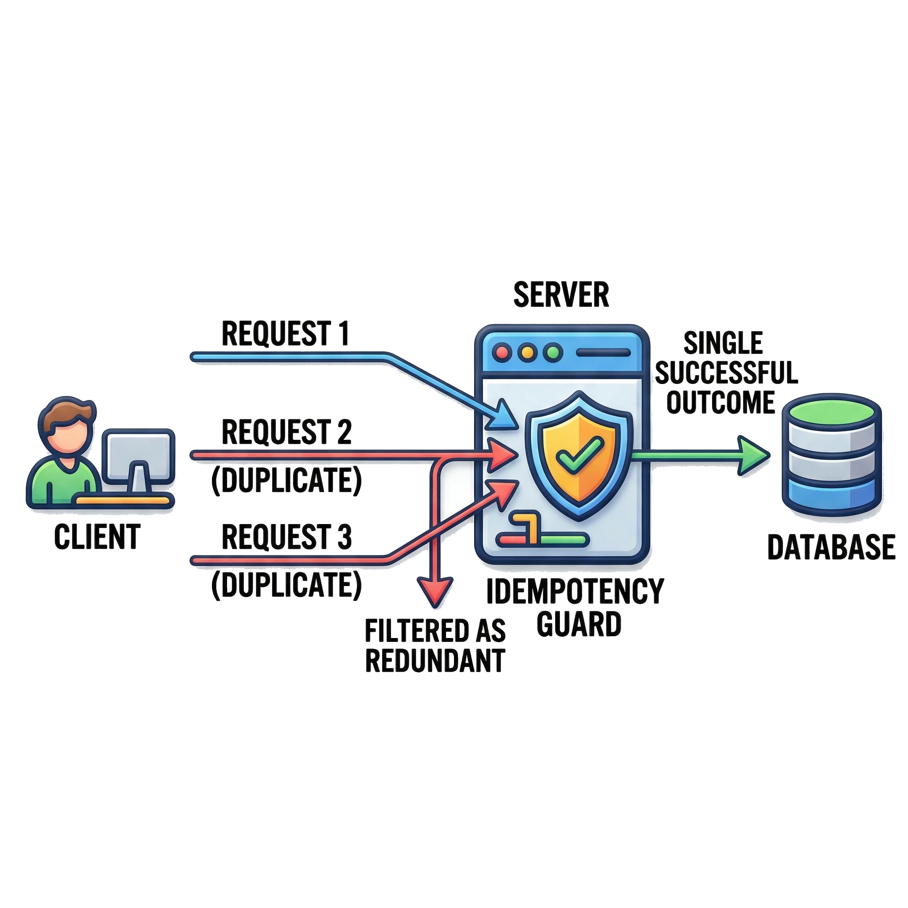

> 💡 **Giải thích:** Idempotency đảm bảo dù một yêu cầu bị thực thi nhiều lần, **kết quả cuối cùng vẫn như thực thi một lần**. Điều này cực kỳ quan trọng trong hệ thống phân tán, nơi lỗi mạng và timeout thường xuyên buộc client phải **retry** (client không biết request trước đã thành công hay chưa). Ví dụ kinh điển: lệnh trừ tiền — không có idempotency thì retry có thể trừ tiền nhiều lần; có idempotency thì hệ thống nhận ra yêu cầu đã xử lý và bỏ qua các lần gửi sau.

### Idempotency trong REST API và Idempotency Key

> **Idempotency key** là token duy nhất gắn kèm yêu cầu để hệ thống nhận diện và loại bỏ bản sao.

- **GET, PUT, DELETE** trong REST mặc định là idempotent — gọi nhiều lần, kết quả không đổi.
- **POST, PATCH** mặc định không idempotent — gọi nhiều lần tạo nhiều bản ghi hoặc thay đổi tích lũy.
- Giải pháp: gắn **idempotency key** (UUID hoặc token duy nhất) vào header yêu cầu.
- Máy chủ lưu key đã xử lý; nếu nhận key cũ, trả về kết quả cũ mà **không thực thi lại**.
- Đảm bảo chỉ tạo đúng một đơn hàng hoặc một giao dịch dù client retry nhiều lần.

> 💡 **Giải thích:** Trong REST, `GET`, `PUT`, `DELETE` có tính idempotent tự nhiên: `DELETE` cùng một resource nhiều lần vẫn chỉ xóa một lần; `PUT` gán cùng một giá trị nhiều lần thì kết quả như nhau. `POST` và `PATCH` thì không — mỗi lần `POST` tạo một bản ghi mới. Để làm `POST` an toàn: **client tự sinh một UUID** và gửi trong header; server tra key trong cache/DB, nếu đã xử lý thì trả lại kết quả cũ. **Stripe, PayPal** và hầu hết payment gateway dùng kỹ thuật này để chống **double-charge**.

### Idempotency — Ví dụ cài đặt (Node.js / Redis)

> Lưu idempotency key vào Redis; nếu key đã tồn tại, trả về kết quả cũ mà không xử lý lại.

```typescript
import { createClient } from 'redis';
const redis = createClient();

const IDEMPOTENCY_TTL = 86_400; // 24 giờ (giây)

async function idempotencyMiddleware(
  req: Request, res: Response, next: NextFunction
) {
  const key = req.headers['idempotency-key'] as string;
  if (!key) return next();                         // không bắt buộc — tuỳ API

  const cacheKey = `idempotency:${key}`;
  const cached   = await redis.get(cacheKey);

  if (cached) {
    // Key đã tồn tại → trả về kết quả đã lưu
    const { status, body } = JSON.parse(cached);
    return res.status(status).json(body);
  }

  // Ghi đè res.json để capture kết quả và lưu vào Redis
  const originalJson = res.json.bind(res);
  res.json = (body: any) => {
    redis.setEx(cacheKey, IDEMPOTENCY_TTL,
      JSON.stringify({ status: res.statusCode, body }));
    return originalJson(body);
  };

  next();
}

// Áp dụng cho route tạo thanh toán
app.post('/payments', idempotencyMiddleware, createPayment);
```

Middleware đọc header `Idempotency-Key`. Nếu key đã có trong Redis thì trả ngay `status` + `body` đã lưu. Nếu chưa, nó "bọc" hàm `res.json` để khi handler (`createPayment`) trả kết quả thì kết quả đó được lưu vào Redis với TTL 24 giờ.

> 💡 **Giải thích:** Middleware **chặn (intercept) `res.json`** để tự động cache kết quả — không cần sửa logic trong handler. Client gửi UUID tự tạo trong header `Idempotency-Key`; cùng UUID → cùng kết quả. **TTL 24h** là mức phổ biến (Stripe dùng mức này). **Lưu ý race condition**: nếu hai request cùng key đến *đồng thời*, cả hai đều thấy `cached = null` và cùng xử lý → cần dùng **Redis `SET NX`** (set if not exists) hoặc **Lua script** để "giành" key một cách atomic.

> 📌 **Mở rộng — giành key bằng `SET NX`** (một cách khắc phục race condition nêu trên):
> ```typescript
> // Chỉ request đầu tiên đặt được trạng thái "processing"
> const acquired = await redis.set(cacheKey, JSON.stringify({ state: 'processing' }),
>                                  { NX: true, EX: IDEMPOTENCY_TTL });
> if (!acquired) {
>   // Key đã tồn tại: hoặc đang xử lý (trả 409 để client chờ), hoặc đã có kết quả (trả lại kết quả cũ)
> }
> ```

### Sơ đồ: luồng xử lý với Idempotency Key

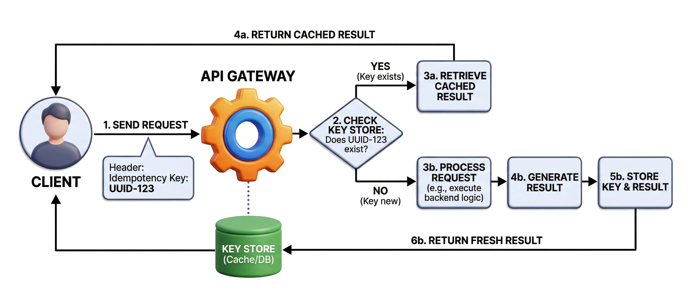

Hình minh họa: client gửi request kèm `Idempotency Key: UUID-123` tới API Gateway; gateway tra Key Store và rẽ hai nhánh — *key đã tồn tại → trả kết quả đã cache*; *key mới → xử lý request → lưu key → trả kết quả*.

> 💡 **Giải thích:** Khi API nhận yêu cầu, bước đầu tiên là **tra key trong kho lưu trữ**. Key đã tồn tại → trả kết quả đã lưu, không xử lý lại. Key mới → chạy logic nghiệp vụ, **lưu key kèm kết quả**, rồi trả về client. Cơ chế đơn giản này ngăn chặn hoàn toàn việc xử lý trùng lặp.

> 📌 **Mở rộng — cùng luồng đó dạng mermaid:**


<details><summary>🔧 Mã nguồn sơ đồ (mermaid)</summary>

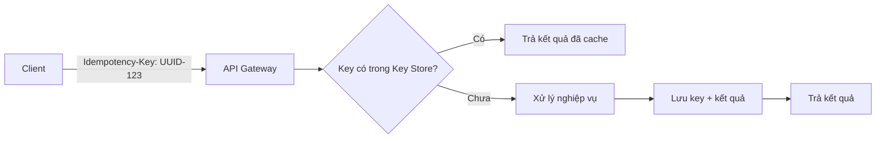

</details>

---

## 8. Pessimistic Locking

### Pessimistic Locking: cơ chế và nguyên lý

> Giả định **luôn có xung đột** — đặt khóa trước khi thao tác, giữ khóa đến khi giao dịch hoàn thành.

- Khóa tài nguyên **ngay khi bắt đầu** giao dịch.
- Ngăn các giao dịch khác đọc hoặc ghi trong khi khóa đang giữ.
- Phù hợp khi **tính nhất quán tuyệt đối** là ưu tiên.
- Ví dụ SQL: `SELECT ... FOR UPDATE`.

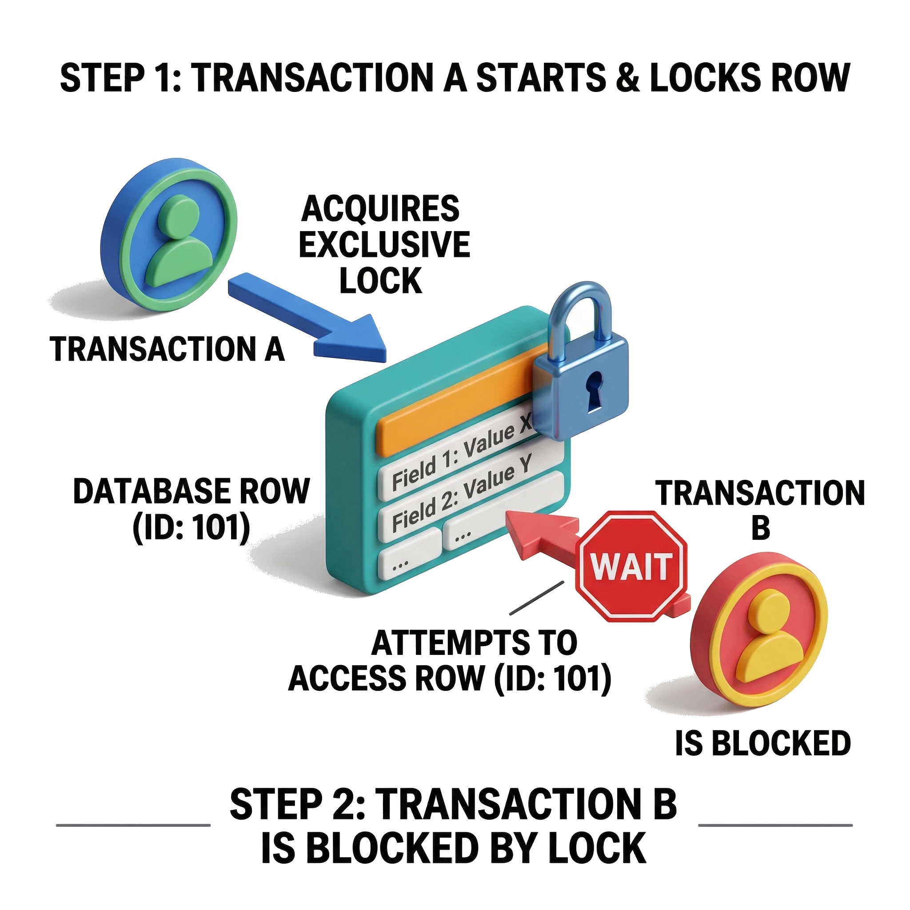

> 💡 **Giải thích:** Pessimistic locking dựa trên giả định **bi quan**: xung đột dữ liệu xảy ra thường xuyên, nên tốt hơn là *phòng ngừa từ đầu*. Khóa được đặt lên tài nguyên ngay khi giao dịch bắt đầu và **giữ cho tới khi commit hoặc rollback**. Trong lúc đó, mọi giao dịch khác muốn truy cập tài nguyên phải **chờ**. Câu SQL điển hình là `SELECT ... FOR UPDATE`, khóa hàng dữ liệu ở tầng database.

### Pessimistic Locking: ưu và nhược điểm

> Đảm bảo nhất quán cao nhưng đánh đổi bằng hiệu năng và nguy cơ deadlock.

| ✅ Ưu điểm | ❌ Nhược điểm |
|---|---|
| Dữ liệu luôn **nhất quán** — không ai thay đổi trong lúc đang thao tác | Dễ gây **tắc nghẽn** — các giao dịch khác phải chờ |
| Logic đơn giản, dễ lý luận về tính đúng đắn | Hiệu năng giảm khi có nhiều giao dịch đồng thời |
| Phù hợp giao dịch tài chính, đặt chỗ quan trọng | Có thể dẫn đến **deadlock** nếu không quản lý thứ tự khóa |

> 💡 **Giải thích:** Ưu điểm lớn nhất là **chính xác tuyệt đối**: tại một thời điểm chỉ một giao dịch được chạm vào tài nguyên, nên không thể có xung đột hay ghi đè dữ liệu. Nhược điểm là **hiệu năng**: nhiều giao dịch đồng thời → việc chờ khóa tạo thành bottleneck. Nguy hiểm nhất là **deadlock**: giao dịch A giữ khóa X và chờ khóa Y, trong khi giao dịch B giữ khóa Y và chờ khóa X → cả hai kẹt mãi.

> 📌 **Mở rộng:** Cách phòng deadlock phổ biến là **luôn khóa theo một thứ tự cố định** (ví dụ khóa tài khoản có `id` nhỏ hơn trước khi chuyển tiền giữa hai tài khoản) và đặt **lock timeout**. Phần lớn DBMS cũng tự phát hiện deadlock và hủy một trong hai giao dịch.

### Pessimistic Locking: ví dụ thực tế

> Khóa hàng dữ liệu trong suốt giao dịch để đảm bảo chỉ một luồng thao tác tại một thời điểm.

- Chuyển tiền: khóa tài khoản trước khi trừ, tránh **âm số dư** do hai giao dịch song song.
- Chỉnh sửa hồ sơ: khóa bản ghi profile để người khác phải **chờ commit**.
- SQL: `SELECT * FROM accounts WHERE id = 1 FOR UPDATE`
- Sau khi commit hoặc rollback, khóa được **giải phóng** cho giao dịch tiếp theo.

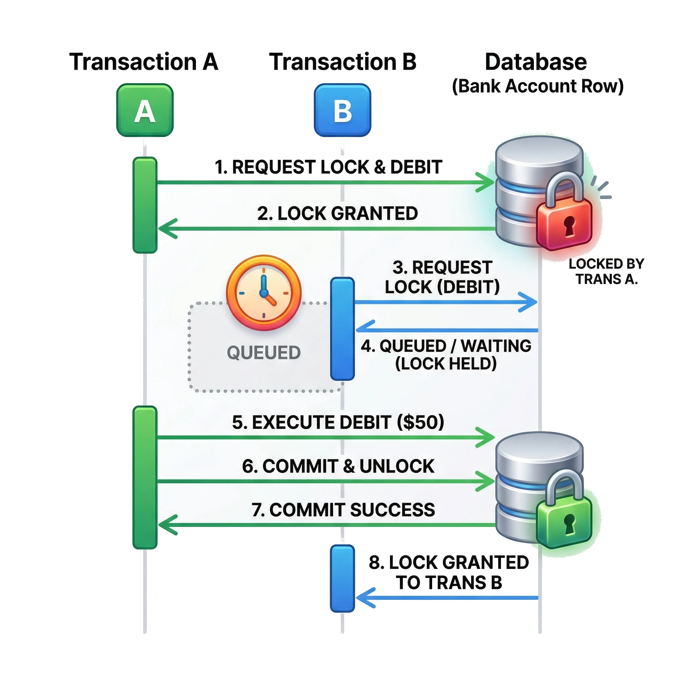

> 💡 **Giải thích:** Chuyển tiền là ví dụ kinh điển. Giả sử tài khoản còn **500k**, hai giao dịch cùng muốn trừ **400k**. Không khóa: cả hai cùng đọc được 500k, cả hai cùng trừ → tài khoản **âm**. Có pessimistic lock: giao dịch A khóa tài khoản, trừ tiền, commit — **chỉ khi đó** giao dịch B mới đọc được số dư thật (100k) và quyết định có tiếp tục hay không. `FOR UPDATE` thực hiện chính xác điều này ở tầng database. (Xem phân tích chi tiết ở mục [📝 Tình huống thảo luận](#-tình-huống-thảo-luận).)

> 📌 **Mở rộng — giao dịch hoàn chỉnh:**
> ```sql
> BEGIN;
> SELECT balance FROM accounts WHERE id = 1 FOR UPDATE;  -- khóa hàng, giao dịch khác phải chờ
> -- ứng dụng kiểm tra: balance >= 400000 ?
> UPDATE accounts SET balance = balance - 400000 WHERE id = 1;
> COMMIT;                                                 -- giải phóng khóa
> ```

---

## 9. Optimistic Locking

### Optimistic Locking: cơ chế và nguyên lý

> Giả định **ít có xung đột** — cho phép đọc/ghi song song, chỉ kiểm tra xung đột khi commit.

- Mỗi bản ghi có thêm trường **version** hoặc **timestamp**.
- Khi cập nhật: so sánh version hiện tại với version lúc đọc.
- Nếu khớp → ghi thành công và **tăng version**.
- Nếu không khớp → rollback hoặc retry (ai đó đã thay đổi trước).

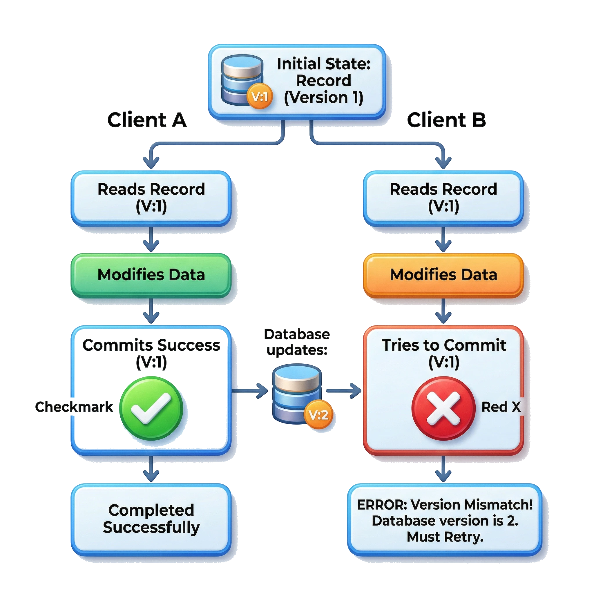

> 💡 **Giải thích:** Optimistic locking có cách nhìn **lạc quan**: xung đột hiếm khi xảy ra nên không cần khóa từ đầu. Thay vào đó, mỗi bản ghi có số **version**. Khi đọc, client ghi nhớ version. Khi ghi, câu `UPDATE` kiểm tra version hiện tại có còn bằng version lúc đọc không. Nếu người khác đã sửa (version đã tăng) → giao dịch thất bại và phải **retry**. Cơ chế này **không cần lock ở database**, nên tăng throughput đáng kể.

### Optimistic Locking: ưu và nhược điểm

> Tăng tính đồng thời và hiệu năng, nhưng yêu cầu xử lý retry khi xảy ra xung đột.

| ✅ Ưu điểm | ❌ Nhược điểm |
|---|---|
| Không giữ khóa cứng — **tăng tính đồng thời** | Khi xung đột xảy ra phải **rollback và retry** — tăng độ phức tạp |
| Hiệu năng cao khi xung đột hiếm (đọc nhiều, ghi ít) | Không phù hợp khi tần suất ghi cao (nhiều xung đột liên tục) |
| Phù hợp với workload có **nhiều client đọc** song song | Chỉ phát hiện xung đột **tại thời điểm commit**, không phòng ngừa sớm |

> 💡 **Giải thích:** Lợi thế lớn nhất: **không giữ khóa** trong suốt quá trình xử lý, nhiều giao dịch chạy song song không cản nhau — rất có giá trị với hệ thống **đọc nhiều** như mạng xã hội, catalog sản phẩm. Nhưng khi xung đột thật sự xảy ra, ứng dụng phải tự lo **retry logic**: đọc lại dữ liệu mới nhất → áp lại thay đổi → commit lần nữa. Nếu xung đột xảy ra thường xuyên, **chi phí retry có thể vượt lợi ích** của việc không khóa.

### Optimistic Locking: ví dụ thực tế

> Kiểm tra version trong câu lệnh UPDATE để đảm bảo dữ liệu chưa bị thay đổi kể từ lần đọc.

- Hai client cùng đọc hồ sơ người dùng với **version = 1**.
- Client A commit thành công → version tăng lên **2**.
- Client B commit thất bại (version cũ = 1 ≠ 2) → phải đọc lại và cập nhật lần nữa.
- SQL: `UPDATE users SET name=?, version=version+1 WHERE id=? AND version=?`
- Tăng lượt xem trang: xung đột không nghiêm trọng, optimistic lock là lựa chọn tốt.

```

</details>sql
UPDATE users
SET    name = ?, version = version + 1
WHERE  id = ? AND version = ?;
```

Câu lệnh chỉ cập nhật khi `version` trong DB vẫn bằng version client đã đọc, đồng thời tăng version lên 1. Nếu có người sửa trước, điều kiện `WHERE` không khớp và câu lệnh cập nhật **0 hàng**.

> 💡 **Giải thích:** Hai client cùng đọc bản ghi version 1. Client A xong trước → `UPDATE` thành công, version thành 2. Client B chạy `UPDATE ... WHERE version = 1` → không hàng nào khớp → **0 rows affected**: đây là tín hiệu cho ứng dụng biết đã có xung đột. Ứng dụng bắt tín hiệu này, đọc lại dữ liệu mới nhất (version 2), áp lại thay đổi và commit lại. Với việc **tăng view count**, xung đột nhỏ không ảnh hưởng nhiều, nên optimistic lock càng phù hợp.

> 📌 **Mở rộng — vòng retry phía ứng dụng:**
> ```typescript
> for (let attempt = 0; attempt < 3; attempt++) {
>   const user = await db.query('SELECT name, version FROM users WHERE id = $1', [id]);
>   const result = await db.query(
>     'UPDATE users SET name = $1, version = version + 1 WHERE id = $2 AND version = $3',
>     [newName, id, user.version]);
>   if (result.rowCount === 1) return;   // thành công
>   // rowCount = 0 → có người sửa trước → đọc lại và thử lại
> }
> throw new Error('Conflict: vui lòng thử lại');
> ```

---

## 10. Khi nào dùng và lựa chọn

### Khi nào dùng Idempotency

> Áp dụng cho mọi API trong hệ thống phân tán **có khả năng retry** hoặc gửi yêu cầu trùng lặp.

- API tạo **giao dịch tài chính** (chuyển tiền, thanh toán) — tránh double-charge.
- API **đặt đơn hàng** — tránh tạo đơn kép khi mạng chập chờn.
- Bất kỳ luồng xử lý nào có thể **thất bại giữa chừng** và client cần retry.

> 💡 **Giải thích:** Nguyên tắc đơn giản: **nếu client có thể retry, hãy thiết kế API có idempotency**. Stripe *bắt buộc* idempotency key cho mọi API tạo charge. Hệ thống đặt hàng cũng phải tránh tạo đơn kép khi người dùng **bấm nút hai lần** hoặc khi kết nối bị gián đoạn. Trong phỏng vấn system design, nhắc tới **idempotency key** khi thiết kế payment service hay order service là một **điểm cộng** quan trọng.

### Idempotency trong các API (hình minh họa)

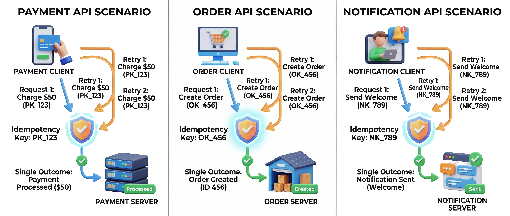

Hình minh họa: ba kịch bản — payment API, order API, notification API — mỗi kịch bản có một "lá chắn" **Idempotency Key** giữa client và server; các luồng retry dù gửi nhiều lần đều hội tụ về **một kết quả duy nhất**.

### Lựa chọn Pessimistic hay Optimistic Locking

> Chọn dựa trên **mức độ xung đột** và **yêu cầu nhất quán** của nghiệp vụ.

- **Optimistic**: xung đột thấp, đọc nhiều, giao dịch ngắn — hệ thống web thông thường.
- **Pessimistic**: xung đột cao, giao dịch dài, nhất quán tuyệt đối — hệ thống ngân hàng.
- Hầu hết ứng dụng web chấp nhận **dirty read** → ưu tiên optimistic để tránh deadlock.


> 💡 **Giải thích:** Quyết định phụ thuộc chủ yếu vào hai yếu tố: **tần suất xung đột** và **yêu cầu nhất quán**. Dữ liệu đọc nhiều hơn ghi, giao dịch ngắn → optimistic là lựa chọn tự nhiên vì tránh được overhead giữ lock. Ngược lại, ngân hàng hay **đặt vé máy bay** — nơi hai người cùng muốn *chiếc ghế cuối cùng* — cần pessimistic để đảm bảo chính xác. Trong phỏng vấn, hãy thể hiện hiểu biết về trade-off này và **gắn nó với đặc điểm cụ thể** của hệ thống đang thiết kế.

> 📌 **Mở rộng:** Chữ "dirty read" ở ý cuối danh sách trên nên hiểu theo nghĩa rộng là *"chấp nhận đôi khi đọc phải dữ liệu không còn mới nhất"*. Theo nghĩa hẹp trong lý thuyết transaction isolation, *dirty read* là đọc dữ liệu **chưa commit** của giao dịch khác — optimistic locking không gây ra hiện tượng đó.

### So sánh tổng hợp

| | **Idempotency** | **Pessimistic Locking** | **Optimistic Locking** |
|---|---|---|---|
| **Mục tiêu** | Xử lý retry an toàn | Tránh xung đột từ đầu | Phát hiện xung đột khi commit |
| **Cơ chế** | Idempotency key | Lock trước, giải phóng sau | Version/timestamp check |
| **Phù hợp** | API phân tán, payment | Giao dịch tài chính, ghi nhiều | Web app, đọc nhiều |
| **Trade-off** | Cần lưu trữ key | Deadlock, throughput thấp | Retry logic phức tạp |

> 💡 **Giải thích:** **Idempotency** xử lý an toàn các yêu cầu trùng lặp ở **tầng API**; **pessimistic** và **optimistic locking** đều giải quyết xung đột dữ liệu ở **tầng database** nhưng theo hai chiến lược trái ngược. Hệ thống phức tạp thường **kết hợp cả ba**: idempotency key ở API layer + một trong hai chiến lược locking tùy loại nghiệp vụ.

---

## 11. Ví dụ minh họa thực tế

### Hệ thống upload file an toàn

> Upload file kết hợp đủ các lớp bảo mật: xác thực, kiểm tra định dạng, quét virus và phân quyền lưu trữ.

- **Xác thực** bắt buộc trước khi cho phép upload — không cho phép upload ẩn danh.
- Kiểm tra **định dạng file** (whitelist: PNG, JPG...) và giới hạn **kích thước**.
- Dùng **thư viện quét virus** để phát hiện mã độc trong file.
- Đổi tên file thành **chuỗi ngẫu nhiên** — tránh lộ thông tin qua tên gốc.
- **Phân quyền lưu trữ**: chỉ user hoặc nhóm được chỉ định mới xem/xóa được file.

> 💡 **Giải thích:** Upload file là một **attack surface** lớn. Nếu không kiểm tra phần mở rộng, attacker có thể upload một file PHP rồi gọi nó để **thực thi code và chiếm quyền server**. Lưu file **ngoài webroot** hoặc trong **cloud storage riêng** ngăn file bị thực thi trực tiếp. Quét virus đặc biệt quan trọng với hệ thống cho phép chia sẻ file giữa nhiều người dùng.

### Hệ thống quản lý người dùng (User Management)

> Kết hợp RBAC, hash mật khẩu, lockout và MFA tạo nên hệ thống quản lý người dùng an toàn toàn diện.

- **RBAC**: vai trò *admin* quản lý user; vai trò *user* chỉ xem thông tin cá nhân.
- Mật khẩu lưu dạng **hash + salt** (bcrypt/Argon2) — không lưu plaintext.
- **Lockout** tạm thời khi đăng nhập sai nhiều lần — chống brute-force.
- **MFA** bắt buộc cho tài khoản admin — email OTP hoặc ứng dụng xác thực.
- Ghi **audit log** đầy đủ: ai làm gì, lúc nào — phục vụ điều tra sự cố.

> 💡 **Giải thích:** **Audit log** hay bị bỏ qua nhưng cực kỳ quan trọng: khi có vi phạm bảo mật, log là **bằng chứng duy nhất** để truy vết. **Lockout** nên kèm thông báo email cho chủ tài khoản để họ biết có người đang cố đăng nhập. Tài khoản admin luôn là mục tiêu tấn công → **MFA + IP whitelist** cho giao diện admin là thực hành tốt.

### Dịch vụ tài chính — ứng dụng ngân hàng

> Ứng dụng ngân hàng kết hợp mọi biện pháp bảo mật ở mức cao nhất: MFA, ABAC, mã hóa và audit đầy đủ.

- Mọi giao dịch yêu cầu **đăng nhập + OTP** (MFA mạnh, không chỉ mật khẩu).
- Truyền dữ liệu qua **HTTPS** — số tiền và thông tin tài khoản không lộ trên đường truyền.
- Dữ liệu nhạy cảm (thẻ, CMND) **mã hóa trong DB** hoặc dùng **HSM**.
- **ABAC**: chặn giao dịch ngoài giờ, từ IP lạ, hoặc vượt ngưỡng bất thường.
- Giao dịch lớn cần **kiểm duyệt thêm** bởi admin; toàn bộ lịch sử được **log đầy đủ**.

> 💡 **Giải thích:** Ngân hàng là ví dụ điển hình của **defense in depth** — mỗi lớp bảo mật bổ sung cho lớp khác. ABAC ở đây đặc biệt hữu ích vì không chỉ kiểm tra *quyền* mà còn kiểm tra *ngữ cảnh*: thời gian, địa điểm, lịch sử giao dịch. **Fraud detection** (phát hiện gian lận) thường kết hợp **rule-based** và **machine learning** để nhận ra pattern bất thường.

---

## 12. Best Practices

### Defense in depth — Phòng thủ nhiều lớp

> An toàn không nằm ở một biện pháp đơn lẻ.

| Lớp | Biện pháp |
|---|---|
| **Hạ tầng** | Firewall, VPN, phân vùng mạng (network segmentation) |
| **API** | Token xác thực, TLS, rate limiting, CORS |
| **Ứng dụng** | Kiểm tra input, CSRF/XSS protection, phân quyền |
| **Dữ liệu** | Mã hóa at rest và in transit, hash mật khẩu |

- Đề cập **đào tạo người dùng** — phishing là vector tấn công phổ biến nhất.

> 💡 **Giải thích:** Trong phỏng vấn system design, trình bày bảo mật **theo tầng** cho thấy tư duy toàn diện. Không cần đi sâu mọi chi tiết — quan trọng là cho thấy bạn biết **có nhiều lớp** và **mỗi lớp giải quyết vấn đề gì**. Cách trình bày rõ nhất: đi từ **ngoài vào trong** (perimeter/firewall → application → data). Đừng quên nhắc **monitoring** và **incident response** — phát hiện và phản ứng nhanh cũng là một phần của bảo mật.

### Cân nhắc hiệu năng và bảo mật

> Bảo mật mạnh hơn thường đi kèm overhead — cần nắm rõ **trade-off** và ưu tiên theo tình huống.

- **TLS handshake** tiêu tốn CPU đáng kể — giảm thiểu bằng TLS session resumption.
- **Bcrypt** tốn thời gian hơn MD5 theo thiết kế — đây là tính năng, không phải lỗi.
- **JWT validation** cần verify signature mỗi request — nhỏ nhưng cộng dồn khi nhiều request.
- **Rate limiting** thêm latency nếu dùng distributed counter (Redis round-trip).
- Nguyên tắc: ***không bao giờ hy sinh bảo mật cốt lõi vì hiệu năng*** — hãy tối ưu đúng chỗ.

> 💡 **Giải thích:** Trade-off hiệu năng–bảo mật là câu hỏi hay gặp khi phỏng vấn. Câu trả lời tốt: **xác định đúng bottleneck trước khi tối ưu**, và **không cắt giảm bảo mật ở các điểm cốt lõi**. Một số cách tối ưu đúng chỗ:
> - **TLS 1.3** handshake nhanh hơn đáng kể so với TLS 1.2.
> - **Connection pooling** và **HTTP/2** giúp "chia nhỏ" (amortize) chi phí TLS cho nhiều request.
> - **bcrypt cost factor** có thể điều chỉnh theo phần cứng — tăng dần theo thời gian khi CPU mạnh lên.

---

## 🧠 Tóm tắt nhanh

### Authentication: Session vs JWT

| | **Session** | **JWT** |
|---|---|---|
| Lưu trạng thái | Server (session store) | Client (token tự chứa thông tin) |
| Gửi kèm | Cookie chứa session ID | Header `Authorization: Bearer ...` |
| Thu hồi | Tức thì (xóa session) | Khó → short TTL (~15 phút) + refresh token |
| Scale | Cần shared store (Redis, DB) | Dễ, mỗi service tự verify chữ ký |
| Lưu ý | Stateful | Payload đọc được — không để dữ liệu nhạy cảm |
| Dùng cho | Web truyền thống, cần đăng xuất từ xa | API, microservices |

Bổ trợ: mật khẩu lưu **hash + salt** (Argon2 > bcrypt > PBKDF2; cấm MD5/SHA-1), **lockout** chống brute-force, **MFA** (app OTP an toàn hơn SMS).

### Authorization: RBAC / ABAC / OAuth2

| | **RBAC** | **ABAC** | **OAuth2** |
|---|---|---|---|
| Bản chất | Quyền gắn với **role** | Quyền tính từ **thuộc tính** user + resource + môi trường | **Giao thức ủy quyền** cho app thứ ba |
| Ví dụ | Editor được sửa, Viewer chỉ xem | Kế toán + file nhạy cảm thấp + giờ hành chính | App đọc Google Drive chỉ với scope đọc |
| Ưu | Đơn giản, dễ audit | Linh hoạt, kiểm soát ngữ cảnh | Không lộ mật khẩu, scope tối thiểu |
| Nhược | Role explosion | Phức tạp, cần policy engine (OPA/Rego) | Không phải authentication → cần OpenID Connect |

### 4 thuật toán Rate Limit

| Thuật toán | Cách hoạt động | Ưu | Nhược / Lưu ý |
|---|---|---|---|
| **Fixed Window** | Đếm request trong cửa sổ cố định (0–60s) | Đơn giản nhất (`INCR` + `EXPIRE`) | Burst tại ranh giới (tới 2× giới hạn) |
| **Sliding Window** | Đếm trong N giây ngay trước hiện tại | Chính xác, tránh burst (Redis sorted set) | Tốn bộ nhớ hơn |
| **Token Bucket** | Mỗi request tiêu 1 token, token nạp lại đều | Cho phép burst ngắn hợp lý — phổ biến nhất | Cần chọn dung lượng xô + tốc độ nạp |
| **Leaky Bucket** | Request xếp hàng, xử lý với tốc độ cố định | Đầu ra hoàn toàn đều | Không cho burst; hợp downstream tốc độ cố định |

Phân tán: dùng **Redis** làm counter chung (Lua/`multi` cho atomic); trả **429** + `Retry-After`, `X-RateLimit-*`.

### Idempotency / Pessimistic / Optimistic Locking

| | **Idempotency** | **Pessimistic Locking** | **Optimistic Locking** |
|---|---|---|---|
| Tầng | API | Database | Database |
| Giả định | Client sẽ retry | Xung đột thường xuyên | Xung đột hiếm |
| Cơ chế | Idempotency key (UUID trong header), lưu key + kết quả (TTL ~24h) | `SELECT ... FOR UPDATE`, giữ khóa tới commit/rollback | Cột `version`; `UPDATE ... WHERE version = ?` |
| Phù hợp | Payment, đặt hàng | Ngân hàng, đặt vé, ghi nhiều | Web app, đọc nhiều, view count |
| Trade-off | Phải lưu key; race khi 2 request cùng key → `SET NX` | Chờ khóa, deadlock, throughput thấp | Retry logic, tệ khi ghi nhiều |

---

## 📝 Tình huống thảo luận

**Tình huống 1 — Chuyển tiền 500k với hai giao dịch 400k.**
Tài khoản A còn **500k**. Hai giao dịch song song cùng muốn trừ **400k**. Điều gì xảy ra nếu không khóa? Pessimistic locking và optimistic locking xử lý thế nào?

<details><summary>Lời giải</summary>

**Không khóa (race condition):**

| Thời điểm | Giao dịch T1 | Giao dịch T2 | Số dư trong DB |
|---|---|---|---|
| t1 | Đọc số dư = 500k | | 500k |
| t2 | | Đọc số dư = 500k | 500k |
| t3 | 500k ≥ 400k → trừ | | 100k |
| t4 | | 500k ≥ 400k → trừ (dựa trên số dư cũ) | **−300k** (hoặc 100k nếu ghi đè `balance = 500k − 400k`) |

Kết quả: hoặc tài khoản **âm**, hoặc mất một lần trừ (*lost update*) — tức đã chi 800k nhưng chỉ ghi nhận trừ 400k. Cả hai đều sai.

**Pessimistic locking:** T1 chạy `SELECT ... FOR UPDATE` → khóa hàng. T2 gọi `FOR UPDATE` trên cùng hàng → **phải chờ**. T1 trừ 400k, commit (số dư = 100k), nhả khóa. T2 lúc này mới đọc được **100k** → không đủ 400k → từ chối. Đúng tuyệt đối, đánh đổi bằng thời gian chờ. Đây chính là cách giải ở phần *Pessimistic Locking: ví dụ thực tế* phía trên.

**Optimistic locking:** cả hai cùng đọc `(500k, version = 1)`. T1: `UPDATE ... SET balance = 100k, version = 2 WHERE id = A AND version = 1` → thành công. T2: cùng câu lệnh với `version = 1` → **0 rows affected** → phát hiện xung đột → đọc lại `(100k, version 2)` → không đủ tiền → từ chối. Cũng đúng, nhưng có retry.

**Nên chọn gì?** Với chuyển tiền (dữ liệu nhạy cảm, có thể nhiều giao dịch dồn vào cùng tài khoản), nên chọn **pessimistic**. Ngoài ra nên gắn thêm **idempotency key** ở tầng API, để việc người dùng bấm "Chuyển" hai lần không bị hiểu thành hai giao dịch.

> 📌 **Mở rộng:** Một cách nữa là dùng một câu `UPDATE` có điều kiện: `UPDATE accounts SET balance = balance - 400000 WHERE id = 1 AND balance >= 400000;`. Bản thân câu lệnh này atomic; nếu nó trả về 0 hàng nghĩa là không đủ tiền.
</details>

**Tình huống 2 — Burst ở ranh giới Fixed Window.**
API giới hạn 100 request/phút bằng fixed window. Một client gửi 100 request lúc 00:59 và 100 request lúc 01:00. Hệ thống có chặn không? Sửa thế nào?

<details><summary>Lời giải</summary>

Không chặn: 100 request thuộc window [00:00–01:00), 100 request thuộc window [01:00–02:00), mỗi window đều chưa vượt giới hạn → **200 request trong khoảng 2 giây**. Cách sửa: dùng **sliding window** (luôn đếm 60 giây trước thời điểm hiện tại → request thứ 101 trong 60 giây bị 429), hoặc **token bucket** nếu muốn cho phép burst nhưng có kiểm soát (burst tối đa = dung lượng xô).
</details>

**Tình huống 3 — Rate limit khi scale lên 10 server.**
Mỗi server tự đếm trong RAM với giới hạn 100 request/phút cho mỗi IP. Sau khi thêm load balancer và scale lên 10 server, giới hạn thực tế còn đúng không?

<details><summary>Lời giải</summary>

Không. Load balancer rải request ra 10 server, mỗi server cho qua 100 → client có thể gửi tới **~1.000 request/phút**, tức gấp **10 lần** giới hạn. Giải pháp: đặt counter ở **kho trung tâm (Redis)** dùng chung cho mọi server, tăng và kiểm tra counter atomic (Lua script hoặc `multi`). Nếu lo latency (~1ms/request), dùng **local cache + đồng bộ định kỳ về Redis**: chấp nhận vượt giới hạn một chút để đổi lấy tốc độ. Hoặc dùng dịch vụ có sẵn: Cloudflare, AWS WAF, Kong, Nginx `limit_req_zone`.
</details>

**Tình huống 4 — Chiếc ghế cuối cùng trên chuyến bay.**
Hai người cùng bấm đặt chiếc ghế cuối cùng. Nên dùng kỹ thuật nào và vì sao?

<details><summary>Lời giải</summary>

Đây là tình huống **xung đột cao trên cùng một tài nguyên** và yêu cầu **nhất quán tuyệt đối** (không được bán một ghế cho hai người) → **pessimistic locking**: người đến trước khóa ghế (`FOR UPDATE`), người sau phải chờ rồi thấy ghế đã có chủ. Kết hợp **idempotency key** cho API đặt vé để người dùng bấm hai lần hoặc client retry không tạo hai booking.
</details>

**Tình huống 5 — Deadlock.**
Giao dịch A chuyển tiền từ tài khoản X sang Y (khóa X rồi khóa Y). Đồng thời giao dịch B chuyển từ Y sang X (khóa Y rồi khóa X). Chuyện gì xảy ra?

<details><summary>Lời giải</summary>

A giữ X và chờ Y; B giữ Y và chờ X → **deadlock**, cả hai kẹt mãi. 📌 Cách phòng tránh: **khóa theo thứ tự cố định** (ví dụ luôn khóa tài khoản có `id` nhỏ hơn trước), đặt **lock timeout**, và để DBMS phát hiện deadlock rồi rollback một giao dịch; ứng dụng cần retry giao dịch bị hủy.
</details>

---

## ❓ Câu hỏi tự kiểm tra

**1.** Phân biệt Authentication và Authorization. Cho một ví dụ cho mỗi loại.

<details><summary>Đáp án</summary>

- **Authentication** xác nhận *danh tính* (bạn là ai): đăng nhập bằng mật khẩu, OTP, JWT.
- **Authorization** xác nhận *quyền hạn* (bạn được làm gì): RBAC kiểm tra role `editor` mới được sửa bài, ABAC chặn truy cập ngoài giờ hành chính.

Thiếu một trong hai đều gây lỗ hổng nghiêm trọng.
</details>

**2.** Vì sao phải lưu mật khẩu dạng hash + salt? Vì sao không dùng MD5/SHA-1?

<details><summary>Đáp án</summary>

Hash để không lưu mật khẩu gốc: DB bị lộ thì attacker chỉ thấy hash. **Salt** ngẫu nhiên, riêng cho mỗi user → cùng mật khẩu nhưng hash khác nhau → vô hiệu hóa **rainbow table** (bảng hash tính sẵn). MD5/SHA-1 **quá nhanh** nên dễ brute-force. Cần thuật toán **chậm có chủ đích**: Argon2 (khuyến nghị), bcrypt (cost 12 ≈ 0,3 giây/lần hash), PBKDF2.
</details>

**3.** Nêu ưu, nhược điểm của JWT so với Session. Làm sao khắc phục nhược điểm khó thu hồi của JWT?

<details><summary>Đáp án</summary>

JWT **stateless**: server không lưu session, mỗi service tự verify chữ ký → scale dễ, hợp microservices. Nhược: **khó revoke** giữa chừng; payload chỉ được ký chứ không mã hóa (ai cũng đọc được). Session **stateful**, revoke tức thì nhưng cần shared session store khi scale. Khắc phục: access token **TTL ngắn** (~15 phút) + **refresh token**.
</details>

**4.** "Role explosion" là gì? Khi gặp nó nên chuyển sang mô hình nào?

<details><summary>Đáp án</summary>

Là khi số role trong RBAC tăng theo cấp số nhân vì phải tổ hợp nhiều điều kiện (phòng ban × mức nhạy cảm × thời gian...), khiến hệ thống khó quản lý. Khi đó nên xem xét **ABAC**: quyết định dựa trên thuộc tính của user, resource và môi trường thông qua policy (ví dụ dùng OPA/Rego).
</details>

**5.** OAuth2 có phải giao thức xác thực không? OpenID Connect bổ sung gì? Trong luồng Authorization Code, vì sao code được đổi lấy token ở phía server?

<details><summary>Đáp án</summary>

Không — OAuth2 là **authorization protocol**: cho app thứ ba access token với **scope** giới hạn, thay vì đưa mật khẩu cho app đó. **OpenID Connect** bổ sung **ID token** để xác thực danh tính (nền tảng của "Login with Google"). Code được đổi lấy token ở **phía server** (back-channel) để access token **không bị lộ qua trình duyệt**.
</details>

**6.** CORS có bảo vệ server khỏi mọi request từ domain lạ không? Vì sao không nên dùng `Access-Control-Allow-Origin: *` cho API có xác thực?

<details><summary>Đáp án</summary>

Không. CORS là cơ chế của **trình duyệt**: server vẫn nhận request từ bất kỳ đâu (curl, script backend); CORS chỉ ngăn trình duyệt đưa response cho script ở origin không được phép. Vì vậy nó **không thay thế** xác thực và phân quyền ở server. Dùng `*` (đặc biệt khi kèm cookie) sẽ mở cửa cho mọi site đọc dữ liệu → lỗ hổng nghiêm trọng; phải chỉ định origin cụ thể.
</details>

**7.** XSS và CSRF khác nhau thế nào? Ba cookie flag Secure, HttpOnly, SameSite chống lại gì?

<details><summary>Đáp án</summary>

- **XSS**: attacker **chèn script** chạy dưới quyền của trang tin cậy (đánh cắp cookie, session). Phòng: escape output, CSP, HttpOnly.
- **CSRF**: **không cần chèn script**, lừa người dùng đã đăng nhập gửi request; trình duyệt tự đính cookie. Phòng: SameSite cookie, CSRF token, xác nhận lại cho hành động quan trọng, kiểm tra `Origin`/`Referer`.

Flag: **Secure** → cookie chỉ đi qua HTTPS; **HttpOnly** → JS không đọc được (giảm thiệt hại XSS); **SameSite** → không gửi cookie theo request cross-site (chống CSRF).
</details>

**8.** So sánh Fixed Window, Sliding Window, Token Bucket và Leaky Bucket. Thuật toán nào phổ biến nhất và vì sao?

<details><summary>Đáp án</summary>

- **Fixed window**: đơn giản, nhưng burst tại ranh giới (tới 2× giới hạn).
- **Sliding window**: chính xác, tránh burst, tốn bộ nhớ hơn.
- **Token bucket**: mỗi request tiêu 1 token, token nạp đều → cho **burst ngắn hợp lý**.
- **Leaky bucket**: request xếp hàng, xử lý tốc độ cố định → đầu ra hoàn toàn đều, hợp downstream nhạy cảm.

**Token bucket** phổ biến nhất vì cho phép burst hợp lý, giống cách người dùng thật sử dụng app.
</details>

**9.** Trong ví dụ Redis Sliding Window, vai trò của từng lệnh `zRemRangeByScore`, `zAdd`, `zCard`, `expire` là gì? Vì sao gói chúng trong `multi()`?

<details><summary>Đáp án</summary>

`zRemRangeByScore` xóa các request có timestamp cũ hơn cửa sổ; `zAdd` thêm request hiện tại (score = timestamp); `zCard` đếm số request trong cửa sổ; `expire` đặt TTL để key tự dọn khi không còn dùng. `multi()` gộp 4 lệnh vào **một round-trip** để giảm latency và thực thi chúng liền một khối. Khi cần atomic tuyệt đối (gồm cả bước quyết định) thì dùng **Lua script**.
</details>

**10.** Phương thức HTTP nào mặc định idempotent? Làm sao biến `POST /payments` thành idempotent?

<details><summary>Đáp án</summary>

**GET, PUT, DELETE** mặc định idempotent; **POST, PATCH** thì không. Cách làm: client sinh **idempotency key** (UUID) gửi trong header `Idempotency-Key`. Server tra key trong store (Redis): có rồi → trả lại kết quả cũ, không xử lý lại; chưa có → xử lý, lưu key + kết quả (TTL ~24h). Cần xử lý race condition khi hai request cùng key đến đồng thời bằng `SET NX` hoặc Lua script.
</details>

**11.** Trong optimistic locking, làm sao ứng dụng biết đã xảy ra xung đột? Sau đó phải làm gì?

<details><summary>Đáp án</summary>

Câu `UPDATE ... SET ..., version = version + 1 WHERE id = ? AND version = ?` trả về **0 rows affected** vì version trong DB đã bị người khác tăng lên. Ứng dụng bắt tín hiệu này, **đọc lại** dữ liệu mới nhất (version mới), **áp lại** thay đổi và **commit lại** (retry), thường có giới hạn số lần thử.
</details>

**12.** Khi nào chọn pessimistic, khi nào chọn optimistic locking? Một hệ thống thanh toán thực tế thường kết hợp những kỹ thuật nào?

<details><summary>Đáp án</summary>

- **Optimistic**: xung đột thấp, đọc nhiều/ghi ít, giao dịch ngắn (web app, catalog, view count).
- **Pessimistic**: xung đột cao, giao dịch dài, cần nhất quán tuyệt đối (ngân hàng, đặt vé, ghế cuối cùng); chấp nhận chờ khóa và nguy cơ deadlock.

Hệ thống thanh toán thường **kết hợp**: **idempotency key** ở tầng API (chống double-charge khi retry) + **locking** ở tầng DB (thường pessimistic cho số dư), bên ngoài là các lớp bảo mật: MFA/OTP, HTTPS, ABAC, rate limit, audit log.
</details>
